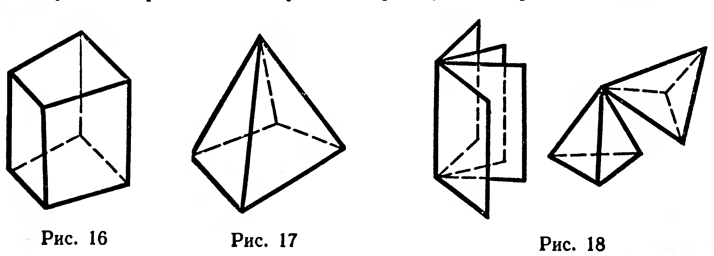
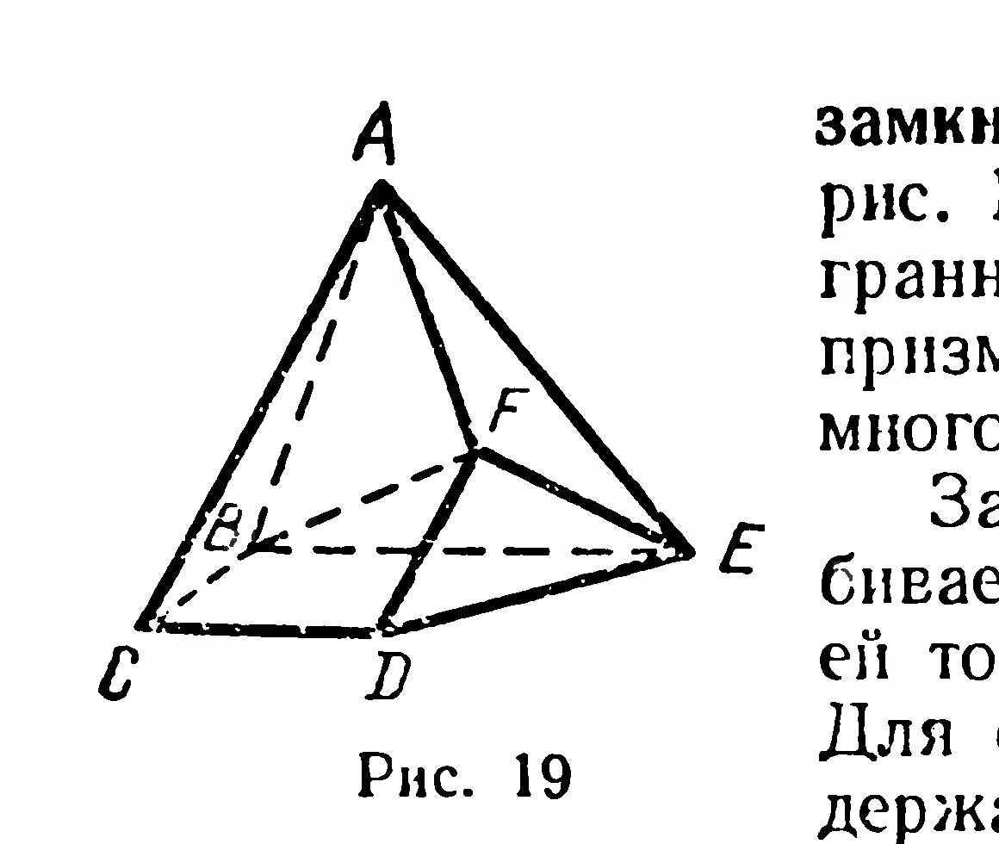
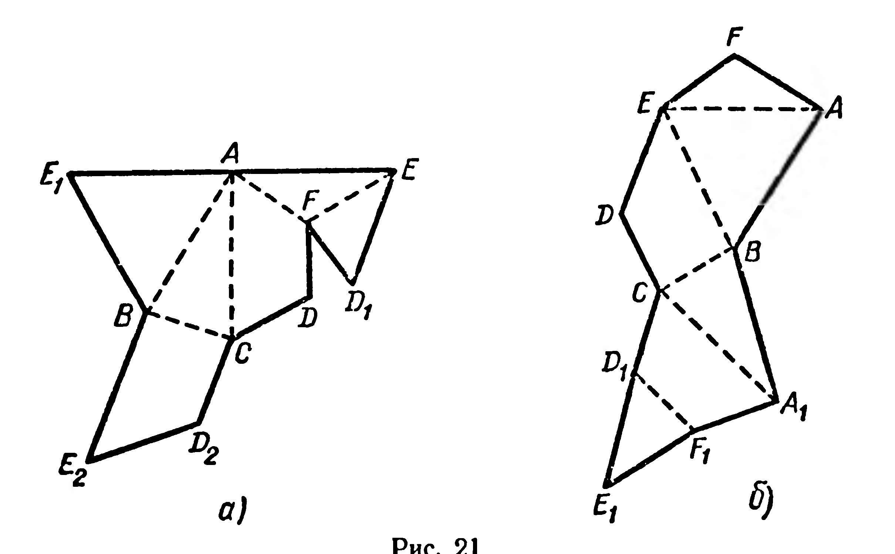
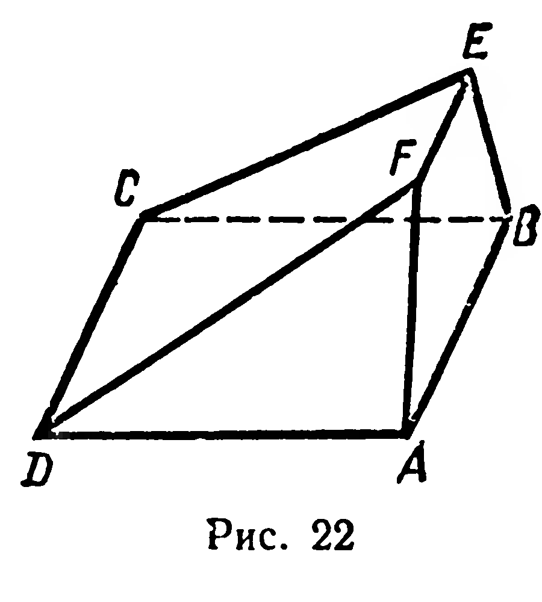

## 5.1. Многогранная поверхность. Многогранник

---
**стр. 117**
---

ГЛАВА V

МНОГОГРАННИКИ

§ 47. МНОГОГРАННАЯ ПОВЕРХНОСТЬ. МНОГОГРАННИК

Из курса VIII класса известны примеры неплоских фигур, являющихся объединением нескольких многоугольников. К таким фигурам относятся боковая поверхность прямой призмы (рис. 16), поверхность пирамиды (рис. 17). Эти фигуры — примеры простых многогранных поверхностей.

**Простой многогранной поверхностью** называется объединение конечного числа многоугольников, удовлетворяющее следующим условиям:

1) *для любых двух вершин этих многоугольников существует ломаная, составленная из их сторон, для которой взятые вершины служат концами;*

2) *произвольная точка поверхности либо является точкой только одного из данных многоугольников, либо принадлежит общей стороне двух и только двух многоугольников, либо является вершиной только одного многогранного угла, плоскими углами которого служат углы данных многоугольников.*

Указанным требованиям удовлетворяют объединения многоугольников, изображенные на рисунках 16 и 17, но не удовлетворяют фигуры, изображенные на рисунке 18 (объясните почему).

В дальнейшем, говоря о простых многогранных поверхностях, мы для краткости будем опускать слово «простых».

Многоугольники, составляющие многогранную поверхность, называются ее *гранями*; стороны многоугольников называются *ребрами*, а вершины — *вершинами* многогранной поверхности.

Если каждое ребро многогранной поверхности содержится в двух ее гранях, то эту многогранную поверхность называют

---
**стр. 118**
---

замкнутой. Поверхность пирамиды (см. рис. 17) является примером замкнутой многогранной поверхности, боковая поверхность призмы (см. рис. 16) — пример незамкнутой многогранной поверхности.

Замкнутая многогранная поверхность разбивает множество всех не принадлежащих ей точек пространства на два подмножества. Для одного из них существуют прямые, содержащиеся в этом подмножестве; для другого — таких прямых не существует. Первое из указанных подмножеств называют *внешней областью* замкнутой многогранной поверхности, а второе — ее *внутренней областью*.

**Определение.** Объединение замкнутой многогранной поверхности и ее внутренней области называется многогранником.

При этом многогранную поверхность и ее внутреннюю область называют соответственно *поверхностью* и *внутренней областью* многогранника. Грани, ребра, вершины поверхности многогранника называют соответственно гранями, ребрами и вершинами многогранника.

Отрезок, который соединяет две вершины многогранника, не принадлежащие одной грани, называют *диагональю многогранника*. На рисунке 19 изображен шестигранник $ABCDEF$ и его диагональ $BF$.

Как и многоугольники, многогранники могут быть выпуклыми (рис. 19) и невыпуклыми (рис. 20). Мы будем изучать только выпуклые многогранники.

---
**стр. 119**
---

Если модель поверхности многогранника изготовлена из гибкого нерастяжимого материала (бумаги, тонкого картона и т. п.), то эту модель можно разрезать по нескольким ребрам и развернуть так, что она превратится в модель некоторого многоугольника. Этот многоугольник называют *развёрткой поверхности многогранника*.

На рисунке 21 показаны развёртки поверхности многогранника, изображённого на рисунке 19. Полученные развёртки не конгруэнтны, но состоят из попарно конгруэнтных многоугольников. Для изготовления модели многогранника удобно сначала изготовить развёртку его поверхности.

**Задачи**

**49°.** Назовите многогранник, имеющий наименьшее число граней. Сколько у него рёбер, вершин, диагоналей?

**50.** Может ли гранью пятигранника служить: 1) четырёхугольник; 2) пятиугольник?

**51.** Одна из граней многогранника — шестиугольник. Какое наименьшее число рёбер может иметь этот многогранник?

**52.** Начертите многогранник, имеющий: 1) 8 рёбер; 2) 9 рёбер.

**53.** Верны ли утверждения: 1) если пересечение двух выпуклых многогранников есть многогранник, то этот многогранник — выпуклый; 2) если объединение двух выпуклых многогранников есть многогранник, то он — выпуклый?

**54.** У многогранника $ABCD FE$<!-- вероятная опечатка оригинала: напечатано «$ABCD FE$» с пробелом между $D$ и $F$, тогда как у многогранника с гранями $ABCD$ и $ABEF$ скорее всего подразумевается $ABCDEF$ --> (рис. 22) грань $ABCD$ — квадрат со стороной $a$; грань $ABEF$ — трапеция, у которой $|BE| = |EF| = |FA| = \frac{a}{2}$; $(ABE) \perp (ABC)$. Найдите: 1) угол наклона ребра $AF$ к плоскости $ABC$; 2) угол между плоскостями $ABC$ и $CDF$; 3) площадь развёртки.
