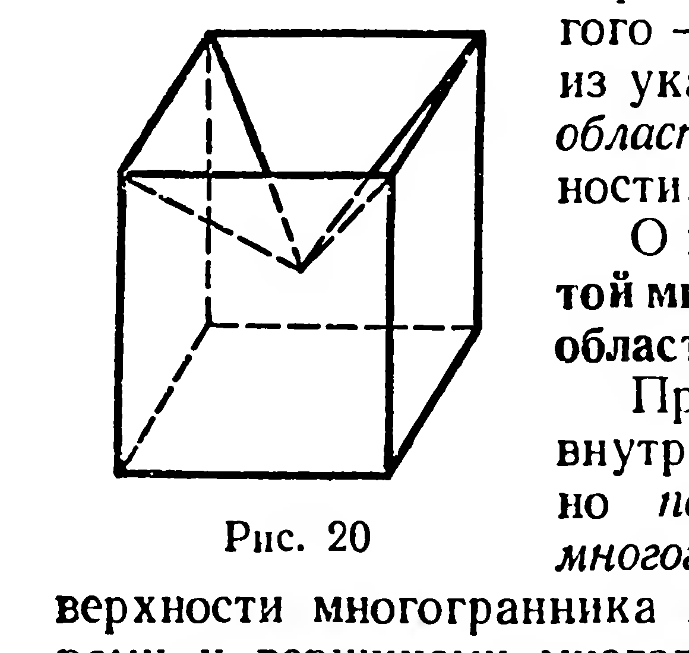
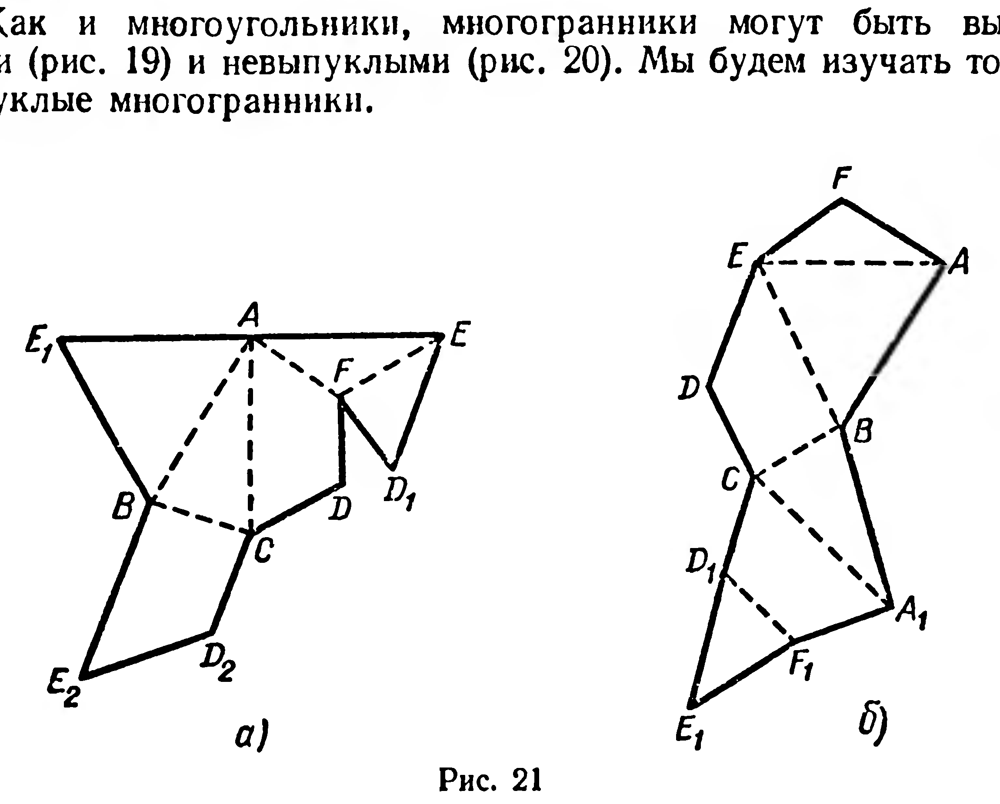

## 5.1. Многогранная поверхность. Многогранник

---
**стр. 117**
---

ГЛАВА V

МНОГОГРАННИКИ

§ 47. МНОГОГРАННАЯ ПОВЕРХНОСТЬ. МНОГОГРАННИК

Из курса VIII класса известны примеры неплоских фигур, являющихся объединением нескольких многоугольников. К таким фигурам относятся боковая поверхность прямой призмы (рис. 16), поверхность пирамиды (рис. 17). Эти фигуры — примеры простых многогранных поверхностей.

**Простой многогранной поверхностью** называется объединение конечного числа многоугольников, удовлетворяющее следующим условиям:

1) *для любых двух вершин этих многоугольников существует ломаная, составленная из их сторон, для которой взятые вершины служат концами;*

2) *произвольная точка поверхности либо является точкой только одного из данных многоугольников, либо принадлежит общей стороне двух и только двух многоугольников, либо является вершиной только одного многогранного угла, плоскими углами которого служат углы данных многоугольников.*

Указанным требованиям удовлетворяют объединения многоугольников, изображенные на рисунках 16 и 17, но не удовлетворяют фигуры, изображенные на рисунке 18 (объясните почему).

В дальнейшем, говоря о простых многогранных поверхностях, мы для краткости будем опускать слово «простых».

Многоугольники, составляющие многогранную поверхность, называются ее *гранями*; стороны многоугольников называются *ребрами*, а вершины — *вершинами* многогранной поверхности.

Если каждое ребро многогранной поверхности содержится в двух ее гранях, то эту многогранную поверхность называют

---
**стр. 118**
---

замкнутой. Поверхность пирамиды (см. рис. 17) является примером замкнутой многогранной поверхности, боковая поверхность призмы (см. рис. 16) — пример незамкнутой многогранной поверхности.

Замкнутая многогранная поверхность разбивает множество всех не принадлежащих ей точек пространства на два подмножества. Для одного из них существуют прямые, содержащиеся в этом подмножестве; для другого — таких прямых не существует. Первое из указанных подмножеств называют *внешней областью* замкнутой многогранной поверхности, а второе — ее *внутренней областью*.

**Определение.** Объединение замкнутой многогранной поверхности и ее внутренней области называется многогранником.

При этом многогранную поверхность и ее внутреннюю область называют соответственно *поверхностью* и *внутренней областью* многогранника. Грани, ребра, вершины поверхности многогранника называют соответственно гранями, ребрами и вершинами многогранника.

Отрезок, который соединяет две вершины многогранника, не принадлежащие одной грани, называют *диагональю многогранника*. На рисунке 19 изображен шестигранник $ABCDEF$ и его диагональ $BF$.

Как и многоугольники, многогранники могут быть выпуклыми (рис. 19) и невыпуклыми (рис. 20). Мы будем изучать только выпуклые многогранники.

