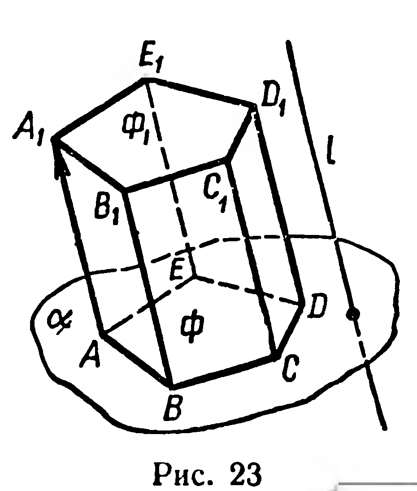
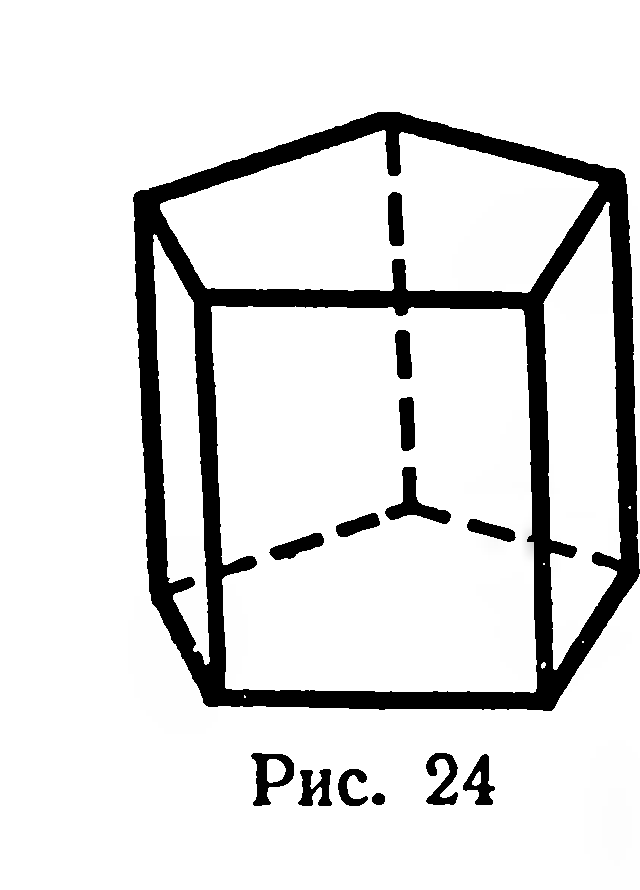
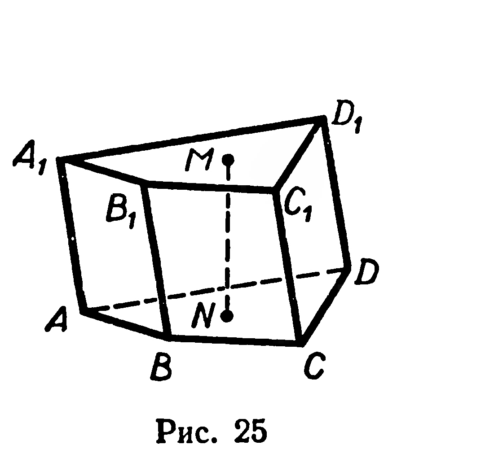
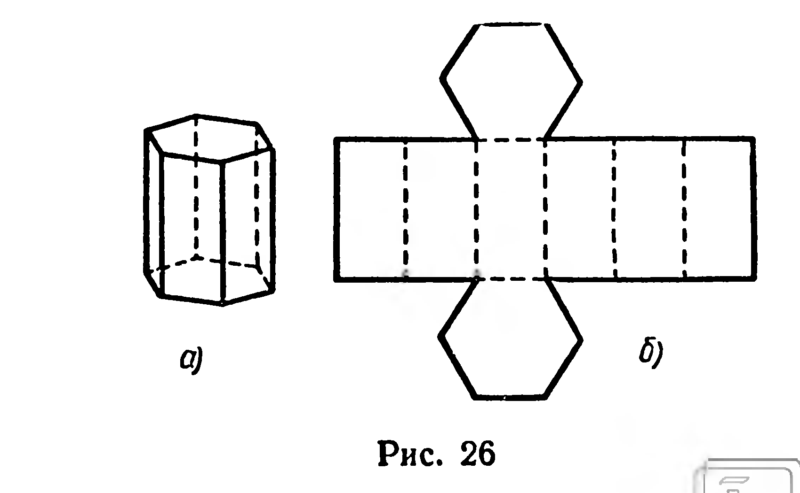
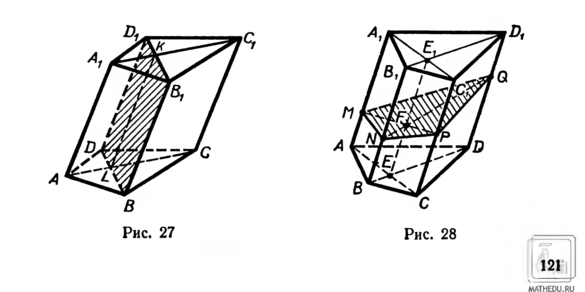
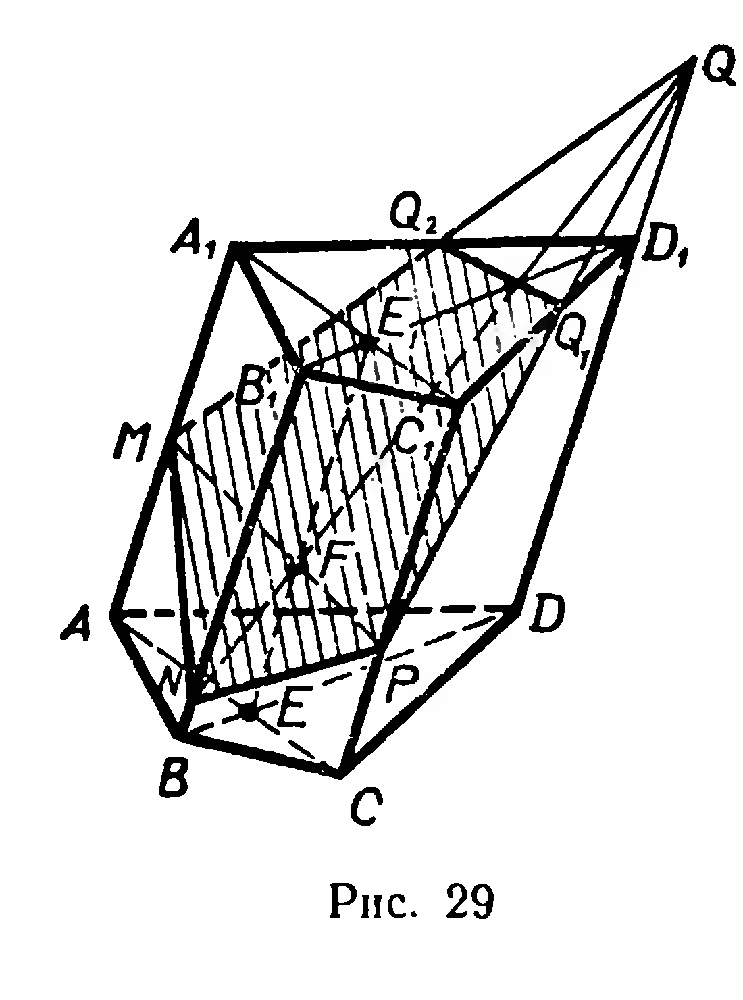

## 5.2. Призма

---
**стр. 119, продолжение**
---

## § 48. ПРИЗМА

**Определение.** Многогранник, две грани которого — $n$-угольники, лежащие в параллельных плоскостях, а остальные $n$ граней — параллелограммы, называется $n$-угольной *призмой*.

Докажем существование призмы. Пусть дан многоугольник $\Phi_1$ и параллельная ему плоскость $\alpha$, причём $\Phi_1 \not\subset \alpha$ (рис. 23). Рассмотрим проектирование (не обязательно ортогональное!) многоугольника $\Phi_1$

---
**стр. 120**
---

на плоскость $\alpha$. Каждая из сторон данного многоугольника и её проекция являются противолежащими сторонами параллелограмма. Объединение всех этих параллелограммов, многоугольника $\Phi_1$ и его проекции $\Phi$ есть замкнутая многогранная поверхность. Многогранник, который задаётся этой поверхностью, является призмой.

Многоугольники $\Phi_1$ и $\Phi$ называют **основаниями призмы**. Основания призмы конгруэнтны, так как существует перемещение, отображающее одно из них на другое: $\overrightarrow{AA}_1(\Phi) = \Phi_1$ (см. рис. 23). Остальные грани призмы называют её **боковыми гранями**, а их объединение — **боковой поверхностью призмы**.

Изображение призмы удобно начинать с изображения одного из её оснований (§ 13). Затем изображают боковые рёбра (рёбра призмы, не лежащие в её основаниях) в виде параллельных и конгруэнтных отрезков и соединяют последовательно их свободные концы.

Различают прямые и наклонные призмы. Призма, боковые рёбра которой перпендикулярны плоскостям оснований, называется **прямой призмой** (рис. 24). Если боковые рёбра призмы не перпендикулярны плоскостям оснований, то её называют **наклонной призмой**.

Перпендикуляр к плоскостям оснований призмы, концы которого принадлежат этим плоскостям, называют *высотой призмы*. На рисунке 25 изображена наклонная четырёхугольная призма $ABCDA_1B_1C_1D_1$ и её высота $MN$.

Прямая призма, основанием которой является правильный многоугольник, называется *правильной призмой*. На рисунке 26 изображена правильная шестиугольная призма и развёртка её поверхности.

**Задачи**

**55.** Какое минимальное число граней может иметь призма? Сколько вершин, рёбер, боковых рёбер у такой призмы?

---
**стр. 121**
---

**56.** 1) Диагональ правильной четырёхугольной призмы равна $25\ \text{см}$, а диагональ её боковой грани $20\ \text{см}$. Найдите высоту призмы.

2) Диагональ основания правильной четырёхугольной призмы равна $a$, диагональ боковой грани равна $b$. Найдите диагональ призмы.

**57.** Каждое из рёбер правильной шестиугольной призмы равно $a$. Найдите диагонали призмы.

**58.** Найдите диагонали прямой призмы, основание которой — ромб со стороной $a$ и острым углом $\varphi$, а большая диагональ этой призмы наклонена к плоскости основания под углом $\beta$.

**59.** Сечение призмы плоскостью, проходящей через два боковых ребра, не лежащие в одной грани, называется *диагональным сечением* призмы (рис. 27). Докажите, что если диагональные сечения призмы пересекаются, то их общий отрезок параллелен боковому ребру.

**60.** 1) Найдите отношение площади диагонального сечения правильной четырёхугольной призмы к площади её боковой грани.

2) Площадь боковой грани правильной шестиугольной призмы равна $Q$. Найдите площади её диагональных сечений.

**61.** Построить сечение четырёхугольной призмы плоскостью, проходящей через точки $M$, $N$, $P$, принадлежащие её различным боковым рёбрам (рис. 28).

Р е ш е н и е. Отрезки $MN$ и $NP$ являются сторонами искомого сечения. Найдём вершину сечения, принадлежащую четвёртому ребру $DD_1$ (или его продолжению). Для этого построим диагональные сечения $AA_1C_1C$ и $BB_1D_1D$ призмы, затем соединим точки $M$ и $P$. Общий отрезок $EE_1$ диагональных сечений пересекает $[MP]$ в точке $F$, которая принадлежит искомому сечению. Продолжив $[NF]$ до пересечения с $(DD_1)$, получим точку $Q$. Четырёхугольник $MNPQ$ — искомое сечение. Если точка $Q$ окажется на продолжении ребра $DD_1$, то сечение — пятиугольник (рис. 29).

---
**стр. 122**
---

**62.** Постройте сечение четырёхугольной призмы $ABCDA_1B_1C_1D_1$ плоскостью, проходящей: 1) через точки $M$, $N$, $P$, принадлежащие рёбрам $BB_1$, $CC_1$, $AD$; 2) через ребро $B_1C_1$ и вершину $A$.

**63.** Постройте сечение треугольной призмы $ABCA_1B_1C_1$ плоскостью, проходящей: 1) через вершину $A_1$ и точки $M$ и $N$, принадлежащие рёбрам $AB$ и $B_1C_1$; 2) через точки $M$, $N$, $P$, где $P \in [A_1C_1]$, а $M$ и $N$ — внутренние точки граней $ABB_1A_1$ и $BCC_1B_1$ соответственно.

**64.** Через сторону основания правильной треугольной призмы проведена плоскость, пересекающая противолежащее боковое ребро. Найдите площадь сечения, если секущая плоскость образует с плоскостью основания угол $\gamma$, а сторона основания равна $a$. Вычислите площадь этого сечения, если $a = 18\ \text{дм}$, $\gamma = 24^{\circ}$.
