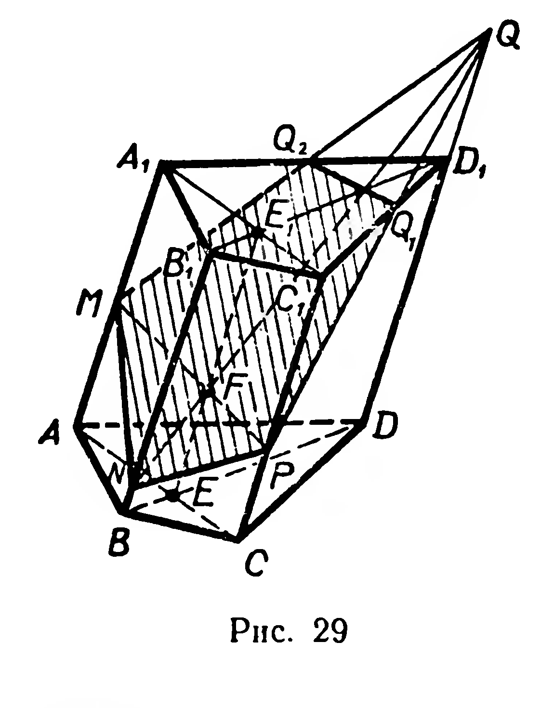
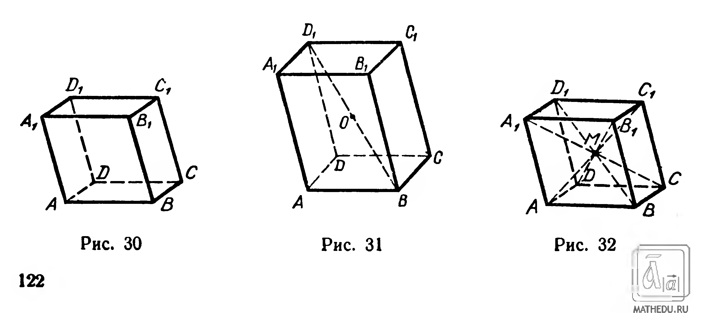
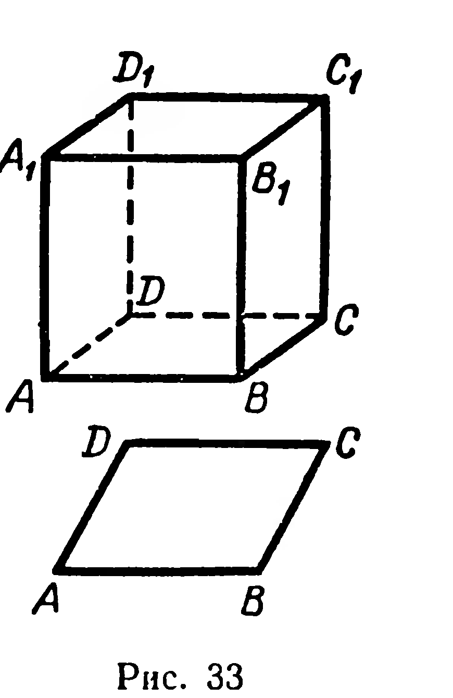
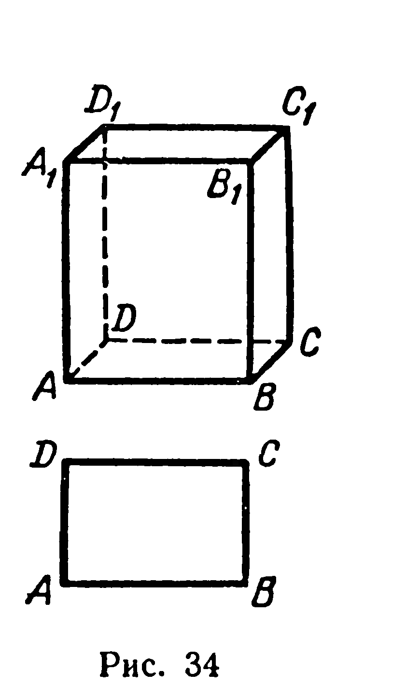
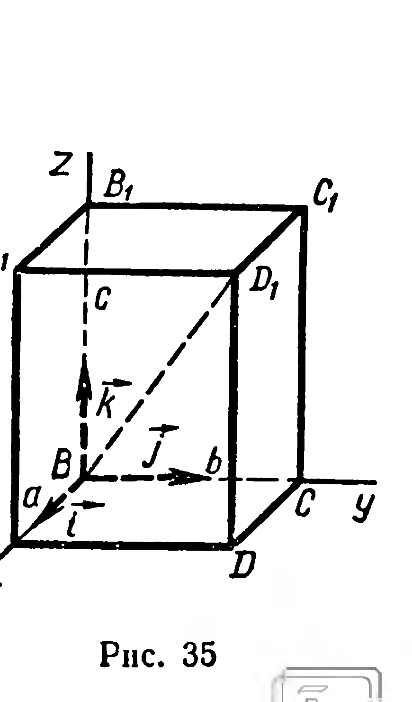
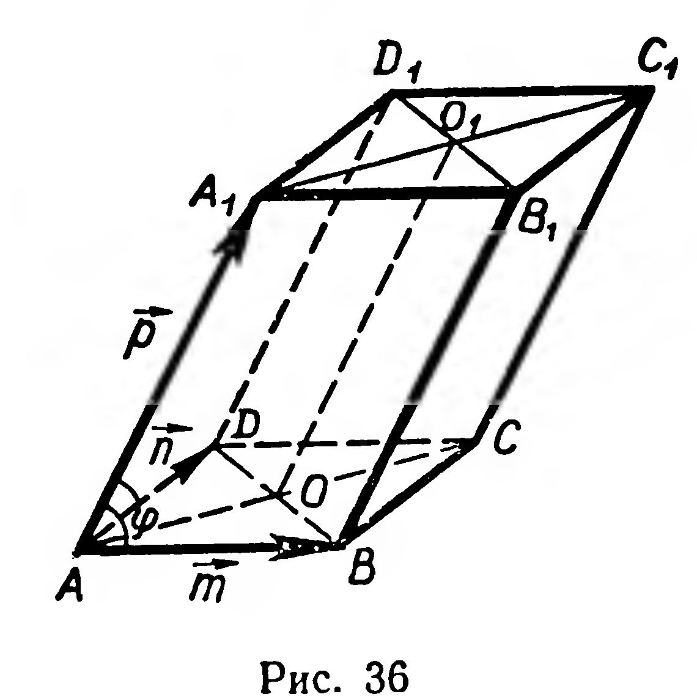

## 5.3. Свойства параллелепипеда

---
**стр. 122**
---

**62.** Постройте сечение четырёхугольной призмы $ABCDA_1B_1C_1D_1$ плоскостью, проходящей: 1) через точки $M$, $N$, $P$, принадлежащие рёбрам $BB_1$, $CC_1$, $AD$; 2) через ребро $B_1C_1$ и вершину $A$.

**63.** Постройте сечение треугольной призмы $ABCA_1B_1C_1$ плоскостью, проходящей: 1) через вершину $A_1$ и точки $M$ и $N$, принадлежащие рёбрам $AB$ и $B_1C_1$; 2) через точки $M$, $N$, $P$, где $P \in [A_1C_1]$, а $M$ и $N$ — внутренние точки граней $ABB_1A_1$ и $BCC_1B_1$ соответственно.

**64.** Через сторону основания правильной треугольной призмы проведена плоскость, пересекающая противолежащее боковое ребро. Найдите площадь сечения, если секущая плоскость образует с плоскостью основания угол $\gamma$, а сторона основания равна $a$. Вычислите площадь этого сечения, если $a = 18\ \text{дм}$, $\gamma = 24^{\circ}$.

**§ 49. СВОЙСТВА ПАРАЛЛЕЛЕПИПЕДА**

**1. О п р е д е л е н и е.** Параллелепипедом называется призма, основанием которой служит параллелограмм.

Из определения следует, что все шесть граней параллелепипеда (рис. 30) — параллелограммы.

Некоторые свойства параллелепипеда аналогичны известным свойствам параллелограмма.

**28. Т е о р е м а.** *Середина диагонали параллелепипеда является его центром симметрии.*

Д о к а з а т е л ь с т в о. Пусть $O$ — середина диагонали $BD_1$ параллелепипеда $ABCDA_1B_1C_1D_1$ (рис. 31). Рассмотрим центральную симметрию с центром $O$. Так как $|OB| = |OD_1|$, то $Z_o(B) = D_1$.

---
**стр. 123**
---

Центральная симметрия отображает луч на противоположно направленный луч (§ 16), поэтому $Z_o([BA)) = [D_1C_1)$, а так как $|BA| = |D_1C_1|$ (почему?), то $Z_o(A) = C_1$. Аналогично доказывается, что точки $C$ и $D$ отображаются соответственно на точки $A_1$ и $B_1$. Отсюда следует, что при симметрии $Z_o$ поверхность параллелепипеда отображается на себя. На себя отображается и внутренняя область параллелепипеда. Итак, при симметрии с центром $O$ параллелепипед $ABCDA_1B_1C_1D_1$ отображается на себя, т. е. $O$ — центр симметрии данного параллелепипеда.

**Следствие 1.** Противолежащие грани параллелепипеда попарно конгруэнтны и параллельны.

**Следствие 2.** Все диагонали параллелепипеда пересекаются в одной точке и делятся ею пополам (рис. 32).

2. Если боковые ребра параллелепипеда перпендикулярны к плоскости его основания (рис. 33), то параллелепипед называется **прямым**. Прямой параллелепипед, основанием которого служит прямоугольник (рис. 34), называется **прямоугольным параллелепипедом**. Все грани прямоугольного параллелепипеда — прямоугольники. Длины трёх рёбер прямоугольного параллелепипеда, выходящих из одной вершины, называются *измерениями* прямоугольного параллелепипеда. Прямоугольный параллелепипед с равными измерениями называется **кубом**. Все грани куба — конгруэнтные квадраты.

29. **Теорема.** *Квадрат длины диагонали прямоугольного параллелепипеда равен сумме квадратов трёх его измерений.*

Докажите это самостоятельно (можно воспользоваться координатным методом, рис. 35).

**Следствие.** Все диагонали прямоугольного параллелепипеда имеют равные длины.

---
**стр. 124**
---

**Задачи**

65. Дан параллелепипед (рис. 32). Докажите конгруэнтность: 1) двугранных углов с рёбрами $AA_1$ и $CC_1$; 2) трёхгранных углов с вершинами $A$ и $C_1$.

66. Имеет ли наклонный параллелепипед: 1) ось симметрии; 2) плоскость симметрии?

67. 1) Может ли основание наклонного параллелепипеда быть прямоугольником?

2) Могут ли две грани наклонного параллелепипеда быть перпендикулярны плоскости основания? Имеет ли такой наклонный параллелепипед ось и плоскость симметрии?

68\*. Докажите, что если все диагонали параллелепипеда конгруэнтны, то он является прямоугольным.

69. Найдите длины диагоналей прямоугольного параллелепипеда, если известны его измерения: 1) 2 дм, 3 дм, 6 дм; 2) 3 см, 6 см, 12 см.

70. 1) Стороны основания прямого параллелепипеда $\sqrt{18}$ см и 7 см, угол между ними равен $135^\circ$, боковое ребро равно 12 см. Найдите диагонали параллелепипеда.

2) Стороны основания прямого параллелепипеда 8 дм и 5 дм, одна из диагоналей основания 3,2 дм, большая диагональ параллелепипеда 13 дм. Найдите его меньшую диагональ.

3) Дан параллелепипед $ABCDA_1B_1C_1D_1$: $|BA| = a$, $|BC| = b$, $|BB_1| = c$, $\widehat{ABC} = \alpha$, $\widehat{ABB_1} = \beta$, $\widehat{B_1BC} = \gamma$. Найдите $|BD_1|$ и $|AC_1|$.

71. Основанием параллелепипеда $ABCDA_1B_1C_1D_1$ служит квадрат со стороной $a$, боковое ребро параллелепипеда равно $b$. Боковое ребро $AA_1$ образует с пересекающими его сторонами основания острые углы, равные $\varphi$ (рис. 36). Найти площади диагональных сечений $AA_1C_1C$ и $BB_1D_1D$ параллелепипеда.

**Решение.** Оба сечения — параллелограммы, причём $|AC| = |BD| = a\sqrt{2}$, $|AA_1| = |BB_1| =b$. Вычислим углы этих параллелограммов. Пусть $\overrightarrow{AB} = \vec{m}$, $\overrightarrow{AD} = \vec{n}$, $\overrightarrow{AA_1} = \vec{p}$, $\widehat{A_1AC} = (\overrightarrow{AA_1}, \overrightarrow{AC}) = x$, $\widehat{BDD_1} = (\overrightarrow{DB}, \overrightarrow{AA_1}) = y$. По определению скалярного произведения векторов

$$\cos x = \frac{\overrightarrow{AA_1} \cdot \overrightarrow{AC}}{|AA_1| \cdot |AC|}; \quad \cos y = \frac{\overrightarrow{AA_1} \cdot \overrightarrow{DB}}{|AA_1| \cdot |DB|}.$$

Преобразуем выражения, стоящие в числителях:

$$\overrightarrow{AA_1} \cdot \overrightarrow{AC} = \vec{p} \cdot (\vec{m} + \vec{n}) = \vec{p} \cdot \vec{m} + \vec{p} \cdot \vec{n} = 2ab \cos \varphi;$$

$$\overrightarrow{AA_1} \cdot \overrightarrow{DB} = \vec{p} \cdot (\vec{m} - \vec{n}) = ab \cos \varphi - ab \cos \varphi = 0.$$
