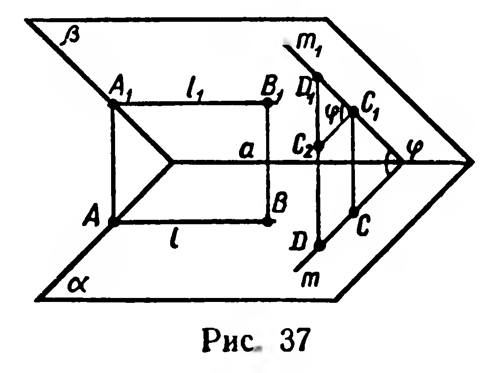
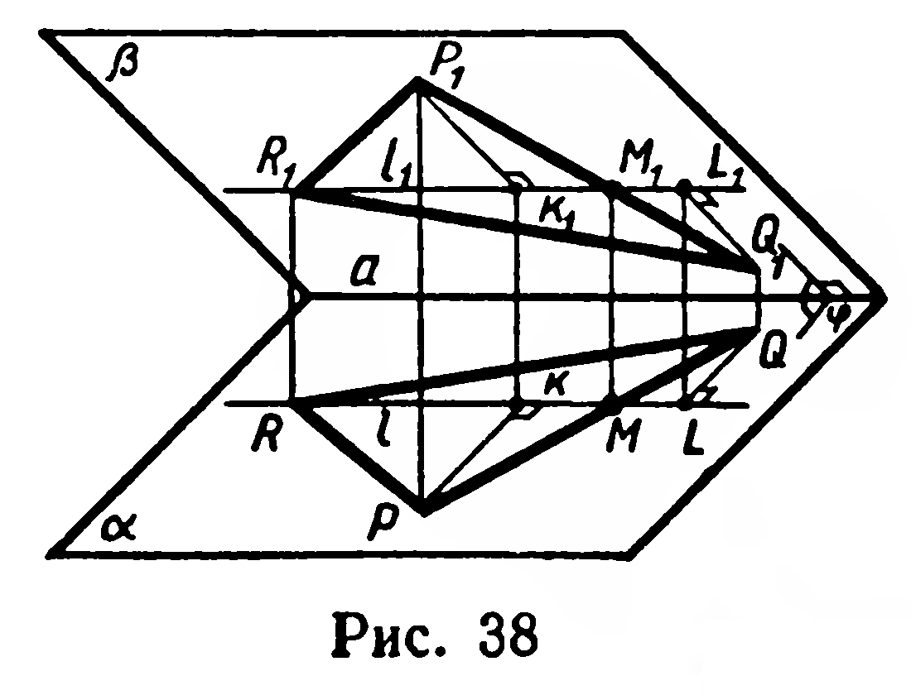

## 5.4. Площадь ортогональной проекции многоугольника

---
**стр. 125, продолжение**
---

## § 50. Площадь ортогональной проекции многоугольника

Предварительно рассмотрим ортогональное проектирование прямых и отрезков, лежащих в плоскости $\beta$, на плоскость $\alpha$.

Пусть $\beta \cap \alpha = a$, $(\widehat{\beta,\alpha}) = \varphi$, $0^\circ < \varphi < 90^\circ$ (рис. 37). Рассмотрим в плоскости $\beta$ прямую $l_1$, параллельную $a$. Параллельное проектирование сохраняет параллельность прямых, поэтому прямые $a$ и $l_1$ отображаются на параллельные прямые $a$ и $l$, отсюда $l_1 \parallel l$ (§ 8). Отрезок $A_1B_1$ прямой $l_1$ и его образ $[AB]$ — противолежащие стороны параллелограмма, так как проектирующие прямые параллельны (см. рис. 37). Следовательно, $|AB| = |A_1B_1|$.

Рассмотрим теперь прямую $m_1$ плоскости $\beta$, перпендикулярную $a$. Проекция $m$ прямой $m_1$ также перпендикулярна $a$ (теорема о трёх перпендикулярах), поэтому $(\widehat{m,m_1}) = \varphi$. Отсюда вытекает, что для отрезка $C_1D_1$, перпендикулярного $a$, и его образа $[CD]$ выполняется равенство $|CD| = |C_1D_1|\cos\varphi$.

**30. Теорема.** *Площадь ортогональной проекции многоугольника на плоскость равна площади проектируемого многоугольника, умноженной на косинус угла между плоскостями многоугольника и его проекции.*

**Доказательство.** Рассмотрим треугольник $P_1Q_1R_1$, лежащий в плоскости $\beta$, и его ортогональную проекцию $(\Delta PQR)$ на плоскость $\alpha$ (рис. 38). Пусть $\beta \cap \alpha = a$, $(\widehat{\beta,\alpha}) = \varphi$, где $0^\circ < \varphi < 90^\circ$.

---
**стр. 126**
---

Если через точки $P_1$, $Q_1$, $R_1$ провести прямые, параллельные $a$, то одна из них имеет общую точку с противолежащей стороной треугольника. Будем считать, что такой прямой является прямая $l_1$, проходящая через точку $R_1$: $l_1 \cap [P_1Q_1] = M_1$.

Пусть $|P_1K_1|$ и $|Q_1L_1|$ — расстояния от точек $P_1$ и $Q_1$ до прямой $l_1$. Построив проекции $M$, $K$, $L$ точек $M_1$, $K_1$, $L_1$, выразим площадь треугольника $PQR$ через площадь треугольника $P_1Q_1R_1$. Очевидно,

$$S_{\Delta PQR} = \frac12|RM|\cdot|PK| + \frac12|RM|\cdot|QL|.$$

Согласно выводам, полученным в начале этого параграфа, имеем:
$$|RM| = |R_1M_1|,\quad |PK| = |P_1K_1|\cos\varphi,\quad |QL| = |Q_1L_1|\cos\varphi.$$

Тогда
$$S_{\Delta PQR} = \left(\frac12|R_1M_1|\cdot|P_1K_1| + \frac12|R_1M_1|\cdot|Q_1L_1|\right)\cos\varphi = S_{\Delta P_1Q_1R_1}\cos\varphi.$$

Итак,

$$S_{\Delta PQR} = S_{\Delta P_1Q_1R_1}\cos\varphi. \qquad (1)$$

Если $\beta \parallel \alpha$, то треугольник и его проекция конгруэнтны. Формула (1) верна и в этом случае.

Всякий многоугольник можно разбить на треугольники, поэтому теорема верна и для многоугольника. ■

**Задачи**

**72.** Стороны основания прямого параллелепипеда равны $4$ дм и $5$ дм, угол между ними $30^\circ$. Найдите площадь сечения параллелепипеда плоскостью, если известно, что она пересекает все его боковые рёбра и образует с плоскостью основания угол в $45^\circ$.

**73.** Боковое ребро прямой призмы равно $6$ см. Её основание — прямоугольный треугольник с катетами $3$ см и $2$ см. Найдите площади сечений призмы плоскостями, проходящими через каждый из данных катетов и образующими углы $60^\circ$ с плоскостью основания.

**74.** Сторона основания правильной треугольной призмы равна $4$ см. Найдите площадь сечения призмы плоскостью, проходящей через середины двух сторон основания и образующей угол $45^\circ$ с его плоскостью, если известно, что плоскость сечения пересекает: 1) только одно боковое ребро призмы; 2) два её боковых ребра.

**75.** Ребро куба равно $a$. Найдите площадь сечения куба плоскостью, проходящей через сторону основания, если угол между этой плоскостью и плоскостью основания равен: 1) $30^\circ$; 2) $\varphi$.

**76.** Через середины двух смежных сторон основания правильной четырёхугольной призмы проведена плоскость, образующая с плоскостью основания угол $\varphi$ и пересекающая три боковых ребра призмы. Найдите сторону основания, если площадь сечения равна $Q$.
