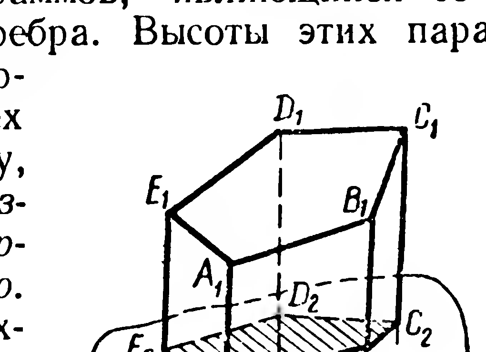
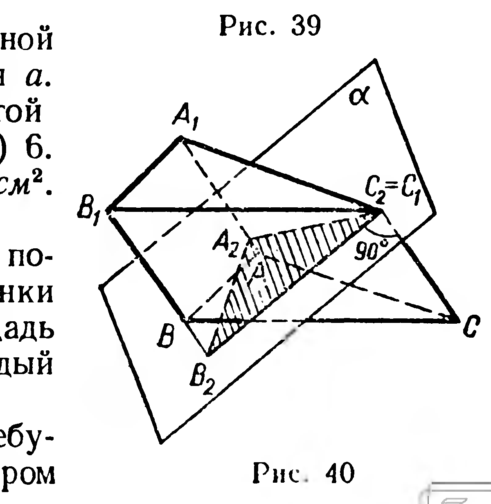

## 5.5. Площадь поверхности призмы

---
**стр. 127**
---

§ 51. ПЛОЩАДЬ ПОВЕРХНОСТИ ПРИЗМЫ

**Площадью поверхности многогранника** называется сумма площадей всех его граней.

Найдем площадь поверхности призмы (рис. 39). Так как основания призмы — конгруэнтные многоугольники, то их площади равны. Поэтому

$$S_{\text{пр}} = 2S_{\text{осн}} + S_{\text{бок}},$$

где $S_{\text{бок}}$ — площадь боковой поверхности призмы. Выведем правило для вычисления $S_{\text{бок}}$.

Пусть дана произвольная призма (рис. 39). Через точку $A_2$, принадлежащую одному из ее боковых ребер, проведем плоскость $\alpha$, перпендикулярную этому ребру. Если плоскость $\alpha$ пересекает все боковые ребра призмы, то полученный многоугольник $A_2B_2C_2D_2E_2$ называется **перпендикулярным сечением призмы** (если такого многоугольника не существует (рис. 40), то за перпендикулярное сечение призмы принимают многоугольник с вершинами в точках пересечения плоскости $\alpha$ с прямыми, на которых лежат боковые ребра).

Примем за основания параллелограммов, являющихся боковыми гранями призмы, ее боковые ребра. Высоты этих параллелограммов — стороны перпендикулярного сечения. Сложив площади всех боковых граней, приходим к выводу, что *площадь боковой поверхности призмы равна произведению периметра перпендикулярного сечения на боковое ребро*. В частности, площадь боковой поверхности прямой призмы равна периметру основания, умноженному на высоту призмы.

**Задачи**

77. Высота правильной $n$-угольной призмы равна $H$, сторона основания $a$. Найдите площадь поверхности этой призмы, если $n$ равно: 1) 4; 2) 3; 3) 6.

78. Площадь поверхности куба $54\text{ см}^2$. Найдите его диагональ.

79. На рисунке 41 изображено поперечное сечение канала. Дно и стенки канала забетонированы. Какую площадь нужно покрыть бетоном на каждый километр канала?

80. Сколько кусков обоев потребуется для оклейки комнаты размером
