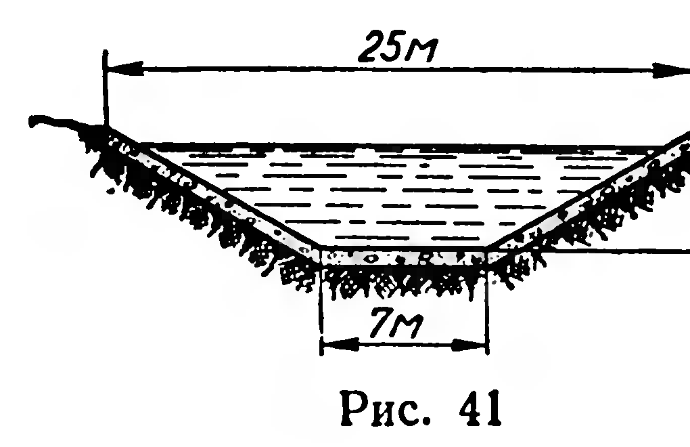
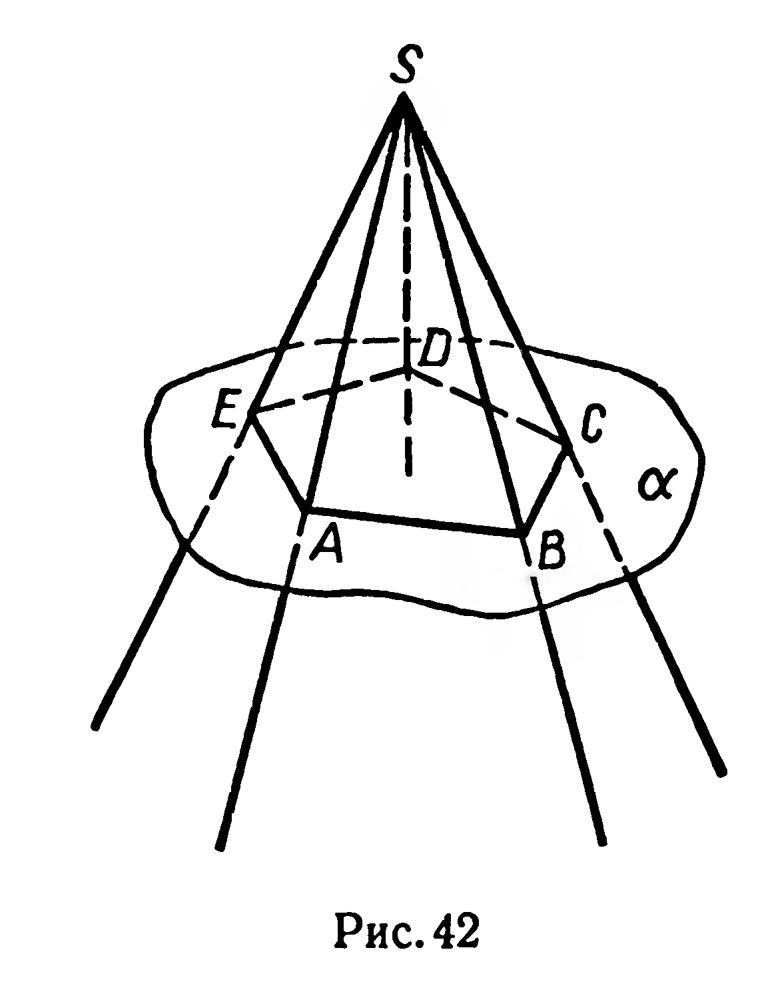
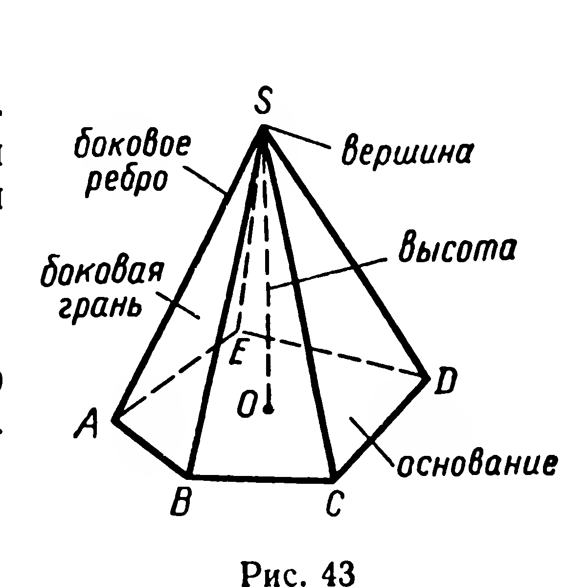
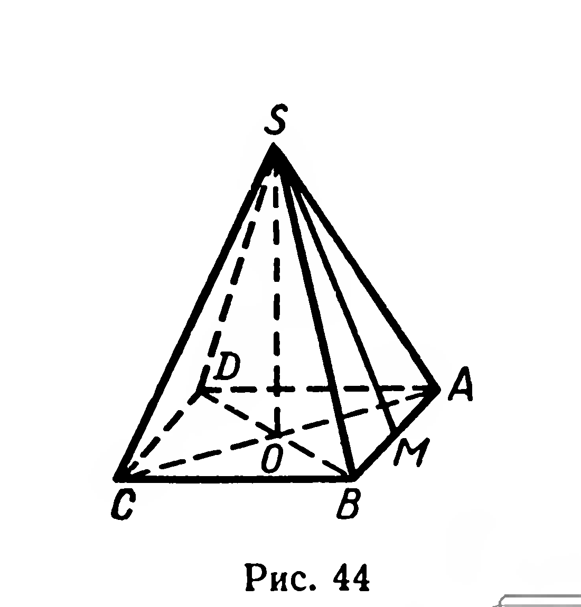
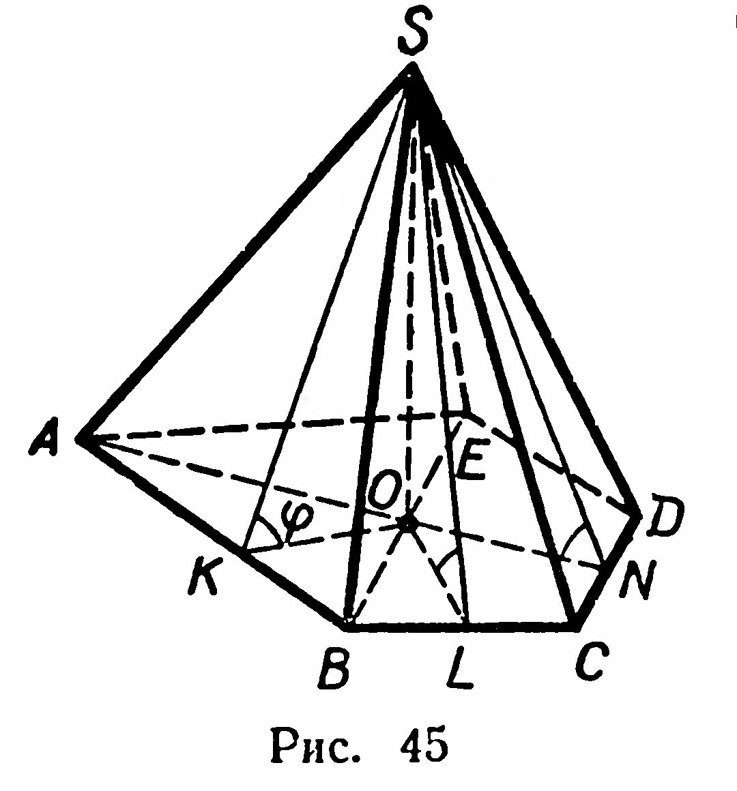

## 5.6. Пирамида

---
**стр. 128**
---

$6\text{ м} \times 5\text{ м} \times 3\text{ м}$, если размеры одного куска $0{,}5\text{ м} \times 7\text{ м}$ и на обрезки достаточно иметь запас, равный площади окон и дверей?

81. Площадь боковой поверхности правильной шестиугольной призмы $648\text{ см}^2$, диагональ боковой грани $15\text{ см}$. Найдите сторону основания и высоту призмы.

82. Двугранный угол при одном из боковых ребер наклонной треугольной призмы равен $120^\circ$; расстояния от этого ребра до других боковых ребер призмы $16\text{ см}$ и $14\text{ см}$. Найдите площадь боковой поверхности призмы, если ее боковое ребро $20\text{ см}$.

83. Каждое ребро наклонной треугольной призмы равно $a$, одно из боковых ребер составляет со смежными сторонами основания углы в $60^\circ$. Найдите площадь полной поверхности.

84. Основание наклонного параллелепипеда — квадрат со стороной $a$, одна из вершин другого основания проектируется в центр этого квадрата. Высота параллелепипеда равна $H$. Найдите площадь боковой поверхности параллелепипеда и угол наклона бокового ребра к плоскости основания. Какова зависимость между $a$ и $H$, если этот угол равен $45^\circ$?

85. Основание прямого параллелепипеда — ромб с острым углом $\varphi$ и большей диагональю $d$; меньшая диагональ параллелепипеда образует с плоскостью основания угол $\beta$. Найдите площадь боковой поверхности параллелепипеда.

§ 52. ПИРАМИДА

О п р е д е л е н и е. **Многогранник**, одна из граней которого — произвольный многоугольник, а остальные грани — треугольники, имеющие общую вершину, называется **пирамидой**.

Пирамиду можно получить как пересечение многогранного угла $SABCDE$ (рис. 42) и полупространства $U$, если: 1) $S \in U$; 2) граница $\alpha$ полупространства $U$ пересекает все ребра данного многогранного угла в различных точках.

В курсе VIII класса вы пользовались терминами: *основание*, *вершина*, *боковая грань*, *боковое ребро* и *высота пирамиды*. Вспомните смысл этих терминов, пользуясь рисунком 43.

Построение изображения пирамиды можно начать с изображения ее основания. Затем изображают вершину пирамиды и ее боковые ребра.

Если основание пирамиды — правильный многоугольник и вершина пирамиды проектируется в центр этого многоугольника, то пирамида называется *правильной* (рис. 44).

Все боковые ребра правильной пирамиды конгруэнтны; все ее боковые грани — конгруэнтные равнобедренные треугольники.

---
**стр. 129**
---

Высота боковой грани правильной пирамиды, проведенная из ее вершины, называется **апофемой** этой пирамиды. $[SM]$ — апофема (рис. 44).

Для вычисления площади боковой поверхности правильной пирамиды имеется удобная формула:
$$S_{\text{бок}} = \frac{1}{2} P \cdot h_{\text{бок}},$$
где $P$ — периметр основания, $h_{\text{бок}}$ — апофема правильной пирамиды. Эта формула читается так: *площадь боковой поверхности правильной пирамиды равна половине произведения периметра основания на апофему пирамиды*.

Площадь полной поверхности пирамиды вычисляется по формуле:
$$S_{\text{пир}} = S_{\text{бок}} + S_{\text{осн}}.$$

**Задача.** Площадь основания пирамиды равна $Q$, двугранные углы при всех сторонах основания равны $\varphi$. Доказать, что
$$S_{\text{бок}} = \frac{Q}{\cos \varphi}.$$

**Решение.** Проведем высоту $SO$ пирамиды $SABCDE$ (рис. 45) и рассмотрим линейные углы $\widehat{SKO}$, $\widehat{SLO}$, $\widehat{SNO} \dots$ По условию $\widehat{SKO} = \widehat{SLO} = \widehat{SNO} = \dots = \varphi$. Проекции боковых граней пирамиды на плоскость ее основания—треугольники $AOB$, $BOC \dots$ Точка $O$ принадлежит внутренней области многоугольника $ABCDE$, так как она является центром вписанного в него круга (треугольники $SOK$, $SOL$, $\dots$ конгруэнтны, откуда $|OK| = |OL| = \dots$). Поэтому объединение треугольников $AOB$, $BOC$, $\dots$ есть многоугольник $ABCDE$.

По теореме о площади ортогональной проекции многоугольника имеем:
$$S_{\triangle ABO} = S_{\triangle ABS} \cdot \cos \varphi;$$
$$S_{\triangle BCO} = S_{\triangle BCS} \cdot \cos \varphi;$$
$$\dots$$

---
**стр. 130**
---

Сложив почленно, получим:
$$Q = S_{\text{бок}} \cdot \cos \varphi, \text{ откуда}$$
$$S_{\text{бок}} = \frac{Q}{\cos \varphi}.$$

Отметим, что полученная формула верна для любой правильной пирамиды.

**Задачи**

$86^{\circ}$. 1) Всякий ли параллелограмм может быть основанием правильной пирамиды? 2) Может ли правильный многоугольник быть основанием неправильной пирамиды?

87. 1) Имеет ли ось симметрии правильная пирамида, если число сторон ее основания равно: а) 3; б) 4; в) $n$?
2) Сколько плоскостей симметрии имеет правильная пирамида, если число сторон ее основания равно: а) 3; б) 4?

88. Докажите, что непересекающиеся ребра правильной треугольной пирамиды взаимно перпендикулярны.

89. Сечение пирамиды плоскостью, проходящей через два боковых ребра, не лежащих в одной грани, называется диагональным сечением пирамиды.

1) Найдите площадь диагонального сечения правильной четырехугольной пирамиды, если сторона основания равна $a$, а боковое ребро образует с плоскостью основания угол $\varphi$.

2) Сторона основания правильной шестиугольной пирамиды равна $a$, высота пирамиды $H$. Найдите площади диагональных сечений.

90. Постройте сечение четырехугольной пирамиды плоскостью, проходящей через три точки, принадлежащие ее боковым ребрам.

91. Сторона основания правильной пирамиды равна $a$, высота пирамиды $H$. Найдите площадь боковой поверхности, если число сторон основания равно: 1) 3; 2) 4; 3) 6; 4) $n$.

92. 1) Сторона основания правильной четырехугольной пирамиды $2\text{ см}$, двугранный угол при основании $60^{\circ}$. Найдите площадь боковой поверхности. 2) Площадь боковой поверхности правильной пирамиды втрое больше площади основания. Найдите двугранный угол при стороне основания.

93. Крыша имеет форму пирамиды с квадратным основанием $4,5\text{ м} \times 4,5\text{ м}$ и углом наклона грани к основанию в $45^{\circ}$. Сколько листов железа размером $70\text{ см} \times 140\text{ см}$ нужно для покрытия крыши, если на отходы нужно добавить $10\%$ площади крыши?

94. Основание пирамиды — равнобедренный треугольник, боковые стороны которого имеют длину $a$ и образуют угол $\alpha$, двугранные углы при всех сторонах основания равны $\beta$. Найдите площадь полной поверхности пирамиды.
