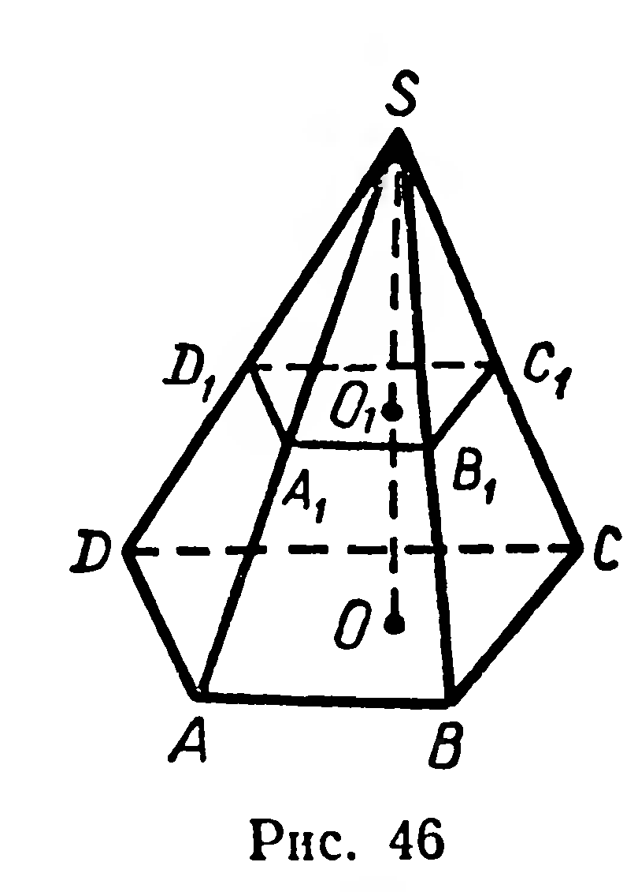
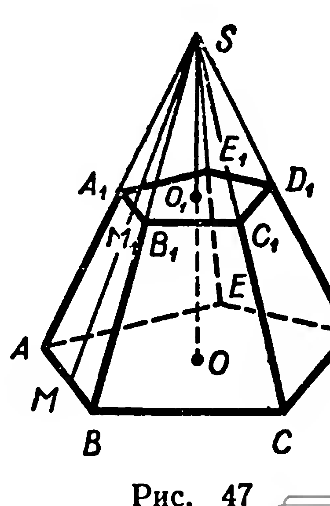
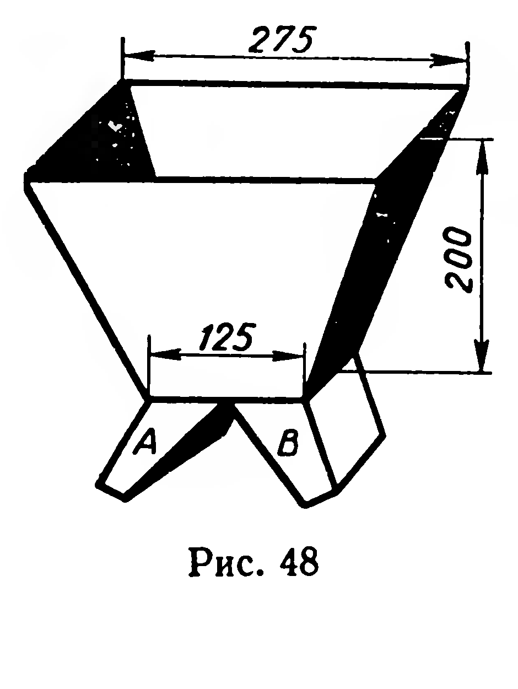

## 5.7. Усеченная пирамида

---
**стр. 131, продолжение**
---

## § 53. УСЕЧЕННАЯ ПИРАМИДА

Рассмотрим предварительно следующую теорему.

**31.** *Теорема. Сечение пирамиды плоскостью, параллельной ее основанию, можно отобразить на основание гомотетией с центром в вершине пирамиды.*

*Доказательство.* Пусть $A_1B_1C_1D_1$ — сечение пирамиды $SABCD$ плоскостью, которая параллельна плоскости $ABCD$ (рис. 46). Рассмотрим гомотетию с центром $S$ и коэффициентом $k = \frac{|SA|}{|SA_1|}$. Эта гомотетия отображает точку $A_1$ на точку $A$, а плоскость сечения пирамиды — на параллельную ей плоскость (§ 46, теорема 27). Но через точку $A$ проходит единственная плоскость, параллельная плоскости сечения; следовательно, сечение $A_1B_1C_1D_1$ пирамиды отображается на ее основание $ABCD$. ■

Рассмотрим многогранник (рис. 47) $ABCDEA_1B_1C_1D_1E_1$, вершинами которого служат вершины основания пирамиды и вершины ее сечения плоскостью, параллельной основанию. Такой многогранник называют усеченной пирамидой.

Усеченная пирамида имеет два основания ($ABCDE$ и $A_1B_1C_1D_1E_1$ на рисунке 47), являющиеся гомотетичными многоугольниками.

Перпендикуляр к плоскостям оснований, концы которого принадлежат этим плоскостям, называется высотой усеченной пирамиды. Боковые грани усеченной пирамиды — трапеции.

5*

---
**стр. 132**
---

Усеченная пирамида называется правильной, если она является частью правильной пирамиды. Боковые грани правильной усеченной пирамиды — конгруэнтные равнобедренные трапеции (см. рис. 47). Высота каждой из этих трапеций называется апофемой правильной усеченной пирамиды ($[MM_1]$ на рисунке 47).

Умножив площадь одной из боковых граней правильной усеченной пирамиды на число этих граней, приходим к формуле

$$S_{\text{бок}} = \frac{1}{2}(P + P_1) \cdot h_{\text{бок}}.$$

*Площадь боковой поверхности правильной усеченной пирамиды равна полусумме периметров оснований, умноженной на апофему.*

## Задачи

**99.** Высота правильной четырехугольной усеченной пирамиды $16$ см, а стороны оснований $24$ см и $40$ см. Найдите диагональ усеченной пирамиды и площадь диагонального сечения.

**100.** 1) Постройте сечение правильной усеченной четырехугольной пирамиды плоскостью, проходящей через конец диагонали меньшего основания и перпендикулярной к этой диагонали.
2) Вычислите площадь сечения, если стороны оснований $a$ и $b$ ($a > b$), а боковое ребро $c$.

**101.** По высоте $H$ и сторонам оснований $a$ и $b$ ($a > b$) найдите площадь боковой поверхности правильной усеченной пирамиды: 1) треугольной; 2) четырехугольной; 3) $n$-угольной.

**102.** На рисунке 48 изображен бункер, поверхность основной части которого представляет боковую поверхность правильной четырехугольной усеченной пирамиды. По размерам, указанным на рисунке (в сантиметрах), вычислите, сколько квадратных дециметров листового железа нужно для изготовления бункера (не считая рукавов $A$ и $B$).

**103.** Основания усеченной пирамиды — равнобедренные треугольники; равные их стороны $a$ и $b$ ($a > b$), углы при вершинах треугольников равны по $120^{\circ}$. Ребро, проходящее через вершины данных углов, перпендикулярно плоскостям оснований и равно $c$. Найдите площадь боковой поверхности усеченной пирамиды.

**104.** Основания усеченной пирамиды — квадраты со сторонами $8$ см и $4$ см; одна из боковых граней, являющаяся равнобедренной трапецией, перпендикулярна к плоскостям оснований, а противолежащая ей грань образует с плоскостью основания угол $60^{\circ}$. Найдите площадь боковой поверхности усеченной пирамиды.
