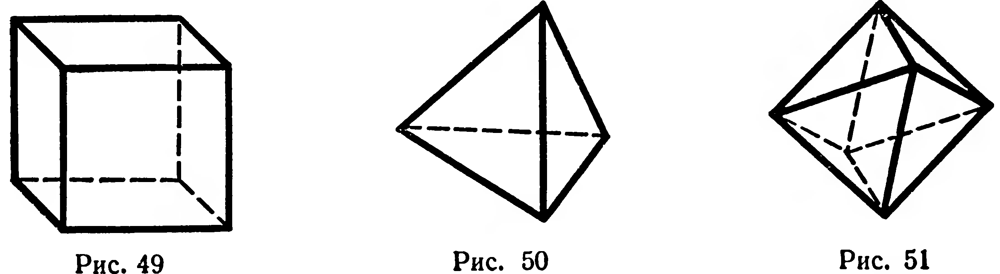
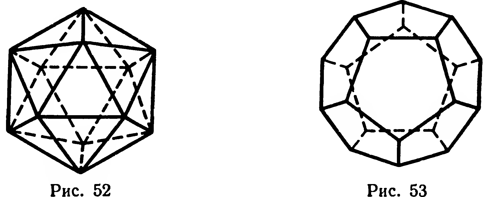
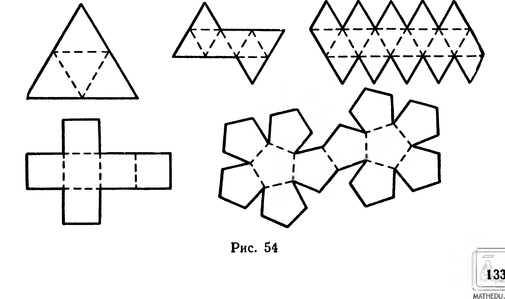

## 5.8. Понятие о правильных многогранниках

---
**стр. 133**
---

§ 54. Понятие о правильных многогранниках

**Определение.** Многогранник называется правильным, если все его грани — конгруэнтные правильные многоугольники и все его многогранные углы имеют одинаковое число граней.

Из определения следует, что все ребра правильного многогранника конгруэнтны, а также конгруэнтны все его плоские углы. Примеры правильных многогранников вам уже известны: это куб (рис. 49), правильный тетраэдр (рис. 50). Можно доказать, что существует еще три вида правильных многогранников. Это правильный восьмигранник (или правильный октаэдр, рис. 51), правильный двадцатигранник (икосаэдр, рис. 52), правильный

