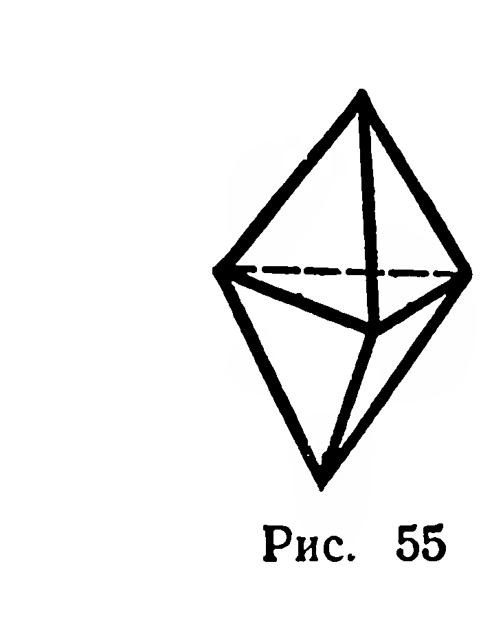
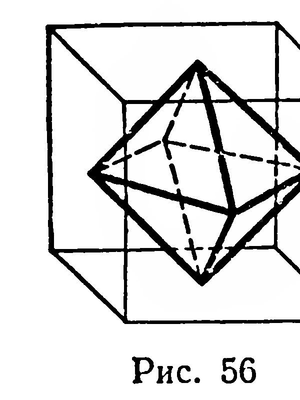
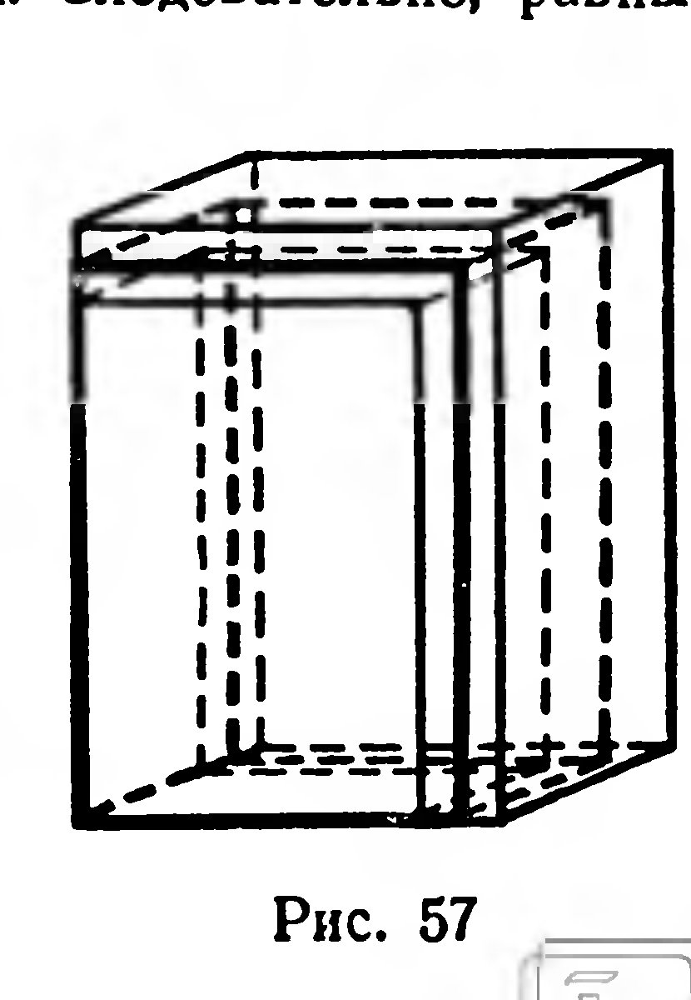
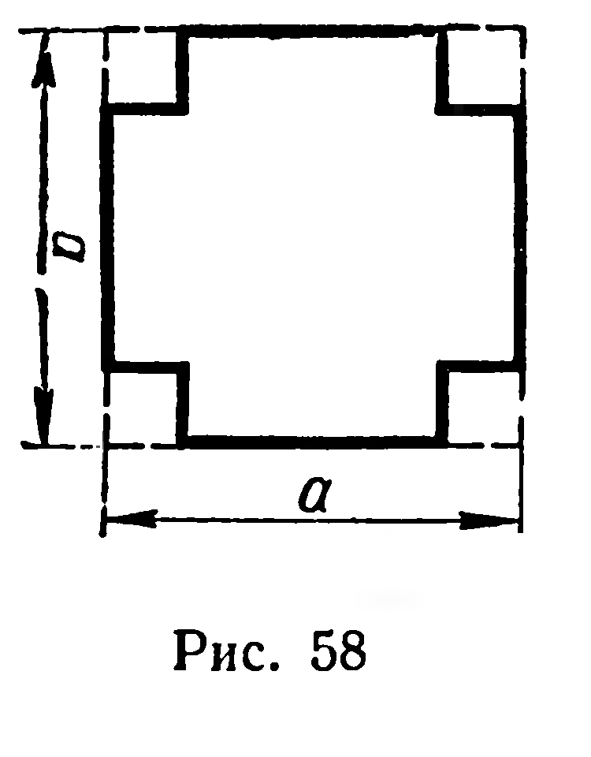

## 5.9. Общие свойства объемов многогранников. Объем прямоугольного параллелепипеда

---
**стр. 134**
---

двенадцатигранник (додекаэдр, рис. 53). Никаких других видов правильных многогранников (выпуклых), кроме пяти перечисленных, не существует (это открытие приписывается древнегреческому философу Платону).

Развертки поверхностей правильных многогранников всех видов изображены на рисунке 54.

**Задачи**

105°. 1) Является ли правильная пирамида (призма) правильным многогранником?

2) Существует ли пирамида (призма), являющаяся правильным многогранником?

106°. Шестигранник является объединением двух правильных тетраэдров, имеющих общее основание (рис. 55). Является ли он правильным многогранником?

107. 1) Из одной вершины куба проведены три диагонали граней, их концы соединены отрезками. Докажите, что пирамида, ребрами которой служат построенные шесть отрезков, есть правильный тетраэдр.

2*) Докажите, что центры граней куба служат вершинами правильного октаэдра (рис. 56).

108. Найдите величину двугранного угла: 1) правильного тетраэдра; 2) правильного октаэдра.

109. 1) Длина ребра правильного октаэдра равна $a$. Найдите площадь поверхности.

2) Площадь поверхности правильного тетраэдра равна $Q$. Найдите длину ребра.

110. Постройте сечение правильного тетраэдра $SABC$ плоскостью, которая проходит через середину $[SA]$, перпендикулярна грани $SBC$ и параллельна $(BC)$.

§ 55. Общие свойства объемов многогранников. Объем прямоугольного параллелепипеда

Задача измерения объемов была поставлена в курсе геометрии VIII класса. Сформулируем ее применительно к многогранникам¹ по аналогии с задачей измерения площадей многоугольников.

Каждому многограннику $\Phi$ требуется поставить в соответствие определенную положительную величину $V$, называемую объемом, так, чтобы выполнялись следующие свойства:

1) единицей измерения объемов является объем куба, длина ребра которого принята за единицу измерения длин;

¹ Рассматриваются как выпуклые, так и невыпуклые многогранники.

---
**стр. 135**
---

2) конгруэнтные многогранники имеют равные объёмы;

3) если многогранник является объединением нескольких многогранников, любые два из которых не имеют общих внутренних точек, то объём данного многогранника равен сумме объёмов всех таких многогранников.

Из свойства 3 вытекает следствие:
*если многогранник с объёмом $V_1$ содержится в многограннике с объёмом $V_2$ и не совпадает с ним, то $V_1 < V_2$.*

Примем без доказательства, что *при заданной единице длины поставленная задача имеет единственное решение, т. е. каждый многогранник имеет определённый объём.*

**32. Теорема.** *Объём прямоугольного параллелепипеда равен произведению трёх его измерений.*

Доказательство этой теоремы для случая, когда числовые значения измерений являются рациональными числами, рассмотрено в учебнике для VIII класса. Теорема верна и в том случае, когда среди числовых значений измерений $a$, $b$, $c$ хотя бы одно — число иррациональное.

**Доказательство.** Так как среди измерений есть иррациональное число, то никакая доля единичного отрезка не уложится в соответствующем отрезке целое число раз. Обозначим $a_n^-$, $b_n^-$, $c_n^-$ приближённые значения чисел $a$, $b$, $c$ по недостатку с точностью до $\frac{1}{10^n}$ и $a_n^+$, $b_n^+$, $c_n^+$ — по избытку с той же точностью. Наряду с данным параллелепипедом рассмотрим параллелепипеды с измерениями $a_n^-$, $b_n^-$, $c_n^-$ и $a_n^+$, $b_n^+$, $c_n^+$ (рис. 57).

Согласно следствию из свойств объёмов можно записать:
$$V_n^- < V < V_n^+.$$

Приближённые значения иррациональных чисел есть числа рациональные, поэтому $V_n^- = a_n^- b_n^- c_n^-$ и $V_n^+ = a_n^+ b_n^+ c_n^+$. Тогда
$$a_n^- b_n^- c_n^- < V < a_n^+ b_n^+ c_n^+. \quad (1)$$

По определению произведения действительных чисел имеем:
$$a_n^- b_n^- c_n^- < abc < a_n^+ b_n^+ c_n^+. \quad (2)$$

Неравенства (1) и (2) показывают, что приближённые значения чисел $V$ и $abc$, взятые с любой одинаковой точностью, равны. Следовательно, равны и эти числа: $V = abc$.

**Задачи**

**111.** Многогранники $\Phi_1$ и $\Phi_2$ имеют объёмы $V_1$ и $V_2$. 1) В каком случае объём фигуры $\Phi_1 \cup \Phi_2$ равен $V_1$? 2) Найдите объём фигуры $\Phi_1 \cup \Phi_2$, если объём фигуры $\Phi_1 \cap \Phi_2$ равен $0{,}5V_2$.

**112.** Строительный кирпич имеет размеры $25~\text{см} \times 12~\text{см} \times 6~\text{см}$. Найдите объём стены, выложенной из $10\,000$ кирпичей. Учтите, что раствор увеличивает объём на $15\%$.

---
**стр. 136**
---

**113.** Единичный куб пересечён плоскостью, проходящей через его центр симметрии. Чему равен объём каждой части куба?

**114.** Правильная четырёхугольная пирамида объёма $V$ пересечена плоскостью, проходящей через высоту пирамиды. Найдите объёмы полученных частей пирамиды.

**115.** Найдите объём пирамиды, основание которой — грань куба, имеющего объём $V$, а вершина — точка пересечения диагоналей этого куба.

**116.** Диагональ куба равна $d$. Найдите объём куба.

**117.** Площади граней прямоугольного параллелепипеда равны $Q_1$, $Q_2$, $Q_3$. Докажите, что его объём равен $\sqrt{Q_1 Q_2 Q_3}$.

**118.** Стороны основания прямоугольного параллелепипеда $a$ и $b$. Его диагональ составляет с плоскостью основания угол $\alpha$. Найдите объём параллелепипеда.

**119.** Диагональ основания прямоугольного параллелепипеда равна $l$, величина угла между диагоналями основания равна $\alpha$, диагональ меньшей боковой грани¹ составляет с плоскостью основания угол $\beta$. Найдите объём и площадь боковой поверхности.

**120.** Сторона основания прямоугольного параллелепипеда равна $a$ и образует с диагональю основания угол $\alpha$. Через данную сторону и противолежащую ей сторону другого основания проведено сечение, плоскость которого составляет с плоскостью основания угол $\varphi$. Найдите объём параллелепипеда.

**121.** На изготовление закрытого ящика с квадратным основанием расходуется $S~\text{м}^2$ фанеры. Найдите линейные размеры ящика, при которых его объём имеет наибольшее значение.

**122.** У квадратного листа жести со стороной $a$ вырезаны по углам квадраты (рис. 58) и загнуты края. Найдите длину стороны вырезанного квадрата, если известно, что получилась коробка наибольшей возможной вместимости.

