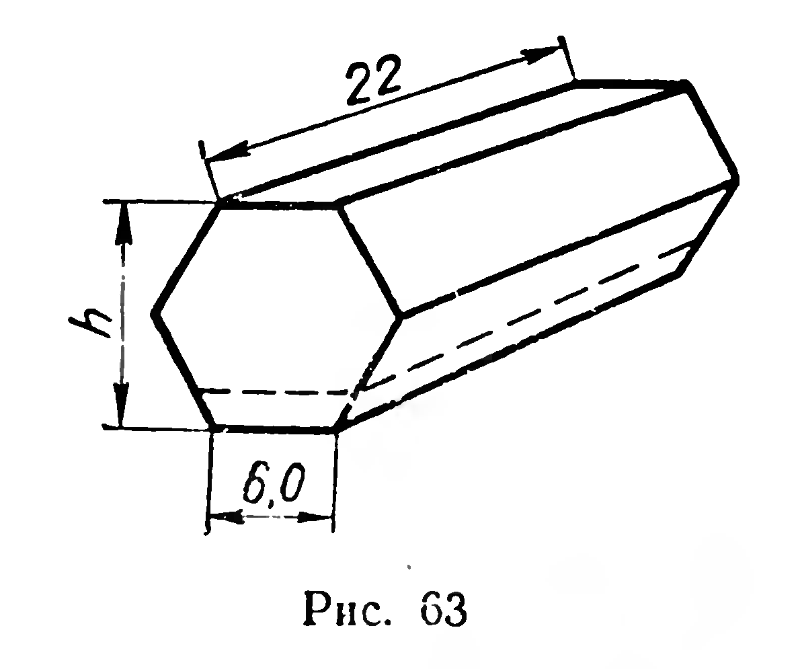
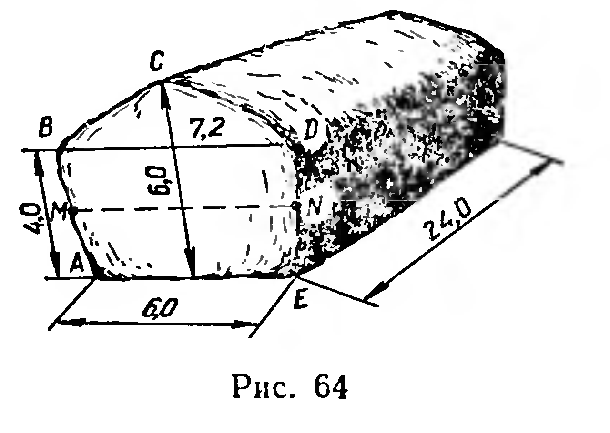

## 5.10. Объем прямой призмы

---
**стр. 136, продолжение**
---

**§ 56. ОБЪЁМ ПРЯМОЙ ПРИЗМЫ**

**33. Теорема.** *Объём прямой призмы равен произведению площади основания на высоту призмы.*

**Доказательство.** Рассмотрим два случая.

1) Основание призмы — треугольник $ABC$ (рис. 59). Предположим, что $[AB]$ — его бо́льшая сторона. Проведём высоту $CD$ треугольника $ABC$. Рассмотрим прямоугольник $ABMN$, у которого $|BM| = |CD|$ (рис. 60), и прямоугольный параллелепипед $ABMNA_1B_1M_1N_1$. Грани $ACC_1A_1$ и $BCC_1B_1$ данной треугольной призмы, а также плоскость, проходящая через ребро $CC_1$ и высоту $CD$ основания, разбивают этот прямоугольный параллеле-

---
¹ Речь идёт о боковой грани, имеющей наименьшую площадь.

---
**стр. 137**
---

лепипед на четыре прямые треугольные призмы, среди которых имеются две пары конгруэнтных призм. Действительно, призмы $ACDA_1C_1D_1$ и $ACNA_1C_1N_1$ конгруэнтны, так как они центрально-симметричны относительно точки $O$ пересечения диагоналей прямоугольника $ACC_1A_1$ (см. рис. 60). Аналогично убеждаемся в том, что призмы $BCDB_1C_1D_1$ и $BCMB_1C_1M_1$ конгруэнтны. Согласно свойствам 2 и 3 объёмов многогранников (§ 55) объём данной треугольной призмы составляет половину объёма прямоугольного параллелепипеда, т. е.

$$V = \frac{1}{2}S_{ABMN} \cdot H = S_{\triangle ABC} \cdot H.$$

2) Рассмотрим прямую $n$-угольную призму при $n > 3$ (рис. 61). Через какое-либо её боковое ребро проведём диагональные сечения, получим $n - 2$ прямые треугольные призмы. Площади их оснований обозначим $Q_1$, $Q_2$, $\ldots$, $Q_{n-2}$. Объём данной $n$-угольной призмы равен сумме объёмов полученных треугольных призм (§ 55, свойство 3). Итак,

$$V = Q_1 \cdot H + Q_2 \cdot H + \ldots + Q_{n-2} \cdot H =$$
$$= (Q_1 + Q_2 + \ldots + Q_{n-2}) \cdot H = Q \cdot H,$$

где $Q$ — площадь основания данной призмы и $H$ — её высота. ■

**Задачи**

123. Площади боковых поверхностей двух прямых параллелепипедов равны. Равны ли объёмы этих параллелепипедов, если их основания: 1) конгруэнтны; 2) имеют равные площади?

124. Длина железнодорожной шпалы равна 275 см, её поперечное сечение показано на рисунке 62

---
**стр. 138**
---

(размеры в сантиметрах). На платформу погружено 600 шпал. Вычислите массу груза. (Плотность дерева принять за 0,8 г/см³.)

125. Из деревянной прямой треугольной призмы с равными рёбрами вырезана правильная четырёхугольная призма наибольшего объёма. Найдите процент отходов, если боковые рёбра призм параллельны.

126. Вращающийся барабан для никелирования мелких деталей имеет форму правильной шестиугольной призмы (рис. 63, размеры в сантиметрах). При работе барабан заполняется на $\frac{1}{6}h$. Найдите объём загруженной части барабана.

127. Скирда сена имеет форму прямой призмы с пятиугольным основанием, размеры скирды (в метрах) указаны на рисунке 64. Вычислите массу сена в скирде, приняв массу 1 м³ сена за 70 кг.

128. Основание прямой призмы — прямоугольный треугольник с площадью $S$ и острым углом $\alpha$. Площадь большей боковой грани равна $Q$. Найдите объём.

129. Диагональ основания прямого параллелепипеда имеет длину $d$ и составляет со сторонами основания углы $\alpha$ и $\beta$. Найдите объём параллелепипеда, если площадь его боковой поверхности равна $S$.
