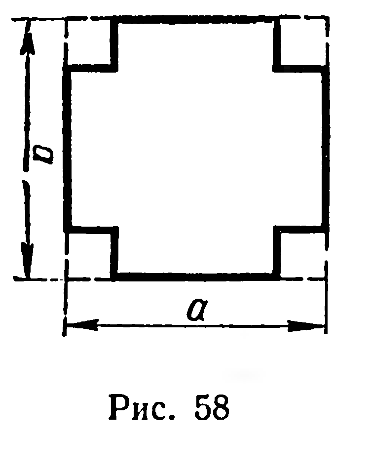
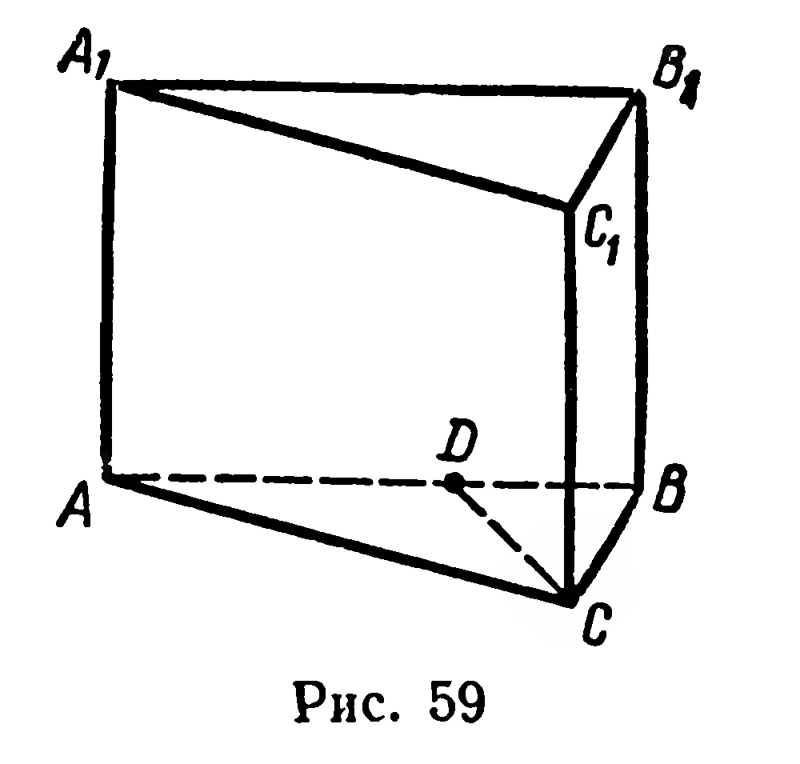
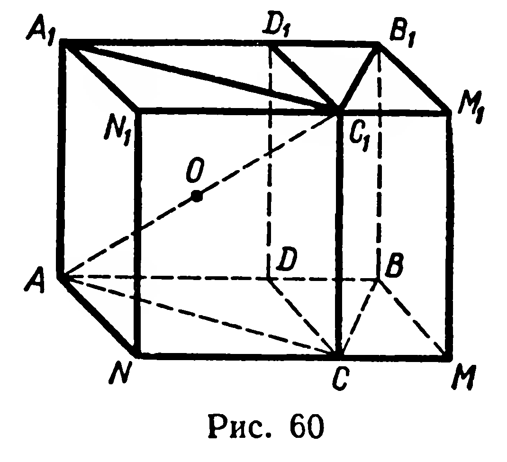
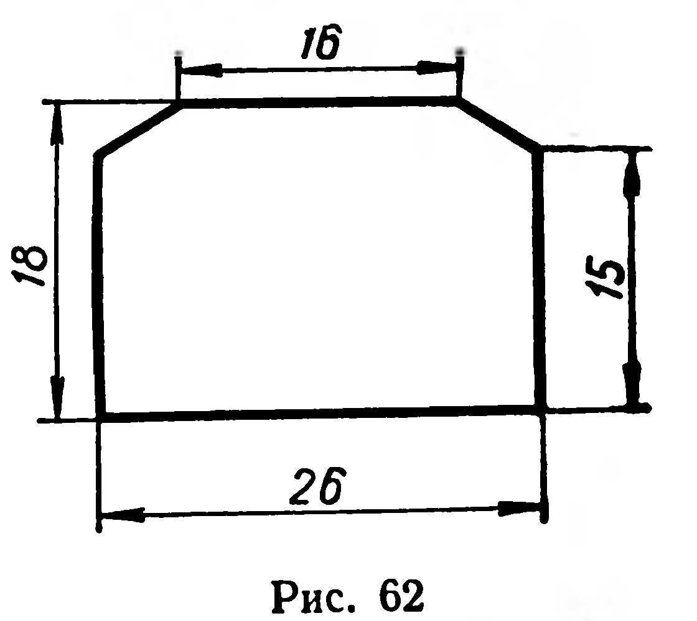

## 5.10. Объем прямой призмы

---
**стр. 136**
---

**113.** Единичный куб пересечён плоскостью, проходящей через его центр симметрии. Чему равен объём каждой части куба?

**114.** Правильная четырёхугольная пирамида объёма $V$ пересечена плоскостью, проходящей через высоту пирамиды. Найдите объёмы полученных частей пирамиды.

**115.** Найдите объём пирамиды, основание которой — грань куба, имеющего объём $V$, а вершина — точка пересечения диагоналей этого куба.

**116.** Диагональ куба равна $d$. Найдите объём куба.

**117.** Площади граней прямоугольного параллелепипеда равны $Q_1$, $Q_2$, $Q_3$. Докажите, что его объём равен $\sqrt{Q_1 Q_2 Q_3}$.

**118.** Стороны основания прямоугольного параллелепипеда $a$ и $b$. Его диагональ составляет с плоскостью основания угол $\alpha$. Найдите объём параллелепипеда.

**119.** Диагональ основания прямоугольного параллелепипеда равна $l$, величина угла между диагоналями основания равна $\alpha$, диагональ меньшей боковой грани¹ составляет с плоскостью основания угол $\beta$. Найдите объём и площадь боковой поверхности.

**120.** Сторона основания прямоугольного параллелепипеда равна $a$ и образует с диагональю основания угол $\alpha$. Через данную сторону и противолежащую ей сторону другого основания проведено сечение, плоскость которого составляет с плоскостью основания угол $\varphi$. Найдите объём параллелепипеда.

**121.** На изготовление закрытого ящика с квадратным основанием расходуется $S~\text{м}^2$ фанеры. Найдите линейные размеры ящика, при которых его объём имеет наибольшее значение.

**122.** У квадратного листа жести со стороной $a$ вырезаны по углам квадраты (рис. 58) и загнуты края. Найдите длину стороны вырезанного квадрата, если известно, что получилась коробка наибольшей возможной вместимости.

**§ 56. ОБЪЁМ ПРЯМОЙ ПРИЗМЫ**

**33. Теорема.** *Объём прямой призмы равен произведению площади основания на высоту призмы.*

**Доказательство.** Рассмотрим два случая.

1) Основание призмы — треугольник $ABC$ (рис. 59). Предположим, что $[AB]$ — его бо́льшая сторона. Проведём высоту $CD$ треугольника $ABC$. Рассмотрим прямоугольник $ABMN$, у которого $|BM| = |CD|$ (рис. 60), и прямоугольный параллелепипед $ABMNA_1B_1M_1N_1$. Грани $ACC_1A_1$ и $BCC_1B_1$ данной треугольной призмы, а также плоскость, проходящая через ребро $CC_1$ и высоту $CD$ основания, разбивают этот прямоугольный параллеле-

---
¹ Речь идёт о боковой грани, имеющей наименьшую площадь.

---
**стр. 137**
---

лепипед на четыре прямые треугольные призмы, среди которых имеются две пары конгруэнтных призм. Действительно, призмы $ACDA_1C_1D_1$ и $ACNA_1C_1N_1$ конгруэнтны, так как они центрально-симметричны относительно точки $O$ пересечения диагоналей прямоугольника $ACC_1A_1$ (см. рис. 60). Аналогично убеждаемся в том, что призмы $BCDB_1C_1D_1$ и $BCMB_1C_1M_1$ конгруэнтны. Согласно свойствам 2 и 3 объёмов многогранников (§ 55) объём данной треугольной призмы составляет половину объёма прямоугольного параллелепипеда, т. е.

$$V = \frac{1}{2}S_{ABMN} \cdot H = S_{\triangle ABC} \cdot H.$$

2) Рассмотрим прямую $n$-угольную призму при $n > 3$ (рис. 61). Через какое-либо её боковое ребро проведём диагональные сечения, получим $n - 2$ прямые треугольные призмы. Площади их оснований обозначим $Q_1$, $Q_2$, $\ldots$, $Q_{n-2}$. Объём данной $n$-угольной призмы равен сумме объёмов полученных треугольных призм (§ 55, свойство 3). Итак,

$$V = Q_1 \cdot H + Q_2 \cdot H + \ldots + Q_{n-2} \cdot H =$$
$$= (Q_1 + Q_2 + \ldots + Q_{n-2}) \cdot H = Q \cdot H,$$

где $Q$ — площадь основания данной призмы и $H$ — её высота. ■

**Задачи**

123. Площади боковых поверхностей двух прямых параллелепипедов равны. Равны ли объёмы этих параллелепипедов, если их основания: 1) конгруэнтны; 2) имеют равные площади?

124. Длина железнодорожной шпалы равна 275 см, её поперечное сечение показано на рисунке 62

