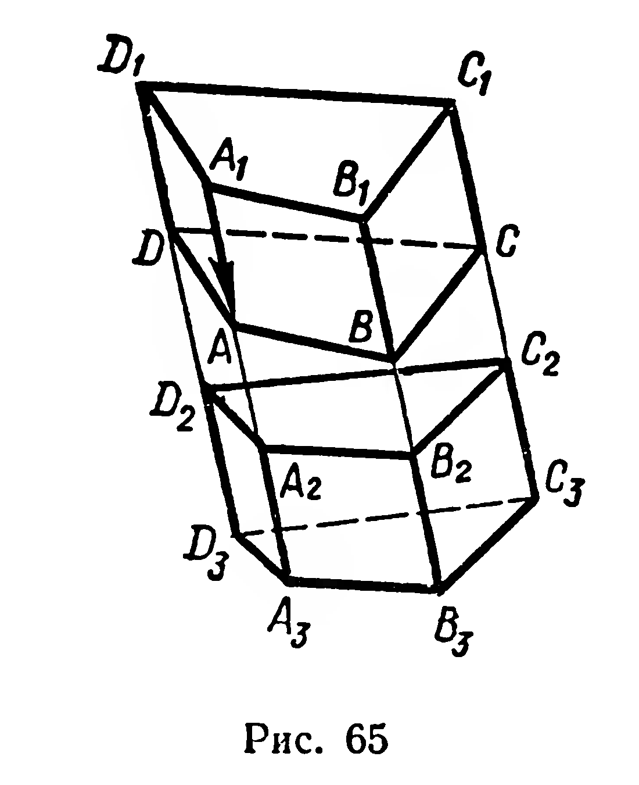
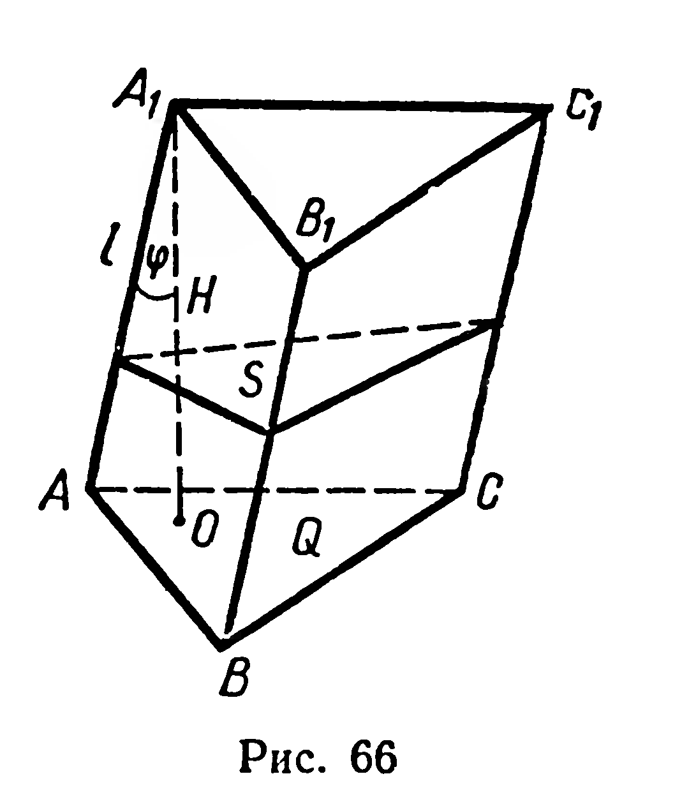

## 5.11. Объем наклонной призмы

---
**стр. 138, продолжение**
---

**§ 57. ОБЪЁМ НАКЛОННОЙ ПРИЗМЫ**

**34. Теорема.** *Объём наклонной призмы равен произведению площади перпендикулярного сечения на боковое ребро.*

Доказательство. Пусть дана наклонная призма¹ $AC_1$ (рис. 65). На продолжении ребра $A_1A$ возьмём точку $A_2$, рассмотрим перпендикулярное сечение $A_2B_2C_2D_2$ призмы. Примем это сечение за основание прямой призмы $A_2C_3$, боковые рёбра которой равны по длине боковым рёбрам наклонной призмы $AC_1$. Докажем равенство объёмов призм $A_2C_3$ и $AC_1$. Многогранники (не обязательно призмы!) $A_2C_1$ и $A_3C$ конгруэнтны, так как второй из них является образом первого при переносе $\overrightarrow{A_1A}$. По второму свойству объёмов (§ 55) $V_{A_2C_1} = V_{A_3C}$; по третьему свой—

¹ При доказательстве этой теоремы многогранник обозначаем, указав его диагональ.

---
**стр. 139**
---

ству $V_{A_3C_1} = V_{AC_1} + V_{A_3C}$ и $V_{A_3C} = V_{A_3C_2} + V_{A_2C}$. Тогда $V_{AC_1} + V_{A_3C} =$
$= V_{A_3C_2} + V_{A_2C}$, отсюда $V_{AC_1} = V_{A_3C_2}$. Применим формулу объема
прямой призмы: $V_{A_3C_2} = S_{A_2B_2C_2D_2} \cdot |A_2A_3|$. Тогда и $V_{AC_1} = S_{A_2B_2C_2D_2} \times$
$\times |A_2A_3| = S_{A_2B_2C_2D_2} \cdot |A_1A|$.

**Следствие.** *Объем наклонной призмы равен произведению площади основания на высоту.*

**Доказательство.** Для данной призмы $ABCA_1B_1C_1$ (рис. 66) введем обозначения: $|A_1A|=l$, $|A_1O| = H$ — высота, $Q$—площадь основания, $S$ — площадь перпендикулярного сечения. Согласно доказанной теореме $V = S \cdot l$. Перпендикулярное сечение данной призмы есть ортогональная проекция ее основания, поэтому (§ 50) $S = Q \cos \varphi$, где $\varphi$ — угол между плоскостями основания и сечения (рис. 66). Угол между прямыми $A_1O$ и $AA_1$, перпендикулярными к этим плоскостям, также равен $\varphi$ (докажите!). Поэтому $l = \frac{H}{\cos \varphi}$, тогда

$$V = S \cdot l = Q \cos \varphi \cdot \frac{H}{\cos \varphi} = QH.$$

**Задачи**

**130.** Основание призмы — трапеция, параллельные стороны которой 44 см и 28 см, а непараллельные — по 17 см. Одно из диагональных сечений призмы перпендикулярно основанию и является ромбом с углом в 45°. Найдите объем призмы.

**131.** 1) Постройте сечение треугольной призмы плоскостью, проходящей через боковое ребро и разбивающей призму на две части, имеющие равные объемы.

2) Постройте сечение наклонного параллелепипеда плоскостью, которая проходит через данную точку стороны основания и делит параллелепипед на две призмы равных объемов.

**132.** Все девять ребер наклонной треугольной призмы имеют длину $a$, объем призмы равен $V$. Найдите угол между боковым ребром и плоскостью основания.

---
**стр. 140**
---

**133.** Все грани призмы — ромбы со стороной $a$ и острым углом $\alpha$. Найдите площадь полной поверхности и объем призмы при $\alpha \leqslant 60°$.

**134.** Основание призмы — равнобедренный прямоугольный треугольник. Боковая грань, проходящая через один из катетов этого треугольника, является квадратом со стороной $a$ и образует с плоскостью основания угол $\alpha$. Найдите объем призмы.

**135.** Постройте сечение треугольной призмы плоскостью, проходящей через точку пересечения медиан основания и параллельной одной из боковых граней. Найдите отношение объемов многогранников, полученных при пересечении призмы этой плоскостью.
