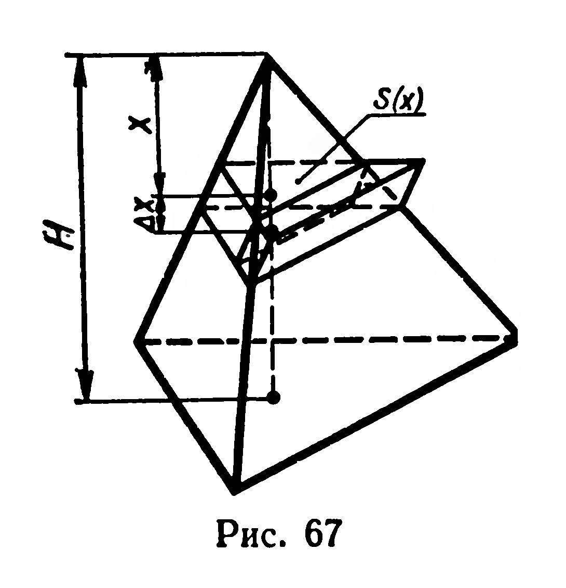

## 5.12. Объем пирамиды

---
**стр. 140, продолжение**
---

## § 58. ОБЪЕМ ПИРАМИДЫ

**35. Теорема.** *Объем пирамиды равен одной трети произведения площади основания на высоту.*

**Доказательство.** Пусть дана пирамида, высота которой $H$, а площадь основания $Q$. Найдем ее объем $V$. Пересечем пирамиду плоскостью, параллельной основанию (рис. 67). Расстояние от вершины пирамиды до секущей плоскости обозначим через $x$. Площадь $S(x)$ сечения и объем $V(x)$ отсеченной пирамиды являются функциями аргумента $x$. Если принять, что $S(0) = 0$ и $V(0) = 0$, то функции $S(x)$ и $V(x)$ определены на отрезке $[0; H]$. Дадим $x$ приращение $\Delta x > 0$ ($x + \Delta x \leqslant H$), тогда объем $V(x)$ также получит приращение $\Delta V$. Здесь $\Delta V$ — объем усеченной пирамиды, основания которой лежат в секущих плоскостях. На каждом из двух сечений построим призму с высотой $\Delta x$ (рис. 67). Согласно свойствам объемов (§ 55) имеем:
$$S(x)\Delta x < \Delta V < S(x + \Delta x)\Delta x;$$
отсюда
$$S(x) < \frac{\Delta V}{\Delta x} < S(x + \Delta x). \qquad (1)$$

Найдем функцию $S(x)$. Рассматриваемое сечение и основание пирамиды — гомотетичные многоугольники (§ 53, теорема 31), причем коэффициент гомотетии равен $\frac{H}{x}$. Из свойств гомотетии

$$\text{следует, что } \frac{Q}{S(x)} = \frac{H^2}{x^2}, \text{ откуда}$$

$$S(x) = \frac{Q}{H^2}x^2.$$

Замечаем, что функция $S(x)$ непрерывна на отрезке $[0; H]$, поэтому $\lim\limits_{\Delta x \to 0} S(x + \Delta x) = S(x)$. Из двойного неравенства (1) вытекает, что $\lim\limits_{\Delta x \to 0} \frac{\Delta V}{\Delta x} = S(x)$. Следовательно, $V'(x)=S(x)$, т. е. функция $V(x)$ есть первообразная для функции $S(x)$ на $[0; H]$. Объем данной

---
**стр. 141**
---

пирамиды равен значению функции $V(x)$ при $x=H$: $V=V(H)$. Так как $V(0)=0$, то можно записать: $V=V(H)-V(0)$. По определению интеграла
$$V=\int\limits_0^H S(x)\,dx.$$
Выполнив интегрирование, получим:
$$V=\int\limits_0^H \frac{Q}{H^2}x^2\,dx=\frac{Q}{H^2}\cdot\left.\frac{x^3}{3}\right|_0^H=\frac13 Q\cdot H.\quad\blacksquare$$
Итак, объем пирамиды вычисляется по формуле:
$$V=\frac13 QH.$$

**Задачи**

**136.** Одно из самых грандиозных сооружений древности — пирамида Хеопса — имеет форму правильной четырехугольной пирамиды с высотой $\approx150$ м и боковым ребром $\approx220$ м. Найдите объем и площадь боковой поверхности этой пирамиды.

**137.** В правильной шестиугольной пирамиде большее диагональное сечение — равнобедренный прямоугольный треугольник с гипотенузой $c$. Найдите объем пирамиды.

**138.** 1) Площадь поверхности правильного тетраэдра равна $S$. Найдите его объем.

2) Один из алмазов, добытых в Якутии, весит 42 карата и имеет форму правильного октаэдра. Найдите ребро этого октаэдра. (Плотность алмаза $3{,}5$ г/см³, 1 карат $=0{,}2$ г.)

**139.** Основанием пирамиды служит прямоугольный треугольник, один из острых углов которого $\alpha$; каждое боковое ребро пирамиды равно $b$ и составляет с плоскостью основания угол $\beta$. Найдите объем пирамиды.

**140.** Одно из диагональных сечений правильной шестиугольной пирамиды делит ее на две неконгруэнтные части. Найдите отношение объемов этих частей.

**141.** Основанием пирамиды служит правильный треугольник со стороной $a$, одна из боковых граней перпендикулярна плоскости основания, две другие боковые грани составляют с основанием углы $\alpha$. Найдите объем пирамиды и площадь большей боковой грани.

**142.** 1°) Плоские углы при вершине треугольной пирамиды прямые, боковые ребра пирамиды равны $5$ см, $6$ см и $7$ см. Найдите объем.

2) Боковые ребра треугольной пирамиды попарно перпендикулярны, площади боковых граней равны $S_1$, $S_2$, $S_3$. Докажите, что объем пирамиды равен $\dfrac13\sqrt{2S_1S_2S_3}$.

---
**стр. 142**
---

**143.** Основание пирамиды — равнобедренная трапеция, параллельные стороны которой $a$ и $b$ $(a>b)$. Все двугранные углы при сторонах основания равны $\varphi$. Найдите объем.

**144.** Стороны оснований правильной треугольной усеченной пирамиды $a$ и $b$ $(a>b)$, двугранный угол при стороне большего основания $\alpha$. Найдите объем.

**145.** Бункер, изображенный на рисунке 48, наполнен зерном. Вычислите массу зерна, если масса одного кубического метра зерна равна $800$ кг.

**146.** Найдите объем правильной шестиугольной усеченной пирамиды, стороны оснований которой относятся как $1:2$, а боковое ребро длиной $b$ составляет с плоскостью основания угол $60^\circ$.

**147.** Для перекрытия русла реки при строительстве гидроэлектростанции изготовляют из бетона правильные треугольные усеченные пирамиды массой по $10$ т. Высота и стороны оснований такой пирамиды пропорциональны числам $5$, $2$, $6$. Рассчитайте линейные размеры этой пирамиды. (Плотность бетона $2{,}2$ г/см³.)
