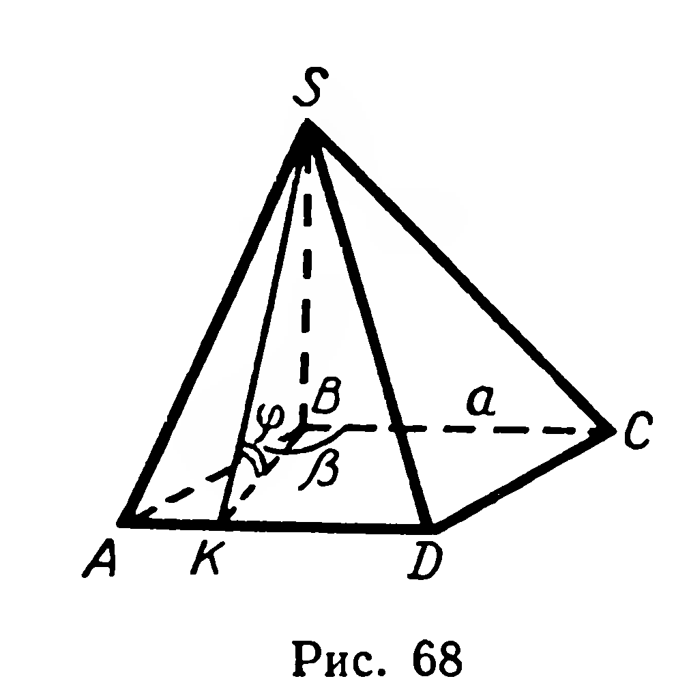
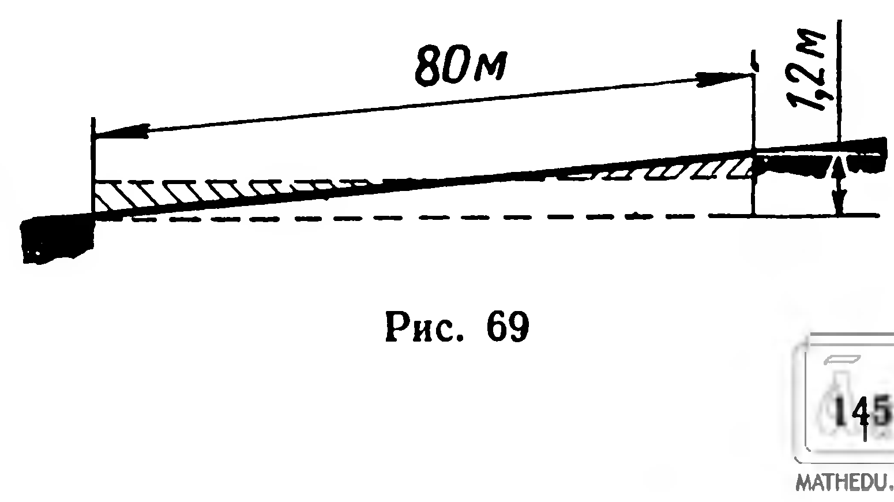

## 5.13. Задачи на повторение к главе V

---
**стр. 142**
---

**143.** Основание пирамиды — равнобедренная трапеция, параллельные стороны которой $a$ и $b$ $(a>b)$. Все двугранные углы при сторонах основания равны $\varphi$. Найдите объем.

**144.** Стороны оснований правильной треугольной усеченной пирамиды $a$ и $b$ $(a>b)$, двугранный угол при стороне большего основания $\alpha$. Найдите объем.

**145.** Бункер, изображенный на рисунке 48, наполнен зерном. Вычислите массу зерна, если масса одного кубического метра зерна равна $800$ кг.

**146.** Найдите объем правильной шестиугольной усеченной пирамиды, стороны оснований которой относятся как $1:2$, а боковое ребро длиной $b$ составляет с плоскостью основания угол $60^\circ$.

**147.** Для перекрытия русла реки при строительстве гидроэлектростанции изготовляют из бетона правильные треугольные усеченные пирамиды массой по $10$ т. Высота и стороны оснований такой пирамиды пропорциональны числам $5$, $2$, $6$. Рассчитайте линейные размеры этой пирамиды. (Плотность бетона $2{,}2$ г/см³.)

**Задачи на повторение к главе V**

**148.** Призма $ABCA_1B_1C_1$ задана координатами четырех своих вершин: $A(1;1;-1)$, $B(0;0;3)$, $C(1;4;1)$, $B_1(1;-1;1)$. Вычислите: 1) $|A_1C|$; 2) $\cos\widehat{AC_1C}$.

**149.** 1) Две боковые грани треугольной призмы взаимно перпендикулярны. Докажите, что сумма квадратов площадей этих граней равна квадрату площади третьей боковой грани призмы.

2) Верно ли обратное предложение?

**150.** Основание призмы — равносторонний треугольник, одна из вершин верхнего основания проектируется в центр нижнего основания. Докажите, что одна из граней призмы — прямоугольник.

**151.** Все ребра прямой треугольной призмы $ABCA_1B_1C_1$ имеют равные длины. Найдите величины углов: 1) между $(BC_1)$ и $(AC)$; 2) между $(BC_1)$ и $(A_1C)$.

**152.** 1) Сколько осей и плоскостей симметрии имеет правильная $n$-угольная призма, если $n$ равно: а) $3$; б) $4$?

2) Имеет ли каждая из этих призм центр симметрии?

**153.** Сторона основания правильной четырехугольной призмы равна $a$, высота призмы равна $H$. Найдите площадь сечения, проведенного через середины двух смежных сторон основания и центр симметрии призмы.

**154.** Угол между диагональю боковой грани правильной треугольной призмы и другой боковой гранью $30^\circ$, боковое ребро призмы $H$. Найдите площадь полной поверхности.

**155.** 1) Расстояния между соседними боковыми ребрами наклонной четырехугольной призмы равны, боковое ребро $4$ дм,

---
**стр. 143**
---

площадь перпендикулярного сечения 18 дм², а площадь боковой поверхности 96 дм². Вычислите величины двугранных углов при боковых ребрах.

2) Расстояния между боковыми рёбрами треугольной призмы пропорциональны числам 26, 25, 3; площадь перпендикулярного сечения 144 м², площадь боковой поверхности 540 м². Найдите боковое ребро.

156*. Из вершины параллелепипеда проведены три диагонали его граней. На этих отрезках как на рёбрах построен параллелепипед. Докажите, что противолежащая вершина данного параллелепипеда служит центром симметрии построенного параллелепипеда.

157. Сколько осей и плоскостей симметрии имеет: 1) прямой параллелепипед, не являющийся прямоугольным; 2) прямоугольный параллелепипед, не являющийся кубом; 3) куб?

158. Основанием прямого параллелепипеда служит ромб, площади диагональных сечений параллелепипеда равны $Q_1$ и $Q_2$. Найдите площадь боковой поверхности.

159. Площади диагональных сечений прямого параллелепипеда равны 112 см² и 144 см²; стороны основания 8 см и 14 см. Найдите площадь полной поверхности.

160. 1) Через основание высоты правильной треугольной пирамиды проведите сечение, параллельное двум скрещивающимся рёбрам. Докажите, что это сечение — прямоугольник.  
2) Найдите площадь сечения, если сторона основания равна $a$, а боковое ребро $b$.

161. Сторона основания правильной четырёхугольной пирамиды 8 см, двугранный угол при боковом ребре равен $120^{\circ}$. Вычислите площадь боковой поверхности пирамиды.

162. Основание пирамиды — треугольник со сторонами 5 см, 5 см и 6 см, высота пирамиды проходит через центр круга, вписанного в этот треугольник, и равна 2 см. Найдите площадь боковой поверхности.

163. Основание пирамиды — квадрат со стороной $a$, высота пирамиды длиной $H$ проходит через вершину основания. Найдите площадь полной поверхности.

164. Докажите, что центры граней правильного тетраэдра служат вершинами другого правильного тетраэдра. Найдите отношение длин рёбер этих тетраэдров.

165. Практическая работа. Изготовьте с помощью развёрток модели: 1) наклонной треугольной призмы; 2) наклонного параллелепипеда; 3) правильной шестиугольной пирамиды; 4) правильной четырёхугольной усечённой пирамиды. На моделях этих многогранников выполните необходимые измерения и вычислите площади их поверхностей.

166. Основание пирамиды — ромб со стороной $a$. Одно из боковых рёбер перпендикулярно плоскости основания; боковые грани, содержащие это ребро, образуют тупой двугранный угол

---
**стр. 144**
---

величиной $\beta$. Одна из остальных боковых граней наклонена к плоскости основания под углом $\varphi$. Найти площадь боковой поверхности пирамиды. Вычислить при $a = 11{,}08$ м, $\varphi = 69^{\circ}16'$, $\beta = 106^{\circ}50'$.

Решение. Пусть $SABCD$ — данная пирамида (рис. 68). Её основание $ABCD$ — ромб с тупым углом $ABC$, ребро $SB$ перпендикулярно плоскости $ABC$. Поэтому $\angle ABC$ — линейный угол двугранного угла с ребром $SB$.

Рассмотрим двугранный угол $AD$. Из точки $B$ проведём перпендикуляр $[BK]$ к прямой $AD$, точку $K$ соединим с $S$. Согласно теореме о трёх перпендикулярах $(SK) \perp (AD)$. Значит, угол $SKB$ — линейный угол двугранного угла с ребром $AD$.

Прямоугольные треугольники $SBA$ и $SBC$ конгруэнтны (по двум катетам), поэтому $|AS| = |SC|$ и $\triangle SAD \cong \triangle SDC$ (по трём сторонам). Имеем: $|AB| = |AD| = a$, $\widehat{ABC} = \beta$, $\widehat{SKB} = \varphi$; требуется найти $S_{\text{бок}}$.

$$\begin{aligned} S_{\text{бок}} &= 2S_{\triangle SAB} + 2S_{\triangle SAD} = |AB| \cdot |SB| + |AD| \cdot |SK|, \\ S_{\text{бок}} &= a(|SB| + |SK|). \end{aligned} \tag{1}$$

Так как $\widehat{ABK} = \beta - 90^{\circ}$, $|BK| = a\cos(\beta - 90^{\circ}) = a\sin\beta$. Рассматривая прямоугольный треугольник $SKB$, получим:
$$|SB| = |BK|\operatorname{tg}\varphi = a\sin\beta \, \operatorname{tg}\varphi, \tag{2}$$
$$|SK| = \frac{|BK|}{\cos\varphi} = \frac{a\sin\beta}{\cos\varphi}. \tag{3}$$

Подставим выражения $(2)$ и $(3)$ в равенство $(1)$:
$$S_{\text{бок}} = a\left(a\sin\beta \, \operatorname{tg}\varphi + \frac{a\sin\beta}{\cos\varphi}\right) = \frac{a^2\sin\beta(1 + \sin\varphi)}{\cos\varphi} =$$
$$= a^2\sin\beta \cdot \frac{1 + \cos(90^{\circ} - \varphi)}{\sin(90^{\circ} - \varphi)} = a^2\sin\beta \cdot \frac{2\cos^2\left(45^{\circ} - \dfrac{\varphi}{2}\right)}{2\sin\left(45^{\circ} - \dfrac{\varphi}{2}\right)\cos\left(45^{\circ} - \dfrac{\varphi}{2}\right)} =$$
$$= a^2\sin\beta \, \operatorname{ctg}\left(45^{\circ} - \frac{\varphi}{2}\right).$$

$$S_{\text{бок}} = 11{,}08^2 \sin 73^{\circ}10' \, \operatorname{ctg} 10^{\circ}22'.$$

Выполнив вычисления, получим:
$$S_{\text{бок}} \approx 642\ \text{м}^2.$$

167. Основание прямой призмы $AC_1$ — ромб со стороной $a$. Найдите площадь боковой поверхности призмы, если известно, что $\widehat{BA_1D} = \beta$, $\widehat{BAD} = \varphi$ ($\varphi > 90^{\circ}$).

---
**стр. 145**
---

**168.** В основании прямоугольного параллелепипеда угол между диагональю, имеющей длину $d$, и одной из сторон равен $\varphi$. Угол между этой стороной и диагональю параллелепипеда равен $\beta$. Найдите площадь боковой поверхности.

**169.** Основание пирамиды — равнобедренный прямоугольный треугольник с гипотенузой $c$; все боковые ребра наклонены к плоскости основания под углом $\varphi$. Найдите площадь полной поверхности.

**170.** Расстояние от центра основания правильной треугольной пирамиды до ее боковой грани равно $d$, двугранный угол при основании равен $\varphi$. Найдите площадь боковой поверхности. Вычислите при $d = 7{,}8$ м и $\varphi = 46^\circ 27'$.

**171.** Боковое ребро длиной $b$ правильной треугольной усеченной пирамиды образует со стороной большего основания угол $\beta$, площади оснований относятся как $4:1$. Найдите площадь полной поверхности.

**172.** Высота прямого параллелепипеда $H$, стороны основания $a$ и $b$. Каким должен быть двугранный угол $\varphi$ при боковом ребре, чтобы объем параллелепипеда был наибольшим?

**173.** На двух скрещивающихся ребрах параллелепипеда даны точки $P$ и $Q$. Разделите параллелепипед плоскостью, проходящей через $P$ и $Q$, на две части с равными объемами.

**174.** Прямоугольная площадка длиной $80$ м и шириной $25$ м наклонена так, что одна из меньших сторон находится выше противоположной стороны на $1{,}2$ м. Сколько кубических метров грунта нужно насыпать, чтобы сделать площадку горизонтальной? Сколько кубических метров грунта нужно срезать на площадке, чтобы, пересыпав этот грунт, выровнять площадку (рис. 69)?

**175.** Железнодорожная насыпь высотой $2{,}8$ м имеет ширину в верхней части $10{,}1$ м, углы откоса $34^\circ$. Найдите объем насыпи на прямолинейном участке длиной $1$ км.

**176.** Основание прямой призмы — прямоугольный треугольник с гипотенузой $c$ и бо́льшим острым углом $\alpha$. Диагонали двух бо́льших боковых граней, проведенные из одной вершины нижнего основания, образуют угол $\beta$. Найдите объем призмы.

**177.** Двугранный угол при боковом ребре наклонного параллелепипеда равен $\alpha$, расстояния от этого ребра до двух соседних ребер равны $a$ и $b$, боковое ребро $c$. Найдите объем.

**178.** Основание призмы — равнобедренный прямоугольный треугольник с катетом $a$; боковое ребро, противолежащее гипотенузе, образует с катетами острые углы $\alpha$ и $\beta$. Найдите объем призмы, если длина бокового ребра $b$.

**179.** Докажите, что любая плоскость, проходящая через середины двух противолежащих ребер правильного тетраэдра, делит его на части, имеющие равные объемы.

---
**стр. 146**
---

**180.** Правильная $n$-угольная пирамида пересечена плоскостью, проходящей через ее высоту. Равны ли объемы полученных пирамид?

**181.** Все ребра треугольной пирамиды, кроме ребра $AB$, имеют длину $a$; величина плоского угла, лежащего против ребра $AB$, равна $\alpha$. Найдите объем.

**182.** Сечение, параллельное основанию пирамиды, делит ее на две части, имеющие равные объемы. Найдите отношение площадей частей, на которые разделена боковая поверхность.

**183.** Через середины каждых трех ребер куба, выходящих из одной вершины, проведены сечения. Найдите объем и площадь поверхности полученного многогранника, если ребро куба равно $a$.

**184.** Боковое ребро правильной четырехугольной пирамиды $SABCD$ составляет с плоскостью основания угол $\alpha$. Через вершину $B$ проведена плоскость, перпендикулярная ребру $SD$. Какую часть объема данной пирамиды составляет объем четырехугольной пирамиды, отделяемой сечением?

**185.** Высота правильной четырехугольной пирамиды равна $h$ и составляет с боковой гранью угол $\alpha$. Через сторону основания пирамиды проведена плоскость, перпендикулярная противолежащей грани. Найдите объем пирамиды, отсекаемой этой плоскостью от данной пирамиды.

**186.** Найдите объем правильной треугольной пирамиды, сторона основания которой имеет длину $a$ и образует с боковой гранью угол $\alpha$.

**187.** Основание пирамиды — прямоугольная трапеция, у которой бо́льшая из непараллельных сторон $12$ см, а меньший угол $30^\circ$. Все боковые грани пирамиды одинаково наклонены к плоскости основания, площадь боковой поверхности $90$ см$^2$. Найдите объем.

**188.** Основание пирамиды $SABC$ — треугольник; $\widehat{C} = 90^\circ$, $\widehat{A} = \alpha$, $|AB| = c$. Боковые ребра одинаково наклонены к плоскости основания, угол между гранью $SBC$ и плоскостью основания $\beta$. Найдите объем. Вычислите при $c = 18$ см, $\alpha = 60^\circ$, $\beta = 45^\circ$.

**189*.** Основанием пирамиды служит равнобедренная трапеция, параллельные стороны которой $a$ и $b$ ($a > b$), а угол между конгруэнтными отрезками диагоналей $\alpha$. Высота пирамиды проходит через точку пересечения диагоналей основания, двугранные углы, прилежащие к параллельным сторонам основания, относятся как $1:2$. Найдите объем пирамиды.
