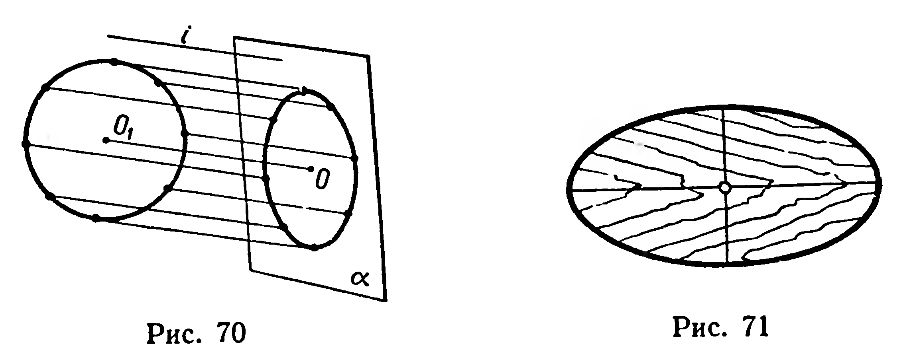
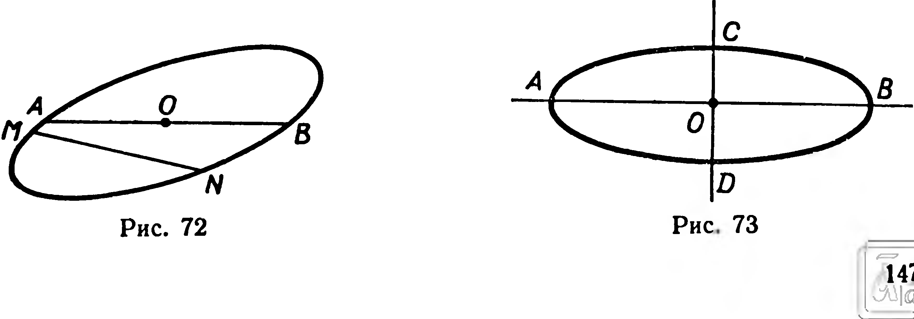
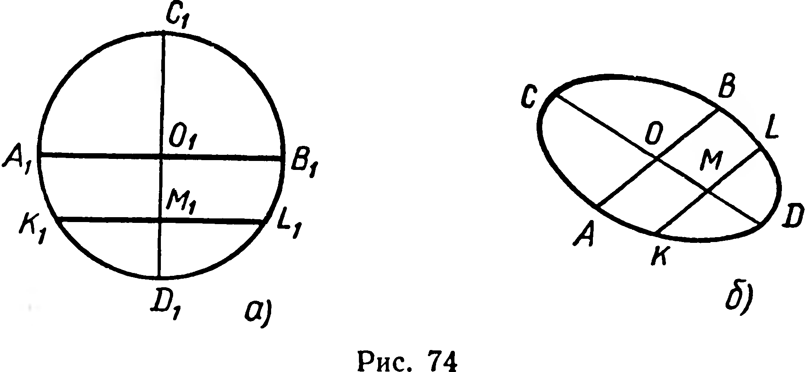
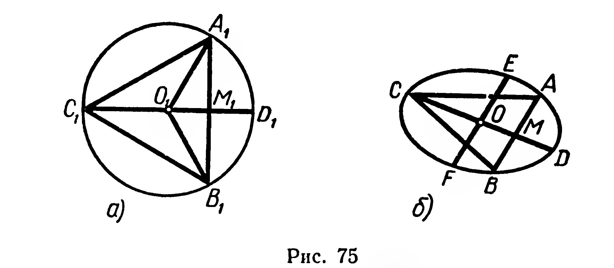
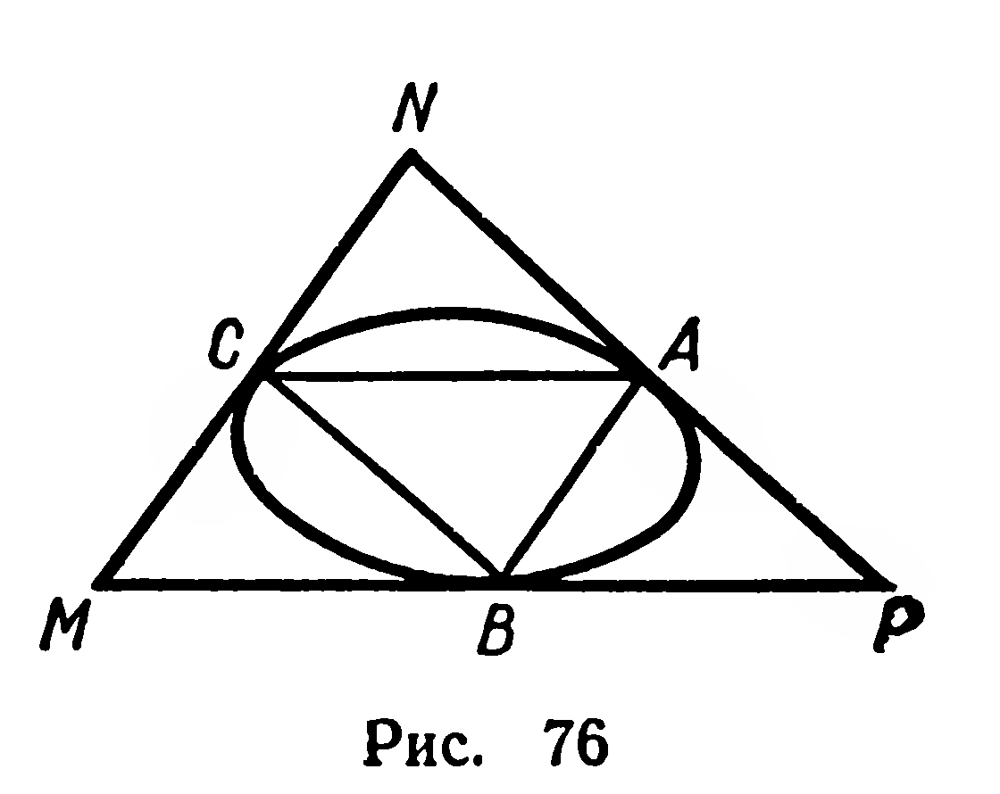

## 6.1. Изображение окружности. Эллипс

---
**стр. 147**
---

# Глава VI. Фигуры вращения

## § 59. Изображение окружности. Эллипс

Для того чтобы изображать фигуры, которые изучаются в этой главе (например, цилиндр, конус), нужно научиться изображать окружность.

Параллельная проекция окружности (отличная от отрезка!) называется **эллипсом** (рис. 70). Вычерчивание эллипса удобно выполнять с помощью шаблона (рис. 71). Заметим, что окружность также является эллипсом: если плоскость проекций параллельна плоскости окружности, то проекция окружности на эту плоскость есть окружность, конгруэнтная данной.

Свойства эллипса применяются при изучении многих явлений. Так, уже давно известно, что траекториями движения планет вокруг Солнца являются эллипсы. Искусственные спутники Земли также движутся по эллиптическим орбитам.

Из свойств параллельного проектирования (§ 12) вытекает, что проекция центра окружности есть центр симметрии эллипса. Сокращенно его называют _центром эллипса_ (точка $O$, рис. 72). Отрезок, соединяющий две точки эллипса, называется _хордой_, а

---
**стр. 148**
---

хорда, проходящая через центр, — _диаметром эллипса_. Эллипс, отличный от окружности, имеет только две оси симметрии, причем они взаимно перпендикулярны (рис. 73).

**Задача.** Пользуясь изображением окружности, построить изображения двух ее взаимно перпендикулярных диаметров^1.

**Решение.** Рассмотрим два взаимно перпендикулярных диаметра $A_1B_1$ и $C_1D_1$ окружности (рис. 74, а). Построим хорду $[K_1L_1] \parallel [A_1B_1]$. Параллельное проектирование сохраняет параллельность прямых и отношение отрезков одной прямой. Отсюда вытекает свойство искомых диаметров эллипса: каждый из этих диаметров делит пополам хорды, параллельные другому диаметру. Пользуясь этим свойством, выполним построение.

Построим произвольный диаметр $AB$ эллипса (рис. 74, б) и параллельную $[AB]$ хорду $KL$. Затем строим середину $M$ этой хорды и проводим через $M$ и $O$ диаметр $CD$. $[AB]$ и $[CD]$ — диаметры эллипса, изображающие перпендикулярные диаметры окружности. Такие диаметры эллипса называются _сопряженными_.

**Задачи**

**190.** Постройте касательную к эллипсу^2: 1) параллельную данной его хорде; 2) проходящую через данную его точку.

**191.** Дано изображение окружности. Построить изображение правильного треугольника: 1) вписанного в данную окружность; 2) описанного около нее.

**Решение.** 1) Предварительно заметим: сторона $A_1B_1$ правильного вписанного в окружность треугольника (рис. 75, а) делит пополам радиус $O_1D_1$, перпендикулярный этой стороне. Действительно, рассматривая прямоугольный треугольник $O_1M_1A_1$, получим:

$$\widehat{O_1A_1M_1} = 30^\circ, \quad |O_1M_1| = \frac{1}{2}|O_1A_1| = \frac{1}{2}|O_1D_1|.$$

***

^1 Для упрощения построений центр данного эллипса считаем заданным.

^2 Проекцию касательной к окружности называем касательной к эллипсу.

---
**стр. 149**
---

Построим сопряжённые диаметры $CD$ и $EF$ (рис. 75, б). Затем через середину $M$ отрезка $OD$ проведём хорду $AB$, параллельную диаметру $EF$. Треугольник $ABC$ — искомый.

2) Изображение правильного описанного треугольника $MNP$ (рис. 76) можно получить, пользуясь изображением правильного вписанного треугольника $ABC$. Стороны этих треугольников соответственно параллельны.

192. Постройте изображения квадрата, вписанного в окружность, и квадрата, описанного около неё.

193. Постройте изображения вписанных в окружность: 1) прямоугольного треугольника; 2) прямоугольника; 3) трапеции; 4) правильного восьмиугольника.

194. Постройте изображения описанных около окружности: 1) прямоугольного треугольника; 2) равнобедренного треугольника; 3) ромба; 4) равнобедренной трапеции.
