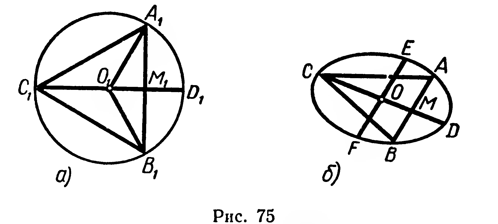
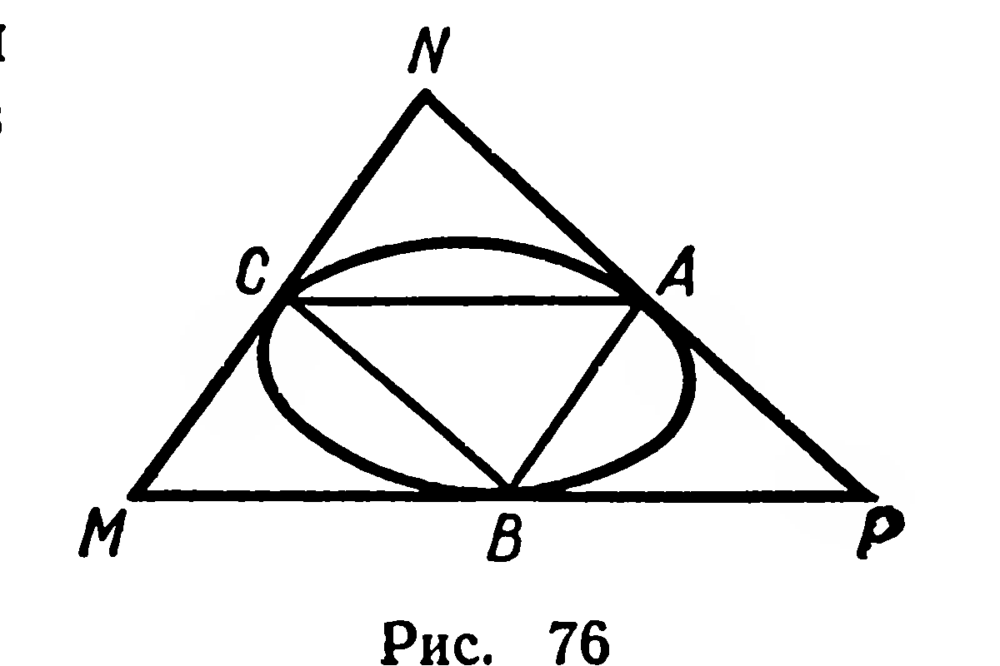

## 6.2. Фигура вращения. Цилиндр

---
**стр. 149**
---

Построим сопряжённые диаметры $CD$ и $EF$ (рис. 75, б). Затем через середину $M$ отрезка $OD$ проведём хорду $AB$, параллельную диаметру $EF$. Треугольник $ABC$ — искомый.

2) Изображение правильного описанного треугольника $MNP$ (рис. 76) можно получить, пользуясь изображением правильного вписанного треугольника $ABC$. Стороны этих треугольников соответственно параллельны.

192. Постройте изображения квадрата, вписанного в окружность, и квадрата, описанного около неё.

193. Постройте изображения вписанных в окружность: 1) прямоугольного треугольника; 2) прямоугольника; 3) трапеции; 4) правильного восьмиугольника.

194. Постройте изображения описанных около окружности: 1) прямоугольного треугольника; 2) равнобедренного треугольника; 3) ромба; 4) равнобедренной трапеции.

**§ 60. ФИГУРА ВРАЩЕНИЯ. ЦИЛИНДР**

1. Пусть дана прямая $l$, $M$ — произвольная точка, не принадлежащая $l$.

Через $M$ проведём плоскость $\alpha$, перпендикулярную $l$ (рис. 77). В этой плоскости рассмотрим окружность с центром $O=\alpha \cap l$ и радиусом $|OM|$.

---
**стр. 150**
---

Условимся говорить, что эта окружность получена при вращении точки $M$ вокруг оси $l$.

В плоскости, проходящей через прямую $l$, зададим фигуру $F$, например треугольник $ABC$ (рис. 78, а). Фигуре $F$ поставим в соответствие объединение $\Phi$ всех точек фигуры $F$, принадлежащих $l$, и окружностей, полученных при вращении всех точек данной фигуры, не принадлежащих $l$ (рис. 78, б). Говорят, что фигура $\Phi$ получена при вращении фигуры $F$ вокруг оси $l$.

Если фигура $\Phi$ получена при вращении некоторой фигуры вокруг оси, то $\Phi$ называют фигурой вращения.

С моделями фигур вращения мы часто имеем дело на практике. Это детали, выточенные на токарном станке (рис. 79), многие виды посуды и т. п.

*Сечением фигуры вращения* будем называть непустое пересечение данной фигуры и плоскости. Иногда вместо изображения фигуры вращения пользуются изображением её *осевого сечения*, т. е. сечения, плоскость которого проходит через ось вращения. На рисунке 80 показано осевое сечение фигуры вращения, изображённой на рисунке 78.

2. О п р е д е л е н и е. Фигура, полученная при вращении прямоугольника вокруг оси, содержащей его сторону, называется цилиндром (рис. 81).

