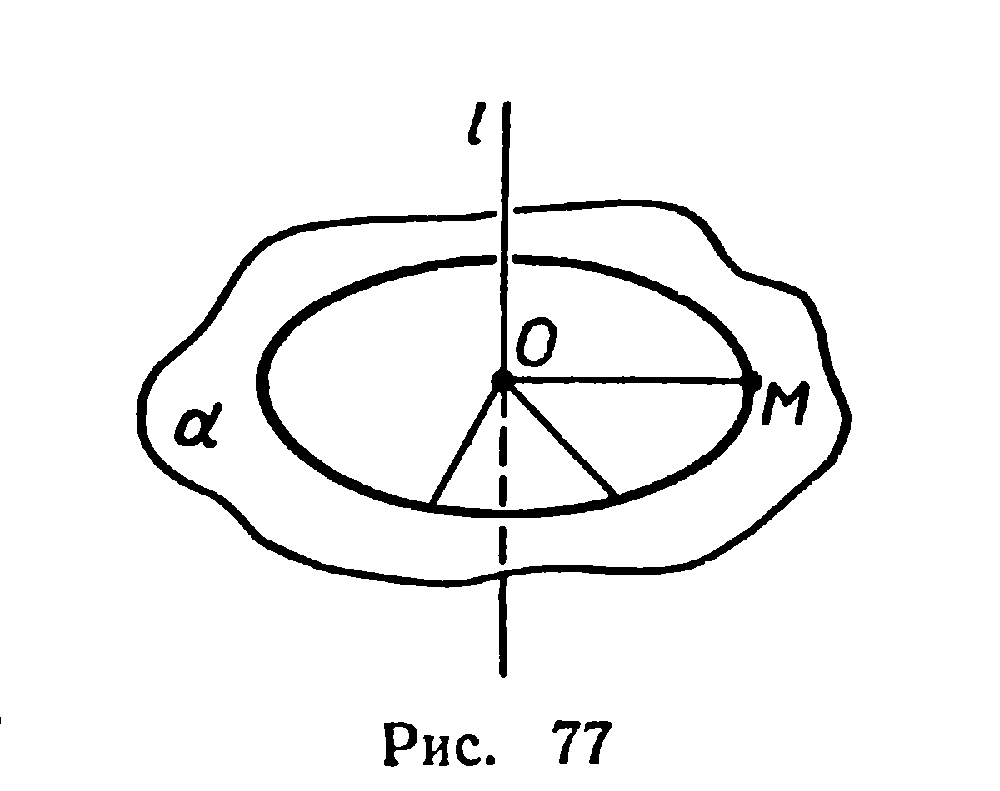
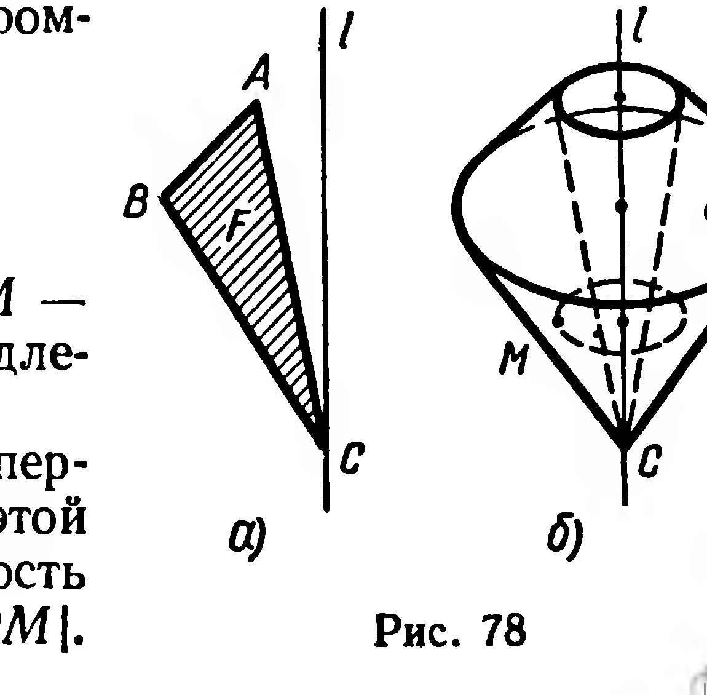
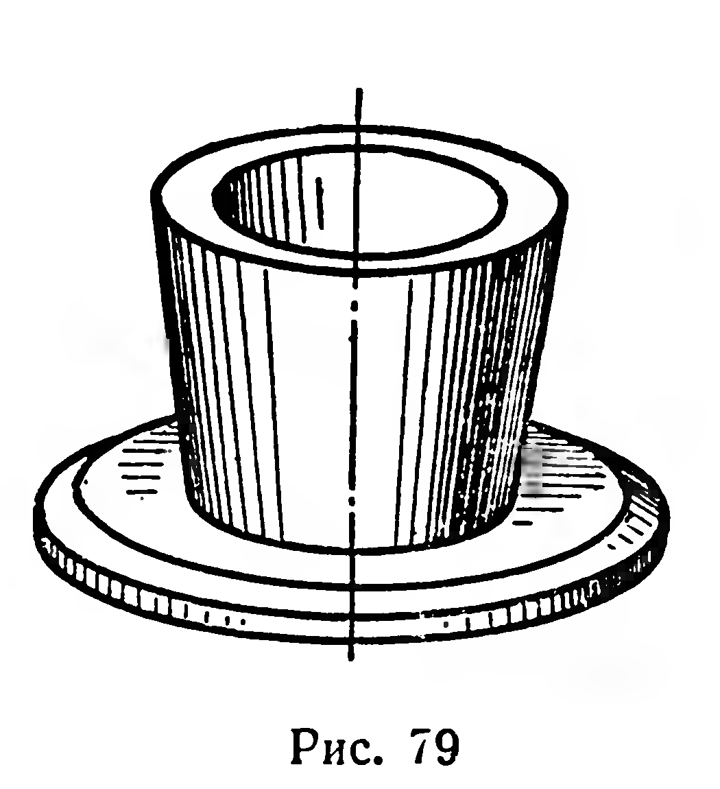
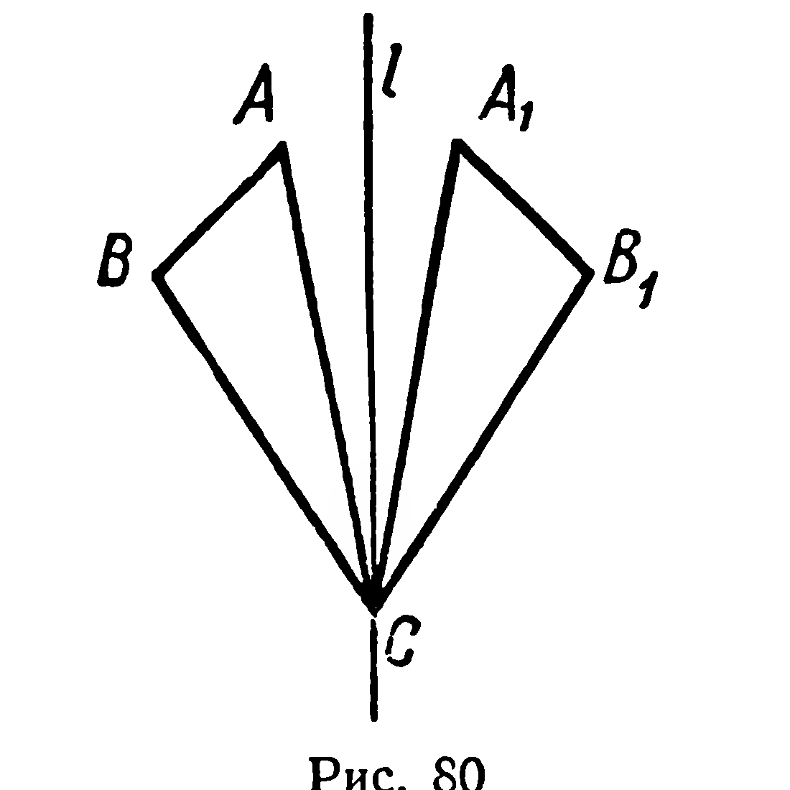
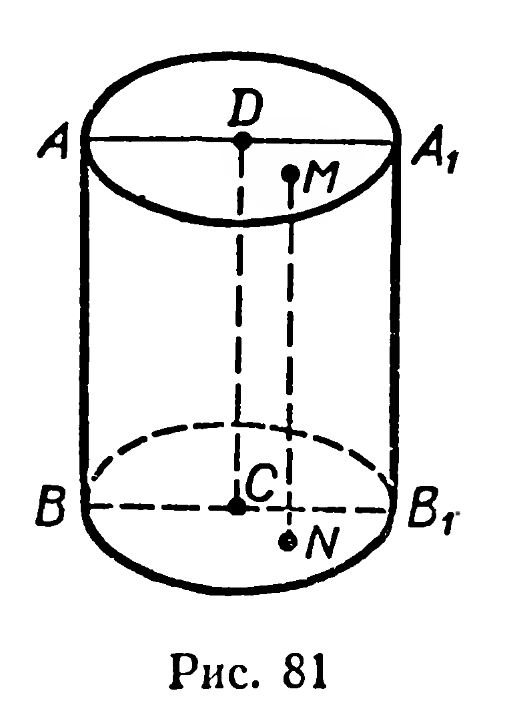
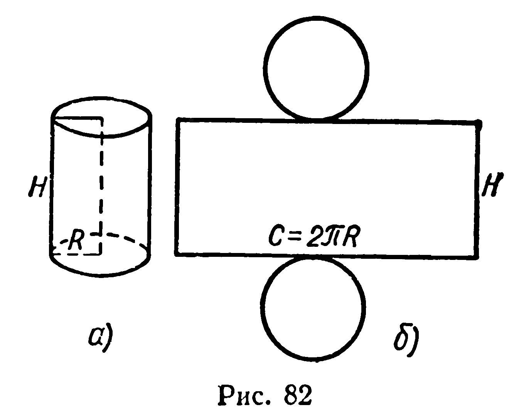
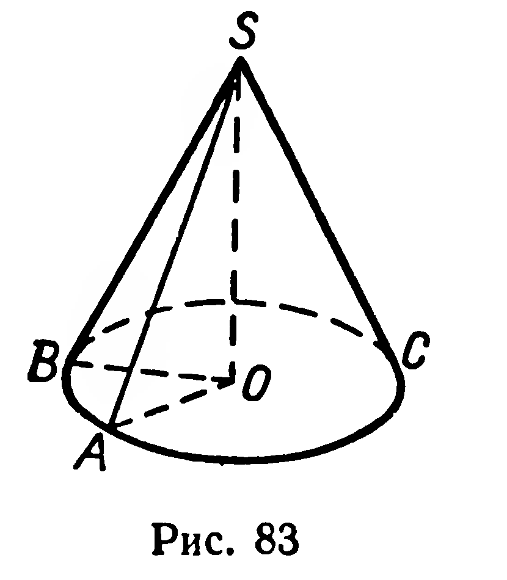
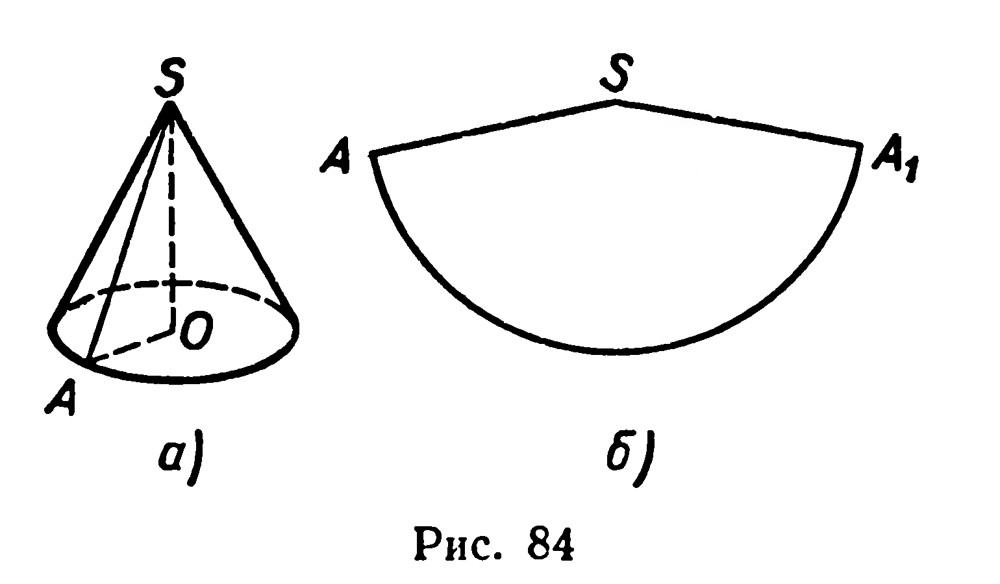

## 6.2. Фигура вращения. Цилиндр

---
**стр. 149, продолжение**
---

**§ 60. ФИГУРА ВРАЩЕНИЯ. ЦИЛИНДР**

1. Пусть дана прямая $l$, $M$ — произвольная точка, не принадлежащая $l$.

Через $M$ проведём плоскость $\alpha$, перпендикулярную $l$ (рис. 77). В этой плоскости рассмотрим окружность с центром $O=\alpha \cap l$ и радиусом $|OM|$.

---
**стр. 150**
---

Условимся говорить, что эта окружность получена при вращении точки $M$ вокруг оси $l$.

В плоскости, проходящей через прямую $l$, зададим фигуру $F$, например треугольник $ABC$ (рис. 78, а). Фигуре $F$ поставим в соответствие объединение $\Phi$ всех точек фигуры $F$, принадлежащих $l$, и окружностей, полученных при вращении всех точек данной фигуры, не принадлежащих $l$ (рис. 78, б). Говорят, что фигура $\Phi$ получена при вращении фигуры $F$ вокруг оси $l$.

Если фигура $\Phi$ получена при вращении некоторой фигуры вокруг оси, то $\Phi$ называют фигурой вращения.

С моделями фигур вращения мы часто имеем дело на практике. Это детали, выточенные на токарном станке (рис. 79), многие виды посуды и т. п.

*Сечением фигуры вращения* будем называть непустое пересечение данной фигуры и плоскости. Иногда вместо изображения фигуры вращения пользуются изображением её *осевого сечения*, т. е. сечения, плоскость которого проходит через ось вращения. На рисунке 80 показано осевое сечение фигуры вращения, изображённой на рисунке 78.

2. О п р е д е л е н и е. Фигура, полученная при вращении прямоугольника вокруг оси, содержащей его сторону, называется цилиндром (рис. 81).

---
**стр. 151**
---

При вращении вокруг той же оси ломаной, составленной из сторон прямоугольника, не лежащих на оси вращения, получим фигуру, которая называется *поверхностью цилиндра*.

Из курса VIII класса вам известны термины: *основание цилиндра, боковая поверхность, высота, образующая* (см. рис. 81).

Напомним также, что за площади боковой и полной поверхностей цилиндра принимаются площади соответствующих разверток (рис. 82). Итак, приходим к формулам:

$$
S_{\text{бок}}=2\pi RH,
$$

$$
S_{\text{цил}}=2\pi RH+2\pi R^2.
$$

### Задачи

**195°.** 1) Имеет ли цилиндр центр симметрии? 2) Сколько осей и плоскостей симметрии имеет цилиндр?

**196.** Какой фигурой является сечение цилиндра плоскостью: 1) проходящей через ось; 2) параллельной основанию; 3) параллельной оси; 4) пересекающей все образующие?

**197.** Площадь осевого сечения цилиндра $8\ м^2$, площадь основания $12\ м^2$. Вычислите площадь сечения, параллельного оси и отстоящего от нее на $1\ м$.

**198.** Радиус цилиндра $R$, высота $H$, площадь сечения, параллельного оси, равна $S$. На каком расстоянии от оси находится плоскость сечения?

**199.** Точки $A$, $B$, $C$ принадлежат различным образующим цилиндра. Постройте точку пересечения плоскости $ABC$ с какой-либо образующей (или с ее продолжением), не содержащей ни одной из данных точек.

**200.** Площадь осевого сечения цилиндра равна $Q$. Найдите площадь боковой поверхности.

**201.** Хорда длиной $a$ стягивает в основании цилиндра дугу $\varphi$. Высота цилиндра $H$. Найдите площадь полной поверхности цилиндра.

**202.** Цилиндрический паровой котел имеет диаметр $1{,}0\ м$, длина котла равна $3{,}8\ м$, давление пара $10\ атм$. Найдите силу давления пара на поверхность котла.

**203.** Сколько квадратных метров жести израсходовано на изготовление 1 млн. консервных банок диаметром $10\ см$ и высотой $5{,}0\ см$ (на швы и отходы добавить 10% материала)?

**204.** Диагональ развертки боковой поверхности цилиндра образует угол $\alpha$ с основанием развертки, длина диагонали равна $d$. 1) Найдите площадь полной поверхности цилиндра. 2) Вычислите угол $\alpha$, при котором полная поверхность цилиндра имеет наибольшее значение.

**205.** Два цилиндра, высоты которых $a$ и $b$, имеют конгруэнтные развертки боковых поверхностей. Найдите отношение $\dfrac ab$, при котором площадь полной поверхности одного цилиндра вдвое больше площади поверхности другого.

---
**стр. 152**
---

