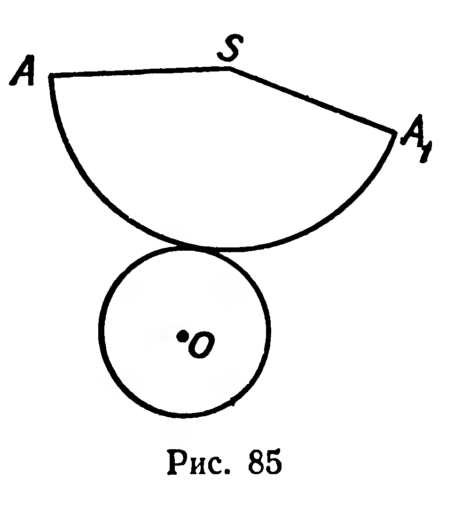
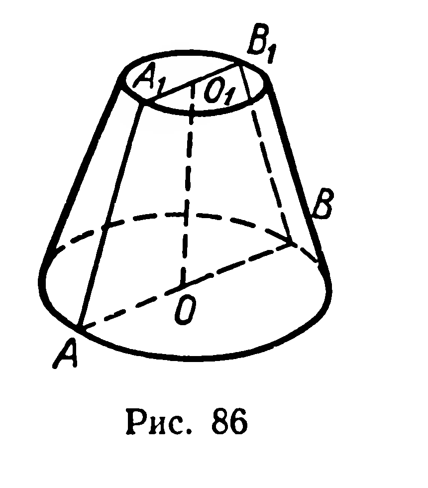
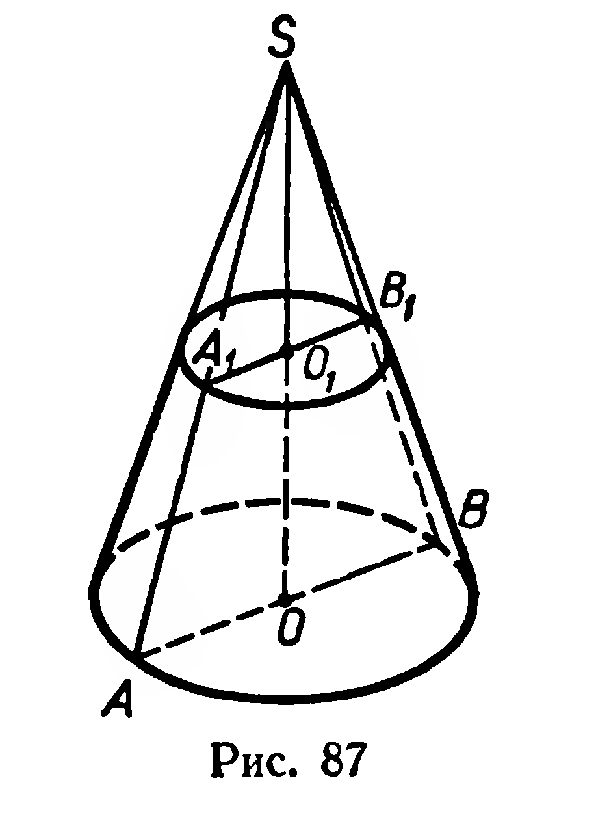
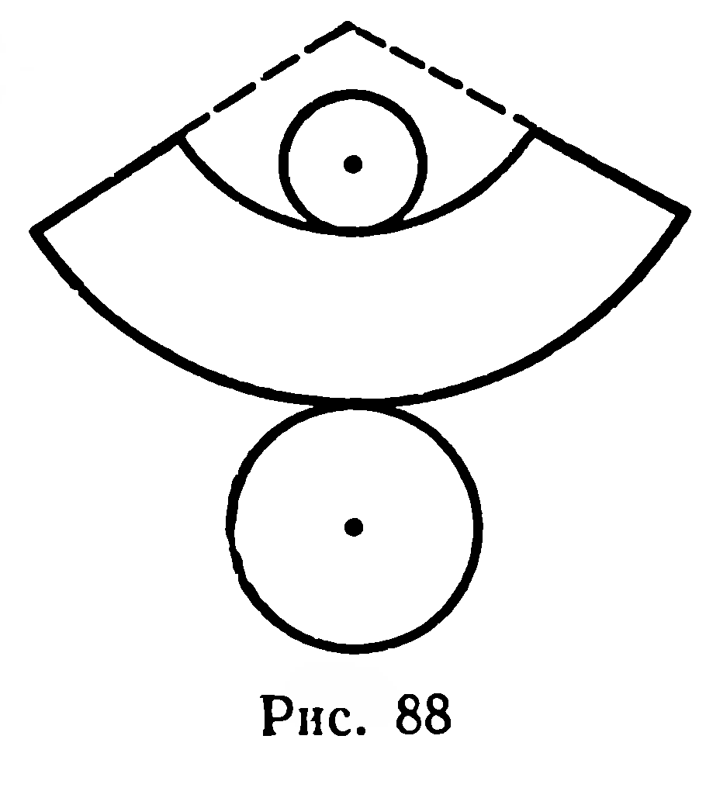

## 6.3. Конус. Усеченный конус

---
**стр. 152, продолжение**
---

## § 61. КОНУС. УСЕЧЕННЫЙ КОНУС

### 1. Определение

**Фигура, полученная при вращении прямоугольного треугольника вокруг оси, содержащей его катет, называется конусом** (рис. 83).

При вращении вокруг той же оси ломаной, составленной из гипотенузы и катета, не лежащего на оси вращения, получим фигуру, которая называется **поверхностью конуса**.

Пользуясь рисунком 83, вспомните смысл таких понятий, как *основание, боковая поверхность, высота* и *образующая конуса*.

Как известно, развертка боковой поверхности конуса является круговым сектором (рис. 84). Площадь этой развертки принимается за площадь боковой поверхности конуса, она равна $\pi RL$, т. е.

$$
S_{\text{бок}}=\pi RL,
$$

где $L$ — длина образующей конуса.

Площадь развертки полной поверхности конуса (рис. 85) принимается за площадь поверхности конуса:

$$
S_{\text{кон}}=\pi RL+\pi R^2.
$$

### 2

На рисунке 86 изображен *усеченный конус*. Это часть конуса, ограниченная его основанием и сечением, плоскость которого параллельна плоскости основания. Основания усеченного конуса — гомотетичные круги; центр гомотетии — вершина $S$ полного

---
**стр. 153**
---

конуса (рис. 87). Образующая и высота усеченного конуса ($[A_1A]$ и $[O_1O]$ на рисунках 86 и 87) являются соответственно частями образующей и высоты полного конуса.

Усеченный конус можно получить при вращении равнобедренной трапеции вокруг ее оси симметрии (рис. 86). При вращении границы этой трапеции получим поверхность усеченного конуса.

На рисунке 88 изображена развертка поверхности усеченного конуса. За площади боковой и полной поверхностей усеченного конуса принимаются площади разверток этих поверхностей.

### Задачи

**206.** Какой фигурой является: 1) осевое сечение конуса; 2) сечение конуса плоскостью, параллельной основанию; 3) сечение конуса плоскостью, проходящей через вершину конуса?

**207°.** 1) Имеет ли конус центр симметрии? 2) Сколько осей и плоскостей симметрии имеет конус?

**208.** 1) Образующая конуса равна $l$, угол при вершине осевого сечения $\varphi$. Найдите площадь основания.

2) Площадь основания конуса $Q$, образующая $l$. Найдите площадь осевого сечения.

**209.** Радиус основания конуса $R$, угол наклона образующей к плоскости основания $\alpha$. Плоскость проходит через вершину конуса и пересекает основание под углом $\varphi$. Найдите площадь сечения.

**210.** Коническая крыша силосной башни имеет диаметр $6\ м$ и высоту $2\ м$. Сколько листов кровельного железа потребуется для этой крыши, если размер листа $0{,}7\ м\times1{,}4\ м$, а на швы и обрезки тратится 10% от площади крыши?

**211.** 1) Прямоугольный треугольник с катетом $a$ и противолежащим ему углом в $30^\circ$ вращается вокруг гипотенузы. Найдите площадь фигуры, полученной при вращении ломаной, составленной из катетов этого треугольника.

2) Равнобедренный треугольник, длина основания которого $b$, а угол при вершине $\varphi$, вращается вокруг основания. Найдите площадь фигуры, полученной при вращении ломаной, состоящей из боковых сторон данного треугольника.

**212.** Через две образующие конуса, угол между которыми равен $\alpha$, проведена плоскость. Площадь получившегося сечения $S$, площадь основания конуса $Q$. Найдите площадь боковой поверхности конуса. Вычислите при $\alpha=28^\circ42'$, $S=12{,}56\ см^2$, $Q=15{,}31\ см^2$.

---
**стр. 154**
---

**213.** 1) Высота усеченного конуса 6 см, радиусы оснований 10 см и 2 см. Найдите площади его боковой и полной поверхностей.

2) Высота усеченного конуса равна $h$, радиусы оснований относятся как $1:3$, угол между образующей и плоскостью основания равен $45^\circ$. Найдите площадь поверхности усеченного конуса.

**214.** Прямоугольная трапеция вращается вокруг меньшей из непараллельных сторон. Найдите площадь поверхности полученной фигуры вращения, если меньшее основание трапеции равно 2 см, а боковая сторона длиной 12 см образует с основанием угол $60^\circ$.

**215.** 1) Радиусы оснований усеченного конуса 5 см и 2 см, высота 4 см. Найдите размеры (радиусы и величины дуг) развертки боковой поверхности (рис. 88).

2) Какие размеры имеет развертка боковой поверхности ведра, если диаметры его оснований 28 см и 20 см, а высота 24 см? Сколько квадратных дециметров материала нужно затратить на изготовление этого ведра (без учета расхода на швы)?
