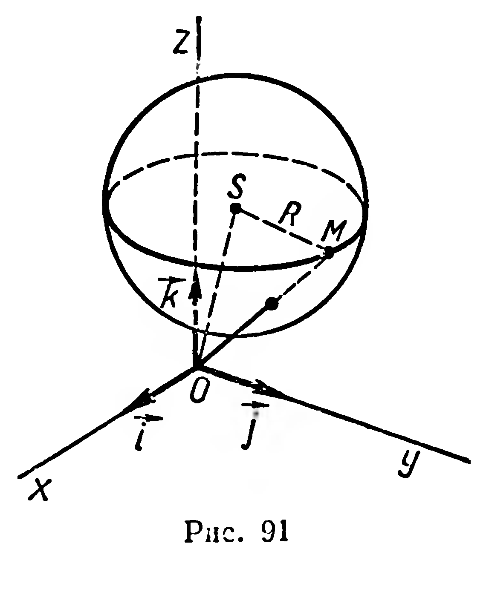

## 6.4. Сфера и шар

---
**стр. 154, продолжение**
---

## § 62. СФЕРА И ШАР

### 1

**Определение 1.** **Множество всех точек пространства, находящихся на положительном расстоянии $R$ от данной точки, называется сферой.**

Данная точка $O$ (рис. 89) — *центр* сферы. Отрезок $OM$ ($M$ — произвольная точка сферы) называется *радиусом* сферы ($|OM|=R$).

Отрезок, соединяющий любые две точки сферы, называется ее *хордой*. Хорда, проходящая через центр $O$, называется *диаметром* сферы. Длина диаметра равна удвоенной длине радиуса (рис. 89).

**Определение 2.** **Множество всех точек пространства, расстояние от каждой из которых до данной точки не больше положительного расстояния $R$, называется шаром.**

Шар можно получить при вращении полукруга вокруг оси, которая содержит диаметр полукруга (рис. 90). Фигура, полученная при вращении полуокружности, есть сфера — поверхность

---
**стр. 155**
---

этого шара. Центр, радиус и хорды этой сферы называют соответственно центром, радиусом и хордами шара. Все точки шара, не принадлежащие его поверхности, называют *внутренними точками шара*.

### 2

Пусть задана прямоугольная система координат. Составим уравнение сферы с центром $S(a;\ b;\ c)$ и радиусом $R$ (рис. 91). Для каждой точки $M(x;\ y;\ z)$, принадлежащей сфере, и только для таких точек, выполняется равенство $|SM|=R$. Отсюда, пользуясь формулой расстояния между двумя точками (§ 44), получим:

$$(x-a)^2+(y-b)^2+(z-c)^2=R^2.$$

Полагая $a=b=c=0$, получим *уравнение сферы с центром в начале координат*:

$$x^2+y^2+z^2=R^2.$$

### Задачи

**216.** 1°) Докажите, что центр сферы является ее центром симметрии. 2°) Сколько осей и плоскостей симметрии имеет сфера?

**217°.** Какой фигурой является пересечение сферы и плоскости, проходящей через центр этой сферы?

**218.** Даны точки $A(1;\,-2;\,3)$, $B(3;\,-3;\,1)$, $C(1;\,1;\,\sqrt2)$, $D(0;\,-3;\,\sqrt7)$. Какие из этих точек принадлежат сфере с центром $S(1;\,-2;\,0)$ и радиусом 3?

**219.** Найдите координаты точек пересечения сферы $x^2+y^2+z^2=R^2$ с осями координат.

**220.** Даны сфера $x^2+y^2+z^2=200$ и точка $S(3;\,4;\,5)$. Найдите координаты точки пересечения этой сферы с прямой $SO$ ($O$ — начало координат).

**221.** Найдите расстояние от точки $A(3p;\,-2p;\,6p)$ до сферы $x^2+y^2+z^2=p^2$ ($p>0$).

**222\*.** Составьте уравнение сферы с центром $S$ и радиусом $R$, если: 1) $S(2;\,-1;\,3)$, $R=4$; 2) $S(-5;\,0;\,7)$, $R=\sqrt3$.
