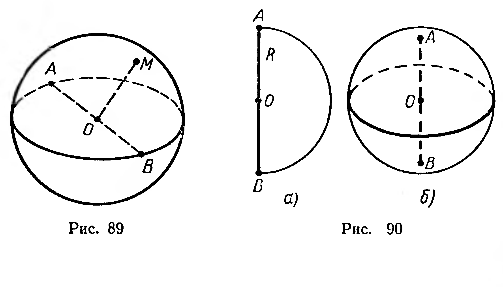

## 6.4. Сфера и шар

---
**стр. 154**
---

**213.** 1) Высота усеченного конуса 6 см, радиусы оснований 10 см и 2 см. Найдите площади его боковой и полной поверхностей.

2) Высота усеченного конуса равна $h$, радиусы оснований относятся как $1:3$, угол между образующей и плоскостью основания равен $45^\circ$. Найдите площадь поверхности усеченного конуса.

**214.** Прямоугольная трапеция вращается вокруг меньшей из непараллельных сторон. Найдите площадь поверхности полученной фигуры вращения, если меньшее основание трапеции равно 2 см, а боковая сторона длиной 12 см образует с основанием угол $60^\circ$.

**215.** 1) Радиусы оснований усеченного конуса 5 см и 2 см, высота 4 см. Найдите размеры (радиусы и величины дуг) развертки боковой поверхности (рис. 88).

2) Какие размеры имеет развертка боковой поверхности ведра, если диаметры его оснований 28 см и 20 см, а высота 24 см? Сколько квадратных дециметров материала нужно затратить на изготовление этого ведра (без учета расхода на швы)?

## § 62. СФЕРА И ШАР

### 1

**Определение 1.** **Множество всех точек пространства, находящихся на положительном расстоянии $R$ от данной точки, называется сферой.**

Данная точка $O$ (рис. 89) — *центр* сферы. Отрезок $OM$ ($M$ — произвольная точка сферы) называется *радиусом* сферы ($|OM|=R$).

Отрезок, соединяющий любые две точки сферы, называется ее *хордой*. Хорда, проходящая через центр $O$, называется *диаметром* сферы. Длина диаметра равна удвоенной длине радиуса (рис. 89).

**Определение 2.** **Множество всех точек пространства, расстояние от каждой из которых до данной точки не больше положительного расстояния $R$, называется шаром.**

Шар можно получить при вращении полукруга вокруг оси, которая содержит диаметр полукруга (рис. 90). Фигура, полученная при вращении полуокружности, есть сфера — поверхность

