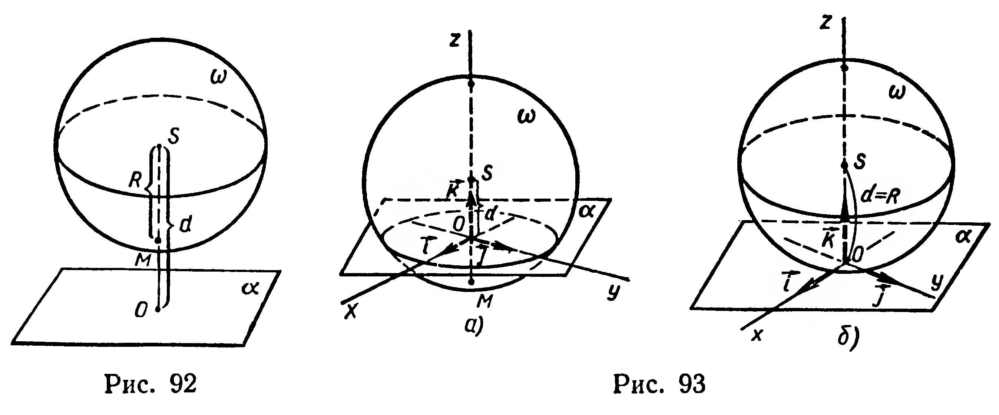
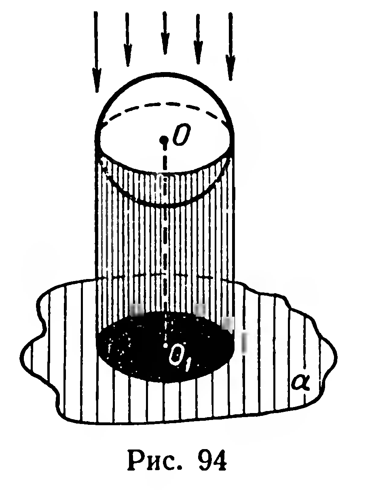
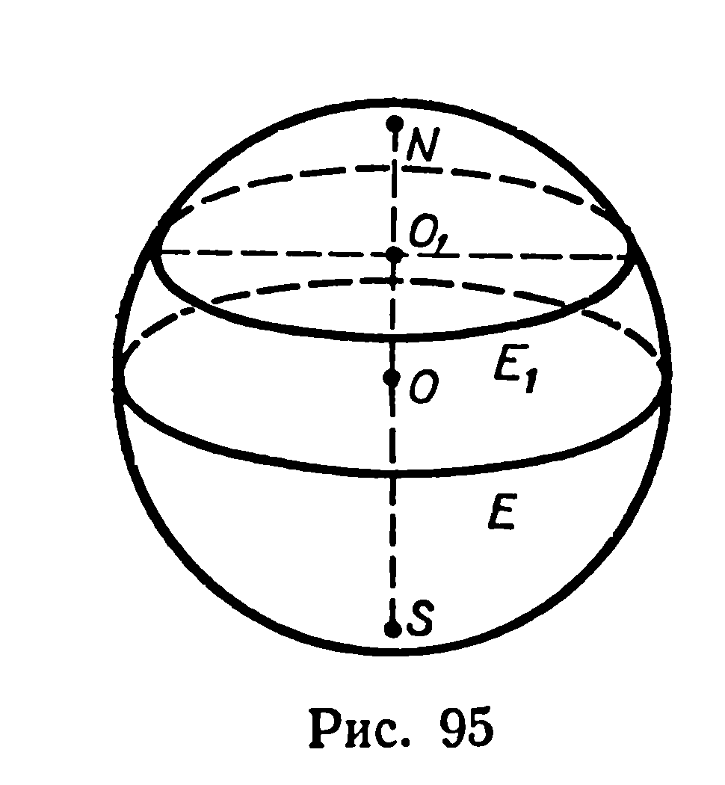

## 6.5. Сечение сферы. Изображение сферы

---
**стр. 155, продолжение**
---

## § 63. СЕЧЕНИЕ СФЕРЫ. ИЗОБРАЖЕНИЕ СФЕРЫ

### 1

Пусть даны плоскость $\alpha$ и сфера $\omega$ радиуса $R$, центр $S$ которой удален от $\alpha$ на расстояние $d$. Выясним, какой фигурой может быть пересечение $\alpha$ и $\omega$.

Если $d>R$ (рис. 92), то, очевидно, сфера и плоскость не имеют общей точки: $\alpha\cap\omega=\varnothing$.

---
**стр. 156**
---

Для исследования случая $d\leqslant R$ применим координатный метод. Через центр $S$ сферы $\omega$ проведем к плоскости $\alpha$ перпендикуляр, $O$ — его основание (рис. 93). Зададим прямоугольную систему координат: за начало координат примем точку $O$ (рис. 93), оси $Ox$ и $Oy$ расположим в плоскости $\alpha$, для оси $Oz$ выберем такое направление, чтобы аппликата центра $S$ сферы была неотрицательна. Тогда точка $S$ имеет координаты $(0;\,0;\,d)$. Фигура $\alpha\cap\omega$ есть множество всех точек, координаты которых удовлетворяют системе уравнений

$$
\begin{cases}
z=0, &(1)\\
x^2+y^2+(z-d)^2=R^2. &(2)
\end{cases}
$$

Подставив в уравнение (2) $z=0$, получим:

$$x^2+y^2+d^2=R^2,\ \text{или}\ x^2+y^2=R^2-d^2. \tag{3}$$

В координатной плоскости $\alpha$ ($z=0$) при $R>d$ (рис. 93, а) уравнение (3) задает окружность с центром $O$ и радиусом $r=\sqrt{R^2-d^2}$ (см. учебник для VIII класса); если же $R=d$ (рис. 93, б), то $x^2+y^2=0$. Этому уравнению удовлетворяют координаты только одной точки $O$, являющейся пересечением $\alpha$ и $\omega$.

**36. Теорема.** ***Сечением сферы является: 1) окружность, если расстояние от центра сферы до плоскости сечения меньше радиуса сферы; 2) точка, если это расстояние равно радиусу.***

Сечение сферы плоскостью, проходящей через центр сферы, называется *большой окружностью* сферы (или шара). Круг, ограниченный большой окружностью, называется *большим кругом* шара. Очевидно, что радиус большого круга равен радиусу шара.

### 2

Шар (сферу) принято изображать в ортогональной проекции (рис. 94); при таком проектировании изображением шара служит круг (рис. 95). Окружность этого круга изображает

---
**стр. 157**
---

большую окружность сферы, ограничивающей шар. На рисунке 95, кроме контурной окружности, изображены два параллельных сечения сферы.

### Задачи

**223.** 1) Докажите, что сечения сферы, одинаково удаленные от ее центра, имеют равные радиусы.

2) Докажите, что из двух сечений сферы больший радиус имеет то сечение, плоскость которого ближе к центру сферы.

**224.** Сфера $x^2+y^2+z^2=4$ пересечена плоскостью. Найдите координаты центра $O_1$ и радиус $r$ сечения, если известно уравнение этой плоскости: 1) $z=0$; 2) $y=1$; 3*) $x+y+z=2$.

**225.** Какая фигура является пересечением сферы $x^2+y^2+z^2=4$ и плоскости: 1) $x=2$; 2) $x+y=4$; 3) $y-z=2$; 4) $11x+19y-7z=0$; 5) $x+y-z+9=0$?

**226*.** Пользуясь координатным методом, докажите, что непустое пересечение двух различных сфер является окружностью, плоскость которой перпендикулярна линии центров, или точкой, принадлежащей линии центров.

**227.** 1°) Какая из географических параллелей является большой окружностью земного шара?

2) Найдите длину полярного круга Земли (радиус Земли принять за 6400 км).

3) Вычислите путь, который проходит за сутки в результате вращения Земли вокруг оси населенный пункт, в котором вы живете.

**228.** Из точки $M$, взятой на сфере радиуса 30 см, проведены две взаимно перпендикулярные хорды $MA$ и $MB$ длиной 24 см и 10 см.

1) Проходит ли плоскость $AMB$ через центр сферы? 2) На каком расстоянии от центра сферы находится хорда $AB$?
