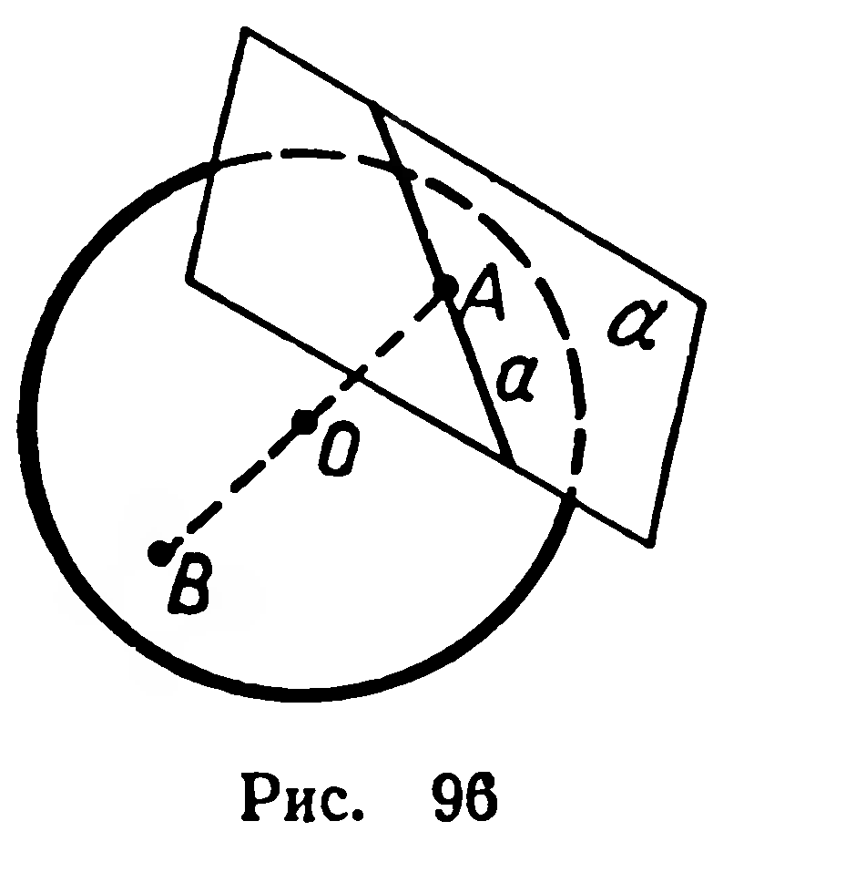

## 6.6. Плоскость, касательная к сфере

---
**стр. 158**
---

## § 64. ПЛОСКОСТЬ, КАСАТЕЛЬНАЯ К СФЕРЕ

**Определение.** Касательной плоскостью к сфере (шару) называется плоскость, имеющая со сферой единственную общую точку.

Эту точку (точку $A$ на рисунке 96) называют *точкой касания* сферы и плоскости. Докажем теорему, аналогичную признаку касания окружности и прямой.

**37. Теорема.** *Для того чтобы плоскость была касательной к сфере, необходимо и достаточно, чтобы эта плоскость была перпендикулярна к диаметру сферы и проходила через его конец.*

**Доказательство.** *Достаточность.* Пусть $[AB]$ — диаметр данной сферы (рис. 96), $A\in\alpha$, $[AB]\perp\alpha$. Тогда расстояние от центра $O$ сферы до плоскости $\alpha$ равно радиусу. Согласно теореме 36 точка $A$ — единственная общая точка сферы и плоскости, т. е. $\alpha$ — касательная плоскость.

*Необходимость.* Пусть $A$ — точка касания сферы и плоскости $\alpha$ (рис. 96). Докажем, что $[OA]\perp\alpha$. Предположим, что $[OA]$ — наклонная к $\alpha$. Тогда расстояние от $O$ до $\alpha$ должно быть меньше $|OA|$, т. е. меньше радиуса сферы. Согласно теореме 36 плоскость $\alpha$ в таком случае не является касательной. Получили противоречие с условием; следовательно, $[AB]\perp\alpha$. ■

В касательной плоскости через точку касания проведем прямую (рис. 96). Очевидно, что эта прямая имеет только одну общую точку со сферой. Такую прямую называют *касательной к сфере (шару)*.

### Задачи

**229°.** Сколько касательных плоскостей к сфере можно провести через точку, взятую: 1) на сфере; 2) вне сферы?

**230°.** Сколько касательных прямых можно провести к сфере через точку, взятую: 1) на этой сфере; 2) вне этой сферы?

**231°.** Найдите множество всех точек, которые являются центрами сфер: 1) касающихся данной плоскости в данной точке $O$; 2) имеющих данный радиус и касающихся данной плоскости.

**232.** 1) Сфера радиуса $R$ касается граней двугранного угла величиной $\varphi$. Найдите расстояние от центра сферы до ребра двугранного угла.

2*) Составьте уравнение сферы радиуса $R$, касающейся всех координатных плоскостей, если известно, что координаты центра этой сферы положительны.

**233.** К шару радиуса $R$ проведена касательная плоскость. Найдите площадь сечения шара плоскостью, которая проходит через точку касания и образует с касательной плоскостью угол $\varphi$.

---
**стр. 159**
---

**234.** Составьте уравнение плоскости, касающейся сферы $x^2+y^2+z^2=9$ в точке с координатами: 1) $(0; 3; 0)$; 2) $(0; 2;-\sqrt5)$; 3) $(2;-2;-1)$.

**235.** Докажите, что уравнение плоскости, касающейся сферы $x^2+y^2+z^2=R^2$ в точке $A\ (m; p; q)$, имеет вид: $mx+py+qz=R^2$.
