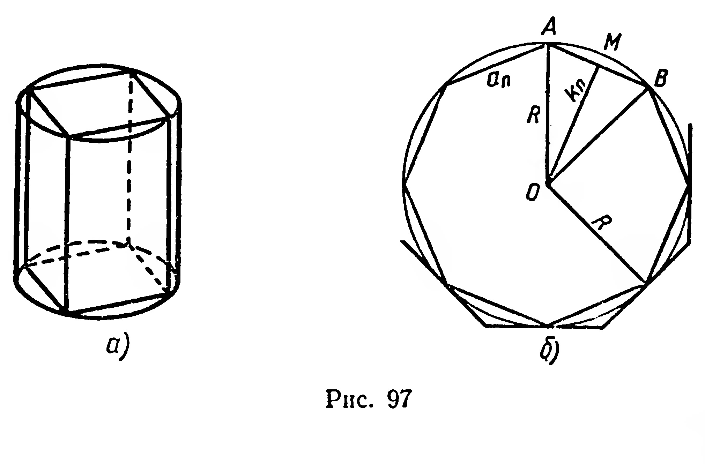

## 6.7. Обобщение задачи измерения объемов. Объем цилиндра

---
**стр. 159**
---

**234.** Составьте уравнение плоскости, касающейся сферы $x^2+y^2+z^2=9$ в точке с координатами: 1) $(0; 3; 0)$; 2) $(0; 2;-\sqrt5)$; 3) $(2;-2;-1)$.

**235.** Докажите, что уравнение плоскости, касающейся сферы $x^2+y^2+z^2=R^2$ в точке $A\ (m; p; q)$, имеет вид: $mx+py+qz=R^2$.

## § 65. ОБОБЩЕНИЕ ЗАДАЧИ ИЗМЕРЕНИЯ ОБЪЕМОВ. ОБЪЕМ ЦИЛИНДРА

**1.** Свойства объемов многогранников нам известны (§ 55). Оказывается, не только многогранникам, но и многим другим фигурам (например, цилиндру, конусу, шару) можно поставить в соответствие положительные величины (объемы этих фигур), обладающие следующими свойствами:

а) *конгруэнтные фигуры имеют равные объемы;*

б) *если фигура* $\Phi_1$ *содержится в фигуре* $\Phi_2$, *то объем фигуры* $\Phi_1$ *не больше объема фигуры* $\Phi_2$.

**2.** Пользуясь этими свойствами, выведем формулу объема цилиндра.

**38. Теорема.** *Объем цилиндра равен произведению площади его основания на высоту.*

**Доказательство.** Пусть дан цилиндр, радиус основания которого $R$ и высота $H$ (рис. 97, а). Рассмотрим правильную четырехугольную призму, вписанную в цилиндр (основания призмы вписаны в основания цилиндра). Путем удвоения числа сторон оснований призмы получим восьмиугольную призму, вписанную в цилиндр; так же можем получить шестнадцатиугольную призму и т. д. Объемы этих призм образуют числовую последовательность: $V_1,V_2,\ldots,V_n,\ldots$ (1). Объем $n$-й призмы $V_n=S_n\cdot H$, где $S_n$ — площадь основания призмы, а $H$ — ее высота.

При неограниченном удвоении числа сторон правильных вписанных в окружность многоугольников последовательность их площадей имеет конечный предел, равный $\pi R^2$.

---
**стр. 160**
---

Действительно, $S_n=\dfrac12P_nk_n$, где $P_n$ — периметр $n$-го правильного многоугольника, $k_n$ — длина его апофемы (рис. 97, б). Из курса алгебры известно, что $\lim\limits_{n\to\infty}P_n=C=2\pi R$ — длина окружности радиуса $R$. Рассматривая треугольник $AOM$, получим: $0<R-k_n<\dfrac12a_n$. Очевидно, $\lim\limits_{n\to\infty}a_n=0$, и из этого неравенства следует, что $\lim\limits_{n\to\infty}k_n=R$. Тогда

$$
\lim_{n\to\infty}S_n=\lim_{n\to\infty}\left(\frac12P_n\cdot k_n\right)
=\frac12\lim_{n\to\infty}P_n\cdot\lim_{n\to\infty}k_n
=\frac12\cdot2\pi R\cdot R=\pi R^2.
$$

Заметим, что такой же предел имеет последовательность площадей правильных описанных многоугольников (рис. 97, б). Действительно, площадь $n$-го многоугольника равна $\dfrac12Q_n\cdot R$, где $Q_n$ — его периметр. Тогда

$$
\lim_{n\to\infty}\left(\frac12Q_n\cdot R\right)
=\frac12\lim_{n\to\infty}Q_n\cdot R
=\frac12\cdot2\pi R\cdot R=\pi R^2.
$$

Величину $\lim\limits_{n\to\infty}S_n=\pi R^2$ по определению принимают за площадь круга радиуса $R$.

Найдем теперь предел последовательности (1):

$$
\lim_{n\to\infty}V_n=\lim_{n\to\infty}(S_n\cdot H)
=H\cdot\lim_{n\to\infty}S_n=\pi R^2H.
$$

Составив последовательность $W_n$ объемов правильных призм, описанных около цилиндра, аналогично докажем, что

$$
\lim_{n\to\infty}W_n=\pi R^2H.
$$

Следовательно, $\lim\limits_{n\to\infty}V_n=\lim\limits_{n\to\infty}W_n=\pi R^2H$.

Согласно свойствам объемов фигур (пункт 1) $V_n\leqslant V\leqslant W_n$, отсюда $V=\pi R^2H$. ■

Итак, объем цилиндра вычисляется по формуле:

$$
V=\pi R^2H.
$$

**Примечание.** При решении задач мы часто будем пользоваться следующим свойством фигур, имеющих объемы: *если фигура* $\Phi$ *является объединением фигур* $\Phi_1$ *и* $\Phi_2$, *не имеющих общих внутренних точек*[^1], *то объем фигуры* $\Phi$ *равен сумме объемов фигур* $\Phi_1$ *и* $\Phi_2$.

[^1]: Определение внутренней точки приведено в «Приложениях», с. 227.

### Задачи

**236.** Стальная болванка имеет форму правильной четырехугольной призмы со стороной основания $0{,}40$ м и высотой $1{,}00$ м. Сколько метров проволоки диаметром $5{,}00$ мм можно изготовить из этой болванки вытягиванием?

**237.** Кабель диаметром $42$ мм заключается в свинцовую оболочку толщиной $2{,}0$ мм. На изготовление оболочки израсходована $1$ т свинца. Какова длина кабеля? (Плотность свинца $11{,}4\ \text{г/см}^3$.)
