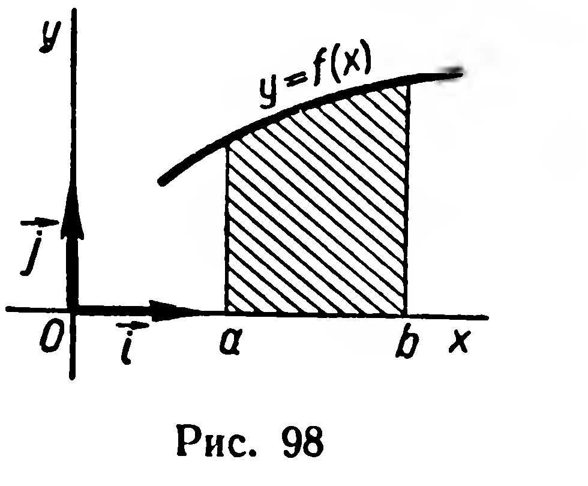
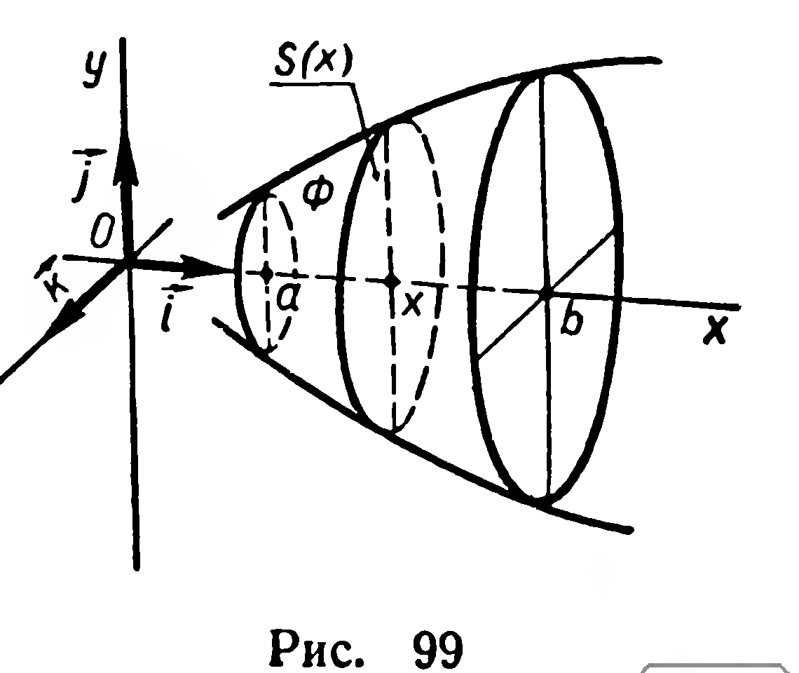
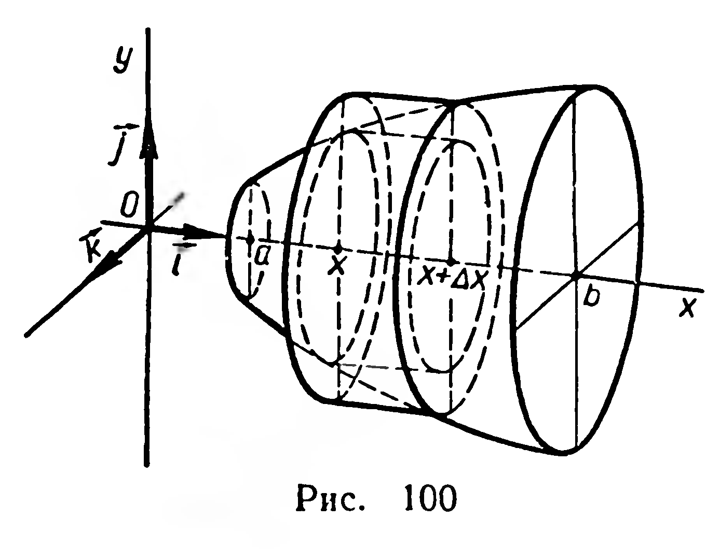
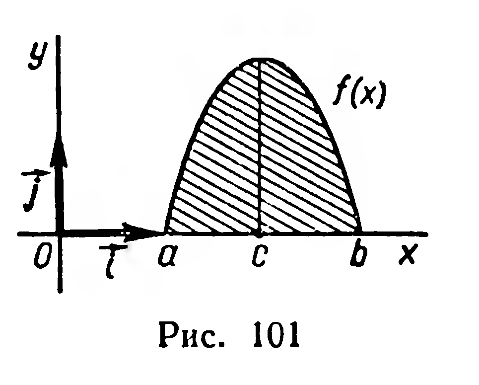

## 6.8. Объем фигуры, полученной при вращении криволинейной трапеции

---
**стр. 161, продолжение**
---

## § 66. ОБЪЕМ ФИГУРЫ, ПОЛУЧЕННОЙ ПРИ ВРАЩЕНИИ КРИВОЛИНЕЙНОЙ ТРАПЕЦИИ

В прямоугольной системе координат на плоскости рассмотрим криволинейную трапецию, ограниченную графиком непрерывной неотрицательной функции $f(x)$, осью абсцисс и прямыми $x=a$, $x=b$ $(a<b)$ (рис. 98). При вращении криволинейной трапеции вокруг оси абсцисс получим фигуру вращения $\Phi$ (рис. 99). Любое сечение фигуры $\Phi$ плоскостью, перпендикулярной оси абсцисс, есть круг (или точка). Рассмотрим сечение, проведенное через точку с абсциссой $x$ $(x\in[a;b])$.

Его площадь $S(x)$ равна $\pi f^2(x)$.

Объем части фигуры $\Phi$, ограниченной плоскостями сечений, проведенными через точки $a$ и $x$, обозначим через $V(x)$. Функции $S(x)$ и $V(x)$ рассматриваются на отрезке $[a;b]$.

Предполагая, что функция $f(x)$ является на $[a;b]$ возрастающей (или убывающей), докажем, что объем фигуры $\Phi$ может быть найден с помощью такой формулы:

$$
V=\int_a^b S(x)\,dx.
$$

Воспользуемся тем же способом, который был применен при доказательстве теоремы об объеме пирамиды (§ 58).

---
**стр. 162**
---

Дадим $x$ приращение $\Delta x>0$ $(x+\Delta x\leqslant b)$; тогда объем $V(x)$ получит приращение $\Delta V$ (рис. 100). Рассмотрим два цилиндра с общей высотой $\Delta x$: основанием первого из них является круг с площадью $S(x)$, а основанием второго — круг с площадью $S(x+\Delta x)$ (рис. 100). Согласно свойствам объемов фигур (§ 65), имеем:

$$
S(x)\Delta x\leqslant\Delta V\leqslant S(x+\Delta x)\Delta x,
$$

отсюда

$$
S(x)\leqslant\frac{\Delta V}{\Delta x}\leqslant S(x+\Delta x). \tag{1}
$$

(если функция $f(x)$ убывает, то вместо неравенства (1) получим неравенство противоположного смысла).

Мы условились, что функция $f(x)$ непрерывна на $[a;b]$, поэтому непрерывна и функция $S(x)=\pi f^2(x)$. Следовательно,

$$
\lim_{\Delta x\to0}S(x+\Delta x)=S(x).
$$

Но тогда из двойного неравенства (1) вытекает: $\lim\limits_{\Delta x\to0}\dfrac{\Delta V}{\Delta x}=S(x)$, т. е. $V'(x)=S(x)$. Таким образом, объем $V(x)$ есть первообразная функции $S(x)$ на $[a;b]$. Объем фигуры $\Phi$ получим при $x=b$: $V=V(b)$. Заметив, что $V(a)=0$, находим:

$$
V=V(b)-V(a),
$$

или

$$
V=\int_a^b S(x)\,dx=\pi\int_a^b f^2(x)\,dx.
$$

Итак, *объем фигуры, полученной при вращении криволинейной трапеции вокруг оси абсцисс, вычисляется по формуле:*

$$
V=\pi\int_a^b f^2(x)\,dx. \tag{2}
$$

**Примечание.** Формулу (2) можно применять и в том случае, когда непрерывная функция $f(x)$ не является возрастающей или убывающей на всем промежутке $[a;b]$ (рис. 101).

---
**стр. 163**
---

**Задачи**

**242.** Найдите объем фигуры, полученной при вращении вокруг оси абсцисс криволинейной трапеции, граница которой задана уравнениями:

1) $y=2x+1,\ x=1,\ x=4,\ y=0$;

2) $y=x^2,\ x=1,\ y=0$;

3) $y=2x-x^2,\ y=0$;

4) $y=\sqrt{ax},\ y=0,\ x=a\ (a>0)$;

5) $y=x^3,\ x=2,\ y=0$;

6) $y=1-x^3,\ x=2,\ y=0$.
