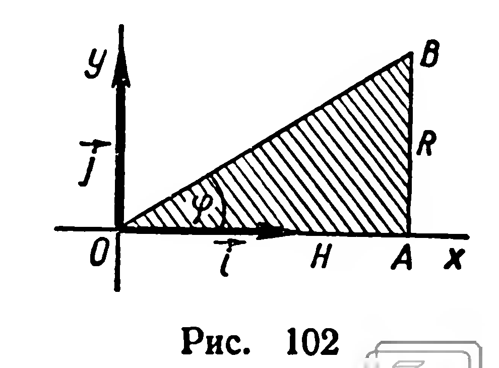

## 6.9. Объем конуса

---
**стр. 163**
---

**Задачи**

**242.** Найдите объем фигуры, полученной при вращении вокруг оси абсцисс криволинейной трапеции, граница которой задана уравнениями:

1) $y=2x+1,\ x=1,\ x=4,\ y=0$;

2) $y=x^2,\ x=1,\ y=0$;

3) $y=2x-x^2,\ y=0$;

4) $y=\sqrt{ax},\ y=0,\ x=a\ (a>0)$;

5) $y=x^3,\ x=2,\ y=0$;

6) $y=1-x^3,\ x=2,\ y=0$.

## § 67. ОБЪЕМ КОНУСА

**39. Теорема.** *Объем конуса равен одной трети произведения площади основания на высоту.*

**Доказательство.** Пусть конус получен при вращении прямоугольного треугольника $OAB$ $(\widehat A=90^\circ)$ вокруг прямой $OA$ (рис. 102). В плоскости $OAB$ введем прямоугольную систему координат с началом $O$ и осью абсцисс $OA$. Уравнение прямой $OB$ имеет вид: $y=kx$, где

$$
k=\operatorname{tg}\varphi=\frac{|AB|}{|OA|}=\frac RH.
$$

Треугольник $OAB$ является частным видом криволинейной трапеции (она ограничена осью абсцисс, графиком функции $y=\dfrac RHx$ и прямой $x=H$). Поэтому объем конуса можно найти с помощью формулы из § 66:

$$
V=\pi\int_0^H\left(\frac RHx\right)^2dx=\frac13\pi R^2H.
$$

Итак, объем конуса вычисляется по формуле:

$$
V=\frac13\pi R^2H.
$$

**Задачи**

**243.** 1) Коническая куча зерна имеет высоту $2{,}4$ м, а окружность основания $20$ м. Сколько тонн зерна в куче, если масса $1$ м³ зерна равна $750$ кг?

2) Щебень укладывается в кучу, имеющую форму конуса с углом откоса $33^\circ$. Какой высоты должна быть куча, чтобы ее объем был равен $10$ м³?

**244.** В основании конуса хорда длины $a$ стягивает дугу $2\alpha$; угол между образующей конуса и плоскостью основания равен $\varphi$. Найдите объем конуса.

**245.** Прямоугольный треугольник с катетом $a$ и прилежащим углом $\beta$ вращается вокруг оси, содержащей гипотенузу. Найдите объем фигуры вращения.

