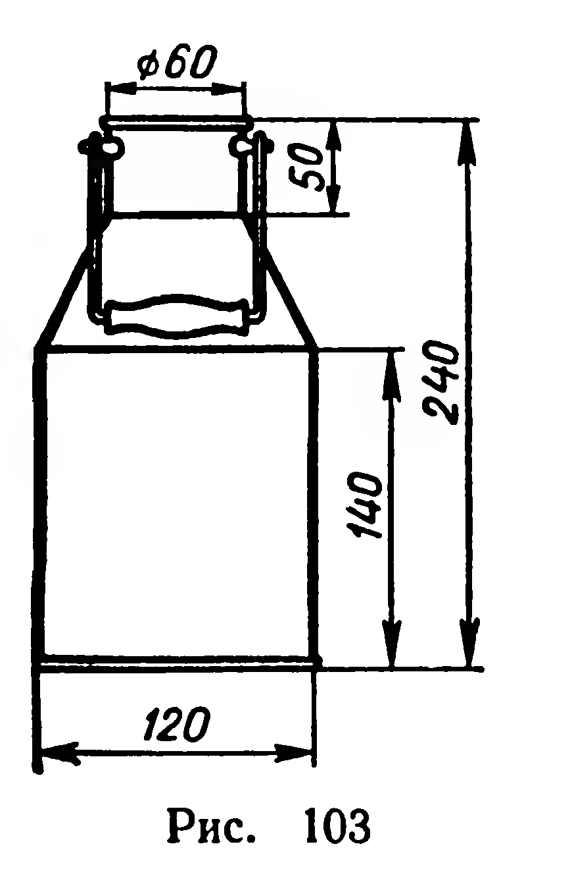

## 6.9. Объем конуса

---
**стр. 163, продолжение**
---

## § 67. ОБЪЕМ КОНУСА

**39. Теорема.** *Объем конуса равен одной трети произведения площади основания на высоту.*

**Доказательство.** Пусть конус получен при вращении прямоугольного треугольника $OAB$ $(\widehat A=90^\circ)$ вокруг прямой $OA$ (рис. 102). В плоскости $OAB$ введем прямоугольную систему координат с началом $O$ и осью абсцисс $OA$. Уравнение прямой $OB$ имеет вид: $y=kx$, где

$$
k=\operatorname{tg}\varphi=\frac{|AB|}{|OA|}=\frac RH.
$$

Треугольник $OAB$ является частным видом криволинейной трапеции (она ограничена осью абсцисс, графиком функции $y=\dfrac RHx$ и прямой $x=H$). Поэтому объем конуса можно найти с помощью формулы из § 66:

$$
V=\pi\int_0^H\left(\frac RHx\right)^2dx=\frac13\pi R^2H.
$$

Итак, объем конуса вычисляется по формуле:

$$
V=\frac13\pi R^2H.
$$

**Задачи**

**243.** 1) Коническая куча зерна имеет высоту $2{,}4$ м, а окружность основания $20$ м. Сколько тонн зерна в куче, если масса $1$ м³ зерна равна $750$ кг?

2) Щебень укладывается в кучу, имеющую форму конуса с углом откоса $33^\circ$. Какой высоты должна быть куча, чтобы ее объем был равен $10$ м³?

**244.** В основании конуса хорда длины $a$ стягивает дугу $2\alpha$; угол между образующей конуса и плоскостью основания равен $\varphi$. Найдите объем конуса.

**245.** Прямоугольный треугольник с катетом $a$ и прилежащим углом $\beta$ вращается вокруг оси, содержащей гипотенузу. Найдите объем фигуры вращения.

---
**стр. 164**
---

**246.** Круговой сектор с радиусом $R$ и центральным углом, равным $\alpha$ радиан, является разверткой боковой поверхности конуса. Найдите объем этого конуса.

**247.** Для изготовления конической воронки из жести вырезают круговой сектор радиуса $R$. Найдите центральный угол сектора, при котором получается воронка наибольшей вместимости.

**248.** 1) Радиусы оснований усеченного конуса равны $1$ дм и $9$ дм, образующая равна $1$ м. Найдите объем.

2) Радиусы оснований усеченного конуса $R$ и $r$ $(R>r)$. Найдите отношение объема усеченного конуса к объему конуса, частью которого является данный усеченный конус.

**249.** Диаметры концов бревна $32$ см и $26$ см, его длина $5{,}3$ м. Из бревна изготовлен прямоугольный брус с наибольшим квадратным сечением. Сколько процентов от объема бревна составит объем бруса?

**250.** Размеры бидона указаны на рисунке 103 (в миллиметрах). Найдите емкость бидона (в литрах).

**251.** Ромб со стороной $a$ и острым углом $\alpha$ вращается вокруг оси, проведенной через вершину острого угла и перпендикулярной к стороне ромба. Найдите объем фигуры вращения.
