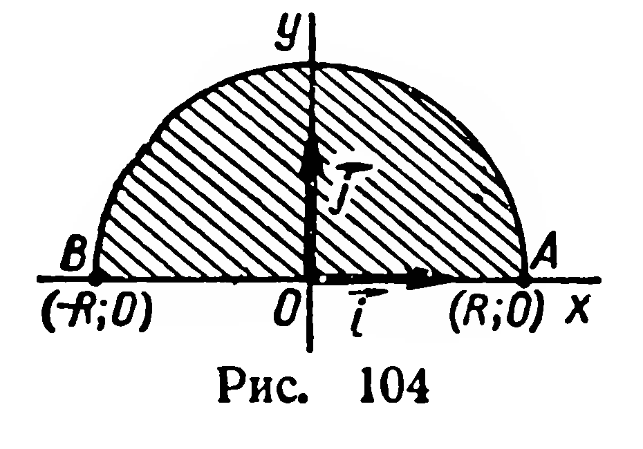

## 6.10. Объем шара

---
**стр. 164, продолжение**
---

## § 68. ОБЪЕМ ШАРА

**40. Теорема.** *Объем шара радиуса $R$ вычисляется по формуле:*

$$
V=\frac43\pi R^3.
$$

**Доказательство.** Пусть дан полукруг с центром $O$ и диаметром $|AB|=2R$. В плоскости полукруга введем прямоугольную систему координат с началом $O$ и осью абсцисс $OA$ (рис. 104). Полукруг является частным видом криволинейной трапеции. Он ограничен осью абсцисс и графиком функции

$$
y=\sqrt{R^2-x^2}.
$$

При вращении данного полукруга вокруг оси абсцисс получим шар. Найдем его объем, пользуясь формулой объема фигуры вращения (§ 66):

$$
V=\pi\int_{-R}^{R}y^2dx
=\pi\int_{-R}^{R}(R^2-x^2)\,dx
=\pi\left.\left(R^2x-\frac{x^3}{3}\right)\right|_{-R}^{R}
=\frac43\pi R^3.
$$

---
**стр. 165**
---

**Задачи**

**252.** Докажите, что объемы двух шаров относятся как кубы их радиусов (диаметров).

**253.** 1) Во сколько раз объем Земли больше объема Луны? (Диаметр Земли принять за $13$ тыс. км, диаметр Луны — за $3{,}5$ тыс. км.)

2) Во сколько раз нужно увеличить диаметр шара, чтобы его объем увеличился в два раза?

**254.** Объем шара можно вычислять по приближенной формуле

$$
V=\frac12d^3.
$$

С недостатком или избытком получим результат? Найдите относительную погрешность вычисления по этой формуле.

**255.** Масса железного шара равна $4{,}00$ кг. Каков его диаметр?

**256.** Какова масса пробкового шара диаметром $2$ м? (Плотность пробки $0{,}25$ г/см³.)

**257.** Найдите объем фигуры, которая задается в координатном пространстве неравенством

$$
x^2+y^2+z^2\leqslant R^2.
$$

**258.** Найдите объем образа шара, ограниченного сферой $x^2+y^2+z^2=R^2$, при гомотетии $H_O^k$.

**259.** Все вершины куба принадлежат сфере. Найдите объем шара, ограниченного этой сферой, если ребро куба имеет длину $a$.
