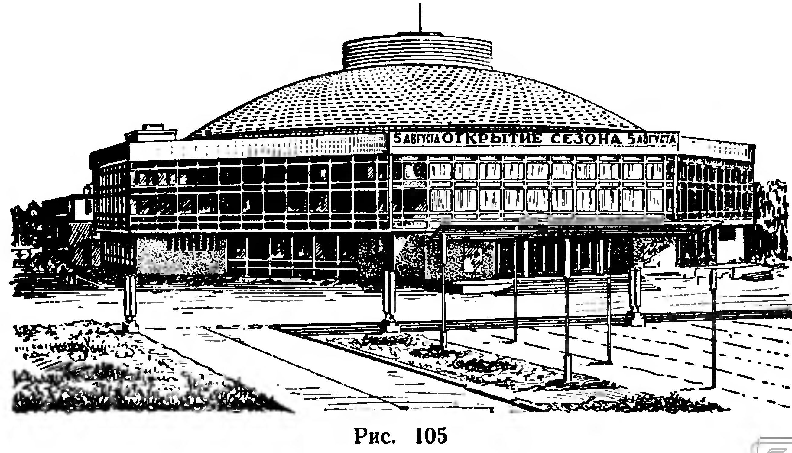
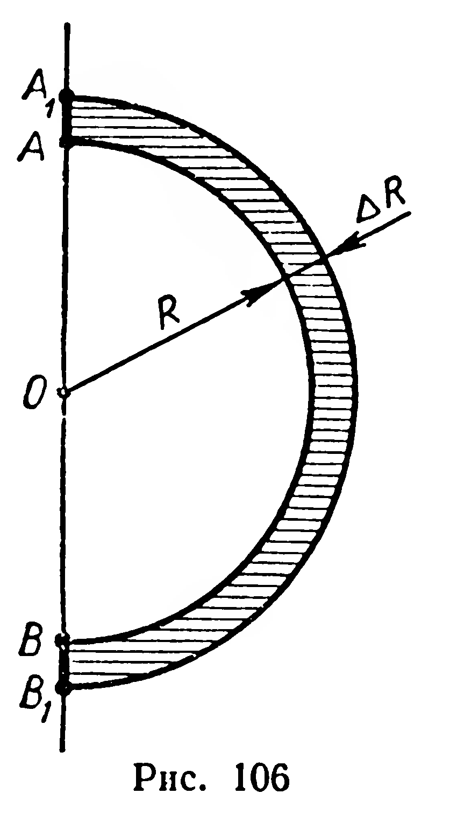

## 6.11. Площадь сферы

---
**стр. 165**
---

**Задачи**

**252.** Докажите, что объемы двух шаров относятся как кубы их радиусов (диаметров).

**253.** 1) Во сколько раз объем Земли больше объема Луны? (Диаметр Земли принять за $13$ тыс. км, диаметр Луны — за $3{,}5$ тыс. км.)

2) Во сколько раз нужно увеличить диаметр шара, чтобы его объем увеличился в два раза?

**254.** Объем шара можно вычислять по приближенной формуле

$$
V=\frac12d^3.
$$

С недостатком или избытком получим результат? Найдите относительную погрешность вычисления по этой формуле.

**255.** Масса железного шара равна $4{,}00$ кг. Каков его диаметр?

**256.** Какова масса пробкового шара диаметром $2$ м? (Плотность пробки $0{,}25$ г/см³.)

**257.** Найдите объем фигуры, которая задается в координатном пространстве неравенством

$$
x^2+y^2+z^2\leqslant R^2.
$$

**258.** Найдите объем образа шара, ограниченного сферой $x^2+y^2+z^2=R^2$, при гомотетии $H_O^k$.

**259.** Все вершины куба принадлежат сфере. Найдите объем шара, ограниченного этой сферой, если ребро куба имеет длину $a$.

## § 69. ПЛОЩАДЬ СФЕРЫ

Площади поверхности цилиндра и конуса были определены с помощью их разверток. Для сферы такой способ не пригоден, так как «развернуть» сферу на плоскость нельзя.

Чтобы получить наглядное представление о способе, который будет применен для определения площади сферы, рассмотрим пример из практики. Предварительно заметим, что площадь основания

---
**стр. 166**
---

призмы может быть найдена делением объема призмы на ее высоту. По аналогии с этим за приближенное значение площади куполообразной крыши здания цирка (рис. 105) можно принять отношение объема краски, затраченной на окраску крыши, к толщине слоя краски. Это приближение будет тем лучше, чем меньше толщина слоя.

Перейдем к решению интересующей нас проблемы. Пусть дан полукруг с центром $O$ и диаметром $|AB|=2R$ (рис. 106). При вращении этого полукруга вокруг оси $AB$ получится шар радиуса $R$. Дадим радиусу $R$ приращение $\Delta R$, тогда объем шара получит приращение $\Delta V$, где $\Delta V$ — объем фигуры, полученной при вращении кругового полукольца $AA_1B_1B$ (рис. 106).

*За площадь сферы принимается предел отношения приращения объема шара, ограниченного этой сферой, к приращению радиуса, когда приращение радиуса стремится к нулю:*

$$
S=\lim_{\Delta R\to 0}\frac{\Delta V}{\Delta R}.
\tag{1}
$$

**11. Теорема.** *Площадь сферы радиуса $R$ вычисляется по формуле:*

$$
S=4\pi R^2.
$$

**Доказательство.** Согласно определению (1) площадь сферы равна производной от функции $V(R)$, выражающей объем шара, ограниченного этой сферой, по радиусу. Пользуясь формулой объема шара, находим:

$$
S=\left(\frac43\pi R^3\right)'=4\pi R^2.
$$

### Задачи

**260.** Докажите, что площади двух сфер относятся как квадраты их радиусов (диаметров).

**261.** Во сколько раз площадь земной суши больше площади поверхности Луны, если известно, что земная суша составляет 29% площади земной поверхности? (См. задачу 253.)

**262.** Объемы двух шаров относятся как $m:n$. Найдите отношение площадей их поверхностей.

**263.** Найдите отношение площади сферы $x^2+y^2+z^2=R^2$ к площади образа этой сферы при гомотетии $H_O^k$.

**264.** Длина образующей конуса равна диаметру основания. Докажите, что площадь поверхности конуса равна площади сферы, диаметр которой равен высоте конуса.
