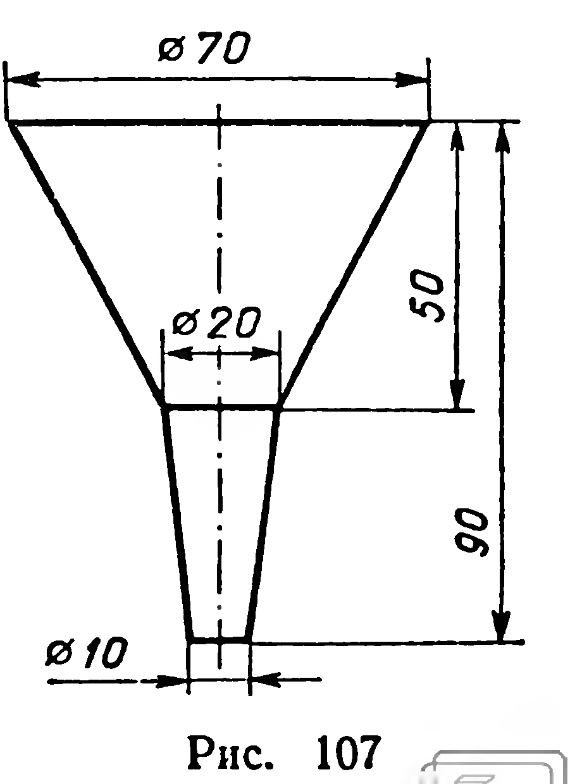
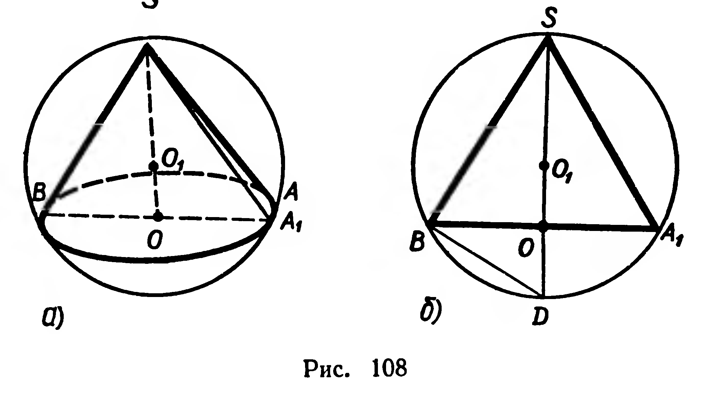
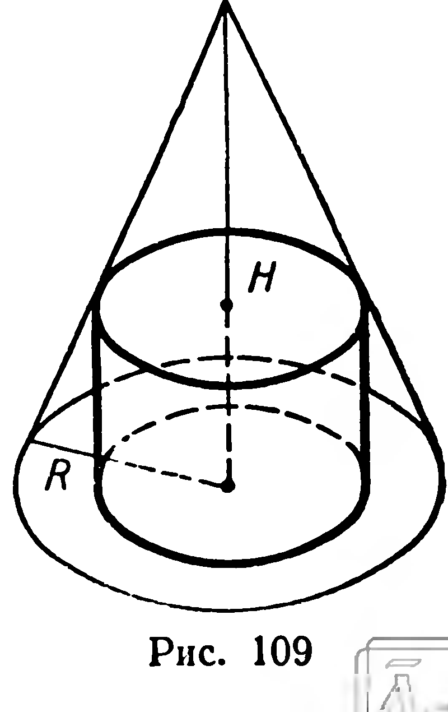
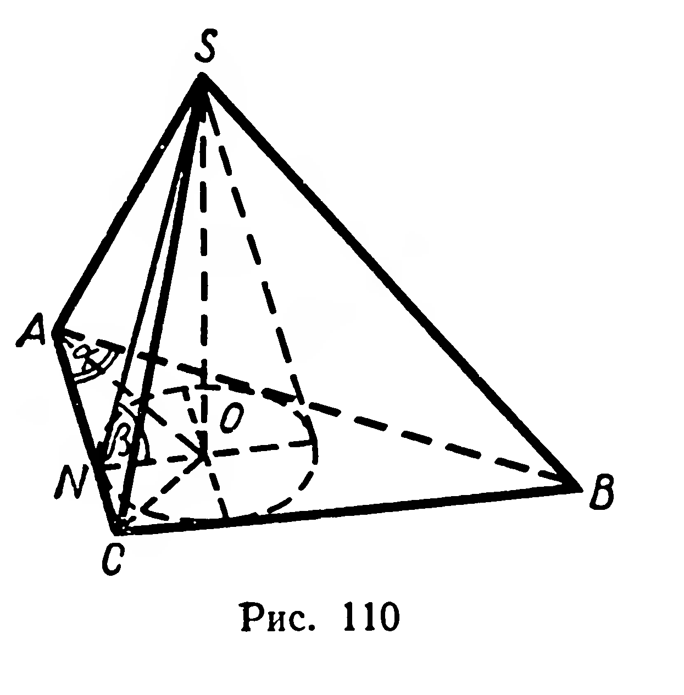

## 6.12. Задачи на повторение к главе VI

---
**стр. 167, продолжение**
---

### Задачи на повторение к главе VI

**268.** Точки $A$, $B$, $C$ принадлежат данному эллипсу. Постройте: 1) точку $M$ так, чтобы дуги $AB$ и $CM$ эллипса изображали конгруэнтные дуги окружности; 2) точку $N$ так, чтобы дуги $AB$ и $AN$ эллипса изображали конгруэнтные дуги окружности.

**269.** Высота цилиндра $h$, диаметр основания $d$ $(h<d)$. На каком расстоянии от оси нужно провести плоскость, чтобы сечением цилиндра являлся квадрат?

**270.** 1) Угол при вершине осевого сечения конуса острый. Докажите, что любое сечение конуса плоскостью, проходящей через его вершину, имеет площадь, не большую площади осевого сечения.

2) Образующая конуса равна $l$. Какой должна быть величина угла наклона образующей к плоскости основания, чтобы осевое сечение конуса имело наибольшую площадь?

**271.** 1) Найдите отношение площадей фигур, полученных при вращении границы ромба с углом $45^\circ$ вокруг прямых, содержащих диагонали ромба.

2) Найдите площадь фигуры, полученной при вращении границы прямоугольного треугольника с гипотенузой $c$ и углом $30^\circ$ вокруг прямой, проходящей через вершину данного угла и параллельной противолежащему катету.

**272.** Выведите формулы для вычисления площадей боковой и полной поверхностей конуса, если известны площадь основания $Q$ и угол $\varphi$ между образующей и плоскостью основания.

**273.** На каком расстоянии от вершины конуса нужно провести сечение, параллельное основанию, чтобы оно разделило боковую поверхность конуса на две части, имеющие равные площади? (Высота конуса равна $H$.)

**274.** Жестяная воронка имеет размеры (в миллиметрах), указанные на рисунке 107. Сколько жести затрачено на изготовление воронки (на швы уходит 10% площади поверхности воронки)?

**275. Практическая работа.** Произведите необходимые измерения и вычислите площадь поверхности модели: 1) цилиндра; 2) конуса; 3) усеченного конуса.

---
**стр. 168**
---

**276.** Докажите, что через две точки сферы, не являющиеся концами диаметра, проходит единственная большая окружность.

**277.** Ленинград и Магадан находятся на $60^\circ$ северной широты, разность их долгот равна $120^\circ$. 1) Найдите расстояние между этими городами по параллели. 2) Найдите расстояние между этими городами по дуге большой окружности.

**278.** 1) Найдите радиус общей окружности сфер, если их диаметры 78 см и 50 см, а расстояние между центрами сфер 56 см.

2*) Каково взаимное расположение двух сфер, у которых заданы координаты центров и радиусы: а) $S_1(1;1;-2)$, $R_1=4$ и $S_2(0;0;1)$, $R_2=1$; б) $S_1(0;2;0)$, $R_1=2$ и $S_2(1;-3;1)$, $R_2=3$?

**279.** Найдите координаты общих точек плоскостей $x+2y-5=0$, $3y-z=1$ и сферы $x^2+y^2+z^2=26$.

**280°.** Найдите множество центров всех сфер: 1) проходящих через три точки, не принадлежащие одной прямой; 2) касающихся двух различных параллельных плоскостей.

**281.** 1) Докажите, что концы диаметра сферы и любая другая ее точка являются вершинами прямоугольного треугольника.

2°) Найдите множество всех вершин прямоугольных треугольников с заданной общей гипотенузой.

**282*.** Сфера пересечена двумя плоскостями, одинаково удаленными от ее центра; угол между плоскостями равен $60^\circ$. Общая хорда окружностей, получившихся в сечении, равна $a$ и стягивает в одной из окружностей дугу $90^\circ$. Найдите радиус сферы.

**283.** Шар называют *вписанным в цилиндр*, если основания и все образующие цилиндра касаются шара. Во всякий ли цилиндр можно вписать шар? При каком условии это возможно?

**284.** Дан шар радиуса $R$. Найдите радиус основания и образующую вписанного цилиндра, имеющего наибольшую площадь боковой поверхности.

**285*.** Конус называется *вписанным в шар*, если основанием конуса служит сечение шара, а вершина конуса принадлежит поверхности шара.

В данный шар вписан конус, имеющий наибольшую площадь боковой поверхности. Найдите угол при вершине осевого сечения этого конуса.

**286.** В шар вписан конус с высотой $H$. Объем конуса равен $\frac14$ объема шара. Найти объем шара.

**Решение.** Пусть $SAB$ — данный конус, $[SO]$ — его высота (рис. 108, а). Около осевого сечения $A_1SB$ конуса опишем круг (рис. 108, б). Центр $O_1$ круга принадлежит высоте $SO$ равнобедренного треугольника (или лежит на продолжении этой высоты). При вращении прямоугольного треугольника $SOB$ вместе с полукругом $SBD$ вокруг прямой $SD$ получим конус $SAB$, который вписан в шар с центром $O_1$ (рис. 108, а). Введем обозначения: $x$ — радиус шара, $r$ — радиус основания конуса. По условию

$$
\frac13\pi r^2H=\frac14\cdot\frac43\pi x^3,
$$

откуда

$$
r^2H=x^3.
\tag{1}
$$

---
**стр. 169**
---

Выразим $r$ через $H$ и $x$. Заметим, что $(BO)\perp(SD)$, $(SB)\perp(BD)$. Поэтому $|BO|^2=|SO|\cdot|OD|$, или $r^2=H(2x-H)$. Равенство (1) примет вид: $H^2(2x-H)=x^3$, или $x^3-2H^2x+H^3=0$. Полученное уравнение решим путем разложения левой части на множители:

$$
\begin{aligned}
(x^3-H^2x)-(H^2x-H^3)&=0;\\
x(x^2-H^2)-H^2(x-H)&=0;\\
(x-H)(x^2+Hx-H^2)&=0.
\end{aligned}
$$

Отсюда $x_1=H$; $x_{2,3}=\dfrac{H(\pm\sqrt5-1)}2$.

Так как $x>0$, задача имеет два решения:

$$
V_1=\frac43\pi H^3
\quad\text{и}\quad
V_2=\frac16\pi(\sqrt5-1)^3H^3.
$$

**287.** В конус, высота которого равна радиусу основания, вписан шар. Найдите отношение объема шара к объему конуса.

**288\*.** В конус вписан шар. Плоскость, параллельная основанию конуса, касается шара и делит конус на две части, имеющие равные объемы. Найдите угол между образующей и плоскостью основания.

**289.** В конус с углом $\varphi$ между образующей и плоскостью основания вписан шар. Найдите отношение объема конуса к объему шара.

**290\*.** Сфера с центром в вершине конуса касается его основания и делит поверхность конуса на две части, имеющие равные площади. Найдите угол при вершине осевого сечения конуса.

**291.** В конус с радиусом основания $R$ и высотой $H$ вписан цилиндр (рис. 109). Найдите линейные размеры цилиндра, при которых его объем наибольший.

---
**стр. 170**
---

**292.** 1) В цилиндр вписан прямоугольный параллелепипед. Диагональ параллелепипеда образует с большей боковой гранью угол $\beta$, а с плоскостью основания угол $\alpha$. Найдите объем цилиндра, если большая сторона основания параллелепипеда равна $a$.

2) В прямой параллелепипед вписан цилиндр, объем которого в $m$ раз меньше объема параллелепипеда. Найдите двугранные углы при боковых ребрах параллелепипеда.

**293.** Конус называется вписанным в пирамиду, если вершина у них общая, а основание конуса вписано в основание пирамиды. Конус вписан в пирамиду, основанием которой служит прямоугольный треугольник с острым углом $\alpha$ (рис. 110). Радиус основания конуса $r$, угол между образующей и плоскостью основания $\beta$. Найдите объем пирамиды.

**294.** Площадь поверхности шара, вписанного в конус, равна площади основания конуса. Найдите угол между образующей конуса и плоскостью его основания.

**295\*.** Сфера вписана в усеченный конус, радиусы оснований которого равны $R$ и $r$. Найдите отношение площади сферы к площади боковой поверхности усеченного конуса.
