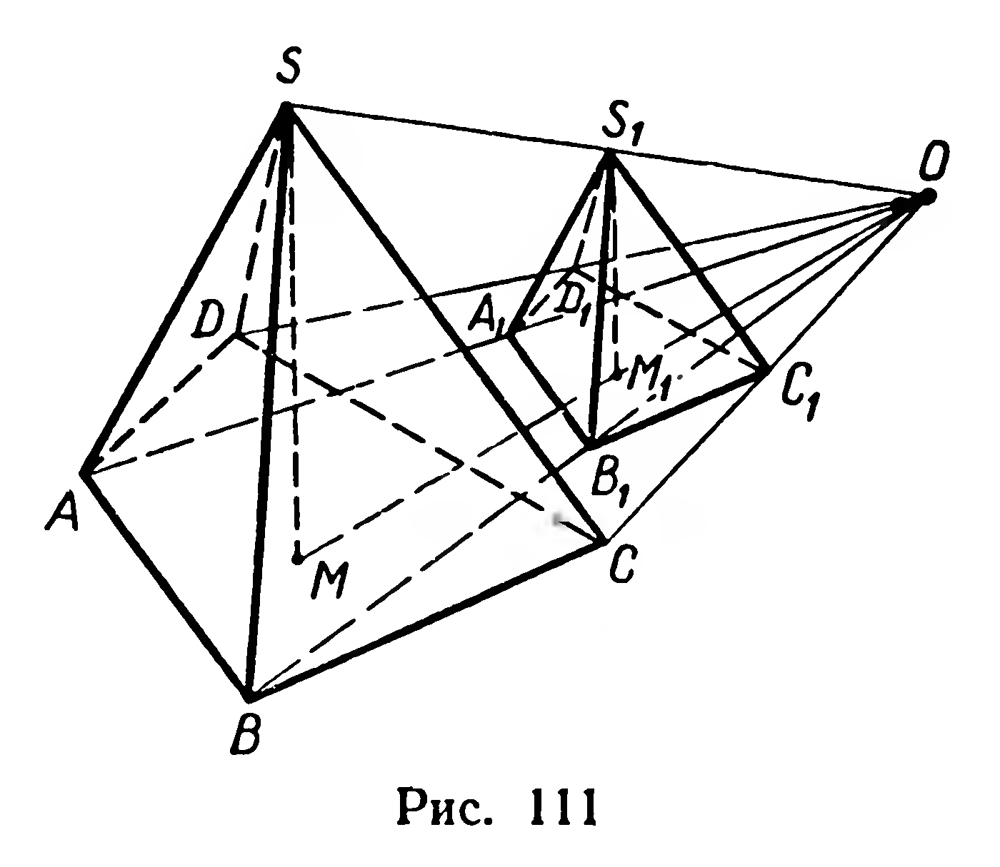
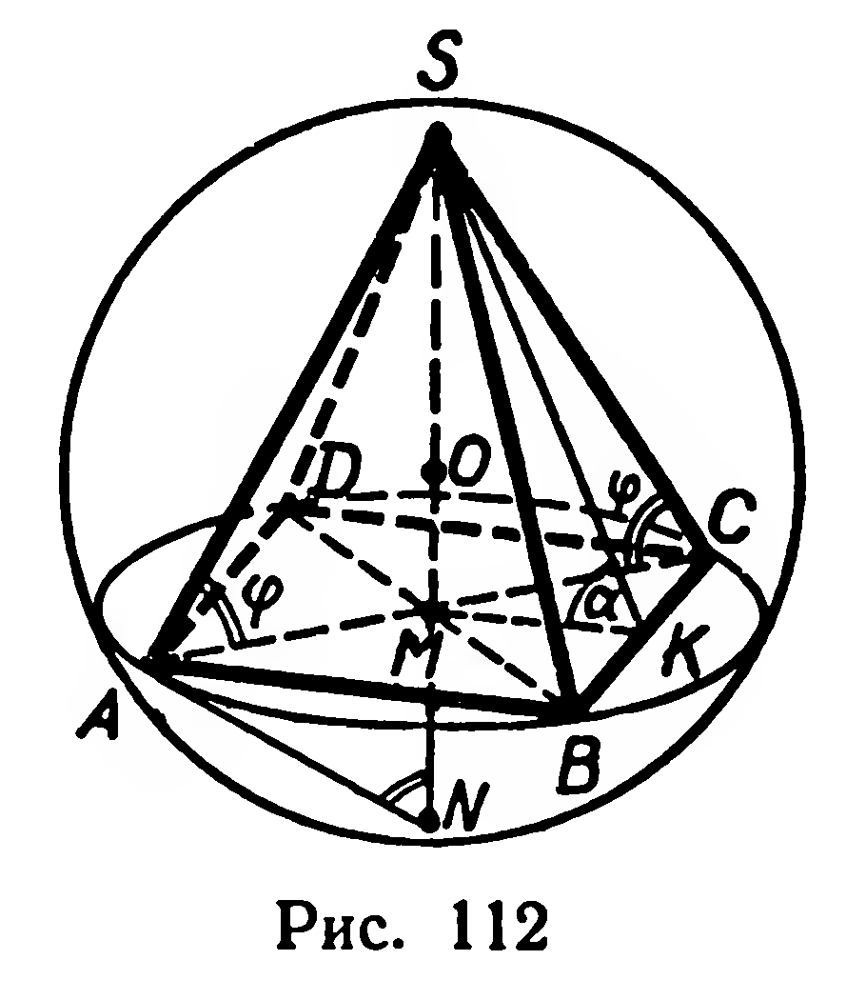
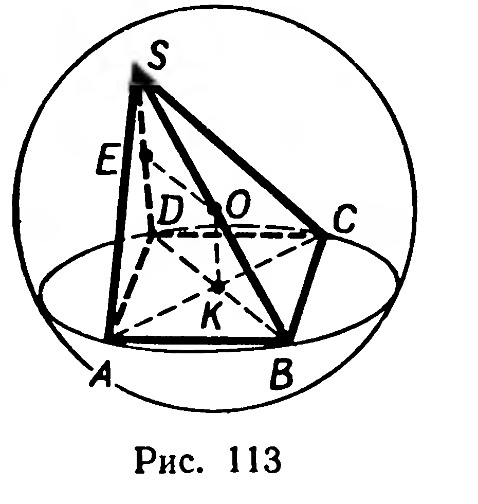
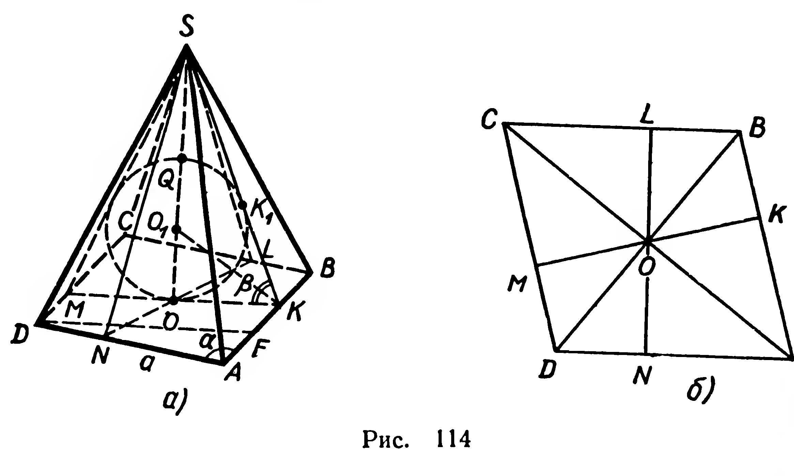
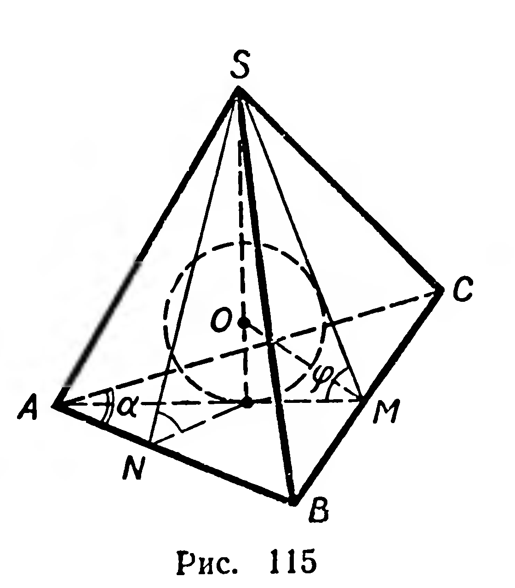

## 7.2. Задачи на повторение по курсу X класса

---
**стр. 175, продолжение**
---

## Задачи на повторение по курсу X класса[^1]

296. Составьте уравнение образа плоскости $ax+by+cz+d=0$ при: 1) переносе $\vec m=(p;q;r)$; 2) симметрии относительно начала координат; 3) симметрии относительно оси ординат; 4) симметрии относительно плоскости $Oxy$.

297. Составьте уравнение плоскости, проходящей через точки:

1) $M_1(0;2;3)$, $M_2(-1;3;1)$, $M_3(2;1;1)$;

2) $M_1(1;1;-1)$, $M_2(2;0;-3)$, $M_3(2;-1;4)$.

298. 1) Найдите расстояние от точки $A(-1;3;0)$ до плоскости $x-3y-2z+5=0$.

2) Найдите расстояние между плоскостями $3x+2y+4z+11=0$ и $9x+6y+12z-5=0$.

299. Пользуясь формулой косинуса угла между двумя векторами, заданными своими координатами, докажите неравенство:

$$(x_1x_2+y_1y_2+z_1z_2)^2\leqslant(x_1^2+y_1^2+z_1^2)\cdot(x_2^2+y_2^2+z_2^2).$$

300. Постройте сечение четырехугольной призмы плоскостью, проходящей через три точки, принадлежащие трем ее боковым граням, но не принадлежащие ребрам призмы.

301. Постройте сечение правильной шестиугольной призмы плоскостью, проходящей через меньшую диагональ нижнего основания и наиболее удаленную от нее вершину верхнего основания. Найдите площадь сечения, если сторона основания призмы и ее боковое ребро соответственно равны $a$ и $b$.

302. Основание параллелепипеда — ромб; одно из диагональных сечений — прямоугольник. Докажите, что плоскость другого диагонального сечения перпендикулярна плоскости основания.

303. Диагональ прямоугольного параллелепипеда равна $l$ и составляет углы $\alpha$ и $\beta$ с двумя смежными боковыми гранями. Найдите объем параллелепипеда.

304*. Угол между плоскостями диагональных сечений прямого параллелепипеда равен $\alpha$; площади сечений $Q_1$ и $Q_2$. 1) Найдите площадь боковой поверхности параллелепипеда. 2) Достаточно ли данных для нахождения его объема?

305*. 1) Три ребра прямоугольного параллелепипеда, имеющие общую точку, «видны» из точки пересечения его диагоналей под углами $\alpha$, $\beta$, $\gamma$. Докажите, что $\cos\alpha+\cos\beta+\cos\gamma=1$.

2) Из точки пересечения диагоналей прямоугольного параллелепипеда диагонали граней, выходящие из одной вершины,

[^1]: При повторении материала, кроме этих задач, используйте задачи из повторительного раздела учебного пособия для IX класса (с. 101—104).

---
**стр. 176**
---

«видны» под углами $\alpha$, $\beta$, $\gamma$. Докажите, что

$$\cos\alpha+\cos\beta+\cos\gamma=-1.$$

306. 1) Требуется изготовить закрытый ящик, площадь основания которого $1\ м^2$. Сумма длин всех ребер должна быть равна $20\ м$. Найдите размеры ящика, при которых площадь его поверхности наибольшая.

2) Требуется изготовить коробку, имеющую форму прямоугольного параллелепипеда. Площадь дна коробки должна быть равна $2\ дм^2$, а площадь боковой поверхности $18\ дм^2$. При каких размерах коробки сумма длин всех ребер будет наименьшей?

307. Сторона основания правильной четырехугольной пирамиды $SABCD$ равна $a$, высота $H$. Найдите расстояние между прямыми $SA$ и $BD$.

308*. Один из плоских углов при вершине треугольной пирамиды прямой, высота пирамиды проходит через точку пересечения высот основания. Найдите остальные плоские углы при вершине пирамиды.

309. Плоский угол при вершине правильной четырехугольной пирамиды равен $\varphi$. Найдите: 1) угол между плоскостями основания и боковой грани; 2) угол между плоскостями противолежащих боковых граней; 3) угол между боковым ребром и плоскостью основания.

310*. Докажите, что биссектор двугранного угла тетраэдра делит противолежащее ребро в отношении, равном отношению площадей граней, образующих этот двугранный угол.

311*. Разделите куб на три попарно конгруэнтные четырехугольные пирамиды.

312. Постройте сечение четырехугольной пирамиды плоскостью, параллельной одной из ее боковых граней и проходящей через данную внутреннюю точку отрезка, соединяющего вершину пирамиды с точкой пересечения диагоналей основания.

313. Основанием пирамиды $SABCD$ служит квадрат. Ребро $SA$ перпендикулярно основанию; площадь основания в $m$ раз меньше площади боковой поверхности. Найдите углы наклона граней $SCD$ и $SBC$ к плоскости основания.

314*. Докажите, что отрезки, соединяющие вершины тетраэдра с точками пересечения медиан противолежащих граней, пересекаются в одной точке и эта точка делит каждый из отрезков в отношении $3:1$, считая от вершины.

315. 1) Постройте сечение правильной треугольной пирамиды, плоскость которого проходит через середину бокового ребра, параллельна противолежащему ребру и перпендикулярна плоскости основания.

2) Найдите объем отсеченной пирамиды, если объем данной пирамиды равен $V$.

316. Основание пирамиды — прямоугольный треугольник с площадью $Q$ и острым углом $\alpha$. Боковая грань, которая проходит через катет, прилежащий к данному углу, перпендикулярна

---
**стр. 177**
---

плоскости основания, две другие грани образуют с основанием углы, равные $\beta$. Найдите объем пирамиды.

317*. 1) Докажите, что середины ребер правильного тетраэдра служат вершинами правильного октаэдра.

2) Найдите объем этого октаэдра, если объем тетраэдра равен $V$.

318. Доказать, что при гомотетии отношение объема образа выпуклого многогранника к объему этого многогранника равно модулю куба коэффициента гомотетии.

Решение. 1) Рассмотрим сначала частный случай: данный многогранник является пирамидой.

Пусть при гомотетии $H_O^k$ пирамида $SABCD$ отображается на пирамиду $S_1A_1B_1C_1D_1$ (рис. 111). Так как гомотетия сохраняет величину угла, $H_O^k$ отображает высоту $SM$ первой пирамиды на высоту $S_1M_1$ второй пирамиды. Найдем отношение объемов этих пирамид:

$$\frac{V_1}{V}=\frac{\frac13Q_1\cdot|S_1M_1|}{\frac13Q\cdot|SM|}=\frac{Q_1\cdot|S_1M_1|}{Q\cdot|SM|},$$

где $Q$ и $Q_1$ — площади оснований этих пирамид. Но $|S_1M_1|=|k|\cdot|SM|$, $Q_1=k^2Q$. Поэтому

$$\frac{V_1}{V}=\frac{k^2Q|k|\cdot|SM|}{Q\cdot|SM|}=|k|^3.$$

2) Пусть дан многогранник $\Phi$. Разобьем его на пирамиды $\Phi_1,\Phi_2,\ldots,\Phi_n$, общей вершиной которых служит внутренняя точка многогранника, а основаниями — его грани. Гомотетия $H_O^k$ отображает многогранник $\Phi$ на многогранник $\Phi'$, причем

$$\Phi'=\Phi'_1\cup\Phi'_2\cup\ldots\cup\Phi'_n,$$

где $\Phi'_i=H_O^k(\Phi_i)$. Таким образом, многогранники $\Phi$ и $\Phi'$ состоят из попарно гомотетичных пирамид, объемы которых обозначим соответственно $V_1,V_2,\ldots,V_n$ и $W_1,W_2,\ldots,W_n$. Имеем: $W_1=|k|^3V_1$, $W_2=|k|^3V_2$, …, $W_n=|k|^3V_n$. Сложив эти равенства, получим, что $V(\Phi')=|k|^3V(\Phi)$.

319. Дан прямоугольный параллелепипед. Докажите, что сумма квадратов расстояний от произвольной точки пространства до концов любой его диагонали не зависит от выбора диагонали.

320. Постройте общий перпендикуляр оси цилиндра и диагонали его сечения, проведенного через две образующие.

321. 1) На данном изображении цилиндра постройте изображение правильной вписанной в него: а) четырехугольной призмы; б) треугольной призмы.

2) Найдите отношение площади боковой поверхности цилиндра к площади боковой поверхности каждой из этих призм.

---
**стр. 178**
---

**322.** Площадь осевого сечения конуса равна $S$, а площадь сечения, проведенного через середину высоты параллельно основанию конуса, равна $Q$. Найдите угол между образующей и плоскостью основания конуса.

**323.** 1) На данном изображении конуса постройте изображение правильной треугольной пирамиды, вписанной в конус.

2) Вычислите отношение площадей боковых поверхностей пирамиды и конуса, если высота конуса 20 см, а диаметр его основания 40 см.

**324\*.** В конус вписана пирамида $SABC$. Ее основание — равнобедренный треугольник $(|AB|=|AC|)$, $|BC|=a$, $\widehat{CAB}=\alpha$, а боковая грань $SCB$ наклонена к плоскости основания под углом $\beta$. Найдите площадь боковой поверхности конуса.

**325.** Расстояние от центра основания до боковой грани правильной четырехугольной пирамиды равно $b$, угол между высотой пирамиды и боковой гранью равен $\alpha$. Найдите площадь полной поверхности конуса, вписанного в данную пирамиду. Вычислите при $b=34{,}5$ дм, $\alpha=34^\circ16'$.

**326.** Найдите объем фигуры, полученной при вращении прямоугольника со сторонами $a$ и $b$ вокруг оси, которая лежит в плоскости этого прямоугольника, перпендикулярна его диагонали и проходит через ее конец.

**327\*.** Радиусы оснований усеченного конуса $R$ и $r$, образующая составляет с плоскостью основания угол $\varphi$. Найдите отношение площадей боковых поверхностей усеченного конуса и правильной усеченной четырехугольной пирамиды, вписанной в него. Укажите лишние данные условия задачи.

**328.** 1) Найдите множество всех точек, удаленных от точки $A$ на расстояние $a$ и от точки $B$ на расстояние $b$.

2) Дана плоскость $\alpha$ и на ней точка $A$. Найдите множество всех точек, удаленных от $A$ на расстояние $a$ и от $\alpha$ на расстояние $b$.

3) Дана прямая $l$ и на ней точка $A$. Найдите множество всех точек, удаленных от $l$ на расстояние $h$ и от точки $A$ на расстояние $p$.

**329\*.** Найдите множество всех точек пространства, разность квадратов расстояний от которых до двух данных точек равна $k^2$.

**330\*.** Найдите множество всех точек пространства, сумма квадратов расстояний от которых до двух данных точек равна $k^2$.

**331\*.** Составьте уравнение образа сферы $(x+1)^2+(y-2)^2+(z-5)^2=9$: 1) при симметрии относительно оси аппликат; 2) при симметрии относительно плоскости $z=0$.

**332.** Какая фигура является пересечением сферы $x^2+y^2+z^2=1$ и плоскости: 1) $x+y+z=1$; 2) $3x-4y-z=6$; 3) $3x+4y=5$?

**333\*.** Докажите, что уравнение плоскости, касающейся сферы
$$(x-a)^2+(y-b)^2+(z-c)^2=R^2$$
в точке $A(m;p;q)$, имеет вид:
$$(a-m)(x-m)+(b-p)(y-p)+(c-q)(z-q)=0.$$

---
**стр. 179**
---

**334\*.** Выясните, пересекаются ли сферы, заданные уравнениями:

1) $x^2+(y-2)^2+(z-3)^2=1$ и
$$(x-1)^2+y^2+z^2=4;$$

2) $x^2+y^2+z^2-2x=0$ и
$$x^2+y^2+z^2-4x-6z+4=0.$$

**335.** 1) Ребро двугранного угла, равного $\alpha$, проходит через центр сферы радиуса $R$. Найдите площадь части сферы, содержащейся в двугранном угле.

2) Найдите площадь части поверхности земного шара, заключенной между Гринвичским и Пулковским меридианами.

**336.** В цилиндр, вписанный в шар, вписан шар. Найдите отношение площадей поверхностей и объемов этих шаров.

**337.** В конус, вписанный в сферу, вписана сфера. Найдите отношение площадей этих сфер, если угол между образующей и основанием конуса равен $\varphi$.

**338.** Площадь боковой поверхности усеченного конуса в $m$ раз больше площади вписанной в него сферы. Найдите угол между образующей и плоскостью основания усеченного конуса.

**339.** Многогранник называется *вписанным в сферу* (в шар), если все вершины многогранника принадлежат сфере.

В сферу вписана правильная четырехугольная пирамида, у которой двугранный угол при основании равен $\alpha$. Зная, что площадь сферы равна $S$, найти площадь основания пирамиды.

Р е ш е н и е. Пусть $SABCD$ — данная пирамида, вписанная в сферу (рис. 112). Плоскость основания пирамиды пересекает сферу по окружности, описанной около квадрата $ABCD$ (основание высоты пирамиды является центром этой окружности).

Из теоремы о сечении сферы следует, что перпендикуляр $(SM)$ к плоскости $ABC$ проходит через центр $O$ сферы.

Рассмотрим $\triangle SAC$. Введем вспомогательный (пока неизвестный) угол $\widehat{SAM}=\varphi$. По доказанному $O$ принадлежит плоскости $SAC$, тогда $\triangle SAC$ можно считать вписанным в большую окружность сферы; диаметром этой окружности служит отрезок $SN$.

Из прямоугольных треугольников $SAN$ и $SMA$ имеем: $\widehat{SNA}=\varphi$,
$$|SA|=|SN|\cdot\sin\widehat{SNA}=2R\sin\varphi;\quad |AM|=|AS|\cdot\cos\widehat{SAM}=$$
$$=2R\sin\varphi\cos\varphi=R\sin2\varphi.$$
Тогда
$$S_{\text{осн}}=\frac12|AC|\cdot|BD|=2R^2\sin^22\varphi.$$

По условию $4\pi R^2=S$, отсюда $R^2=\dfrac{S}{4\pi}$ и
$$S_{\text{осн}}=\frac{S}{2\pi}\sin^22\varphi.$$

Остается выразить $\sin2\varphi$ через функции угла $\alpha$. Из прямоугольных треугольников $SMC$ и $SMK$ выразим их общую сторону $|SM|$. Из $\triangle SMC$ имеем: $|SM|=|MC|\tg\varphi$. Из $\triangle SMK$: $|SM|=|MK|\tg\alpha$. Тогда $|MC|\tg\varphi=|MK|\tg\alpha$. Но $|MC|=|MK|\sqrt2$,

---
**стр. 180**
---

поэтому $\sqrt2\tg\varphi=\tg\alpha$, $\tg\varphi=\dfrac{\tg\alpha}{\sqrt2}$. По формуле
$$\sin2\varphi=\frac{2\tg\varphi}{1+\tg^2\varphi}$$
получим:
$$\sin2\varphi=\frac{2\sqrt2\tg\alpha}{2+\tg^2\alpha}.$$

Следовательно,
$$S_{\text{осн}}=\frac{4S\tg^2\alpha}{\pi(2+\tg^2\alpha)^2}.$$

**340.** Правильная четырехугольная пирамида вписана в сферу. Найдите объем пирамиды, если радиус сферы равен 12 см, а радиус окружности, описанной около основания пирамиды, равен 6 см.

**341.** Правильная треугольная пирамида вписана в сферу. Найдите объем пирамиды, если ее боковое ребро составляет с плоскостью основания угол $\alpha$, а расстояние от центра сферы до основания пирамиды равно $d$ $(d\ne0,\ \alpha<45^\circ)$.

**342.** Прямая призма, основание которой — прямоугольный треугольник с катетами $a$ и $b$, вписана в сферу. Найдите высоту призмы, если радиус сферы равен $R$.

**343.** Прямая четырехугольная призма, основание которой — трапеция $ABCD$, вписана в шар. Известно, что высота призмы равна $H$, $|AB|=|BC|=a$, $\widehat{BAD}=\alpha$. Найдите объем шара.

**344\*.** Пирамида, основание которой — прямоугольник со сторонами 6 дм и 7 дм, вписана в сферу. Высота пирамиды проходит через вершину основания и равна 6 дм. Найдите радиус сферы (рис. 113).

**345\*.** Пирамида, основанием которой служит правильный треугольник со стороной $a$, вписана в шар. Две боковые грани пирамиды перпендикулярны плоскости основания, третья грань образует с основанием двугранный угол $\varphi$. Найдите объем шара.

---
**стр. 181**
---

**346.** Сфера называется *вписанной в многогранник*, если все грани многогранника касаются сферы.

1) Основание пирамиды — ромб со стороной $a$ и острым углом $\alpha$, каждый из двугранных углов при основании равен $\beta$. Найти объем шара, вписанного в пирамиду.

Р е ш е н и е. Пусть $SABCD$ — данная пирамида (рис. 114), $ABCD$ — ромб, $\angle DAB<90^\circ$. Проведем $[SO]\perp(ABC)$, через точку $O$ проведем высоты $[MK]$ и $[NL]$ ромба. $[SK]\perp[AB]$ (теорема о трех перпендикулярах), $\angle SKO$ — линейный угол двугранного угла с ребром $AB$. Аналогично получим линейные углы при остальных сторонах основания пирамиды. Согласно условию задачи

$$
\angle SKO=\angle SLO=\angle SMO=\angle SNO.
$$

Прямоугольные треугольники $SKO$, $SLO$, $SMO$, $SNO$ конгруэнтны, так как они имеют общий катет $SO$ и равные углы, противолежащие этому катету. Отсюда $|OK|=|OL|=|OM|=|ON|$ и $O$ — центр окружности, вписанной в ромб $ABCD$, т. е. $O$ — точка пересечения диагоналей $AC$ и $BD$.

По условию в данную пирамиду вписан шар. Докажем, что его центр принадлежит высоте $SO$ пирамиды.

Впишем в треугольник $SOK$ полуокруг $OK_1Q$, центр $O_1$ которого принадлежит $[SO]$, а дуга касается $[SK]$ и $[OK]$. При вращении полуокруга $OK_1Q$ вокруг оси $SO$ получим шар, вписанный в пирамиду. Точки касания сферы и боковых граней будут принадлежать высотам этих граней, проведенным из точки $S$. Этот шар касается и основания пирамиды в точке $O$. Итак, центр шара, вписанного в пирамиду $SABCD$, принадлежит высоте пирамиды.

Имеем: $|AB|=|AD|=a$, $\angle DAB=\alpha$, $\angle SKO=\beta$.

Найдем объем вписанного шара. $V=\dfrac43\pi|O_1O|^3$. Проведем $[DF]\perp[AB]$, тогда $[DF]\parallel[MK]$ и $|DF|=|MK|$. Из $\triangle ADF$ получим: $|DF|=a\sin\alpha$, тогда $|OK|=\dfrac12|MK|=\dfrac12a\sin\alpha$. Из $\triangle O_1OK$, где $\angle O_1KO=\dfrac\beta2$, имеем:

$$
|O_1O|=|OK|\tg\frac\beta2=\frac12a\sin\alpha\tg\frac\beta2.
$$

Следовательно,

$$
V=\frac43\pi\left(\frac12a\sin\alpha\tg\frac\beta2\right)^3
=\frac16\pi\left(a\sin\alpha\tg\frac\beta2\right)^3.
$$

2) Докажите, что во всякую пирамиду, у которой двугранные углы при основании равны, можно вписать сферу.

**347.** В правильную четырехугольную пирамиду вписан шар. Расстояние от центра шара до вершины пирамиды равно $a$, двугранный угол при основании равен $\alpha$. Найдите площадь полной поверхности пирамиды.

**348\*.** Основанием пирамиды служит равнобедренный треугольник с углом $\alpha$ при вершине, все боковые грани пирамиды наклонены к основанию под углом $\varphi$ (рис. 115). Объем шара, вписанного в пирамиду, равен $V$. Найдите объем пирамиды.

---
**стр. 182**
---

**349.** 1) Докажите, что объем треугольной пирамиды равен одной трети произведения площади ее полной поверхности на радиус вписанной сферы.

2) Верно ли это свойство для других выпуклых многогранников, в которые вписаны сферы?

**350.** 1) В правильную треугольную пирамиду, вписанную в шар, вписан шар. Докажите, что эта пирамида является правильным тетраэдром, если центры шаров совпадают.

2*) В правильную четырехугольную пирамиду, вписанную в шар, вписан шар. Найдите угол между плоскостями боковой грани и основания пирамиды, если известно, что центры шаров совпадают.

**351.** Основание прямой призмы — прямоугольный треугольник с катетом $a$ и противолежащим острым углом $\alpha$. Найдите объем шара, вписанного в призму.

**352.** В правильную треугольную призму, вписанную в сферу, вписана сфера. Найдите отношение площадей этих сфер.

**353\*.** 1) Докажите, что если сфера касается всех ребер параллелепипеда, то параллелепипед является кубом.

2) Докажите, что если сфера касается всех ребер тетраэдра, то суммы длин его противолежащих ребер равны.

**354.** Шар вписан в прямую призму, основанием которой является равнобедренный треугольник с площадью $S$ и углом $\alpha$ при вершине. Найдите площадь поверхности шара.

**355.** 1) На изготовление открытой цилиндрической консервной банки расходуется $S\ см^2$ жести. Каковы должны быть линейные размеры банки, чтобы ее объем был наибольшим?

2) Цилиндрическая бочка для горючего вмещает 400 л. При каких линейных размерах бочки на ее изготовление будет затрачено наименьшее количество материала?

**356\*.** Известно, что площадь полной поверхности конуса в $m$ раз больше площади поверхности вписанного в него шара. Найдите угол между образующей конуса и плоскостью его основания.

**357\*.** В конус вписан шар. Отношение объемов конуса и шара равно 2. Найдите отношение площадей полных поверхностей конуса и шара.

**358.** Шар радиуса $R$ вписан в конус. Из центра шара образующая конуса видна под углом $\alpha$. Найдите объем конуса.

**359\*.** Плоскость, перпендикулярная к высоте конуса, проходит через центр описанного шара и делит конус на две части, имеющие равные объемы. Найдите угол между образующей и плоскостью основания конуса.

---
**стр. 183**
---

**360.** В усеченный конус вписан шар радиуса $r$. Образующая конуса наклонена к плоскости основания под углом $\alpha$. Найдите объем усеченного конуса.

**361.** Около шара описан усеченный конус, площадь осевого сечения которого $S$, острый угол сечения $\alpha$. Найдите объем шара. Вычислите при $S=52\ дм^2$, $\alpha=81^\circ$.

**362.** Докажите, что отношение объемов шара и описанного около него усеченного конуса равно отношению площадей поверхностей этих фигур.

**363.** В правильную четырехугольную пирамиду вписан конус. Найдите площадь поверхности конуса, если сторона основания пирамиды равна $b$, а угол между высотой пирамиды и плоскостью боковой грани $\varphi$.

**364.** Сторона основания правильной четырехугольной пирамиды равна $a$, двугранный угол при основании равен $\alpha$. В пирамиду вписан цилиндр так, что одно его основание лежит в основании пирамиды, а окружность другого основания имеет единственную общую точку с каждой из боковых граней. Найдите объем цилиндра, зная, что его высота и радиус основания равны.

**365.** Усеченный конус вписан в четырехугольную усеченную пирамиду, основанием которой служит равнобедренная трапеция с острым углом $\varphi$, боковые стороны оснований равны $a$ и $b$ $(a>b)$. Боковое ребро пирамиды образует с большей из параллельных сторон основания угол $\alpha$. Найдите объем усеченного конуса.

**366.** Основанием пирамиды служит прямоугольный треугольник; боковые грани, проходящие через катеты, составляют с основанием углы $30^\circ$ и $60^\circ$. Найдите объем и площадь боковой поверхности конуса, описанного около пирамиды, если высота пирамиды равна $h$.

**367.** В прямую призму, основанием которой служит прямоугольный треугольник с углом $\alpha$ и гипотенузой $c$, вписана сфера. Найдите объем призмы.

**368.** Сторона основания правильной четырехугольной пирамиды равна $a$, плоский угол при вершине $\alpha$. Найдите площадь поверхности сферы, вписанной в пирамиду. Вычислите при $a=10{,}75\ дм$, $\alpha=41^\circ44'$.

**369.** Около шара радиуса $R$ описана $n$-угольная правильная усеченная пирамида с двугранным углом $\alpha$ при основании. Найдите площадь боковой поверхности усеченной пирамиды. Достаточно ли данных для вычисления ее объема?

**370.** В куб с ребром $a$ вписана сфера. Найдите радиус другой сферы, касающейся трех граней куба и первой сферы.

**371\*.** Правильный тетраэдр содержится в шаре радиуса $R$, так что три его вершины принадлежат сфере, а центр сферы принадлежит тетраэдру и находится на расстоянии $d$ от его четвертой вершины. Найдите ребро тетраэдра.

---
**стр. 184**
---

**372.** Через сторону основания правильной треугольной пирамиды и центр вписанного в пирамиду шара проведена плоскость. В каком отношении эта плоскость делит объем пирамиды, если ее боковое ребро в 3,5 раза больше стороны основания?

**373.** В правильную четырехугольную пирамиду, сторона основания которой равна $a$, плоский угол при вершине $\alpha$, вписана полусфера, основание которой лежит в основании пирамиды. Найдите объем многогранника, четыре вершины которого являются точками касания сферы с боковыми гранями пирамиды, а пятая вершина — центром сферы.

**374.** Многогранник является объединением двух правильных четырехугольных пирамид, симметричных относительно плоскости их общего основания. В этот многогранник вписана сфера. Найдите ее радиус, если сторона основания пирамиды равна $a$, а плоский угол при вершине $\alpha$.

**375.** В правильную четырехугольную пирамиду $SABCD$, у которой $|AB|=1$ дм, $|SA|=\dfrac{\sqrt5}{2}$ дм, вписан шар. Через точку касания шара с гранью $SAB$ и точку шара, ближайшую к вершине $S$, проведена плоскость, параллельная стороне $AB$. Найдите площадь сечения пирамиды этой плоскостью.

**376.** Сфера вписана в прямую призму, основанием которой служит прямоугольная трапеция с параллельными сторонами длиной $a$ и $b$. Найдите объем призмы.

**377\*.** Основание пирамиды $SABC$ — прямоугольный треугольник, катеты $CA$ и $CB$ которого равны $a$, боковое ребро $SC$ перпендикулярно основанию и также равно $a$. Найдите радиус сферы, вписанной в пирамиду.

**378\*.** Основанием пирамиды служит квадрат со стороной $a$, два двугранных угла при ребрах основания — прямые, а два других равны $\varphi$. Найдите радиус сферы, вписанной в пирамиду.

**379\*.** Докажите, что если все грани параллелепипеда равновелики, то в него можно вписать сферу. Убедитесь в том, что диагональные сечения такого параллелепипеда, не имеющие общей диагонали, взаимно перпендикулярны.
