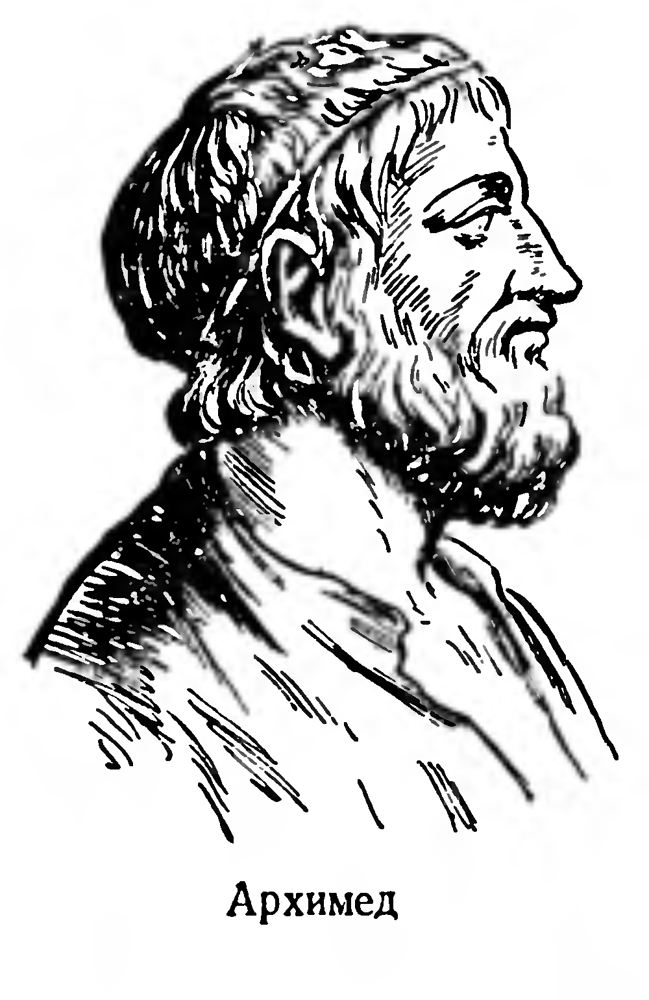
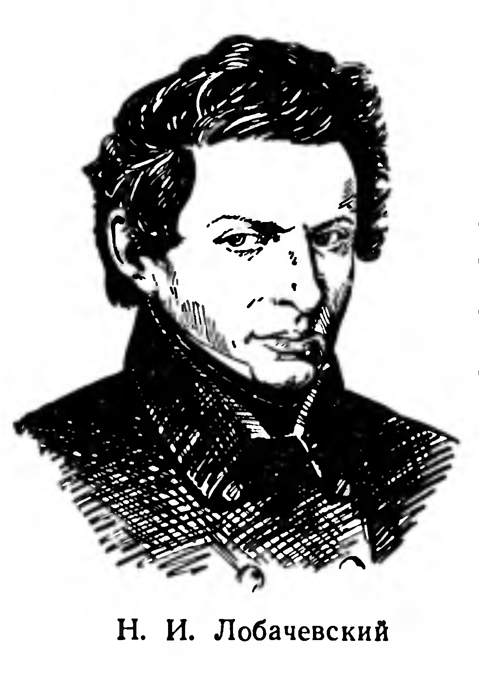
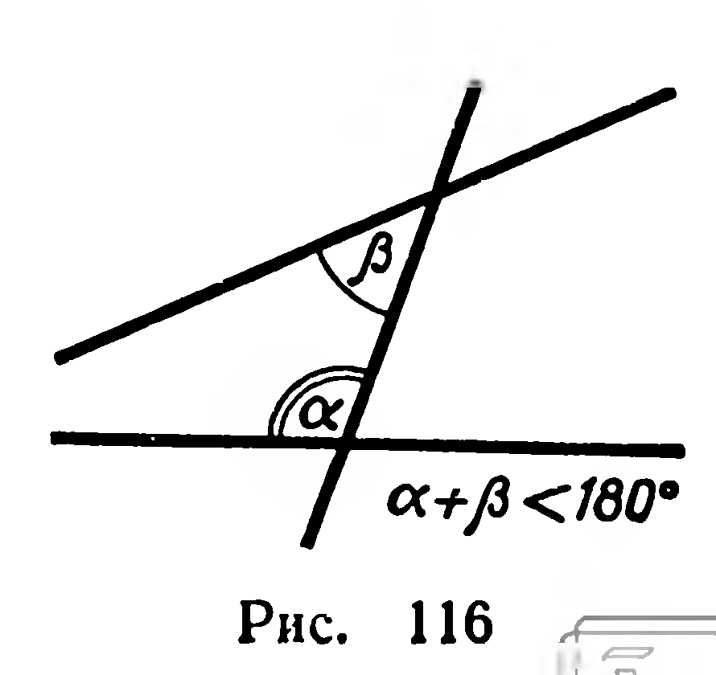
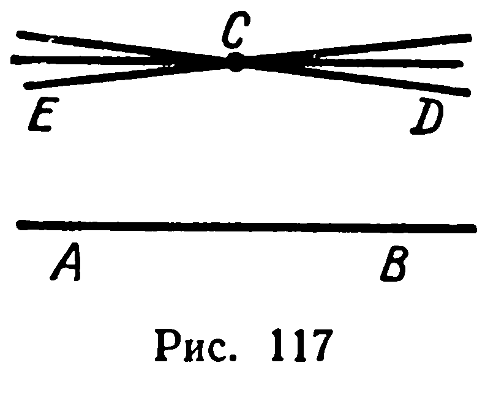
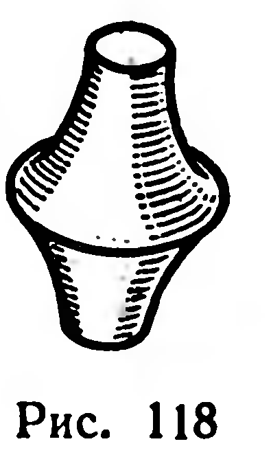

## 7.3. Исторический очерк

---
**стр. 185**
---

# ИСТОРИЧЕСКИЙ ОЧЕРК

Геометрия, как и другие науки, возникла из практических потребностей людей. При изготовлении орудий труда, строительстве жилищ у человека возникла необходимость определять форму и размеры предметов.

Дошедшие до нас памятники материальной культуры и многочисленные письменные документы древности свидетельствуют о том, что уже около 4000 лет тому назад жители Древнего Египта и Вавилона обладали значительным запасом геометрических сведений. Например, египетские пирамиды (гробницы фараонов) отличаются удивительной правильностью формы. Ясно, что руководить их строительством могли лишь люди, располагавшие геометрическими знаниями. В древнеегипетских папирусах, относящихся к 2000—1700 гг. до н. э., содержится решение ряда геометрических задач, причем некоторые из них решены безукоризненно.

Заслуги в деле дальнейшего накопления и систематизации геометрических сведений принадлежат ученым Древней Греции.

Первые доказательства геометрических фактов связывают с именем Фалеса Милетского (639—548 гг. до н. э.). Какие способы рассуждений применял Фалес, мы можем только догадываться. Например, вдумываясь в формулировки теорем Фалеса: «диаметр делит круг пополам», «вертикальные углы равны», «углы при основании равнобедренного треугольника равны», можно предположить, что истинность этих свойств обнаруживалась путем совмещения одной фигуры с другой. Фалесу приписывается также доказательство признаков конгруэнтности треугольников, доказательство теоремы о конгруэнтных отрезках, отсекаемых на двух прямых параллельными прямыми, и др.

Автором доказательств многих теорем называют Пифагора (564—473 гг. до н. э.). Впрочем, знаменитая «теорема Пифагора» была известна задолго до него. Остается неустановленным, кто впервые доказал эту теорему и какое доказательство было дано самим Пифагором.

Доказательства истинности геометрических фактов, общие методы рассуждений в науке привлекли внимание выдающихся философов древности: Демокрита, Платона, Аристотеля. В V и

---
**стр. 186**
---

IV вв. до н. э. были предприняты попытки последовательного изложения геометрического материала в виде ряда утверждений, подкрепленных доказательствами.

Первые работы по систематизации геометрии до нас не дошли: все они были забыты после появления знаменитых «Начал» Евклида (около 300 г. до н. э.). Последовательность и строгость изложения сделали это произведение источником геометрических знаний во многих странах мира в течение более двух тысячелетий. До недавнего времени почти все школьные учебники геометрии были во многом сходны с «Началами».

Величайший математик древности Архимед (287—212 гг. до н. э.) углубил и дополнил теоретические положения Евклида. Среди открытий Архимеда отметим глубокую разработку вопросов, связанных с измерением длины окружности и площади круга, с вычислением объемов фигур, в том числе цилиндра и шара. Архимед погиб как патриот, защищая родной город Сиракузы от нападения римских захватчиков. Он завещал на надгробном камне изобразить шар, вписанный в цилиндр. Доказательство того, что объем этого шара составляет $\dfrac23$ объема цилиндра, явилось одним из научных достижений Архимеда.

Современник Архимеда, Аполлоний Пергский, написал обстоятельный трактат о конических сечениях: эллипсах, гиперболах и параболах. Несколько позже, во II в. до н. э., Гиппарх составил первую (не дошедшую до нас) таблицу хорд, она заменяла применяющиеся сейчас таблицы синусов.

Ряд работ, посвященных правилам вычислений в геометрии, появляется в I и II вв. н. э. Так, в книге Герона из Александрии «Метрика» даны правила вычисления площадей и объемов, например правило нахождения площади треугольника, у которого заданы длины трех сторон (впрочем, это правило было известно еще Архимеду). Таблица хорд, составленная Птолемеем, содержала длины хорд для углов от $0^\circ$ до $180^\circ$ через каждые $0{,}5^\circ$.

После гибели рабовладельческих государств древности, в средние века, центр передовой науки перемещается в страны Востока — в Среднюю Азию, арабские страны, Индию.

Расцвет математики в Индии относится к V—XII вв. Индийцы уделяли большое внимание вычислительной геометрии: вычислению площадей поверхностей и объемов фигур, тригонометрическим вычислениям. В тригонометрии они пользовались не хордой, а полухордой; наряду с синусом они ввели функцию, называемую теперь косинусом.

---
**стр. 187**
---

В трудах индийских ученых подробные обоснования нередко отсутствовали: иногда чертеж и слово «смотри!» подле него составляли все изложение теоремы.

Завоевания арабов в VII в. привели к возникновению на территории от Индии до Испании обширных государств, росту городов, оживлению хозяйственной и культурной жизни. В области математики арабы использовали достижения ученых Индии, Китая и труды античных авторов. К концу IX в. на арабский язык были переведены творения Евклида, Архимеда, Аполлония и их многочисленных комментаторов. На арабском языке были написаны математические сочинения ученых, живших в IX—XI вв. на территории, занимаемой ныне среднеазиатскими республиками Советского Союза.

Особенно широкое развитие получают в то время разделы математики, важные для решения практических вопросов астрономии, оптики, техники. В связи с этим алгебра и тригонометрия, отдельные задачи которых решались еще в древности, формируются в самостоятельные математические дисциплины; значительно совершенствуются методы геометрических построений и графические методы решения задач. Но не забываются и теоретические проблемы, волновавшие античных ученых. Крупнейшие ученые Востока, такие, как знаменитый математик и поэт Омар Хайям (XI в.), работавший в Средней Азии и Иране, и Насир-ад-Дин-ат-Туси (XIII в., Иран и Азербайджан), создают оригинальные теории параллельных прямых и геометрическую теорию пропорций.

В XII в., в связи с крестовыми походами, в Европе возникает интерес к математической культуре арабов. С арабского языка на латинский (бывший тогда официальным языком ученых всех стран Европы) переводятся «Начала» Евклида. В эпоху раннего Возрождения (XIV—XV вв.) математические знания распространялись среди все более широкого круга ученых. Накануне великих географических открытий (XV в.) особый интерес возник к астрономии и вследствие этого к тригонометрии.

Влияние арабских ученых заметно в первом изданном в Европе пособии по тригонометрии «Пять книг о треугольниках всякого рода» (1461 г.). Автором этого пособия был Иоганн Мюллер, известный в науке под латинизированным именем Региомонтана. Вслед за арабскими учеными Региомонтан употребляет тригонометрические функции, которые мы называем тангенсом и котангенсом, применяет алгебру при решении геометрических задач.

Бурное развитие техники, начавшееся в странах Западной Европы в XVI—XVII вв., привело к не менее значительным результатам в области математики.

Рене Декарт, французский философ и математик первой половины XVII в., в своей «Геометрии» впервые ввел в математику переменные величины. Декарт рассматривал линии на плоскости как графики функций, выражающих зависимость одной перемен-

---
**стр. 188**
---

ной величины от другой. Тем самым он заложил основы аналитической геометрии плоскости.

Вскоре переменные величины окончательно укоренились в математике благодаря работам Исаака Ньютона (1643—1727, Англия) и Готфрида Вильгельма Лейбница (1646—1716, Германия), завершивших создание основ дифференциального и интегрального исчисления. Математические открытия Декарта, Ньютона и Лейбница были подлинной революцией в математике. С помощью новых разделов математики было легко найдено решение многих геометрических задач: о проведении касательной к произвольной кривой, о вычислении площадей и объемов различных фигур.

С XVII в. трудами французских ученых Дезарга и Паскаля положено начало новому направлению в геометрии, получившему в дальнейшем наименование проективной геометрии. Полутора столетиями позднее их соотечественник Гаспар Монж разработал метод изображения фигур с помощью ортогонального проектирования на две плоскости. Работы Монжа послужили основой технического черчения и начертательной геометрии.

С XVIII в. в России начинают печататься учебники и научные труды по геометрии. Разделы, посвященные геометрии, имелись в первом русском учебнике математики — «Арифметике» Л. Ф. Магницкого, вышедшем в 1703 г. Леонард Эйлер (1707—1783), многие годы живший и работавший в России, обнаружил ряд замечательных свойств поверхностей и пространственных кривых. Благодаря исследованиям Эйлера и Монжа в XVIII в. возникает метод изучения свойств геометрических фигур, основанный на применении производной, — дифференциальная геометрия.

В XIX в. в связи с задачами геометрии, механики и физики возникает векторное исчисление. Термин «вектор» предложил английский ученый У. Р. Гамильтон; изложение векторного исчисления, близкое к современному, принадлежит физику Дж. В. Гиббсу (1839—1903, США).

Немалый вклад в разработку теории и приложений векторов внес русский математик А. П. Котельников.

К середине XIX в. русские ученые не только поднялись до уровня, достигнутого передовыми математиками Западной Европы, но и сделали ряд открытий первостепенной важности. Особое место здесь принадлежит великому русскому ученому Н. И. Лобачевскому (1792—1856), создавшему неевклидову геометрию.

---
**стр. 189**
---

Чтобы лучше уяснить значение научного подвига Н. И. Лобачевского, рассмотрим некоторые особенности «Начал» Евклида.

Евклид начинает с определений геометрических понятий: точки, линии, прямой, поверхности, плоскости, тела, угла и т. п. Так, первое определение гласит: точка есть то, что не имеет частей. Определение прямой таково: прямая — это линия, одинаково расположенная относительно всех своих точек. Приведенные определения можно рассматривать лишь как наглядные описания понятий точки и прямой, причем эти описания не вполне удачны. Например, «определению» прямой, по-видимому, удовлетворяет и окружность и сфера. Разумеется, опираться на такие определения при построении математической теории нельзя — Евклид и не пытается этого делать.

Затем Евклид формулирует десять аксиом, первые пять из которых он называет постулатами¹. Например, первый из этих постулатов утверждает: «От каждой точки до каждой другой точки можно провести одну прямую линию», а первая аксиома такова: «Равные одному и тому же равны между собой». На основе постулатов и аксиом доказываются остальные предложения (теоремы) «Начал».

Геометры древности считали, что постулаты и аксиомы не требуют доказательства ввиду своей очевидности. Такое мнение господствовало в науке вплоть до XX в., когда оно было заменено иной, известной нам точкой зрения на аксиомы.

Во все времена особое внимание математиков привлекал пятый постулат Евклида: *если две прямые образуют с третьей по одну ее сторону внутренние углы, сумма которых меньше развернутого угла, то такие прямые пересекаются при достаточном продолжении с этой стороны* (рис. 116).

Если остальные постулаты и аксиомы казались вполне очевидными, то очевидность пятого постулата вызывала сомнения. Отличался он от других постулатов и сложностью формулировки. Поэтому были предприняты многочисленные попытки доказать этот постулат, основываясь на первых четырех постулатах и пяти аксиомах «Начал». На протяжении двух тысячелетий многие крупнейшие математики пытались это сделать, но безуспешно. Удавалось лишь заменить пятый постулат эквивалентными предложениями, которые нередко формулировались проще и обладали большей наглядностью, но тем не менее оставались недоказанными.

Безрезультатность попыток доказательства пятого постулата привела нескольких выдающихся ученых к предположению

---

¹ Евклид не указывает, в чем состоит принципиальное различие между постулатами и аксиомами. В настоящее время применяется только термин «аксиома».

---
**стр. 190**
---

о возможности существования геометрической системы, в которой вместо пятого постулата Евклида взято противоречащее ему высказывание. При этом вначале вопрос ставился чисто логически: наглядное истолкование и практические применения новой системы были отодвинуты на второй план.

Впервые такую геометрию с большой полнотой и основательностью создал Николай Иванович Лобачевский. В 1826 г. он делает устное сообщение о своем открытии, а в дальнейшем публикует ряд трудов по неевклидовой геометрии[^1].

Н. И. Лобачевский заменяет пятый постулат следующей аксиомой: *через точку $C$, не принадлежащую прямой $AB$, в плоскости $ABC$ проходит бесконечное множество прямых, не пересекающихся с $(AB)$* (рис. 117). Все остальные постулаты и аксиомы Евклида Н. И. Лобачевский принимает за истинные. Если бы пятый постулат вытекал из этих предложений, то, приняв противоречащее ему предложение, Н. И. Лобачевский должен был получить противоречие при дальнейших рассуждениях. Но никакого противоречия с остальными девятью аксиомами не получилось в многочисленных теоремах и формулах, доказанных Лобачевским на основе его аксиомы. Более того, предложения, доказанные Н. И. Лобачевским, составили стройную систему, не уступавшую «Началам» Евклида ни в полноте охвата свойств геометрических фигур, ни в логичности изложения этих свойств.

Аксиома Н. И. Лобачевского, теоремы, основанные на ней, поразили своей необычностью современников великого ученого, привыкших к геометрии Евклида. Так, например, в геометрии Лобачевского сумма углов треугольника оказалась меньше 180° и уменьшалась с увеличением его площади; в новой геометрии не существовало прямоугольников и подобных (но не конгруэнтных) фигур.

Ученые того времени не сумели оценить глубины и важности открытия, сделанного Н. И. Лобачевским. Однако вскоре после смерти «Коперника геометрии» его идеи получили всеобщее признание. Этому в особенности способствовало предложенное итальянским математиком Бельтрами доказательство выполнимости всех аксиом планиметрии Лобачевского на некоторых поверхностях вращения, существующих в «евклидовом» прост-

[^1]: Примерно в то же время независимо от Н. И. Лобачевского к открытию неевклидовой геометрии пришли замечательный венгерский математик Янош Бойяи и знаменитый Карл Фридрих Гаусс. Бойяи опубликовал свои результаты в 1832 г. Гаусс долгое время не решался публично выступить с изложением своих работ по неевклидовой геометрии, а после выхода в свет работ Лобачевского и Бойяи счел, по-видимому, такую публикацию ненужной.

---
**стр. 191**
---

ранстве. Одна из таких поверхностей изображена на рисунке 118.

В настоящее время геометрия Лобачевского входит в математическую науку на равных правах с геометрией Евклида.

Значение открытия Н. И. Лобачевского состоит не только в том, что он положил конец попыткам доказательства пятого постулата.

Создание неевклидовой геометрии показало, что геометрия Евклида не есть единственно возможное представление о пространстве, представление, которое, по мнению философов-идеалистов, является у человека врожденным, доопытным.

Появление второй логически возможной схемы пространства поставило перед учеными вопрос: какая из этих схем точнее отражает свойства реального, физического пространства в его малых участках (например, в пределах земной поверхности) и в грандиозных глубинах космоса?

Лобачевский и Гаусс предлагали решить такие вопросы, опираясь на геодезические и астрономические измерения. Но эти измерения не могли дать оснований для какого-либо определенного вывода. Например, можно рассчитать, что сумма углов равнобедренного прямоугольного треугольника с катетом, равным диаметру земной орбиты, согласно формулам Лобачевского должна быть меньше 180° примерно на 0,000003 угловой секунды. А такой «дефект» пока неуловим даже для наиболее совершенной измерительной аппаратуры нашего времени.

Исследования Н. И. Лобачевского привлекли внимание ученых мира к вопросам оснований геометрии, т. е. поставили проблему создания такой системы основных понятий и аксиом, которая была бы логически безупречной. Еще Н. И. Лобачевский указал, что математическая наука не должна начинаться с таких «темных» понятий, какими у Евклида являются определения точки, прямой и т. п. В середине XIX в. были отмечены также недостатки аксиоматики Евклида. Была, например, замечена неполнота его системы аксиом: многие построения и доказательства в «Началах» основываются на допущениях, не сформулированных Евклидом.

В самом конце XIX в. немецкий ученый Д. Гильберт предложил систему основных понятий и аксиом, свободную от логических недостатков. К основным (неопределяемым) понятиям Гильберт отнес понятия *точки, прямой* и *плоскости*. Между основными понятиями установлены основные отношения: *принадлежность, между* и *быть конгруэнтными*. Основные отношения также даются у Гильберта без определений. Далее следует 20 аксиом, разделенных на пять групп. Некоторые из этих аксиом вам хорошо известны (например, аксиомы принадлежности, аксиома параллельных прямых).

Система аксиом Гильберта обладает свойствами *полноты, непротиворечивости* и *независимости*. Это означает, во-первых, что

---
**стр. 192**
---

с помощью этой системы можно доказать истинность или ложность любого высказывания евклидовой геометрии; во-вторых, что никакие два предложения, выведенные из данных аксиом, не могут оказаться утверждением и отрицанием одного и того же математического факта; наконец, многие аксиомы этой системы независимы, т. е. они не могут быть выведены из остальных аксиом.

Многие из учебников, излагавших евклидову геометрию, были построены на базе этой системы основных понятий и аксиом, хотя при начальном изложении геометрии (например, в школьных учебниках) не все аксиомы Гильберта были сформулированы.

За основу построения курса евклидовой геометрии может быть принята и иная система основных понятий и аксиом. Например, в 1918 г. немецкий математик Г. Вейль предложил в качестве неопределяемых понятий рассматривать *вектор* и *точку*, а аксиомами считать некоторые из свойств векторов и операций над ними. Если избрать аксиоматику Вейля, то понятия прямой и плоскости определяются, а аксиомы Гильберта становятся теоремами.

Учебники, по которым вы изучали геометрию в VI—VIII классах, а также учебники для IX—X классов основываются на системе неопределяемых понятий и аксиом, предложенной академиком А. Н. Колмогоровым. Полный список таких аксиом, относящихся к курсу планиметрии, приведен на страницах 193, 194; аксиомы стереометрии сформулированы выше (с. 5—7).

В XX в. ученые многих стран мира продолжают разработку различных разделов геометрии и открывают новые направления в геометрических исследованиях. Фундаментальное значение здесь имеют работы советских математиков.

В области дифференциальной геометрии успешно работали В. Ф. Каган, С. П. Фиников и другие. Большой вклад в создание и развитие новой геометрической дисциплины — топологии — внесли П. С. Александров, А. Н. Колмогоров и Л. С. Понтрягин. Уже в послевоенные годы усилиями А. Д. Александрова, Н. В. Ефимова, А. В. Погорелова и других получены выдающиеся результаты в разделе геометрии, получившем название «Геометрия в целом».
