## 7.4. Краткая сводка сведений по курсу планиметрии

---
**стр. 193**
---

# КРАТКАЯ СВОДКА СВЕДЕНИЙ ПО КУРСУ ПЛАНИМЕТРИИ

## А. Аксиомы планиметрии

Основными (неопределяемыми) понятиями планиметрии являются: точка, прямая, расстояние.

Аксиомы — это предложения, принимаемые без доказательства. В аксиомах выражены свойства основных понятий.

### I. Аксиомы принадлежности

**Аксиома I₁.** Каждая прямая есть множество точек.

**Аксиома I₂.** Для любых двух отличных друг от друга точек существует одна и только одна содержащая их прямая.

**Аксиома I₃.** Существует хотя бы одна прямая, и каждой прямой принадлежит хотя бы одна точка.

### II. Аксиомы расстояния

**Аксиома II₁.** Для любых двух точек $A$ и $B$ имеется неотрицательная величина $|AB|$, называемая расстоянием от $A$ до $B$. Расстояние равно нулю в том и только в том случае, если точки $A$ и $B$ совпадают.

**Аксиома II₂.** Расстояние от точки $A$ до точки $B$ равно расстоянию от точки $B$ до точки $A$:

$$|AB|=|BA|.$$

**Аксиома II₃.** Для любых трех точек $A$, $B$, $C$ расстояние от $A$ до $C$ не больше суммы расстояний от $A$ до $B$ и от $B$ до $C$:

$$|AC|\leqslant|AB|+|BC|.$$

### III. Аксиомы порядка

**Аксиома III₁.** Любая точка $O$ прямой $p$ разбивает множество всех отличных от $O$ точек прямой $p$ на два непустых множества так, что: а) для любых двух точек $A$ и $B$, принадлежащих разным множествам, точка $O$ лежит между $A$ и $B$; б) если точки $A$ и $B$ принадлежат одному и тому же множеству, то одна из них лежит между другой точкой и точкой $O$.

---
**стр. 194**
---

**Аксиома III₂.** Для любого расстояния $a$ на заданном луче с началом $O$ существует одна и только одна точка $A$, расстояние от которой до точки $O$ равно $a$: $|OA|=a$.

**Аксиома III₃.** Если точка $C$ лежит между точками $A$ и $B$, то точки $A$, $B$, $C$ принадлежат одной прямой $p$.

**Аксиома III₄.** Любая прямая $p$ разбивает множество не принадлежащих ей точек плоскости на два непустых множества так, что: а) любые две точки, принадлежащие разным множествам, разделены прямой $p$; б) любые две точки, принадлежащие одному и тому же множеству, не разделены прямой $p$.

Аксиома III₁ позволяет ввести понятие луча, а аксиома III₄ — понятие полуплоскости (см. с. 197, 198).

### IV. Аксиома подвижности плоскости

Если расстояние $|AB|$ положительно и равно расстоянию $|A_1B_1|$, то существуют два и только два перемещения, каждое из которых отображает точку $A$ на точку $A_1$, а точку $B$ на точку $B_1$.

Если $\alpha$ — полуплоскость, ограниченная прямой $AB$, то она этими двумя перемещениями отображается на две различные полуплоскости $\alpha_1$ и $\beta_1$, ограниченные прямой $A_1B_1$.

### V. Аксиома параллельных

Через точку проходит не более одной прямой, параллельной данной прямой.

## Б. Определения и теоремы

**1.** Для всех понятий планиметрии (кроме основных!) формулируются определения. Определение раскрывает смысл нового понятия, сводя его к другим уже известным понятиям.

В качестве примера рассмотрим определение ромба: ромбом называется параллелограмм, все стороны которого равны. Понятие «ромб» сведено к более широкому понятию «параллелограмм», причем указан признак — все стороны равны, — выделяющий множество ромбов из множества всех параллелограммов.

**2.** Свойства геометрических фигур, свойства поворота, симметрии, переноса, отношения конгруэнтности и т. п. формулируются в виде теорем (за исключением тех свойств, которые содержатся в аксиомах). Теоремой называется предложение, истинность которого доказывается.

Рассмотрим виды теорем и напомним основные сведения о необходимых и достаточных условиях.

Всякая теорема состоит из условия и заключения. Обозначим условие и заключение теоремы соответственно буквами $P$ и $Q$, тогда эту теорему символически можно записать: $P\Rightarrow Q$ (1) (читается: «Если есть $P$, то есть и $Q$» или «Из $P$ следует $Q$»). Назовем

---
**стр. 195**
---

теорему (1) исходной теоремой (употребляется также термин «прямая теорема»).

Поменяв местами условие и заключение исходной теоремы, получим обратную ей теорему: $Q\Rightarrow P$ (2). Теоремы (1) и (2) можно назвать взаимно обратными. Это значит, что любая из них может быть принята за исходную («прямую»), тогда другая будет ей обратной.

Предположим, что истинность теоремы (1) доказана. Обратная ей теорема (2) может оказаться либо истинной, либо ложной. Вспомним, например, теорему Пифагора, которую мы для удобства рассуждений сформулируем так: «Если в треугольнике $ABC$, длины сторон которого равны $a$, $b$ и $c$, угол $C$ прямой, то выполняется равенство $c^2=a^2+b^2$». Сформулируем обратную теорему: «Если в треугольнике $ABC$ для сторон $a$, $b$, $c$ выполняется равенство $c^2=a^2+b^2$, то угол $C$ прямой». Эта теорема также истинна (докажите это, пользуясь теоремой косинусов).

Но для теоремы о конгруэнтности вертикальных углов обратная теорема ложна, так как утверждение «два любых конгруэнтных угла являются вертикальными» неверно.

Помимо исходной и обратной теорем, в математике рассматривают теоремы, противоположные им. Теорема, противоположная теореме Пифагора, может быть сформулирована так: «Если в треугольнике $ABC$ угол $C$ не является прямым, то для сторон $a$, $b$, $c$ равенство $c^2=a^2+b^2$ не выполняется».

Теорему, противоположную теореме (1), символически запишем: $\overline P\Rightarrow\overline Q$ (3). Здесь $\overline P$ обозначает отрицание условия $P$, $\overline Q$ — отрицание заключения $Q$. Читаем: «Если нет $P$, то нет и $Q$» или «Из отрицания $P$ следует отрицание $Q$».

Наконец, возможна теорема, противоположная обратной теореме: $\overline Q\Rightarrow\overline P$ (4) (прочитайте словами). В случае теоремы Пифагора теорема (4) читается так: «Если в треугольнике $ABC$ для сторон $a$, $b$, $c$ не выполнено равенство $c^2=a^2+b^2$, то угол $C$ не является прямым».

Для теоремы Пифагора истинность теорем (3) и (4) может быть также доказана с помощью теоремы косинусов. Но такое доказательство излишне. Оказывается, что вообще теорема (4), противоположная обратной, истинна тогда и только тогда, когда истинна исходная теорема. Иными словами, теоремы (1) и (4) равносильны:

$$(P\Rightarrow Q)\Leftrightarrow(\overline Q\Rightarrow\overline P) \tag{5}$$

Этот факт служит основой метода доказательства от противного: доказательство теоремы заменяют доказательством теоремы, противоположной обратной. Метод «от противного» неоднократно применялся в курсе планиметрии. Вспомните, например, доказательство теоремы «Центрально-симметричные прямые параллельны». Теоремы обратная и противоположная также равносильны. В самом деле, запись

$$(Q\Rightarrow P)\Leftrightarrow(\overline P\Rightarrow\overline Q)$$

отличается от (5) лишь иным обозначением условия и заключения.

---
**стр. 196**
---

3. В формулировках теорем нередко употребляются термины «достаточно», «необходимо», «необходимо и достаточно». Напомним смысл этих терминов.

1. Условие $P$ называется *достаточным* для заключения $Q$, если из $P$ следует $Q$ (т. е. теорема $P\Rightarrow Q$ является истинной).

Например, достаточным условием конгруэнтности двух углов является их вертикальность.

2. Условие $P$ называется *необходимым* для заключения $Q$, если из $Q$ следует $P$ (т. е. истинна теорема $Q\Rightarrow P$).

Выше мы отмечали равносильность теорем: $(Q\Rightarrow P)\Leftrightarrow(\overline P\Rightarrow\overline Q)$. Поэтому понятие необходимого условия можно определить так: «Условие $P$ называется необходимым для заключения $Q$, если из отрицания $P$ следует отрицание $Q$».

Достаточное условие не обязательно является необходимым, а необходимое условие не во всех случаях служит и достаточным. Вернемся к рассмотренным выше взаимно обратным теоремам о вертикальных углах. Можно утверждать, что вертикальность двух углов — достаточное, но не необходимое условие их конгруэнтности (обратная теорема не верна!). Вместе с тем конгруэнтность углов для их вертикальности является необходимым условием, но отнюдь не достаточным.

Однако возможны случаи, когда условие является и достаточным, и необходимым. Применительно к теоремам это означает истинность обеих взаимно обратных теорем: исходной и обратной ей. Например, теорему Пифагора и ей обратную можно заменить одним предложением: «Для того чтобы квадрат стороны треугольника был равен сумме квадратов двух других сторон, необходимо и достаточно, чтобы угол, противолежащий первой стороне, был прямым».

При употреблении терминов «достаточно», «необходимо», «необходимо и достаточно» вместо слова «условие» нередко говорят «признак». Слова «достаточно и необходимо» иногда заменяют оборотами: «тогда и только тогда», «те и только те» и т. п.

## Простейшие фигуры

1. **О¹.** Геометрической фигурой называется любое множество точек.

2. **О.** Фигура называется выпуклой, если она содержит отрезок, соединяющий любые две ее точки.

Например, четырехугольник $ABCD$ (рис. 119, а) — выпуклая фигура, а четырехугольник $MNPQ$ (рис. 119, б) — невыпуклая фигура.

3. **О.** Пересечением двух или нескольких данных фигур называется фигура, состоящая из всех тех и только тех точек, которые принадлежат каждой из данных фигур.

---

¹ В дальнейшем определения будем обозначать буквой О, теоремы — буквой Т.

---
**стр. 197**
---

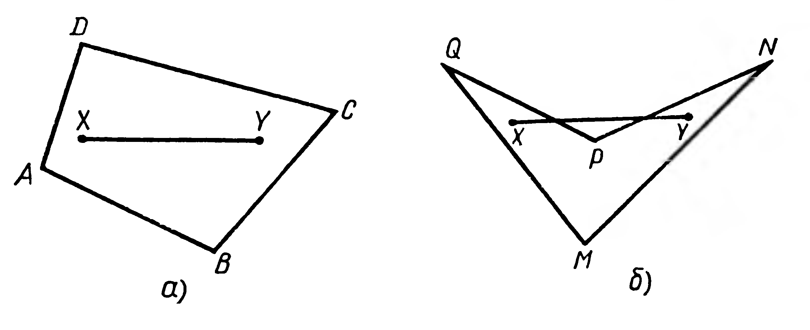

4. **О.** Объединением двух или нескольких данных фигур называется фигура, состоящая из всех тех и только тех точек, которые принадлежат хотя бы одной из данных фигур.

Например, пересечением треугольников $ABC$ и $DEF$ (рис. 120) служит четырехугольник $MENB$, а объединением — невыпуклый шестиугольник $ACNFDM$.

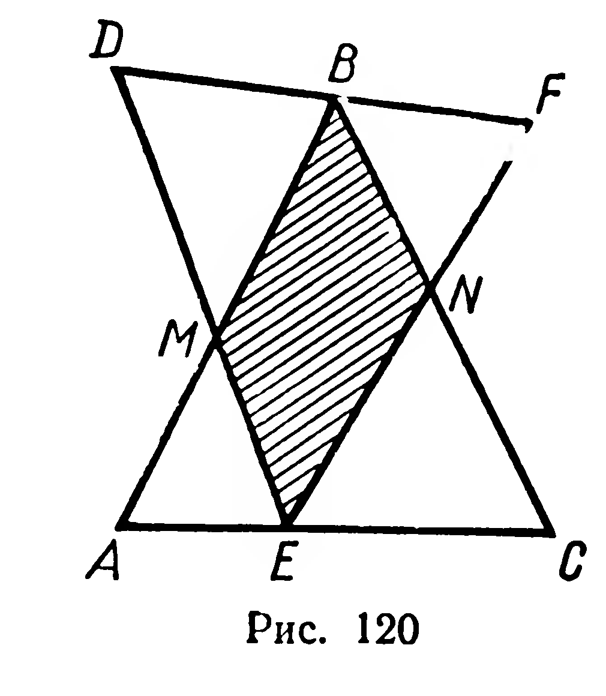

5. **О.** Точка $X$ лежит между точками $A$ и $B$, если эти три точки различны и $|AB|=|AX|+|XB|$ (рис. 121).

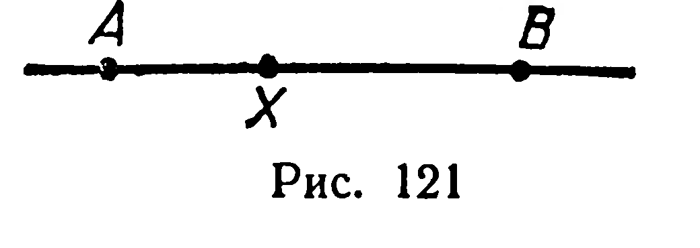

6. **О.** Множество, состоящее из двух различных точек и всех точек, лежащих между ними, называется отрезком.

7. **О.** Ломаной называется объединение отрезков $A_0A_1, A_1A_2,\ldots,A_{n-1}A_n$, таких, что конец каждого отрезка (кроме последнего) является началом следующего и смежные отрезки не лежат на одной прямой (рис. 122).

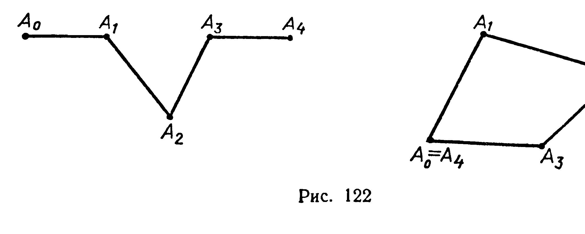

8, а). **О.** Каждое из множеств, на которые точка $O$, принадлежащая прямой $a$ (рис. 123), разбивает эту прямую, называется открытым лучом с началом $O$.

---
**стр. 198**
---

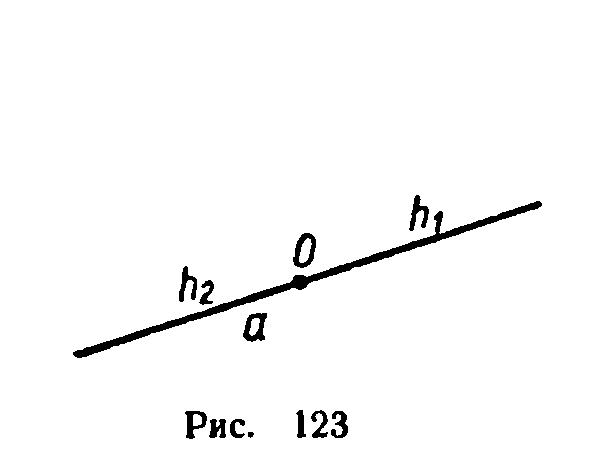

8, б). **О.** Объединение открытого луча и его начала — точки $O$ — называется лучом с началом $O$.

9, а). **О.** Каждое из множеств, на которые прямая $a$ разбивает множество не принадлежащих ей точек плоскости (рис. 124), называется открытой полуплоскостью с границей $a$.

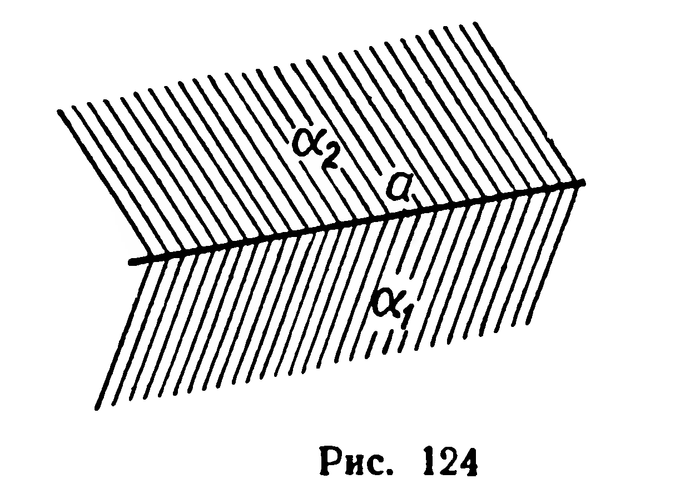

9, б). **О.** Объединение открытой полуплоскости и ее границы $a$ называется полуплоскостью с границей $a$.

10. **О.** Фигура, состоящая из двух различных лучей с общим началом и ограниченной ими части плоскости, называется углом.

## Конгруэнтность фигур и перемещения

1. **Отображения.** Если каждой точке $M$ фигуры $\Phi$ ставится в соответствие единственная точка $M_1$ фигуры $F$, то такое соответствие называется отображением фигуры $\Phi$ в фигуру $F$. Точку $M_1$ при этом называют образом точки $M$. Примеры отображений приведены на рисунке 125.

Множество $\Phi_1$ образов всех точек фигуры $\Phi$ при заданном отображении называется образом фигуры $\Phi$. При этом говорят, что фигура $\Phi$ отображается на фигуру $\Phi_1$.

2. **Конгруэнтные фигуры. О.** Если фигуру $\Phi$ можно отобразить на фигуру $\Phi_1$ так, что расстояние между любыми двумя точками фигуры $\Phi$ равно расстоянию между соответствующими им точками фигуры $\Phi_1$, то говорят, что фигура $\Phi_1$ конгруэнтна фигуре $\Phi$.

**Т.** Отношение конгруэнтности фигур:

а) рефлексивно: $\Phi\cong\Phi$;

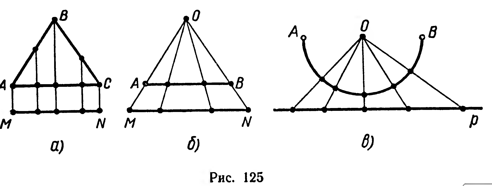

---
**стр. 199**
---

б) симметрично: $(\Phi_1 \cong \Phi) \Rightarrow (\Phi \cong \Phi_1)$;

в) транзитивно: $(\Phi_1 \cong \Phi,\ \Phi_2 \cong \Phi_1) \Rightarrow (\Phi_2 \cong \Phi)$.

Примеры конгруэнтных фигур:

1) Два отрезка конгруэнтны в том и только в том случае, когда их длины равны: $([AB] \cong [CD]) \Leftrightarrow (|AB|=|CD|)$.

2) Любые два луча конгруэнтны.

3) Любые две прямые конгруэнтны.

4) Два угла конгруэнтны в том и только в том случае, когда они имеют одну и ту же величину:

$$(\angle AOB \cong \angle A_1O_1B_1) \Leftrightarrow (\widehat{AOB}=\widehat{A_1O_1B_1}).$$

### 3. Перемещения

**О.** Отображение плоскости на себя, сохраняющее расстояния, называется перемещением.

**Примечание.** Говорят, что отображение фигуры $\Phi$ сохраняет расстояния, если расстояние $|A_1B_1|$ между образами любых точек $A$ и $B$ фигуры $\Phi$ равно расстоянию $|AB|$.

В курсе планиметрии изучаются три основных вида перемещений плоскости: поворот, осевая симметрия, параллельный перенос (вектор).

1. **О.** Поворотом вокруг центра $O$ называется такое перемещение плоскости, при котором:

   1) точка $O$ отображается на себя;

   2) угол между любым лучом $OX$ и соответствующим ему лучом $OX_1$ — постоянная величина $\alpha$.

Величина $\alpha$ берется в промежутке $0^\circ \leqslant \alpha \leqslant 180^\circ$ и называется углом поворота.

Поворот задается центром, углом и направлением поворота.

2. **О.** Центральная симметрия есть частный вид поворота — это поворот на $180^\circ$.

Центральная симметрия задается указанием центра симметрии.

**О.** Если фигура $\Phi$ отображается на себя при симметрии с центром $O$, то говорят, что фигура $\Phi$ центрально-симметрична (или имеет центр симметрии).

3. **О.** Осевой симметрией с осью $l$ называется такое перемещение, при котором:

   1) точки прямой $l$ остаются на месте;

   2) полуплоскости с границей $l$ отображаются одна на другую.

Осевая симметрия задается указанием оси симметрии или пары соответственных (различных) точек.

Способ построения точек, симметричных относительно оси, обосновывается следующими теоремами:

**Т.** Прямая, перпендикулярная оси, при осевой симметрии отображается на себя.

**Т.** Через любую точку плоскости можно провести одну и только одну прямую, перпендикулярную данной прямой.

**О.** Если фигура $\Phi$ отображается при осевой симметрии с осью $l$ на себя, то прямая $l$ называется осью симметрии фигуры $\Phi$. Фигура $\Phi$ при этом называется симметричной относительно оси $l$.

---
**стр. 200**
---

## Параллельность и параллельный перенос

### 1. Параллельные прямые

**О.** Прямые $a$ и $b$, лежащие в одной плоскости, называются параллельными, если они не имеют общих точек или совпадают.

Существование параллельных прямых обосновывается следующей теоремой:

**Т.** Центрально-симметричные прямые параллельны (рис. 126).

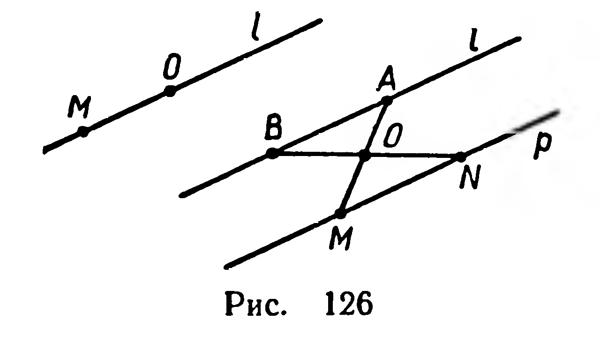

Аксиома параллельных приведена на странице 194 (аксиома V).

Из аксиомы параллельных вытекает теорема: если две прямые параллельны третьей, то они параллельны между собой:

$$(a\parallel c,\ b\parallel c)\Rightarrow(a\parallel b).$$

Отношение параллельности прямых: а) рефлексивно: $a\parallel a$; б) симметрично: $(a\parallel b)\Rightarrow(b\parallel a)$; в) транзитивно: $(a\parallel b,\ b\parallel c)\Rightarrow(a\parallel c)$.

### 2. Направление

**О.** а) Два луча, лежащие на одной прямой, называются сонаправленными, если один из них содержится в другом (рис. 127, а), и противоположно направленными, если ни один из них не содержится в другом (рис. 127, б).

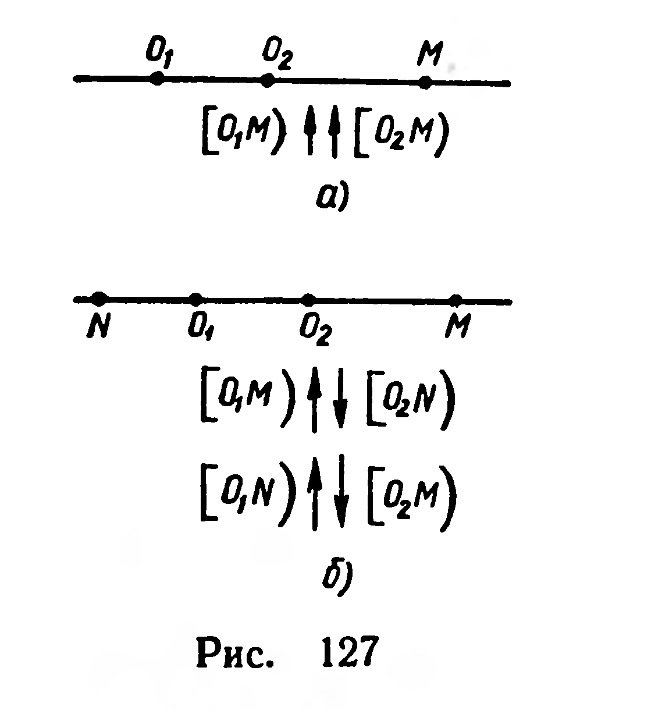

б) Пусть лучи $O_1M$ и $O_2N$ параллельны, но не лежат на одной прямой. Если оба луча лежат в одной полуплоскости с границей $(O_1O_2)$, то такие лучи называются сонаправленными (рис. 128, а); если же они лежат в разных полуплоскостях (рис. 128, б), то лучи называют противоположно направленными.

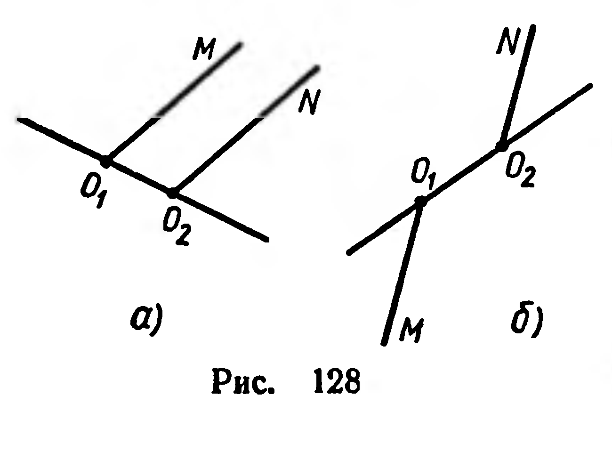

**О.** Множество всех попарно сонаправленных лучей плоскости называют направлением.

**О.** Углом между двумя направлениями называют угол между любыми двумя лучами этих направлений, имеющими общее начало. Угол между направлениями принадлежит промежутку $[0^\circ;180^\circ]$.

### 3. Признаки параллельности прямых

1) **Т.** Если две прямые центрально-симметричны, то они параллельны.

---
**стр. 201**
---

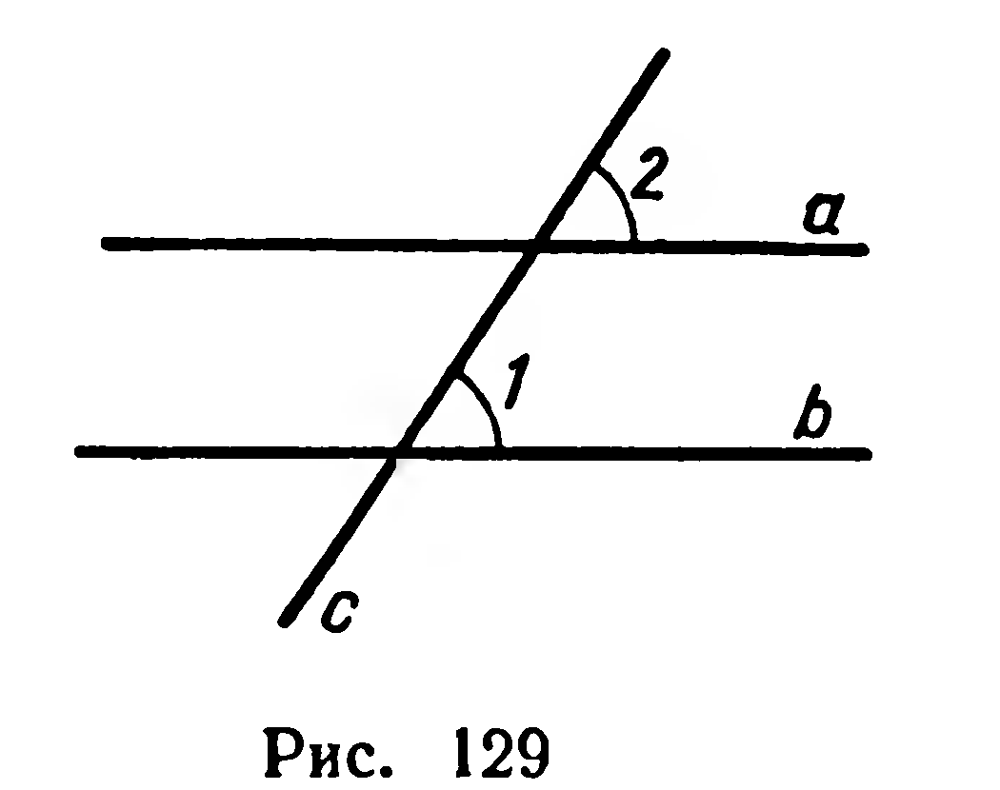

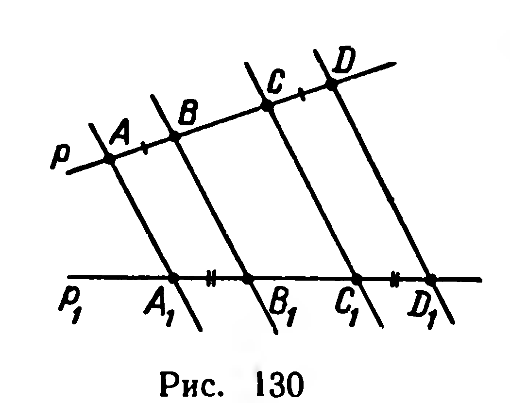

2) **Т.** Если две прямые перпендикулярны одной и той же прямой, то они параллельны.

3) **Т.** Если какие-либо два соответственных угла при пересечении двух прямых третьей конгруэнтны, то эти две прямые параллельны (рис. 129).

### 4. Параллельный перенос

**О.** Параллельным переносом называется отображение плоскости на себя, при котором все точки плоскости смещаются в одном и том же направлении на одно и то же расстояние.

**Т.** Параллельный перенос является перемещением.

Для задания переноса достаточно указать пару соответственных точек или направленный отрезок.

### 5. Теорема Фалеса

Если на одной прямой отложить несколько конгруэнтных отрезков и через их концы провести параллельные прямые, пересекающие вторую прямую, то они отсекут на второй прямой отрезки, конгруэнтные между собой (рис. 130).

$$([AB]\cong[CD],\ (AA_1)\parallel(BB_1)\parallel(CC_1)\parallel(DD_1))\Rightarrow([A_1B_1]\cong[C_1D_1]).$$

Пользуясь теоремой Фалеса, можно разделить данный отрезок на $n$ конгруэнтных отрезков (см. с. 213).

**О.** Средней линией треугольника называется отрезок, соединяющий середины двух сторон треугольника.

**Т.** Средняя линия треугольника параллельна его стороне, а длина ее равна половине длины этой стороны (рис. 131).

$$(|AM|=|MC|,\ |BN|=|NC|)\Rightarrow((MN)\parallel(AB),\ |MN|=\frac12|AB|).$$

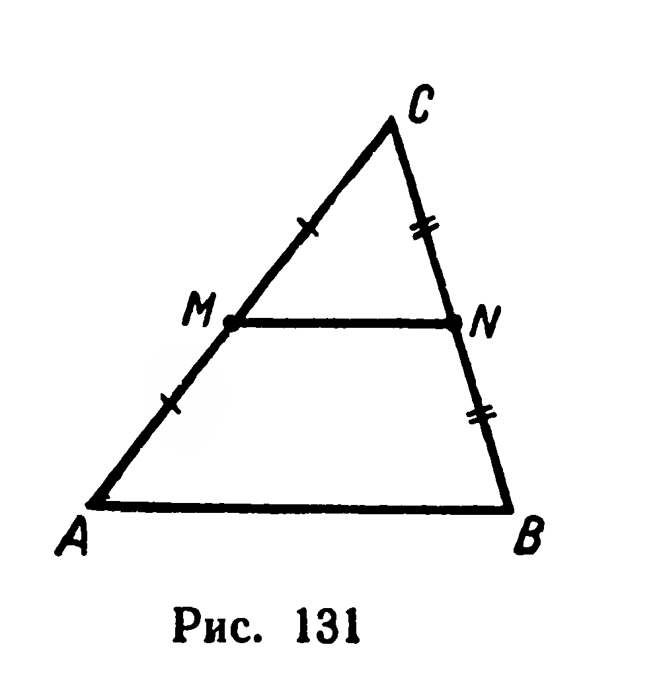

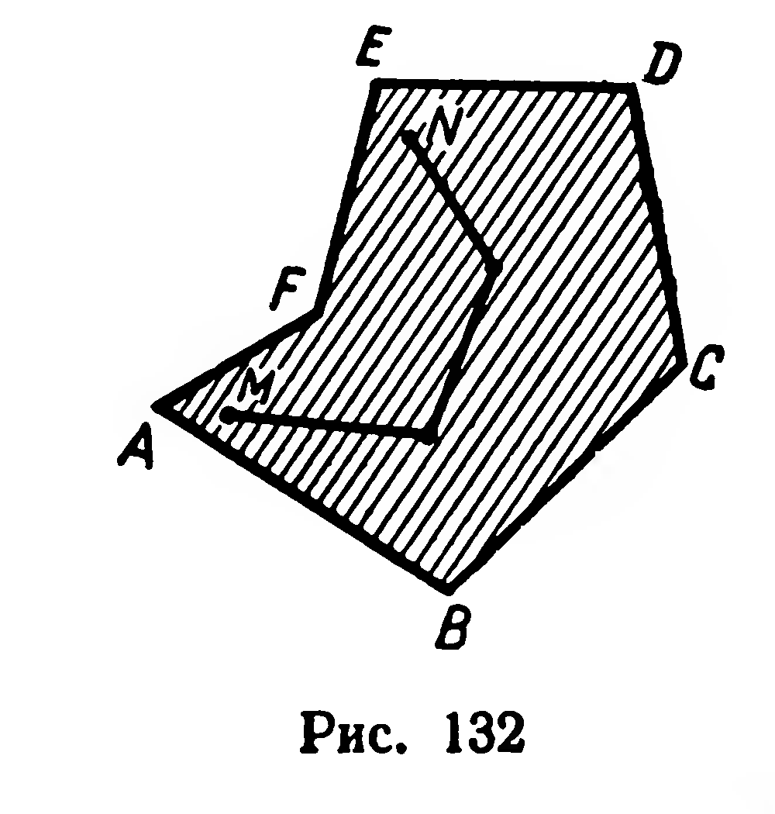

---
**стр. 202**
---

# Многоугольники

## 1. Определение многоугольника

Объединение простой замкнутой ломаной и ее внутренней области называется многоугольником. Сама ломаная называется границей многоугольника, а ее внутренняя область — внутренней областью многоугольника.

Внутренняя область многоугольника $ABC\ldots$ (рис. 132) выделена штриховкой. Для любых двух точек внутренней области многоугольника существует ломаная с концами $M$ и $N$, содержащаяся в этой области.

## 2. Признаки конгруэнтности треугольников (рис. 133)

1) **Т.** Если три стороны одного треугольника соответственно конгруэнтны трем сторонам другого треугольника, то такие треугольники конгруэнтны.

$$
([A_1B_1]\cong[AB],\ [B_1C_1]\cong[BC],\ [A_1C_1]\cong[AC])
\Rightarrow
(\triangle A_1B_1C_1\cong\triangle ABC).
$$

2) **Т.** Если сторона и два прилежащих к ней угла одного треугольника соответственно конгруэнтны стороне и двум прилежащим к ней углам другого треугольника, то такие треугольники конгруэнтны.

$$
([A_1B_1]\cong[AB],\ \angle A_1\cong\angle A,\ \angle B_1\cong\angle B)
\Rightarrow
(\triangle A_1B_1C_1\cong\triangle ABC).
$$

3) **Т.** Если две стороны и угол между ними одного треугольника соответственно конгруэнтны двум сторонам и углу между ними другого треугольника, то такие треугольники конгруэнтны.

$$
([A_1B_1]\cong[AB],\ [B_1C_1]\cong[BC],\ \angle B_1\cong\angle B)
\Rightarrow
(\triangle A_1B_1C_1\cong\triangle ABC).
$$

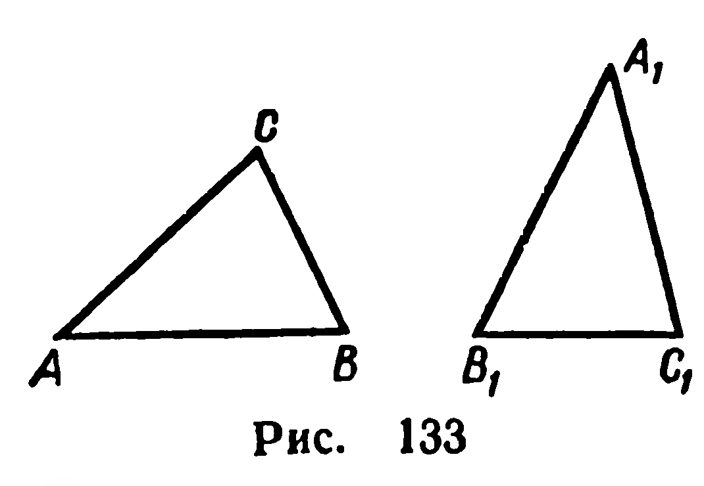

## 3. Соотношения между элементами треугольника

**Т.** Против большей стороны в треугольнике лежит больший угол; обратно, против большего угла в треугольнике лежит большая сторона:

$$
(|BC|>|AB|)\Leftrightarrow(\widehat A>\widehat C)
\quad\text{(рис. 134).}
$$

**Т.** Против равных сторон в треугольнике лежат равные углы; обратно, против равных углов в треугольнике лежат равные стороны.

## 4. Параллелограммы

**О.** Четырехугольник, противоположные стороны которого попарно параллельны, называется параллелограммом.

---
**стр. 203**
---

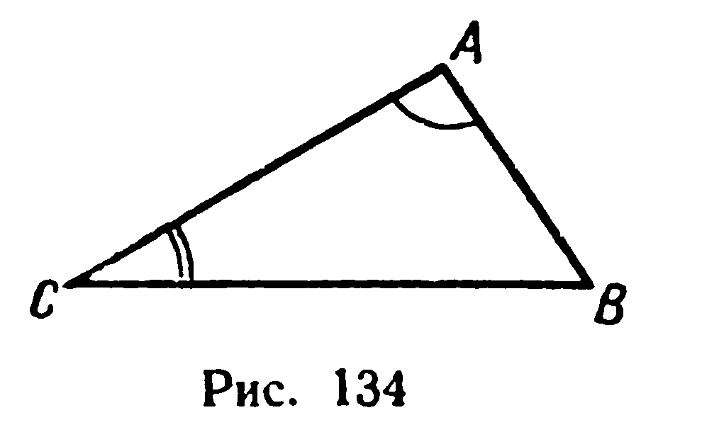

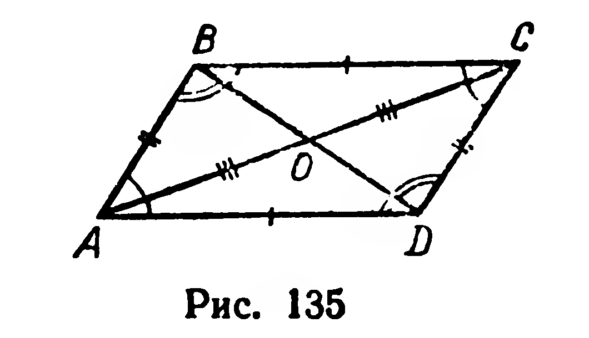

**Т.** Середина диагонали параллелограмма является его центром симметрии (рис. 135).

Отсюда следует конгруэнтность противоположных сторон параллелограмма, конгруэнтность его противоположных углов. Диагонали параллелограмма делятся точкой пересечения пополам.

Сформулируем признаки параллелограмма:

1) **Т.** Если в четырехугольнике противоположные стороны попарно конгруэнтны, то этот четырехугольник — параллелограмм.

2) **Т.** Если в четырехугольнике две противоположные стороны конгруэнтны и параллельны, то этот четырехугольник — параллелограмм.

## 5. Виды параллелограммов

1) **О.** Параллелограмм, у которого углы прямые, называется прямоугольником.

**Т.** Серединный перпендикуляр к стороне прямоугольника является его осью симметрии.

Отсюда следует конгруэнтность диагоналей прямоугольника.

2) **О.** Параллелограмм, все стороны которого равны, называется ромбом.

**Т.** Прямая, содержащая диагональ ромба, является его осью симметрии.

Отсюда следует, что диагонали ромба взаимно перпендикулярны и делят его углы пополам.

3) **О.** Квадратом называется прямоугольник, у которого все стороны равны.

Квадрат обладает всеми свойствами прямоугольника и ромба.

Виды параллелограммов изображены на рисунке 136.

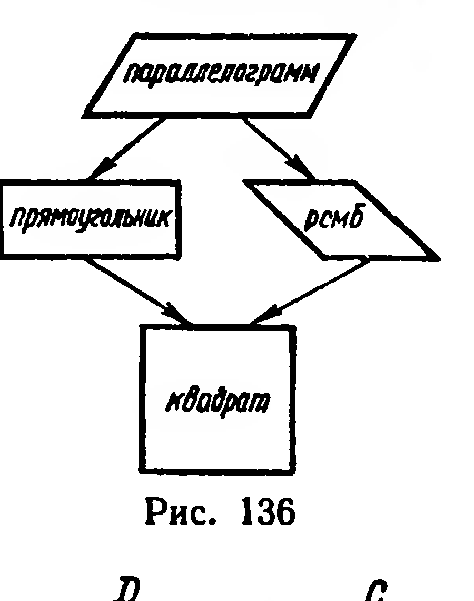

## 6. Трапеция

**О.** Четырехугольник, две стороны которого параллельны, а две другие не параллельны, называется трапецией.

**О.** Отрезок, соединяющий середины боковых сторон трапеции (рис. 137), называется ее средней линией.

**Т.** Средняя линия трапеции параллельна основаниям, а длина ее равна полусумме длин оснований.

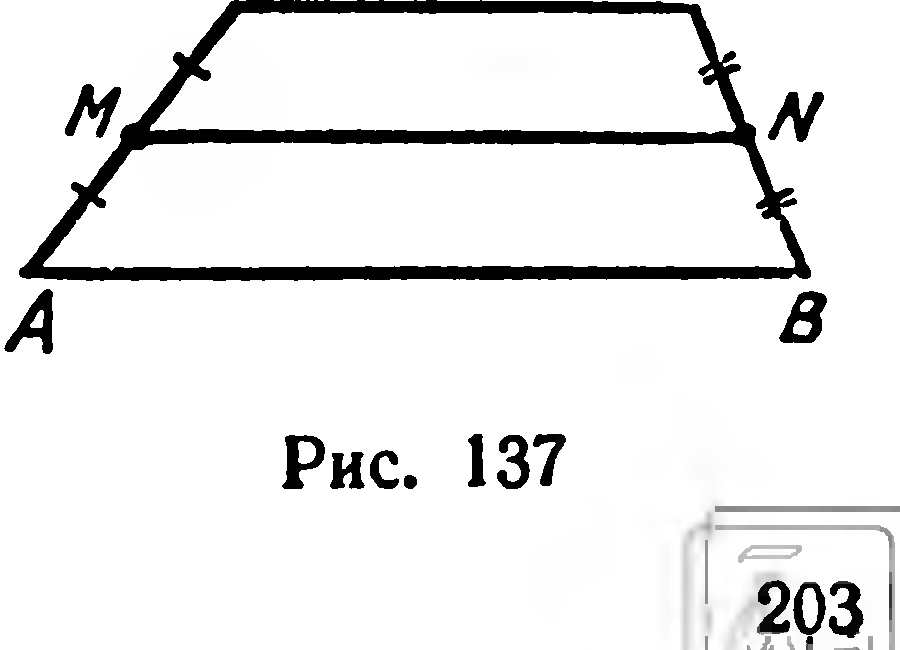

## 7. Площади многоугольников

**О.** Каждому многоугольнику может быть постав-

---
**стр. 204**
---

лена в соответствие положительная величина, называемая его площадью, так, что выполняются следующие условия:

1) единицей измерения площадей многоугольников является площадь квадрата, длина стороны которого принята за единицу измерения длин;

2) конгруэнтные многоугольники имеют равные площади;

3) если многоугольник составлен из непересекающихся многоугольников, то его площадь равна сумме площадей этих многоугольников.

Формулы для вычисления площадей многоугольников смотрите на странице 217.

# Окружность и круг

1. **О.** Множество всех точек плоскости, находящихся на данном положительном расстоянии от данной точки, принадлежащей этой плоскости, называется окружностью.

2. **О.** Множество всех точек плоскости, расстояние от каждой из которых до данной точки этой плоскости не больше данного, называется кругом.

3. **Т.** Через любые три точки, не принадлежащие одной прямой, можно провести одну и только одну окружность.

4. **О.** Прямая, имеющая с окружностью только одну общую точку, называется касательной к этой окружности.

5. **Т.** Для того чтобы прямая была касательной к окружности, необходимо и достаточно, чтобы эта прямая была перпендикулярна к диаметру окружности и проходила через его конец.

Способ построения касательной к окружности смотрите на странице 215.

6. **Т.** Чтобы две дуги окружности были конгруэнтны, необходимо и достаточно, чтобы они соответствовали конгруэнтным центральным углам:

$$
(\angle AOB\cong\angle COD)
\Leftrightarrow
(\overset{\frown}{AB}\cong\overset{\frown}{CD})
\quad\text{(рис. 138).}
$$

7. **Т.** Если две хорды окружности конгруэнтны, то конгруэнтны и стягиваемые ими дуги.

8. **Т.** Любая прямая, проходящая через центр окружности, является ее осью симметрии.

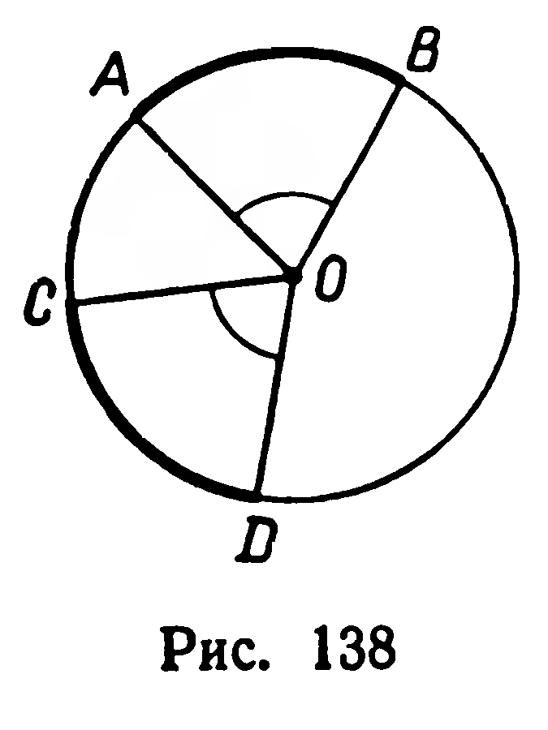

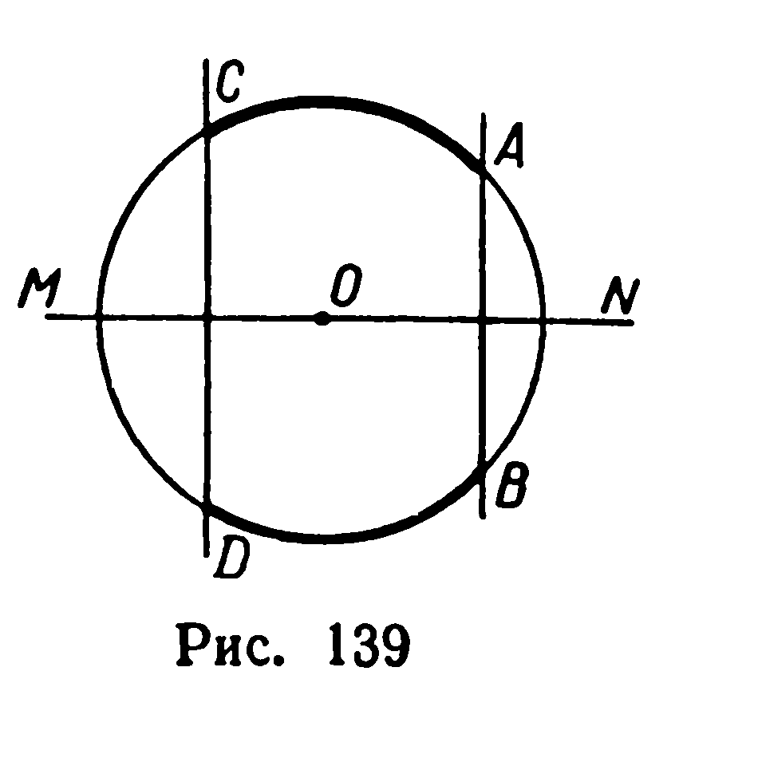

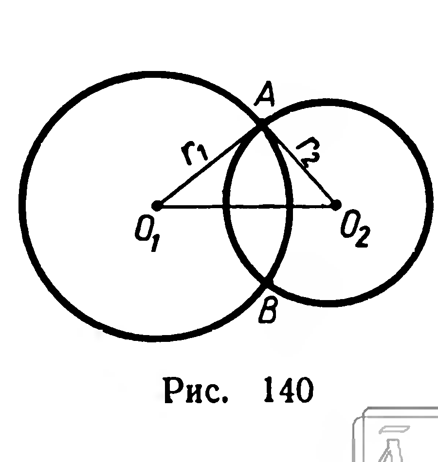

---
**стр. 205**
---

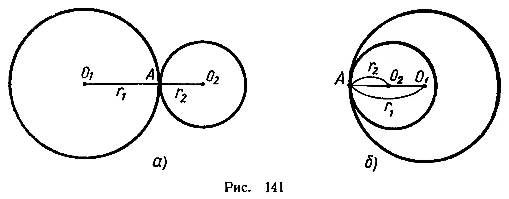

Отсюда следует (рис. 139): 1) дуги, заключенные между параллельными хордами, конгруэнтны; 2) диаметр, перпендикулярный хорде, делит ее и стягиваемые ею дуги пополам; 3) диаметр, который делит пополам хорду, не проходящую через центр, перпендикулярен к этой хорде.

**9. Т.** В окружности хорды равной длины равноудалены от центра; обратно: хорды, равноудаленные от центра окружности, имеют равные длины.

**10. Т.** Из двух неконгруэнтных хорд окружности хорда большей длины расположена ближе к центру; обратно: из двух неконгруэнтных хорд большую длину имеет та, которая ближе к центру.

**11. Т.** Если расстояние между центрами двух окружностей меньше суммы радиусов, но больше модуля их разности, то окружности пересекаются в двух и только в двух точках (рис. 140).

$$
|r_1-r_2|<|O_1O_2|<r_1+r_2.
$$

**12. Т.** Если расстояние между центрами двух окружностей равно сумме или разности радиусов, то окружности имеют только одну общую точку, принадлежащую прямой, проходящей через центры окружностей:

$$
\begin{aligned}
|O_1O_2|&=r_1+r_2 &&\text{(рис. 141, а),}\\
|O_1O_2|&=|r_1-r_2| &&\text{(рис. 141, б).}
\end{aligned}
$$

## Вписанные и описанные многоугольники

**1. О.** Угол, вершина которого принадлежит окружности, а стороны угла пересекают ее, называется вписанным в эту окружность.

**2. Т.** Величина вписанного угла равна половине угловой величины дуги, на которую он опирается.

Отсюда следует, что вписанный угол, опирающийся на диаметр, прямой.

---
**стр. 206**
---

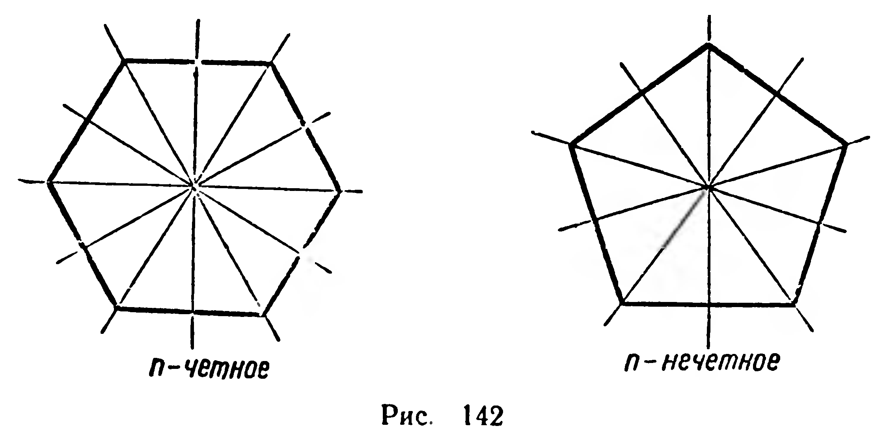

**3. О.** Многоугольник, все вершины которого принадлежат окружности, называется вписанным в эту окружность, а окружность — описанной около этого многоугольника.

**4. О.** Многоугольник, все стороны которого касаются окружности, называется описанным около этой окружности, а окружность — вписанной в этот многоугольник.

**5. Т.** Около всякого треугольника можно описать окружность, и притом только одну. Центром этой окружности является точка пересечения серединных перпендикуляров к сторонам треугольника.

**6. Т.** Во всякий треугольник можно вписать окружность, и притом только одну. Центром этой окружности является точка пересечения биссектрис углов треугольника.

**7. Т.** Для того чтобы около четырехугольника можно было описать окружность, необходимо и достаточно, чтобы сумма противолежащих углов этого четырехугольника была равна $2d$.

**8. Т.** Для того чтобы в четырехугольник можно было вписать окружность, необходимо и достаточно, чтобы суммы длин противолежащих сторон этого четырехугольника были равны.

**9. О.** Многоугольник, у которого все стороны конгруэнтны и все углы конгруэнтны, называется правильным.

Правильный $n$-угольник имеет ровно $n$ осей симметрии (рис. 142).

**10. Т.** Около всякого правильного многоугольника можно описать окружность. Во всякий правильный многоугольник можно вписать окружность.

**11. О.** Длиной окружности называется предел последовательности периметров правильных вписанных многоугольников при неограниченном удвоении числа сторон.

## Гомотетия плоскости и подобие фигур. Пропорциональные отрезки

**1. Подобные фигуры. О.** Если фигуру $\Phi$ можно отобразить на фигуру $\Phi_1$ так, что для любых точек $X$ и $Y$ первой фигуры отношение расстояния $|X_1Y_1|$ между их образами к расстоянию $|XY|$

---
**стр. 207**
---

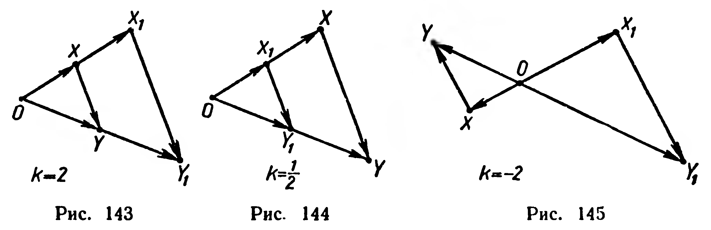

между самими точками $X$ и $Y$ равно одному и тому же числу $k>0$, то говорят, что фигура $\Phi_1$ подобна фигуре $\Phi$ с коэффициентом подобия $k$.

Определение подобия фигур включает в себя определение конгруэнтности фигур как частный случай. Конгруэнтные фигуры — это подобные фигуры с коэффициентом подобия, равным единице.

**Т.** Отношение подобия фигур:

1) рефлексивно: $\Phi\overset{1}{\sim}\Phi$;

2) симметрично: $(\Phi_1\overset{k}{\sim}\Phi)\Leftrightarrow(\Phi\overset{\frac1k}{\sim}\Phi_1)$;

3) транзитивно: $(\Phi_1\overset{k_1}{\sim}\Phi,\ \Phi_2\overset{k_2}{\sim}\Phi_1)\Rightarrow(\Phi_2\overset{k_1k_2}{\sim}\Phi)$.

**2. Гомотетия. О.** Гомотетией с центром $O$ и коэффициентом $k\ne0$ называется отображение плоскости на себя, при котором образом произвольной точки $X$ является такая точка $X_1$, что

$$
\overrightarrow{OX_1}=k\overrightarrow{OX}.
$$

Тождественное отображение плоскости на себя и центральная симметрия являются частными видами гомотетии:

$$
H_O^1=E,\qquad H_O^{-1}=Z_O.
$$

Отображение, обратное гомотетии, также является гомотетией: если $H_O^k(X)=X_1$, то $H_O^{\frac1k}(X_1)=X$.

Сформулируем основные свойства гомотетии.

**Т.** Центр гомотетии отображается на себя.

**Т.** Если $k>0$, то точки $X$ и $X_1=H(X)$ лежат на прямой $OX$ по одну сторону от центра гомотетии (рис. 143, 144).

Если $k<0$, то точки $X$ и $X_1=H(X)$ лежат на прямой $OX$ по разные стороны от центра гомотетии (рис. 145).

**Т.** Если при гомотетии с коэффициентом $k$ точки $X$ и $Y$ отображаются на точки $X_1$ и $Y_1$, то

$$
\overrightarrow{X_1Y_1}=k\overrightarrow{XY}
$$

(рис. 143—145).

¹ Определение и свойства векторов плоскости аналогичны определению и свойствам векторов пространства (см. с. 41).

---
**стр. 208**
---

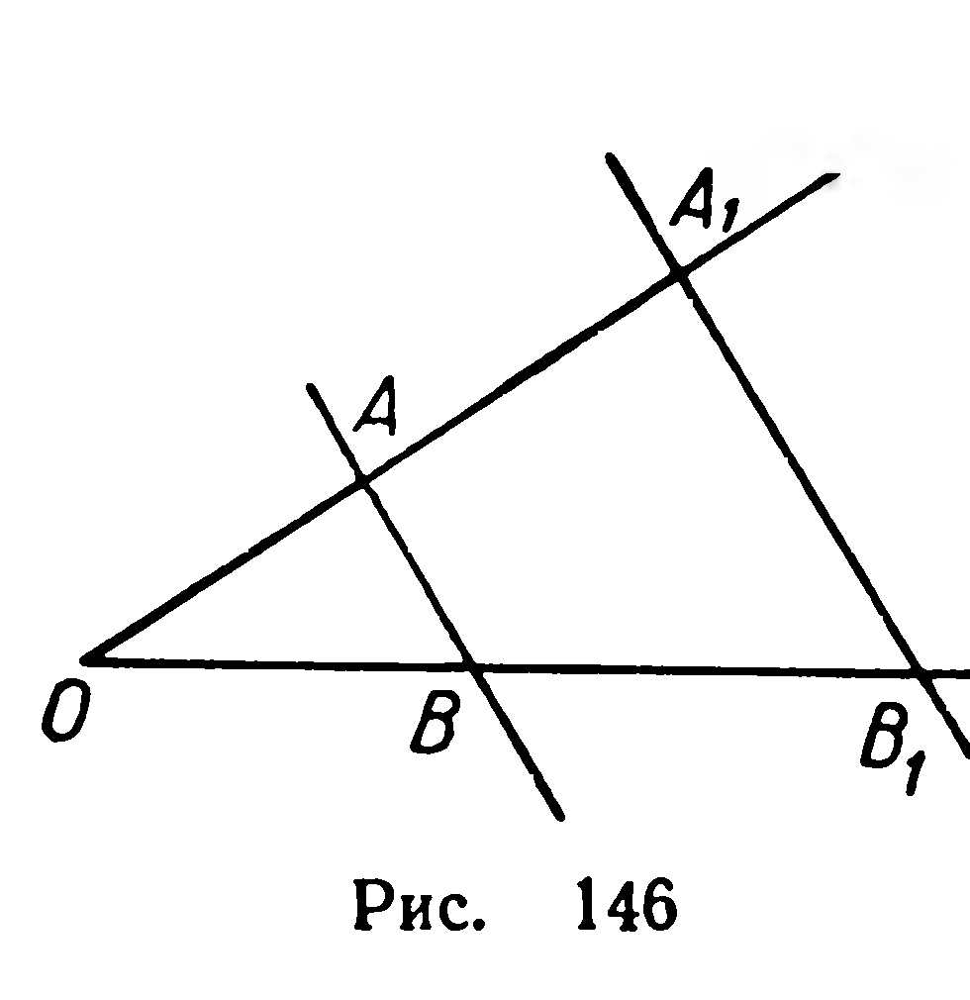

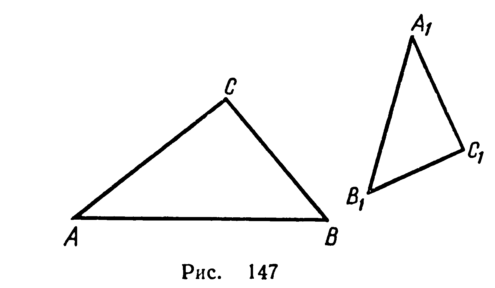

При гомотетии с коэффициентом $k$ все расстояния между точками умножаются на $|k|$, т. е. $|X_1Y_1|=|k|\cdot|XY|$.

Отсюда вытекает, что гомотетичные фигуры подобны.

**Т.** При гомотетии с положительным коэффициентом каждый луч отображается на сонаправленный с ним луч. При гомотетии с отрицательным коэффициентом каждый луч отображается на противоположно направленный с ним луч.

**Т.** Гомотетия отображает каждую прямую на параллельную ей прямую.

**Т.** Гомотетичные углы конгруэнтны.

### 3. Пропорциональные отрезки

**О.** Отрезки $AB$, $CD$, $A_1B_1$, $C_1D_1$ называются пропорциональными, если пропорциональны их длины:

$$
|A_1B_1|:|AB|=|C_1D_1|:|CD|.
$$

1. **Т.** Параллельные прямые, пересекающие стороны угла, отсекают на них пропорциональные отрезки:

$$
((A_1B_1)\parallel(AB),\ (AA_1)\cap(BB_1)=O)
\Rightarrow
(|OA_1|:|OA|=|OB_1|:|OB|).
$$

2. **Т.** Если отрезки $OA_1$ и $OB_1$ пропорциональны отрезкам $OA$ и $OB$ и лежат соответственно на лучах $OA$ и $OB$, то прямые $A_1B_1$ и $AB$ параллельны (рис. 146).

### 4. Преобразование подобия

**О.** Отображение плоскости на себя, при котором все расстояния между точками изменяются в одном и том же отношении $k>0$, называется преобразованием подобия.

1. **Т.** Каждое преобразование подобия есть композиция гомотетии и перемещения.

2. **Т.** Если две фигуры подобны, то существует фигура, гомотетичная первой и конгруэнтная второй.

Отсюда следует, что соответственные углы подобных фигур конгруэнтны.

### 5. Подобные многоугольники

1. **Т.** Если три стороны одного треугольника пропорциональны трем сторонам другого треугольника, то такие треугольники подобны (рис. 147):

$$
\left(
\frac{|A_1B_1|}{|AB|}
=
\frac{|B_1C_1|}{|BC|}
=
\frac{|A_1C_1|}{|AC|}
\right)
\Rightarrow
(\triangle A_1B_1C_1\sim\triangle ABC).
$$

---
**стр. 209**
---

2. **Т.** Если две стороны одного треугольника пропорциональны двум сторонам другого треугольника и углы между этими сторонами равны, то такие треугольники подобны:

$$
\left(
\frac{|A_1B_1|}{|AB|}
=
\frac{|B_1C_1|}{|BC|},
\ \widehat{B_1}=\widehat B
\right)
\Rightarrow
(\triangle A_1B_1C_1\sim\triangle ABC).
$$

3. **Т.** Если два угла одного треугольника равны двум углам другого треугольника, то такие треугольники подобны:

$$
(\widehat{A_1}=\widehat A,\ \widehat{B_1}=\widehat B)
\Rightarrow
(\triangle A_1B_1C_1\sim\triangle ABC).
$$

**О.** Отрезок $x$ называется средним пропорциональным (или средним геометрическим) между отрезками $m$ и $n$, если выполняется равенство:

$$
m:x=x:n.
$$

4. **Т.** 1) Катет прямоугольного треугольника есть среднее пропорциональное между гипотенузой и проекцией этого катета на гипотенузу. 2) Высота прямоугольного треугольника, проведенная из вершины прямого угла, есть среднее пропорциональное между проекциями катетов на гипотенузу.

5. **Т. Теорема Пифагора.** Квадрат гипотенузы прямоугольного треугольника равен сумме квадратов его катетов.

6. **Т.** Если стороны одного многоугольника соответственно пропорциональны сторонам другого многоугольника и соответственные углы этих многоугольников равны, то такие многоугольники подобны.

7. **Т.** Отношение периметров подобных многоугольников равно коэффициенту подобия:

$$
(F_1\mathrel{\overset{k}{\sim}}F)\Rightarrow(P_1:P=k).
$$

8. **Т.** Отношение площадей подобных многоугольников равно квадрату коэффициента подобия:

$$
(F_1\mathrel{\overset{k}{\sim}}F)\Rightarrow(S_1:S=k^2).
$$

## 8. Геометрические построения

### 1. Серединный перпендикуляр к отрезку

Построить прямую, перпендикулярную к данному отрезку $AB$ и проходящую через его середину (рис. 148).

**Построение.** 1), 2) Построим окружности радиуса $r$ с центрами $A$ и $B$ $(r>\frac12|AB|)$.

3) Отмечаем точки $C$ и $C_1$ пересечения окружностей.

4) Построим прямую $p=(CC_1)$, отмечаем точку $M=p\cap[AB]$.

$p$ — искомая прямая, $M$ — середина $[AB]$.

**Примечание.** Серединный перпендикуляр к отрезку есть множество всех точек плоскости, каждая из которых равноудалена от концов отрезка.

---
**стр. 210**
---

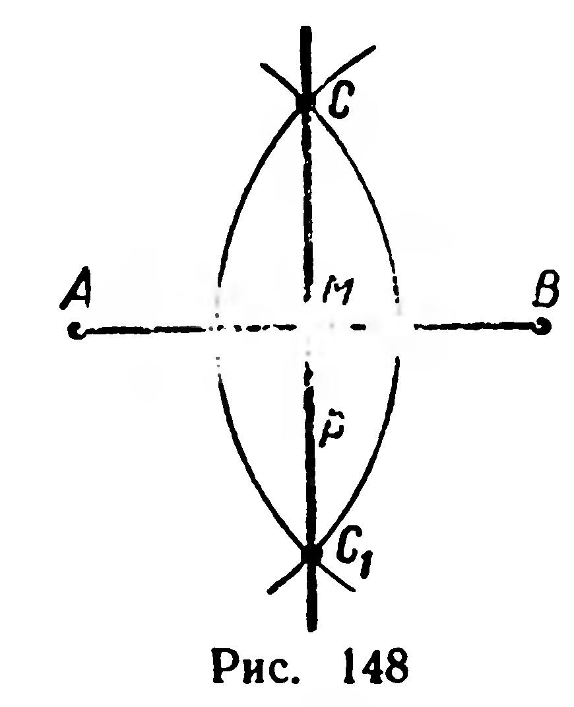

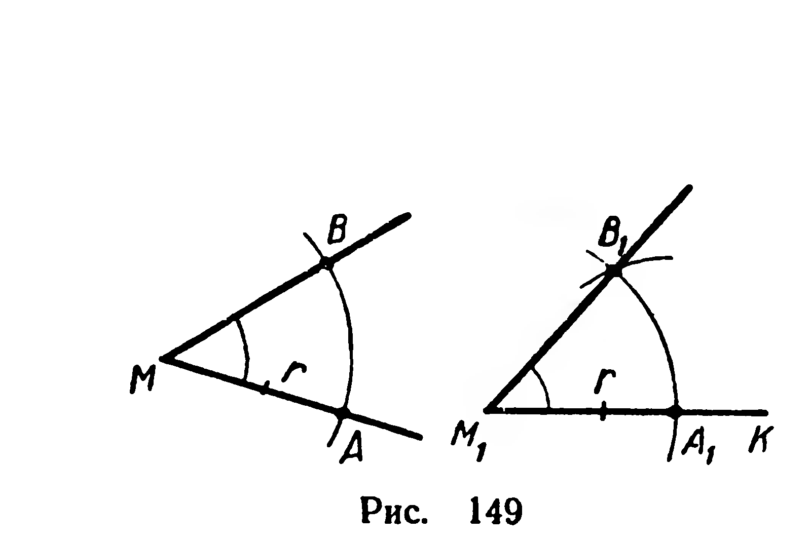

### 2. Угол, конгруэнтный данному

Построить угол, конгруэнтный данному углу $M$ (рис. 149).

**Построение.** 1) Построим окружность произвольного радиуса $r$ с центром $M$.

2) Отмечаем точки $A$ и $B$ пересечения этой окружности со сторонами угла $M$.

3) Построим произвольный луч $M_1K$.

4) Построим окружность радиуса $r$ с центром $M_1$.

5) Отмечаем точку $A_1$ ее пересечения с лучом $M_1K$.

6) Построим окружность радиуса $|AB|$ с центром $A_1$.

7) Отмечаем точку $B_1$ ее пересечения с окружностью $(M_1;r)$.

8) Построим луч $M_1B_1$.

Угол $A_1M_1B_1$ — искомый.

### 3. Биссектриса угла

Построить биссектрису угла $AOB$, меньшего $180^\circ$ (рис. 150).

**Построение.** 1) Построим окружность произвольного радиуса с центром $O$.

2) Отмечаем точки $M$ и $N$ ее пересечения со сторонами угла $AOB$.

3), 4) Построим окружности радиуса $r$ с центрами $M$ и $N$ $(r>\frac12|MN|)$.

5) Отмечаем одну из точек $P$ пересечения окружностей $(M;r)$ и $(N;r)$.

6) Построим луч $OP$.

Луч $OP$ — искомая биссектриса.

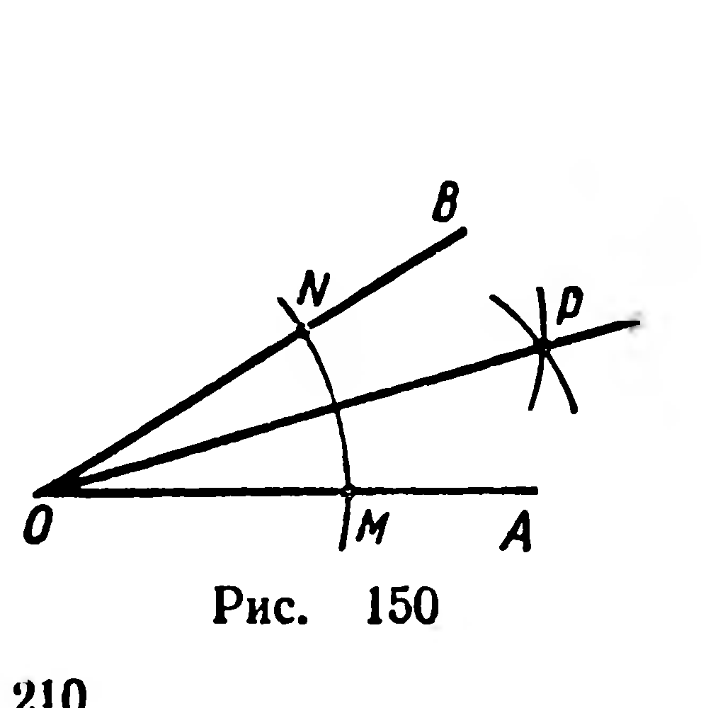

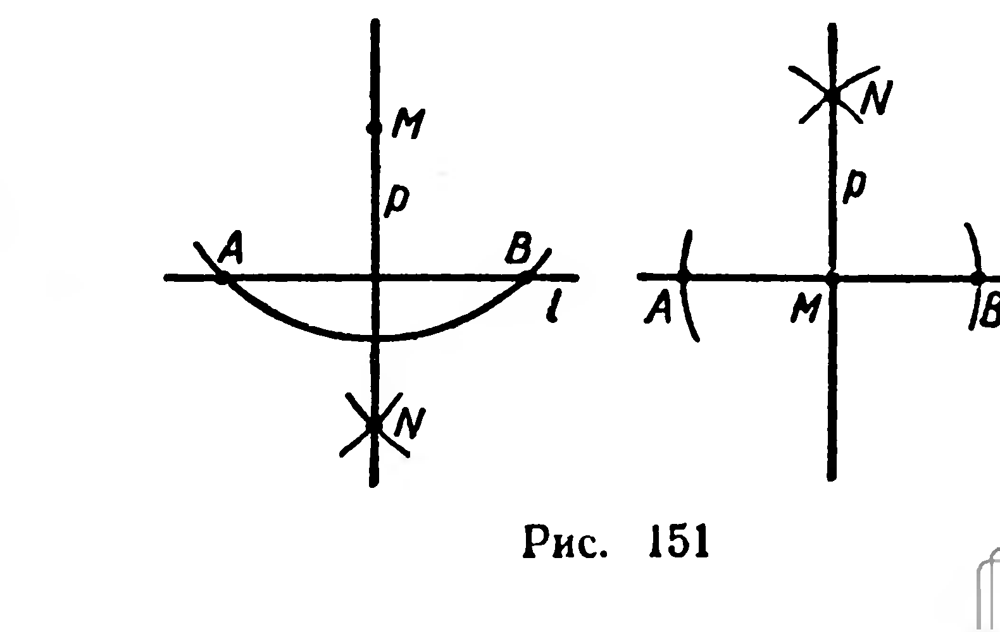

---
**стр. 211**
---

**Примечание.** Биссектриса угла, меньшего развернутого, есть множество всех точек угла, каждая из которых равноудалена от его сторон.

**4. Перпендикуляр к прямой.** Построить перпендикуляр к данной прямой $l$, проходящий через данную точку $M$ (рис. 151).

**Построение.** 1) Построим окружность с центром $M$ и радиусом, большим расстояния от $M$ до $l$.

2) Отмечаем точки $A$ и $B$ пересечения этой окружности и прямой $l$.

3), 4) Построим окружности радиуса $r$ с центрами $A$ и $B$ $\left(r>\dfrac12|AB|\right)$.

5) Отмечаем одну из точек $N$ пересечения окружностей $(A;\,r)$ и $(B;\,r)$.

6) Построим прямую $p=(MN)$.

Прямая $p$ — искомая.

**5. Прямоугольный треугольник (по гипотенузе и катету).** Построить треугольник $ABC$, в котором $\angle ACB=90^\circ$, $|AB|=c$, $|BC|=a$, $c>a$ (рис. 152).

**Построение.** 1) Построим отрезок $BC$ длиной $a$.

2) Построим перпендикуляр $p$ к прямой $BC$, проходящий через точку $C$ (построение 4).

3) Построим окружность с центром $B$ радиуса $c$.

4) Отмечаем одну из точек $A$ пересечения прямой $p$ и этой окружности.

$\triangle ABC$ — искомый.

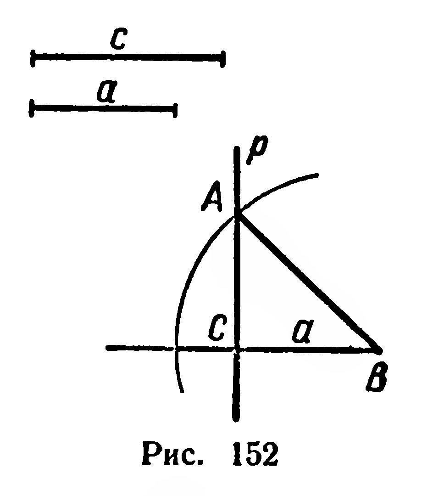

**6. Образ фигуры при повороте.** Построить образ треугольника $ABC$ при повороте вокруг данной точки $O$ на данный угол $\alpha$ в данном направлении (рис. 153).

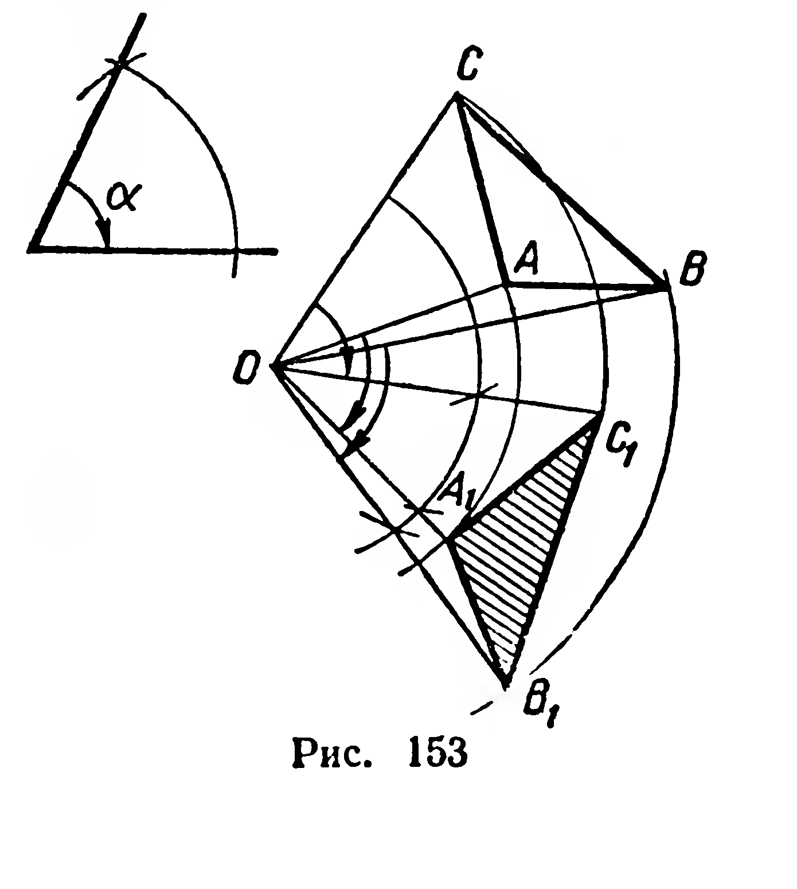

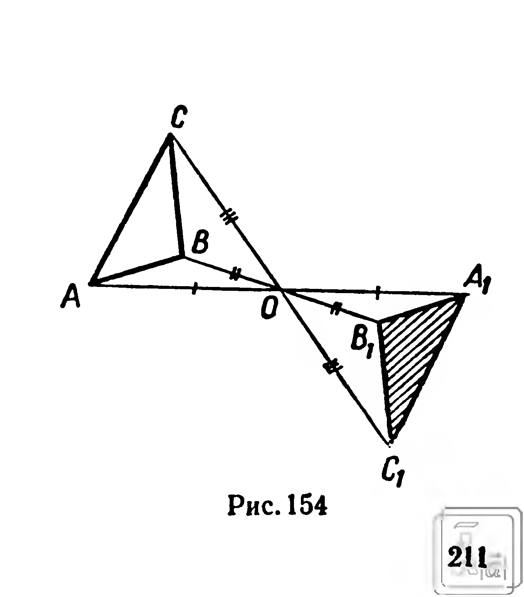

---
**стр. 212**
---

**Построение.** 1) Построим образ $A_1$ точки $A$ при данном повороте:

а) построим луч $OA$;

б) построим угол $AOA_1$, имеющий величину $\alpha$ (построение 2), так, чтобы поворот точки $A$ выполнялся в заданном направлении.

$$A_1=R_O^\alpha(A).$$

2), 3) Построим аналогично $B_1=R_O^\alpha(B)$, $C_1=R_O^\alpha(C)$.

$\triangle A_1B_1C_1$ — искомый.

**7. Образ фигуры при центральной симметрии.** Построить образ треугольника $ABC$ при симметрии с центром $O$ (рис. 154).

**Построение.** 1) Построим образ $A_1$ точки $A$ при симметрии $Z_O$:

а) построим прямую $AO$;

б) на прямой $AO$ по другую сторону от этой точки откладываем отрезок $OA_1$ длиной $|OA|$, тогда $A_1=Z_O(A)$.

2), 3) Построим аналогично $B_1=Z_O(B)$, $C_1=Z_O(C)$.

$\triangle A_1B_1C_1$ — искомый.

**8. Образ фигуры при осевой симметрии.** Построить образ треугольника $ABC$ при симметрии с осью $l$ (рис. 155).

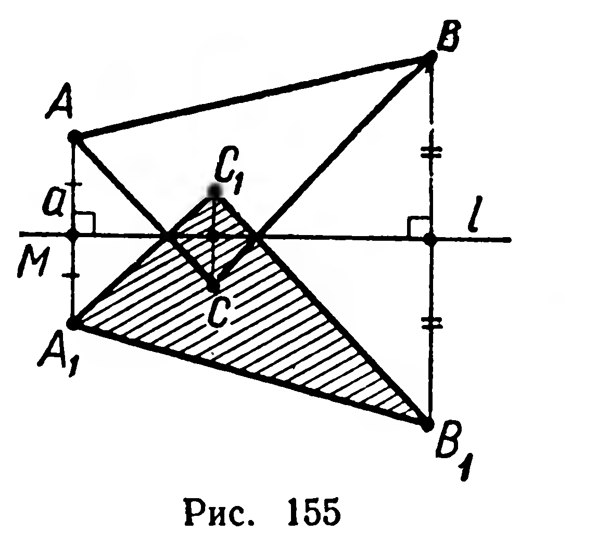

**Построение.** 1) Построим образ $A_1$ точки $A$ при симметрии $S_l$:

а) построим перпендикуляр $a$ к прямой $l$, проходящий через точку $A$ (построение 4);

б) отмечаем точку $M=a\cap l$;

в) на прямой $a$ от точки $M$ откладываем по другую сторону оси $l$ отрезок $MA_1$ длиной $|MA|$, тогда $A_1=S_l(A)$.

2), 3) Построим аналогично $B_1=S_l(B)$, $C_1=S_l(C)$.

$\triangle A_1B_1C_1$ — искомый.

**9. Прямая, параллельная данной.** Построить прямую, проходящую через данную точку $M$ и параллельную данной прямой $l$ (см. рис. 126).

**Построение.** Пусть $M\notin l$.

1) Отмечаем на прямой $l$ две точки $A$ и $B$.

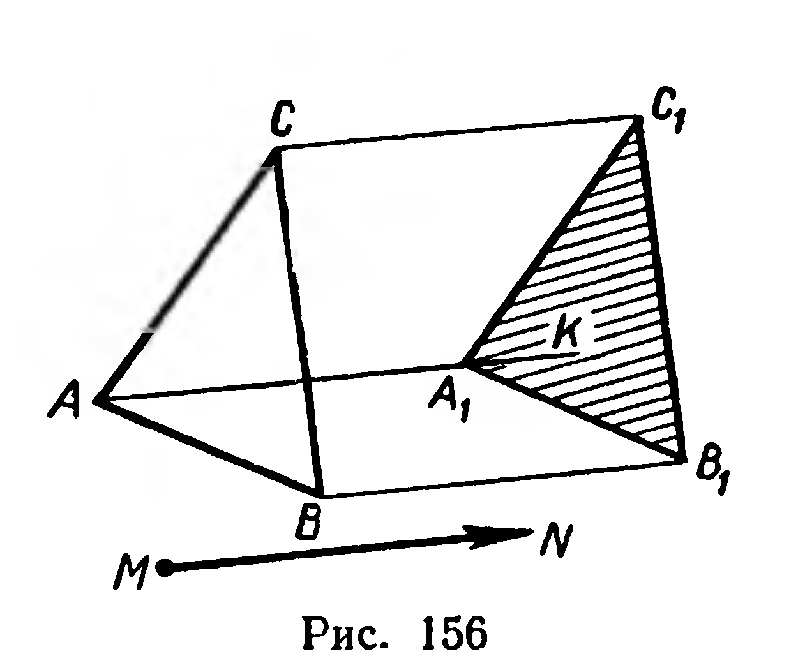

---
**стр. 213**
---

2) Построим отрезок $AM$.

3) Построим середину $O$ отрезка $AM$ (построение 1).

4) Построим точку $N$, симметричную точке $B$ относительно центра $O$ (построение 7).

5) Построим прямую $p=(MN)$.

Прямая $p$ — искомая.

Если $M\in l$, то $p=l$.

**Примечание.** Построение 9 можно выполнить на основе других признаков параллельности прямых (см. с. 200, пункт 3).

**10. Образ фигуры при переносе.** Построить образ треугольника $ABC$ при переносе $\overrightarrow{MN}$ (рис. 156).

**Построение.** 1) Построим образ $A_1$ точки $A$ при данном переносе:

а) построим луч $AK$, сонаправленный с лучом $MN$ (см. построение 9);

б) на этом луче от точки $A$ откладываем отрезок $AA_1$ длиной $|MN|$, тогда $A_1=\overrightarrow{MN}(A)$.

2), 3) Построим аналогично $B_1=\overrightarrow{MN}(B)$, $C_1=\overrightarrow{MN}(C)$.

$\triangle A_1B_1C_1$ — искомый.

**11. Деление отрезка на конгруэнтные отрезки.** Данный отрезок $AB$ разделить на $n$ конгруэнтных отрезков (рис. 157).

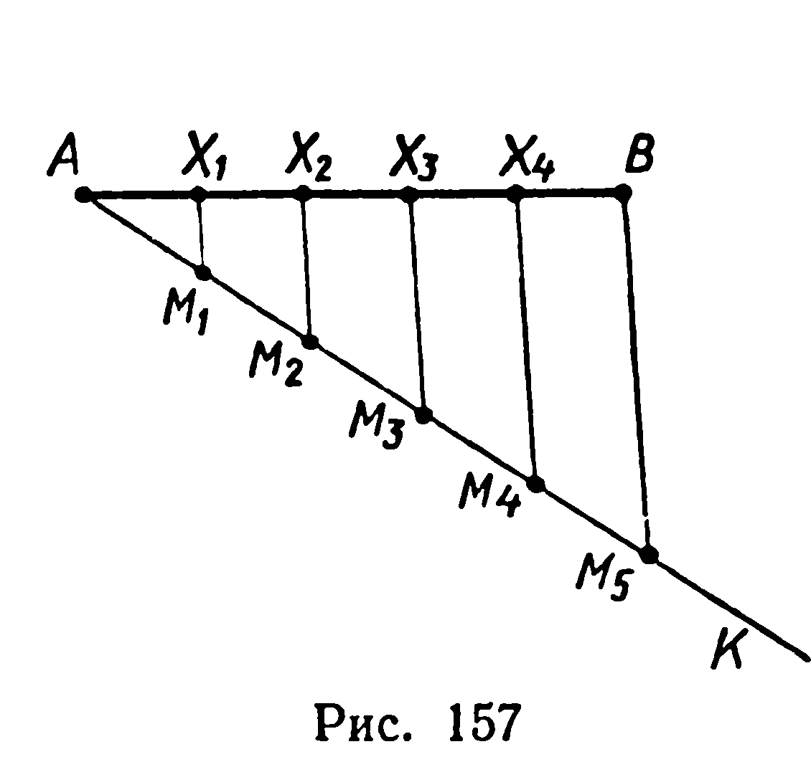

**Построение.** 1) Построим луч $AK$ $(K\notin(AB))$.

2) На луче $AK$ отложим последовательно $n$ конгруэнтных отрезков $AM_1$, $M_1M_2$, $\ldots$, $M_{n-1}M_n$ (на рисунке $n=5$).

3) Построим прямую $M_nB$.

4) Построим прямые, проходящие через точки $M_1$, $M_2$, $\ldots$, $M_{n-1}$ и параллельные $(M_nB)$ (построение 9).

5) Отмечаем точки $X_1$, $X_2$, $\ldots$, $X_{n-1}$ пересечения этих прямых с отрезком $AB$.

Отрезки $AX_1$, $X_1X_2$, $\ldots$, $X_{n-1}B$ — искомые.

**12. Образ фигуры при гомотетии.** Построить образ треугольника $ABC$ при гомотетии, заданной центром $O$ и парой соответственных точек $M$ и $M_1$ (рис. 158).

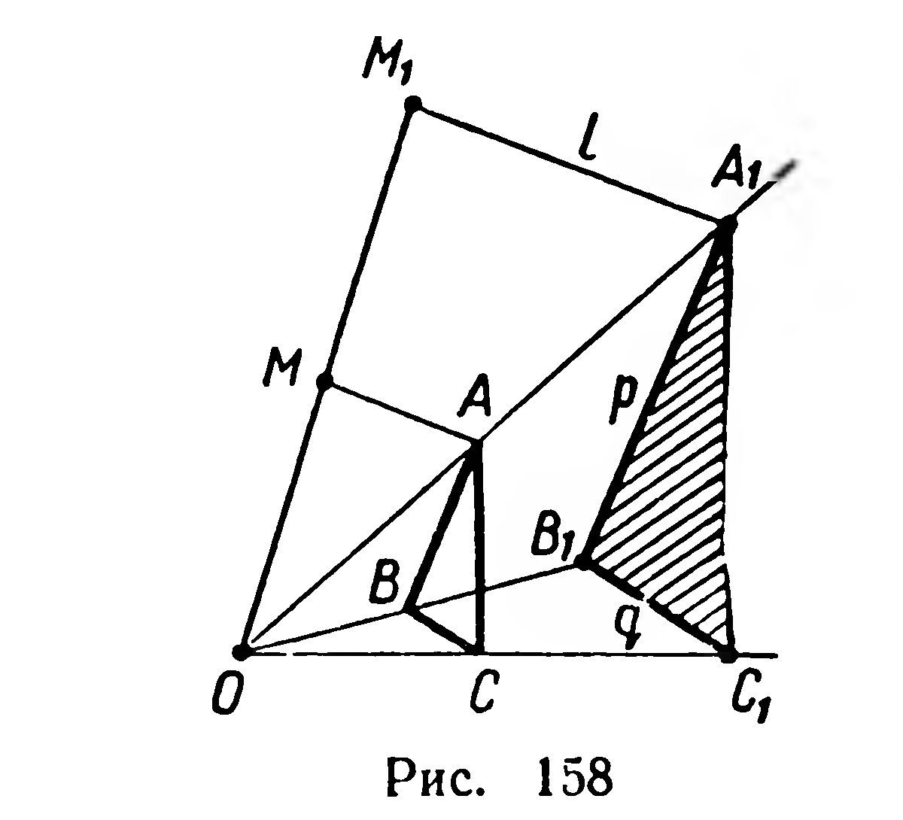

---
**стр. 214**
---

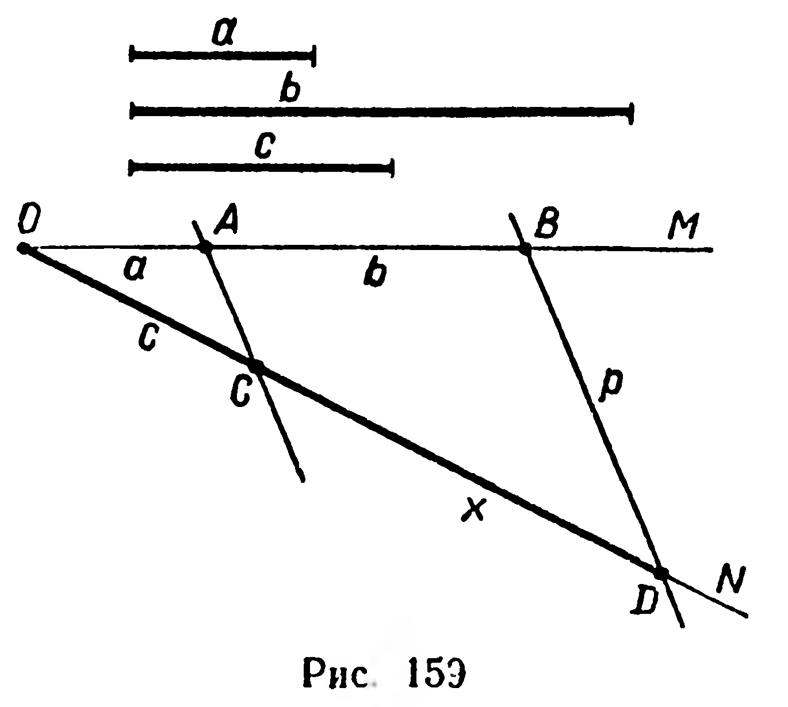

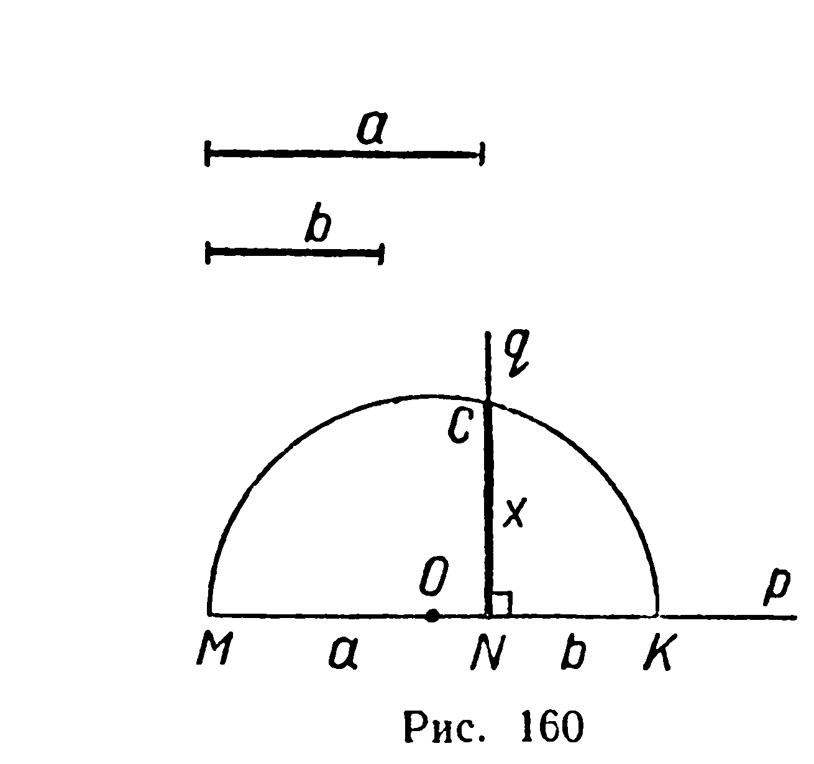

**Построение.** 1) Построим образ $A_1$ точки $A$ при данной гомотетии $H_O^k$ $(|k|=|OM_1|:|OM|)$:

а) построим прямую $OA$;

б) построим прямую $MA$;

в) построим прямую $l$, проходящую через $M_1$ и параллельную $(MA)$ (построение 9);

г) отмечаем точку $A_1$ пересечения прямых $OA$ и $l$, $A_1=H_O^k(A)$.

2) Построим $B_1=H_O^k(B)$:

а) построим прямую $OB$;

б) построим прямую $p$, проходящую через $A_1$ и параллельную $(AB)$;

в) отмечаем точку $B_1=p\cap(OB)$, $B_1=H_O^k(B)$.

3. Построим $C_1=H_O^k(C)$ аналогично пункту 2).

$\triangle A_1B_1C_1$ — искомый.

**13. Четвертый пропорциональный отрезок.** Даны отрезки, длины которых $a$, $b$, $c$. Построить отрезок длины $x$, чтобы была верна пропорция $a:b=c:x$ (рис. 159).

**Построение.** 1) Построим угол $MON$ $(\widehat{MON}<180^\circ)$.

2) На луче $OM$ откладываем отрезки $OA$ и $OB$, длины которых соответственно равны $a$ и $b$.

3) На луче $ON$ откладываем отрезок $OC$ длины $c$.

4) Построим прямую $AC$.

5) Построим прямую $p$, проходящую через точку $B$ и параллельную $(AC)$ (построение 9).

6) Отмечаем точку $D$ пересечения прямой $p$ и луча $ON$.

Отрезок $OD$ — искомый.

**14. Средний пропорциональный отрезок.** Построить отрезок, средний пропорциональный между отрезками, длины которых равны $a$ и $b$ (рис. 160).

**Построение.** 1) На произвольной прямой $p$ от точки $M\in p$ последовательно откладываем отрезки $MN$ и $NK$, длины которых соответственно равны $a$ и $b$.

---
**стр. 215**
---

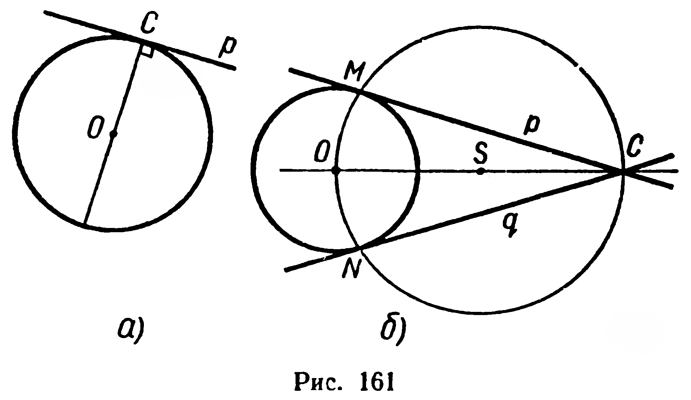

2) Построим середину $O$ отрезка $MK$ (построение 1).

3) Построим полуокружность с диаметром $MK$.

4) Построим перпендикуляр $q$ к прямой $MK$, проходящий через точку $N$ (построение 4).

5) Отмечаем точку $C$ пересечения полуокружности и прямой $q$.

Отрезок $NC$ — искомый.

**Примечание.** Построение 14 можно выполнить на основе другой теоремы (см. с. 209, пункт 4, 1).

**15. Касательная к окружности.** а) Построить касательную к данной окружности $(O;r)$, проходящую через данную точку $C$, которая принадлежит этой окружности (рис. 161, а).

**Построение.** 1) Построим прямую $OC$.

2) Построим перпендикуляр $p$ к прямой $OC$, проходящий через точку $C$ (построение 4).

Прямая $p$ — искомая касательная.

б) Построить касательную к данной окружности $(O;r)$, проходящую через данную точку $C$, при условии $|OC|>r$ (рис. 161, б).

**Построение.** 1) Построим середину $S$ отрезка $OC$ (построение 1).

2) Построим окружность $(S;|SO|)$.

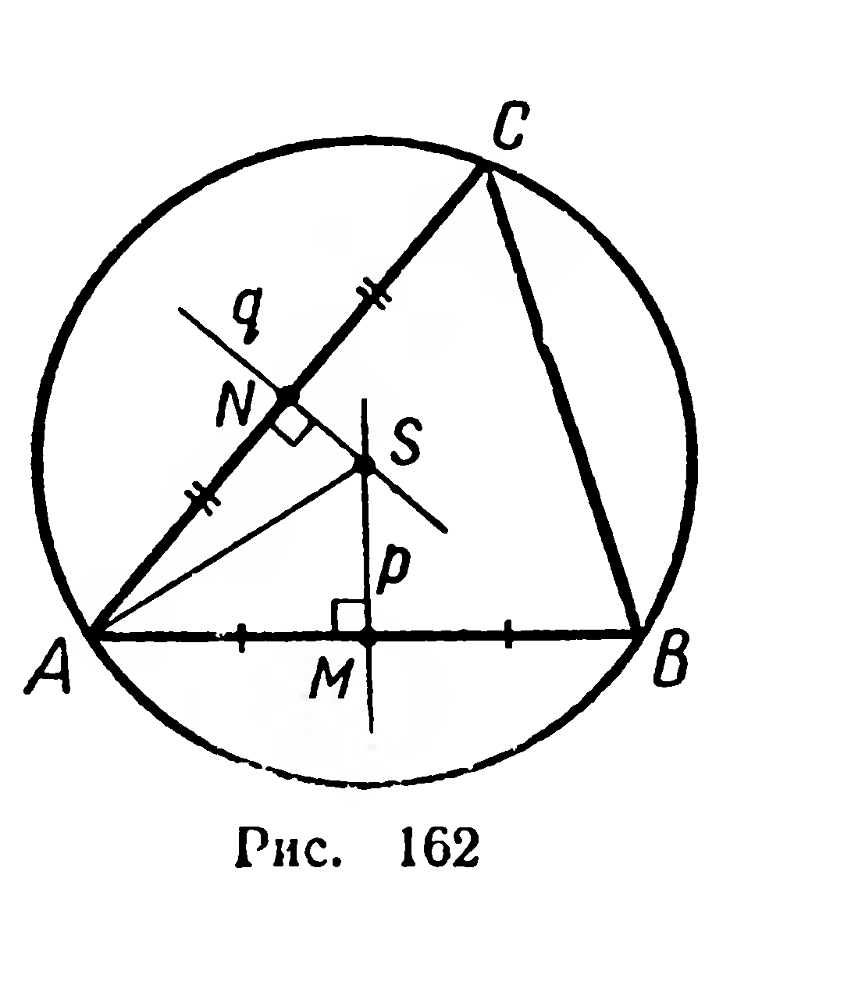

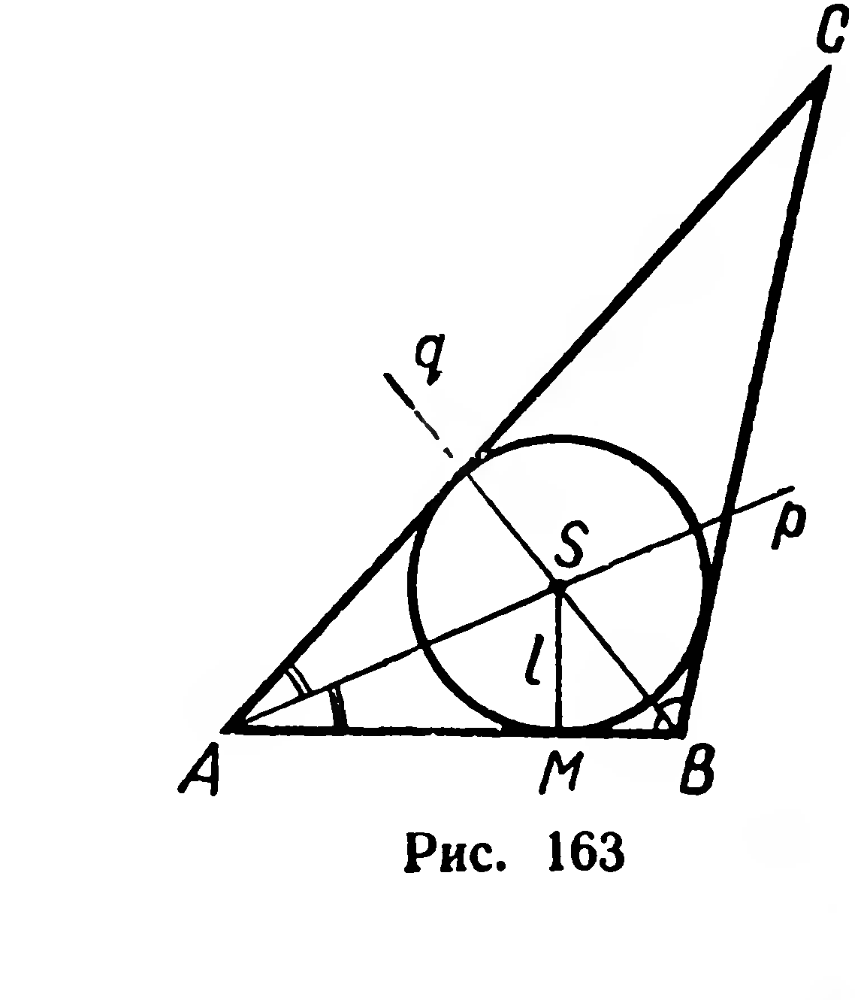

---
**стр. 216**
---

3) Отмечаем точки $M$ и $N$ пересечения данной и построенной окружностей.

4), 5) Построим прямые $p=(CM)$, $q=(CN)$.

Прямые $p$ и $q$ — искомые касательные.

**16. Окружность, описанная около треугольника.** Около данного треугольника $ABC$ описать окружность (рис. 162).

**Построение.** 1), 2) Построим серединные перпендикуляры $p$ и $q$ к отрезкам $AB$ и $AC$ (построение 1).

3) Отмечаем точку $S=p\cap q$.

4) Построим окружность $(S;|SA|)$. Эта окружность — искомая.

**Примечание.** $\{S\}$ — множество всех точек, равноудаленных от вершин данного треугольника.

**17. Окружность, вписанная в треугольник.** В данный треугольник $ABC$ вписать окружность (рис. 163).

**Построение.** 1), 2) Построим биссектрисы $p$ и $q$ углов $BAC$ и $ABC$ (построение 3).

3) Отмечаем точку $S=p\cap q$.

4) Построим перпендикуляр $l$ к прямой $AB$, проходящий через точку $S$ (построение 4).

5) Отмечаем точку $M=l\cap[AB]$.

6) Построим окружность $(S;|SM|)$. Эта окружность — искомая.

**Примечание.** $\{S\}$ — множество всех точек треугольника, одинаково удаленных от его сторон.
