## 7.6. Приложения

---
**стр. 220**
---

# ПРИЛОЖЕНИЯ

## ТЕОРЕМЫ О КОНГРУЭНТНОСТИ ФИГУР (к § 31)

**Теорема 1.** *Любые два луча конгруэнтны.*

**Доказательство.** Рассмотрим два случая.

1) Данные лучи $h$ и $h_1$ имеют общее начало $O$ (рис. 164). Проведем прямую $l$, содержащую биссектрису угла $(h,h_1)$[^1]. Симметрия $S_l$ отображает луч $h$ на луч $h_1$.

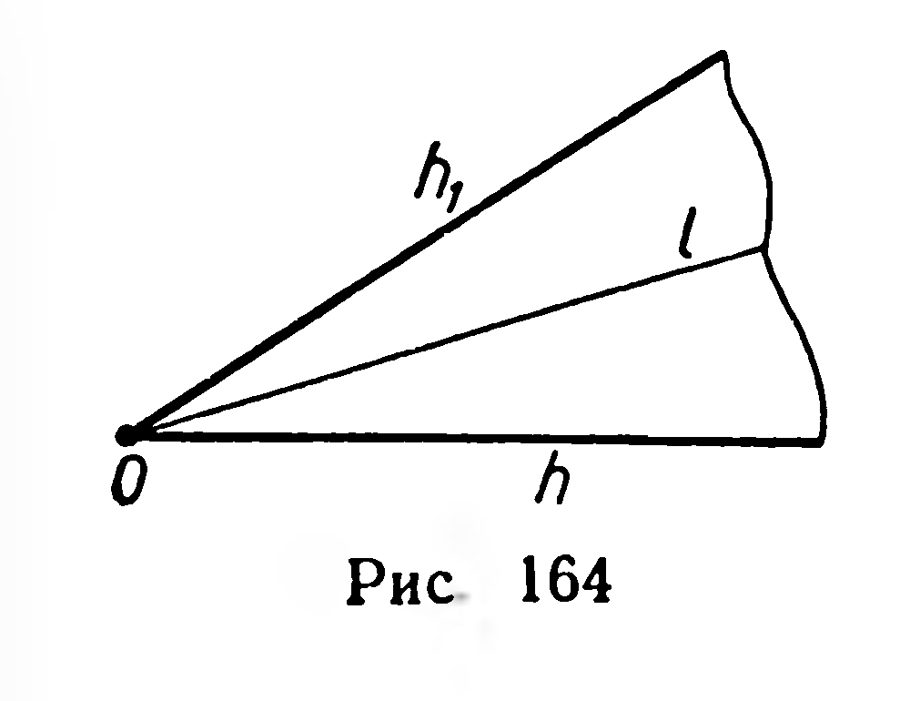

2) Пусть лучи $h$ и $h_1$ имеют разные начальные точки $O$ и $O_1$ (рис. 165). Рассмотрим симметрию относительно произвольного серединного перпендикуляра $l_1$ отрезка $OO_1$: $S_{l_1}(O)=O_1$, $S_{l_1}(h)=h'$. Если $h'=h_1$, то теорема доказана. Предположим, что $h'\ne h_1$. Симметрия относительно прямой $l_2$, содержащей биссектрису угла $(h',h_1)$, отображает луч $h'$ на луч $h_1$. Итак,
$$(S_{l_2}\circ S_{l_1})(h)=h_1.$$

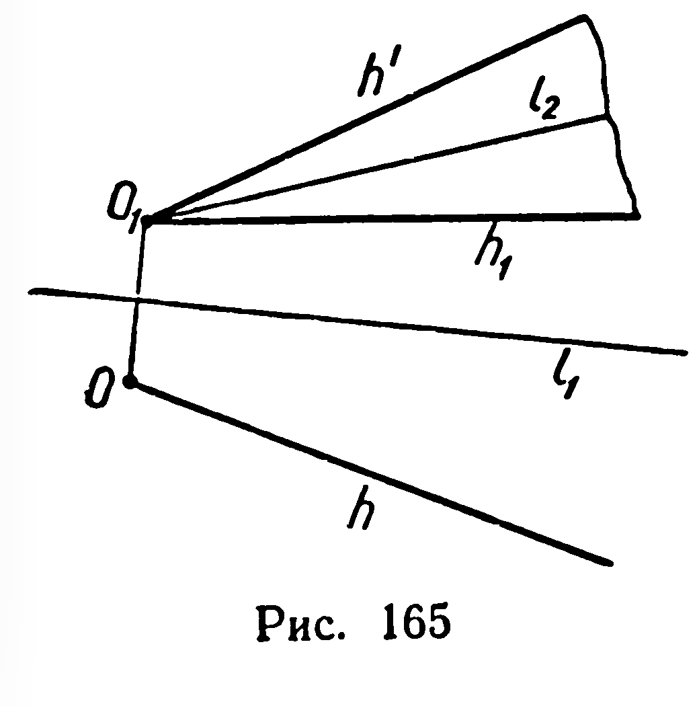

**Замечание.** Если лучи $h$ и $h_1$ лежат в одной плоскости $\beta$, то можно указать перемещение $F$, которое отображает $h$ на $h_1$, а плоскость $\beta$ на себя. Для этого достаточно выбрать тот серединный перпендикуляр $l_1$, который содержится в $\beta$ (см. доказательство теоремы 1).

**Теорема 2.** *Если на границах двух полуплоскостей $\alpha$ и $\alpha_1$ заданы соответственно лучи $h$ и $h_1$, то существует перемещение, отображающее $h$ на $h_1$ и $\alpha$ на $\alpha_1$.*

**Доказательство.** 1) Рассмотрим сначала тот случай, который встречается в планиметрии: данные полуплоскости лежат в одной плоскости $\beta$ (рис. 166). Согласно теореме 1 суще-

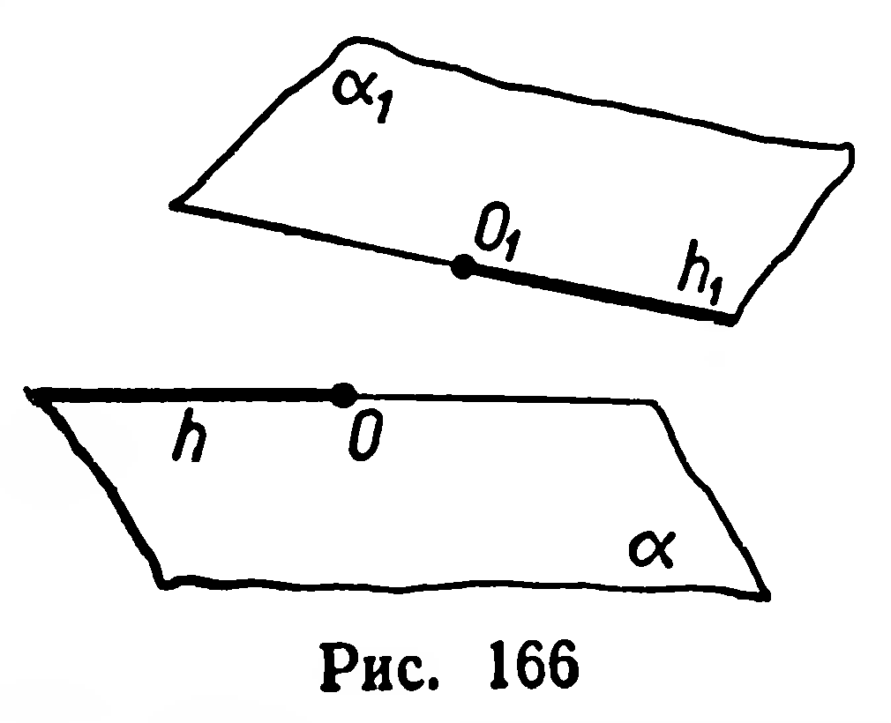

[^1]: Угол, стороны которого лучи $h$ и $h_1$, здесь обозначается $(h,h_1)$.

---
**стр. 221**
---

ствует такое перемещение $F$, что $F(h)=h_1$, при этом $F(\alpha)=\alpha'$. Можно считать, что $\alpha'\subset\beta$ (см. замечание к теореме 1). Если $\alpha'=\alpha_1$, то теорема доказана. Предположим, что $\alpha'\ne\alpha_1$. В последнем случае полуплоскости $\alpha'$ и $\alpha_1$ симметричны относительно прямой $l$, содержащей луч $h_1$. Тогда композиция $S_l\circ F$ отображает $h$ на $h_1$ и $\alpha$ на $\alpha_1$.

2) Пусть данные полуплоскости не лежат в одной плоскости. Луч, дополняющий луч $h_1$ до прямой, обозначим через $h'$. Существует такое перемещение $F_1$, что $F_1(h)=h'$ (теорема 1). Пусть $F_1(\alpha)=\alpha'$ (рис. 167). Из начальной точки $O_1$ луча $h'$ в полуплоскостях $\alpha'$ и $\alpha_1$ проведем соответственно лучи $l'$ и $l_1$, перпендикулярные лучу $h'$. Затем проведем прямую $l$, содержащую биссектрису угла $(l',l_1)$. По признаку перпендикулярности прямой и плоскости луч $h'$ перпендикулярен плоскости угла $(l',l_1)$, отсюда $h'\perp l$. Имеем: $S_l(h')=h_1$, $S_l(l')=l_1$, тогда $S_l(\alpha')=\alpha_1$. Следовательно, композиция $S_l\circ F_1$ отображает $h$ на $h_1$ и $\alpha$ на $\alpha_1$.

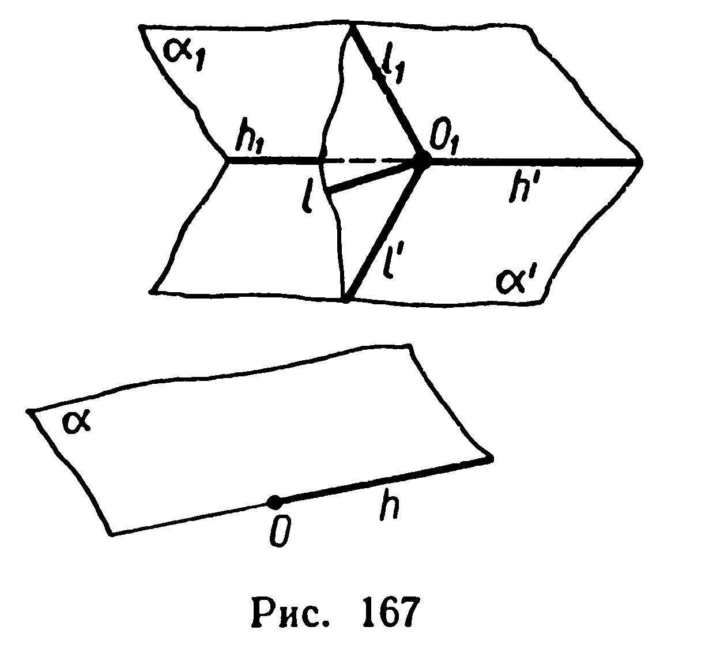

**Теорема 3.** *Если длины трех сторон одного треугольника соответственно равны длинам трех сторон другого треугольника, то такие треугольники конгруэнтны.*

**Доказательство.** Пусть у треугольников $ABC$ и $A_1B_1C_1$ длины сторон соответственно равны: $|AB|=|A_1B_1|$, $|AC|=|A_1C_1|$, $|BC|=|B_1C_1|$ (рис. 168). Прямая $AB$ — общая граница двух полуплоскостей. Обозначим через $\alpha$ ту из них, которая содержит точку $C$. Аналогично, прямая $A_1B_1$ — общая граница двух полуплоскостей. Пусть $\alpha_1$ — та из них, которая содержит точку $C_1$. Существует перемещение $F$, отображающее полуплоскость $\alpha$ на полуплоскость $\alpha_1$ так, что образом луча $AB$ является луч $A_1B_1$ (теорема 2). По условию $|AB|=|A_1B_1|$, отсюда $F(B)=B_1$. Пусть $F(C)=C'$. Возникает вопрос: различны точки $C'$ и $C_1$ или совпадают? Предположим, что эти точки различны. Рассмотрим точку $C''$, симметричную $C'$ относительно прямой $A_1B_1$, тогда $\triangle A_1C''B_1$ симметричен треугольнику $A_1C'B_1$ относительно $(A_1B_1)$. Всякое перемещение сохраняет расстояния, поэтому $|A_1C''|=|A_1C_1|$ и $|B_1C''|=|B_1C_1|$, т. е. каждая из точек $A_1$ и

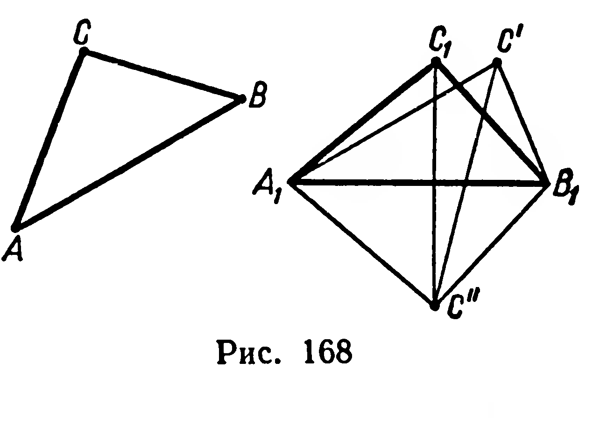

---
**стр. 222**
---

$B_1$ равноудалена от концов отрезка $C_1C''$. Отсюда $(A_1B_1)$ есть серединный перпендикуляр отрезка $C_1C''$. Другими словами, точки $C_1$ и $C''$ симметричны относительно прямой $A_1B_1$. Получили, что для точки $C''$ существуют две различные симметричные точки $C'$ и $C_1$ относительно $(A_1B_1)$. Это невозможно. Следовательно, $C'=C_1$, $F(\triangle ABC)=\triangle A_1B_1C_1$ и $\triangle A_1B_1C_1\cong\triangle ABC$.

Остальные признаки конгруэнтности треугольников, известные из планиметрии, можно доказать, пользуясь теоремой 2.

В планиметрии была принята аксиома подвижности плоскости. Для пространства верно аналогичное предложение: если $|AB|=|A_1B_1|$, $|AC|=|A_1C_1|$, $|BC|=|B_1C_1|$ и точки $A$, $B$, $C$ не принадлежат одной прямой, то существуют два и только два перемещения, каждое из которых отображает точки $A$, $B$, $C$ соответственно на точки $A_1$, $B_1$, $C_1$.

Существование одного такого перемещения $F$ вытекает из признака конгруэнтности треугольников по трем сторонам (теорема 3). Вторым перемещением является композиция $S_{\alpha_1}\circ F$, где $\alpha_1=(A_1B_1C_1)$.

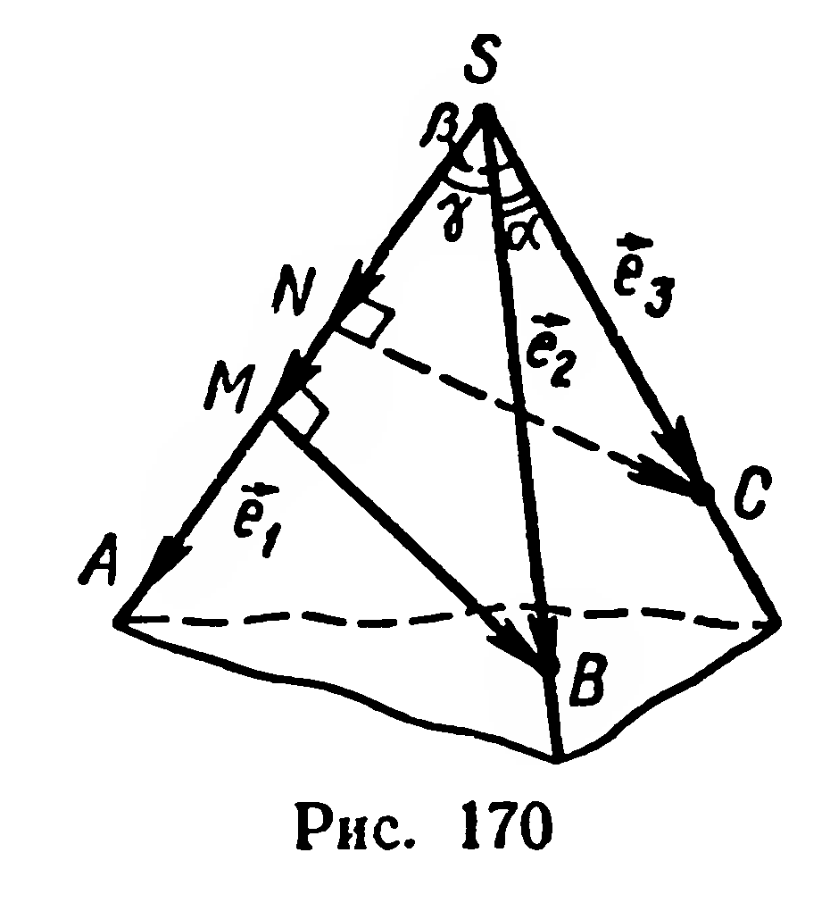

## ПРОЕКЦИЯ ВЕКТОРА НА ОСЬ[^2] (к § 28)

Пусть даны ось $l$, направление которой определяется единичным вектором $\vec e$, и вектор $\overrightarrow{AB}$ (рис. 169). Точки $A_1$ и $B_1$ являются соответственно проекциями точек $A$ и $B$ на прямую $l$: $[AA_1]\perp l$ и $[BB_1]\perp l$. Докажем, что
$$\overrightarrow{A_1B_1}=|\overrightarrow{AB}|\cos\varphi\cdot\vec e,$$
где
$$\varphi=(\widehat{\overrightarrow{AB},\vec e}).$$

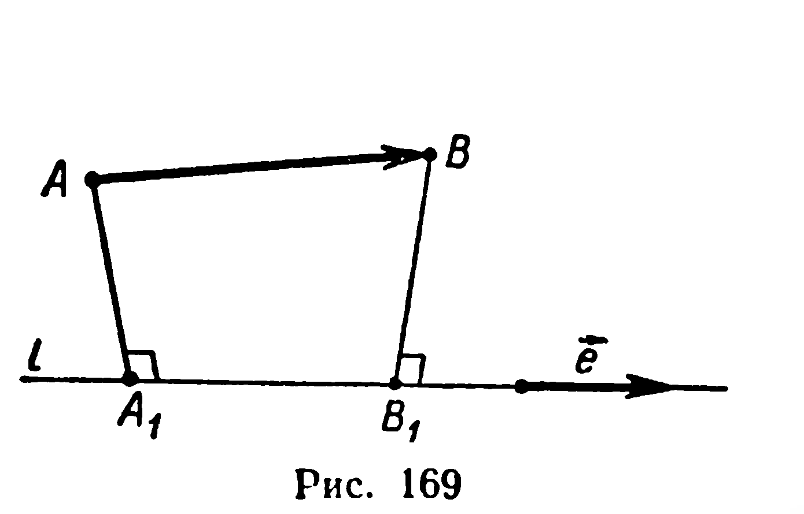

В самом деле, векторы $\overrightarrow{A_1B_1}$ и $\vec e$ коллинеарны, поэтому существует такое число $x$, что $\overrightarrow{A_1B_1}=x\vec e$. Найдем это число. По

[^2]: В этом случае осью мы называем прямую, на которой с помощью единичного вектора задано направление.

---
**стр. 223**
---

правилу многоугольника $\vec{xe}=\overrightarrow{A_1A}+\overrightarrow{AB}+\overrightarrow{BB_1}$. Умножив обе части этого равенства на $\vec e$, получим:

$$
x=\overrightarrow{AB}\cdot\vec e,\quad\text{или}\quad x=|\overrightarrow{AB}|\cos\varphi.
$$

Тогда

$$
\overrightarrow{A_1B_1}=|\overrightarrow{AB}|\cos\varphi\cdot\vec e.
$$

Величина $|\overrightarrow{AB}|\cos\varphi$ называется *проекцией вектора* $\overrightarrow{AB}$ *на ось* $l$.

## ТЕОРЕМА КОСИНУСОВ ДЛЯ ТРЕХГРАННОГО УГЛА (к § 40)

**Теорема.** *Косинус плоского угла трехгранного угла равен произведению косинусов двух остальных плоских углов, сложенному с произведением синусов тех же углов и косинуса двугранного угла, определяемого этими плоскими углами:*

$$
\cos\alpha=\cos\beta\cos\gamma+\sin\beta\sin\gamma\cos\widehat A.
$$

Эта теорема носит название «теорема косинусов для трехгранного угла».

**Доказательство.** На ребрах данного трехгранного угла $SABC$ (рис. 170) отложим единичные векторы:

$$
\overrightarrow{SA}=\vec e_1,\quad
\overrightarrow{SB}=\vec e_2,\quad
\overrightarrow{SC}=\vec e_3.
$$

Проведем отрезки $BM$ и $CN$ перпендикулярно прямой $SA$, тогда

$$
(\overrightarrow{MB},\overrightarrow{NC})=\widehat A.
$$

Для углов из промежутка $]0^\circ,180^\circ[$ имеем:

$$
|NC|=\sin\beta,\quad |MB|=\sin\gamma.
$$

Кроме того, по свойству проекции вектора на ось

$$
\overrightarrow{SN}=\cos\beta\,\vec e_1,\quad
\overrightarrow{SM}=\cos\gamma\,\vec e_1.
$$

По правилу сложения векторов:

$$
\begin{aligned}
\vec e_3&=\overrightarrow{SN}+\overrightarrow{NC}
=\vec e_1\cos\beta+\overrightarrow{NC},\\
\vec e_2&=\overrightarrow{SM}+\overrightarrow{MB}
=\vec e_1\cos\gamma+\overrightarrow{MB}.
\end{aligned}
$$

Перемножим скалярно эти два равенства, учитывая, что $\overrightarrow{NC}\perp\vec e_1$ и $\overrightarrow{MB}\perp\vec e_1$. Получим:

$$
\vec e_3\cdot\vec e_2
=\cos\beta\cos\gamma\,\vec e_1^{\,2}
+\overrightarrow{NC}\cdot\overrightarrow{MB}.
$$

Итак,

$$
\cos\alpha=\cos\beta\cos\gamma+\sin\beta\sin\gamma\cos\widehat A.
$$

Приведем примеры применения теоремы косинусов.

---
**стр. 224**
---

### Задачи

**1.** С помощью теоремы косинусов для трехгранного угла доказать теорему 24 и следствие из этой теоремы (§ 41).

**Решение.** Рассмотрим трехгранный угол $SABC$ (рис. 170). Докажем, что $\beta+\gamma>\alpha>|\beta-\gamma|$. Воспользуемся теоремой косинусов:

$$
\cos\widehat A=\frac{\cos\alpha-\cos\beta\cos\gamma}
{\sin\beta\sin\gamma}.
$$

Так как $0^\circ<\widehat A<180^\circ$, то $-1<\cos\widehat A<1$, или

$$
-1<
\frac{\cos\alpha-\cos\beta\cos\gamma}
{\sin\beta\sin\gamma}
<1.
$$

Произведение $\sin\beta\sin\gamma$ положительно, поэтому из предыдущего неравенства следует:

$$
-\sin\beta\sin\gamma
<\cos\alpha-\cos\beta\cos\gamma
<\sin\beta\sin\gamma.
$$

Отсюда

$$
\cos\beta\cos\gamma-\sin\beta\sin\gamma
<\cos\alpha<
\cos\beta\cos\gamma+\sin\beta\sin\gamma,
$$

т. е.

$$
\cos(\beta+\gamma)<\cos\alpha<\cos(\beta-\gamma). \tag{1}
$$

Косинус — четная функция. Поэтому $\cos(\beta-\gamma)=\cos|\beta-\gamma|$. В промежутке $[0^\circ,180^\circ]$ косинус монотонно убывает, поэтому при условии $\beta+\gamma\leqslant180^\circ$ из (1) следует неравенство $\beta+\gamma>\alpha>|\beta-\gamma|$. Если же $\beta+\gamma>180^\circ$, то последнее неравенство и подавно выполняется.

**2.** 1) Величины плоских углов трехгранного угла равны $60^\circ$, $90^\circ$, $120^\circ$. Найдите величины его двугранных углов.

2) Два плоских угла трехгранного угла равны $30^\circ$ и $90^\circ$, двугранный угол между ними прямой. Найдите остальные двугранные углы.

**Ответ.** 1) $\approx54^\circ44'$, $\approx109^\circ28'$, $\approx125^\circ16'$; 2) $\approx26^\circ34'$, $\approx98^\circ35'$.

**3.** У трехгранного угла величины двух плоских углов равны. Докажите, что величины противолежащих им двугранных углов равны.

**4.** Трехгранный угол имеет два конгруэнтных плоских угла, третий плоский угол — прямой. Докажите, что двугранный угол, противолежащий прямому плоскому углу, не может быть острым.

## НЕОБХОДИМОЕ И ДОСТАТОЧНОЕ УСЛОВИЕ СУЩЕСТВОВАНИЯ ТРЕХГРАННОГО УГЛА (к § 41)

**Теорема.** *Необходимым и достаточным условием существования трехгранного угла с данными плоскими углами $\alpha,\beta,\gamma$, принадлежащими промежутку $]0^\circ,180^\circ[$, является выполнение неравенств:*

$$
|\beta-\gamma|<\alpha<\beta+\gamma \tag{1}
$$

*и*

$$
\alpha+\beta+\gamma<360^\circ. \tag{2}
$$

**Доказательство.** 1) *Необходимость.* Если существует трехгранный угол с плоскими углами $\alpha,\beta,\gamma$, то согласно теоремам § 41 неравенства (1) и (2) имеют место.

2) *Достаточность.* Пусть плоские углы $\alpha,\beta,\gamma$ удовлетворяют неравенствам (1) и (2). Нужно доказать существование трехгранного угла с плоскими углами $\alpha,\beta,\gamma$.

Рассмотрим два случая.

а) $\beta+\gamma\leqslant180^\circ$. В промежутке $[0^\circ,180^\circ]$ косинус монотонно убывает, поэтому из неравенства (1) следует неравенство

$$
\cos(\beta+\gamma)<\cos\alpha<\cos|\beta-\gamma|.
$$

Пользуясь четностью косинуса,

---
**стр. 225**
---

опустим знак модуля, затем применим формулы тригонометрии:

$$
\cos\beta\cos\gamma-\sin\beta\sin\gamma
<\cos\alpha<
\cos\beta\cos\gamma+\sin\beta\sin\gamma.
$$

Так как $\sin\beta\sin\gamma>0$, из последнего неравенства следует:

$$
-1<
\frac{\cos\alpha-\cos\beta\cos\gamma}
{\sin\beta\sin\gamma}
<1.
$$

Это неравенство показывает, что существует двугранный угол $SA$ $(0^\circ<\widehat A<180^\circ)$, такой, что

$$
\cos\widehat A=
\frac{\cos\alpha-\cos\beta\cos\gamma}
{\sin\beta\sin\gamma}. \tag{3}
$$

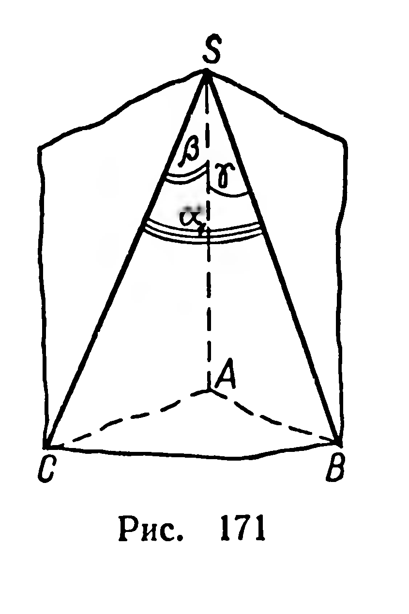

Построим трехгранный угол по двугранному углу $SA$ и заключающим его плоским углам $\beta$ и $\gamma$ (рис. 171). Третий плоский угол этого трехгранного угла обозначим $\alpha_1$. По теореме косинусов

$$
\cos\alpha_1=
\cos\beta\cos\gamma+
\sin\beta\sin\gamma\cos\widehat A. \tag{4}
$$

С другой стороны, из равенства (3) имеем:

$$
\cos\alpha=
\cos\beta\cos\gamma+
\sin\beta\sin\gamma\cos\widehat A. \tag{5}
$$

Из (4) и (5): $\cos\alpha_1=\cos\alpha$, отсюда $\alpha_1=\alpha$. Итак, построенный трехгранный угол имеет плоские углы $\alpha,\beta,\gamma$.

б) $\beta+\gamma>180^\circ$. Из неравенства (1) $|\beta-\gamma|<\alpha$, а из неравенства (2) $\alpha<360^\circ-(\beta+\gamma)$, тогда

$$
|\beta-\gamma|<\alpha<360^\circ-(\beta+\gamma). \tag{6}
$$

Заметим, что $360^\circ-(\beta+\gamma)<180^\circ$. Пользуясь монотонностью косинуса в промежутке $[0^\circ,180^\circ]$, из неравенства (6) получим:

$$
\cos|\beta-\gamma|>\cos\alpha>
\cos\bigl(360^\circ-(\beta+\alpha)\bigr),
$$

<!-- вероятная опечатка оригинала: в последнем косинусе напечатано β+α, тогда как из (6) следует β+γ -->

или

$$
\cos(\beta-\gamma)>\cos\alpha>\cos(\beta+\gamma).
$$

Дальнейшие рассуждения проводятся, как и в случае а).

## СВОЙСТВА ПЛОСКИХ УГЛОВ МНОГОГРАННОГО УГЛА (к § 41)

**Теорема.** *Величина каждого плоского угла многогранного угла меньше суммы величин остальных его плоских углов.*

Доказательство проведем методом математической индукции. Для трехгранного угла теорема верна (§ 41, теорема 25). Предположим, что она верна для $n$-гранного угла, и докажем ее истинность для $(n+1)$-гранного угла (рис. 172). Пусть $\alpha_{n+1}$ — наибольший плоский угол этого многогранного угла. Требуется доказать, что

$$
\alpha_{n+1}<\alpha_1+\alpha_2+\ldots+\alpha_n.
$$

Обозначим $\widehat{A_{n-1}SA_{n+1}}=\beta$; по предположению для $n$-гранного угла $SA_1A_2\ldots A_{n-1}A_{n+1}$ имеем:

$$
\alpha_{n+1}<\alpha_1+\alpha_2+\ldots+\alpha_{n-2}+\beta. \tag{1}
$$

---
**стр. 226**
---

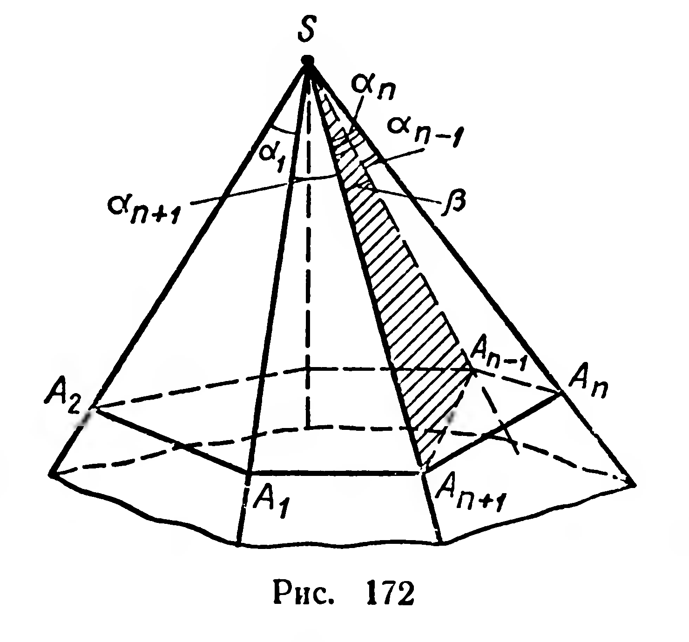

Но в трехгранном угле $SA_{n-1}A_nA_{n+1}$:

$$
\beta<\alpha_{n-1}+\alpha_n. \tag{2}
$$

Из неравенств (1) и (2) следует:

$$
\alpha_{n+1}<\alpha_1+\alpha_2+\ldots+\alpha_{n-2}+\alpha_{n-1}+\alpha_n.
$$

**Теорема. В многогранном угле сумма величин плоских углов меньше $360^\circ$.**

Доказательство, как и выше, проведем методом математической индукции.

Для трехгранного угла теорема верна (§ 41). Предположив, что теорема верна для $n$-гранного угла, докажем ее для $(n+1)$-гранного угла.

Пусть дан $(n+1)$-гранный угол $SA_1A_2\ldots A_{n+1}$ с плоскими углами $\alpha_1,\alpha_2,\ldots,\alpha_n,\alpha_{n+1}$ (рис. 173). Плоскости углов $\alpha_1$ и $\alpha_n$ имеют общую точку $S$, поэтому они пересекаются по прямой $a$,

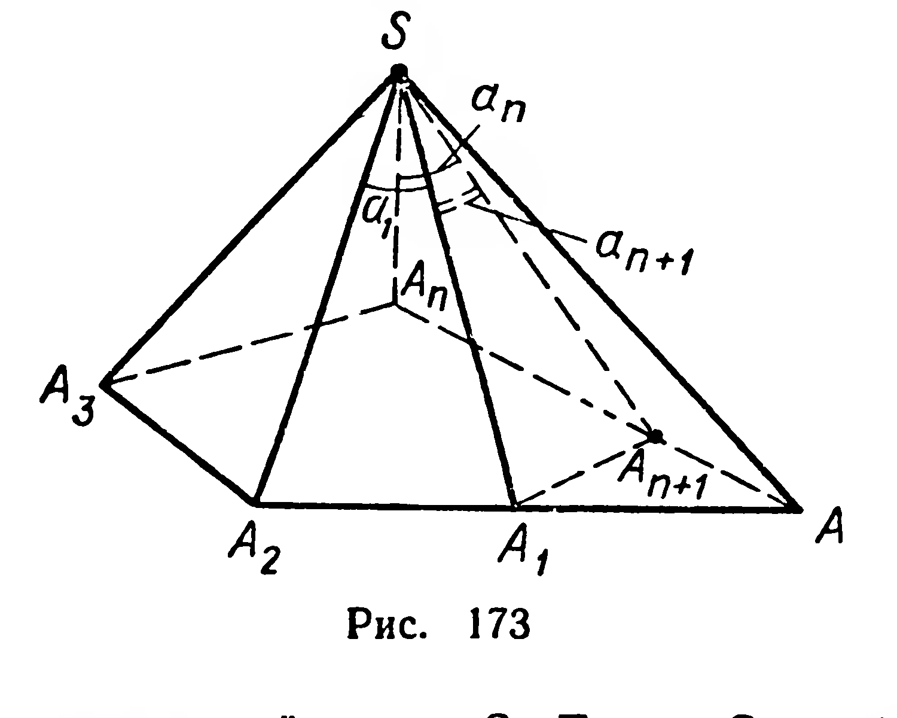

проходящей через $S$. Точка $S$ разбивает прямую $a$ на два луча. Один из этих лучей и данный многогранный угол лежат по разные стороны плоскости угла $\alpha_{n+1}$. Этот луч обозначим $SA$. Рассмотрим выпуклый $n$-гранный угол $SAA_2\ldots A_n$. Величины плоских углов таковы: $(\widehat{ASA_1}+\alpha_1),\alpha_2,\alpha_3,\ldots,\alpha_{n-1},(\alpha_n+\widehat{A_{n+1}SA})$. По предположению для этого $n$-гранного угла теорема верна, т. е.

$$
(\widehat{ASA_1}+\alpha_1)+\alpha_2+\alpha_3+\ldots+(\alpha_n+\widehat{A_{n+1}SA})<360^\circ,
$$

или

$$
\alpha_1+\alpha_2+\ldots+\alpha_n+(\widehat{ASA_1}+\widehat{A_{n+1}SA})<360^\circ.
$$

Но по предыдущей теореме для трехгранного угла $SAA_1A_{n+1}$ имеем:

$$
\widehat{ASA_1}+\widehat{A_{n+1}SA}>\alpha_{n+1},
$$

тогда и подавно

$$
\alpha_1+\alpha_2+\ldots+\alpha_{n+1}<360^\circ.
$$

# ГЕОМЕТРИЧЕСКОЕ ТЕЛО (к гл. V и VI)

Многогранники и некоторые фигуры вращения можно рассматривать как частные виды геометрических тел. Понятия геометрического тела и его поверхности можно ввести следующим образом.

---
**стр. 227**
---

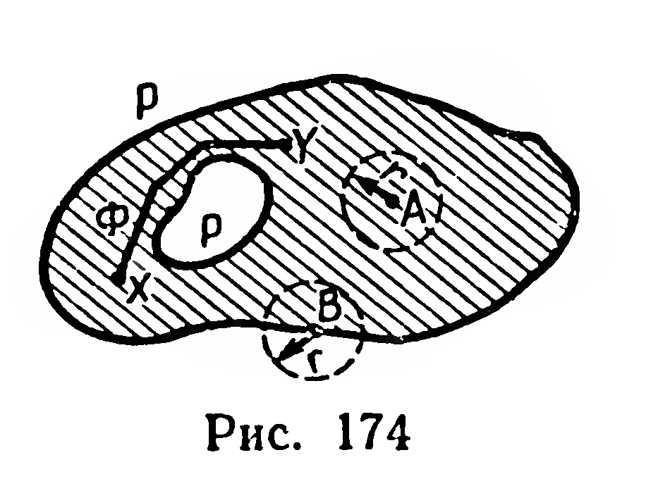

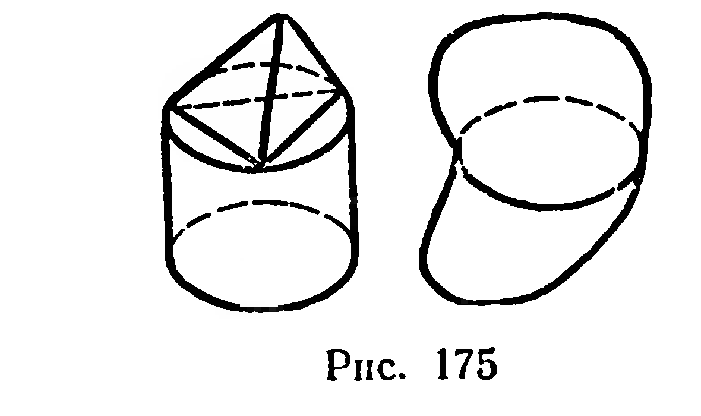

Рассмотрим в пространстве фигуру $\Phi$ (на рисунке 174 для простоты изображено лишь ее пересечение с некоторой плоскостью). Точка $A$, принадлежащая фигуре $\Phi$, называется ее **внутренней точкой относительно пространства**, если существует такая положительная величина $r$, что все точки пространства, расстояния которых до точки $A$ меньше $r$, принадлежат $\Phi$. Не следует думать, что каждая фигура имеет внутренние точки относительно пространства. Например, отрезок или треугольник не имеют ни одной такой точки.

Фигуру $\Phi$ называют **открытой пространственной областью**, если каждая ее точка является внутренней и любые две ее точки можно соединить ломаной, содержащейся в $\Phi$ (рис. 174). Примером открытой пространственной области может служить пространство, открытое полупространство (§ 4) или внутренняя область многогранного угла (§ 40). Точка $B$ (рис. 174) называется **граничной точкой** открытой области $\Phi$, если для любого $r>0$ среди точек, находящихся от $B$ на расстоянии, меньшем $r$, существуют точки, принадлежащие этой области, и точки, не принадлежащие ей. Множество $P$ (рис. 174) всех граничных точек открытой области называется **границей области**. Например, границей открытого полупространства является плоскость (§ 4), границей внутренней области трехгранного угла (§ 40) служит объединение всех его граней.

Объединение открытой пространственной области $\Phi$ и ее границы $P$ (рис. 174) называется **замкнутой пространственной областью**. Примерами замкнутых областей могут служить замкнутое полупространство, двугранный или трехгранный угол.

Фигура называется **ограниченной**, если существует такая величина $R$, что расстояние между любыми двумя точками данной фигуры меньше $R$. Примером ограниченной плоской фигуры является треугольник, примером неограниченной неплоской фигуры служит трехгранный угол.

**Определение. Ограниченная замкнутая пространственная область называется телом.**

Множество всех внутренних точек тела называют **внутренней областью тела**, а границу этой области — **поверхностью тела**.

Примерами геометрических тел могут служить призма, пирамида, конус, шар и т. д. Трехгранный угол телом не является, так как для него не выполнено требование ограниченности. Существуют тела, которые нельзя отнести ни к многогранникам, ни к фигурам вращения (рис. 175).

---
**стр. 228**
---

# ОБЪЕМ УСЕЧЕННОГО КОНУСА, ШАРОВОГО СЕГМЕНТА И ШАРОВОГО СЕКТОРА (к гл. VI)

## 1. Задача 1

Найти объем усеченного конуса, зная радиусы его оснований и высоту.

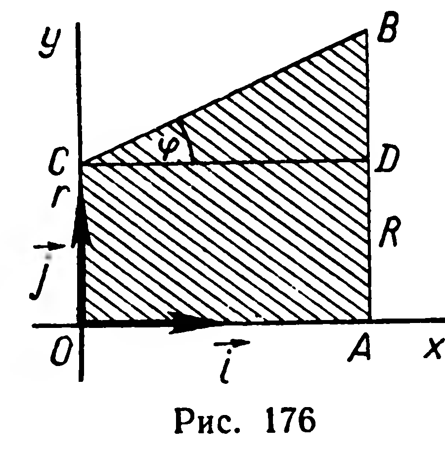

**Решение.** Пусть усеченный конус получен при вращении прямоугольной трапеции $OABC$ ($\widehat O=\widehat A=90^\circ$) вокруг стороны $OA$ (рис. 176). Введем обозначения: $|OA|=H$, $|AB|=R$, $|OC|=r$. В плоскости трапеции зададим прямоугольную систему координат с началом $O$ и осью абсцисс $OA$. Уравнение прямой $CB$ имеет вид

$$
y=kx+b,
$$

где

$$
b=r,\qquad k=\operatorname{tg}\varphi=\frac{R-r}{H}
$$

(рис. 176), т. е.

$$
y=\frac{R-r}{H}x+r.
$$

По формуле объема фигуры вращения (§ 66) имеем:

$$
V=\pi\int_0^H\left(\frac{R-r}{H}x+r\right)^2\,dx.
$$

Выполнив интегрирование, получим формулу объема усеченного конуса:

$$
V=\frac13\pi H(R^2+Rr+r^2).
$$

## 2

Рассмотрим круговой сегмент $ACB$ и диаметр $CD$, перпендикулярный хорде $AB$ (рис. 177, а).

Фигура, полученная при вращении кругового сегмента вокруг диаметра, перпендикулярного его хорде, называется **шаровым сегментом** (рис. 177, б). При этом вращении дуга кругового сегмента и его хорда образуют фигуры, которые называются соответственно сегментной поверхностью и основанием шарового сегмента. Отрезок $KC$ диаметра ($K=[AB]\cap[CD]$), вокруг кото-

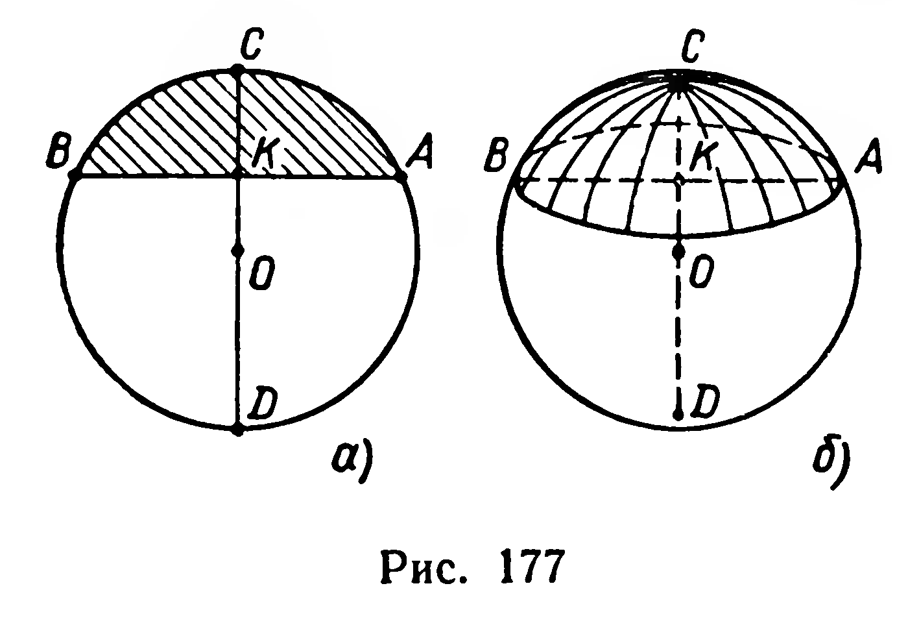

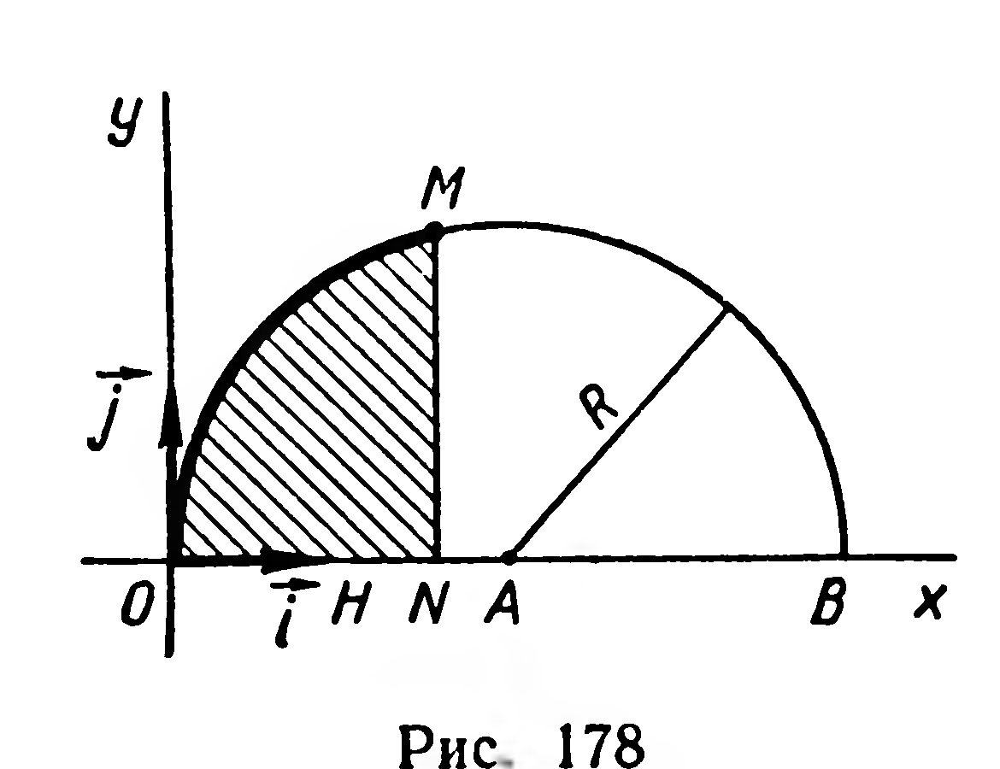

---
**стр. 229**
---

рого производится вращение, называется высотой шарового сегмента, а также сегментной поверхности.

**Задача 2.** Найти объем шарового сегмента, зная его высоту и радиус шара.

Р е ш е н и е. Рассмотрим полукруг с центром $A$ и диаметром $|OB|=2R$. В плоскости полукруга введем прямоугольную систему координат с началом $O$ и осью абсцисс $OA$ (рис. 178). Пусть $N$ — проекция точки $M$ полуокружности на прямую $OA$. При вращении данного полукруга вокруг оси абсцисс получим шар, а криволинейной трапеции $OMN$ — шаровой сегмент, высота $H$ которого равна $|ON|$. Уравнение окружности $(A; R)$ имеет вид:

$$(x-R)^2+y^2=R^2,\ \text{или}\ y^2=2Rx-x^2.\tag{1}$$

Пользуясь уравнением (1) и интегральной формулой объема фигуры вращения (§ 66), находим объем шарового сегмента:

$$V=\pi\int_0^H y^2\,dx=\pi\int_0^H(2Rx-x^2)\,dx=\frac13\pi H^2(3R-H).$$

Итак,

$$V=\frac13\pi H^2(3R-H).$$

**3. Шаровым сектором** называют фигуру, полученную при вращении кругового сектора вокруг оси, содержащей один из его граничных радиусов (рис. 179, а, б). Дуга кругового сектора образует при этом вращении сегментную поверхность.

**Задача 3.** Найти объем шарового сектора, зная радиус шара и высоту сегментной поверхности.

Р е ш е н и е. Пусть шаровой сектор получен при вращении кругового сектора $AOC$ вокруг диаметра $CD$ (рис. 179, а). Введем обозначения: $|CK|=H$, $|KA|=r$, $|OA|=R$. Объем шарового сектора, содержащегося в полушаре, равен сумме объемов конуса и шарового сегмента (рис. 179, б):

$$V=V_{\text{кон}}+V_{\text{сегм}}=\frac13\pi r^2(R-H)+\frac13\pi H^2(3R-H).$$

Рассматривая треугольник $ACD$, получим $r^2=H(2R-H)$, поэтому

$$V=\frac13\pi H(2R-H)(R-H)+\frac13\pi H^2(3R-H).$$

После раскрытия скобок и приведения подобных членов получим формулу объема шарового сектора:

$$V=\frac23\pi R^2H.$$

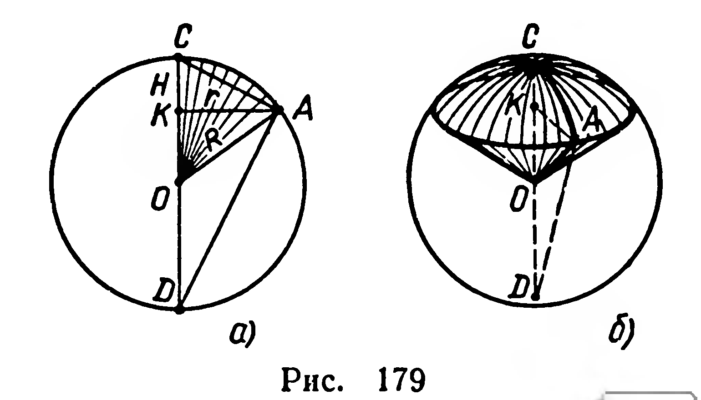

---
**стр. 230**
---

Эта формула верна и для шарового сектора, содержащего полушар. Докажите это самостоятельно, рассмотрев разность объемов шара и шарового сектора, дополняющего данный шаровой сектор до шара (рис. 179).

### Задачи

**1.** Объем усеченного конуса вычислили, умножив площадь среднего сечения на высоту. С недостатком или избытком получили приближенное значение? Какова относительная погрешность, если $R:r=2:1$?

О т в е т: с недостатком, $3{,}57\%$.

**2.** В усеченном конусе диагонали осевого сечения взаимно перпендикулярны, образующая равна $l$ и составляет с плоскостью основания угол $\alpha$. Найдите объем.

О т в е т: $\dfrac1{12}\pi l^3\sin\alpha(2-\cos2\alpha)$.

**3.** Дана четырехугольная пирамида, в которую можно вписать конус. Докажите, что суммы противоположных плоских углов при вершине пирамиды равны.

**4.** Найдите объем шарового сегмента, в осевом сечении которого хорда длиной $a$ стягивает дугу $\alpha$. Вычислите при $a=6$ см, $\alpha=120^\circ$.

О т в е т: $\dfrac{\pi a^3\tan\dfrac\alpha4\left(2+\cos\dfrac\alpha2\right)}{24\left(1+\cos\dfrac\alpha2\right)}\approx27{,}2\text{ см}^3$.

**5.** Круговой сегмент с хордой $a$ вращается вокруг диаметра, параллельного этой хорде. Докажите, что объем фигуры вращения не зависит от радиуса дуги сегмента.

**6.** Сфера с центром в вершине конуса касается его основания и делит конус на две части, имеющие равные объемы. Найдите угол при вершине осевого сечения конуса.

О т в е т: $2\arccos\dfrac{\sqrt{17}+1}{8}\approx100^\circ20'$.

## ПЛОЩАДЬ ПОВЕРХНОСТИ ЦИЛИНДРА, КОНУСА И ШАРОВОГО СЕГМЕНТА (к гл. VI)

При введении понятий площади боковой поверхности цилиндра, площади боковой поверхности конуса и площади сегментной поверхности можно применить такой же способ, который использовался для площади сферы (§ 69).

**1.** Пусть цилиндр получен при вращении прямоугольника $ABCD$ вокруг прямой $CD$ (рис. 180). Тогда его радиус $R$ и высота $H$ соответственно равны $|CA|$ и $|CD|$. Дадим радиусу $R$ приращение $\Delta R$, оставив высоту $H$ без изменения. При этом объем $V$ цилиндра получит приращение $\Delta V$ ($\Delta V$ — объем фигуры, полученной при вращении прямоугольника $BB_1A_1A$, стороны которого имеют длины $\Delta R$ и $H$).

*За площадь боковой поверхности цилиндра принимается предел отношения приращения объема цилиндра к приращению радиуса, когда приращение радиуса стремится к нулю:*

$$S=\lim_{\Delta R\to0}\frac{\Delta V}{\Delta R}.\tag{1}$$

---
**стр. 231**
---

Из формулы (1) вытекает, что для нахождения площади боковой поверхности цилиндра достаточно найти производную от его объема по радиусу. Формула объема цилиндра имеет вид: $V=\pi R^2H$. В рассматриваемом случае $H$ постоянная, поэтому

$$S=V'=(\pi R^2H)'=2\pi RH.$$

Итак, площадь боковой поверхности цилиндра вычисляется по формуле

$$S_{\text{бок}}=2\pi RH.$$

Площадь полной поверхности цилиндра получим, прибавив к площади его боковой поверхности удвоенную площадь основания:

$$S_{\text{цил}}=2\pi RH+2\pi R^2=2\pi R(H+R).$$

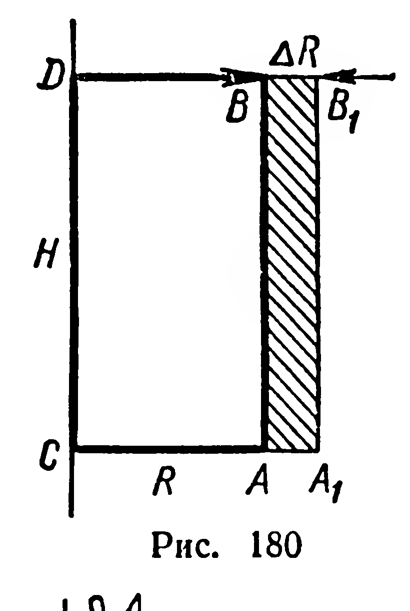

**2.** Пусть конус получен при вращении прямоугольного треугольника $ABO$ ($\widehat{AOB}=90^\circ$) вокруг прямой $AO$ (рис. 181). Тогда его радиус $R$ и образующая $L$ соответственно равны $|OB|$ и $|AB|$. Проведем $[BC]\perp[AB]$, где $C\in(AO)$. Ниже будет показано, что объем фигуры, полученной при вращении треугольника $ABC$ вокруг прямой $AC$, можно выразить через величину $\varphi$ угла $ABO$ и длину $p$ наибольшего из отрезков, перпендикулярных $[AB]$, с концами на $[AB]$ и $(AC)$ (таким отрезком является $[BC]$).

Дадим $p$ приращение $\Delta p$, оставив величину $\varphi$ без изменения. При этом объем $V_{\triangle ABC}$ получит приращение $\Delta V$, где $\Delta V$ — объем фигуры, полученной при вращении прямоугольника $AA_1B_1B$, стороны которого имеют длины $\Delta p$ и $L$ (рис. 181).

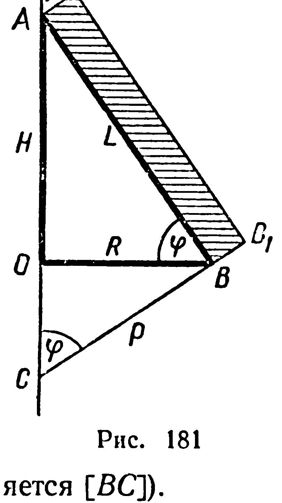

*За площадь боковой поверхности конуса принимается предел отношения приращения объема $V_{\triangle ABC}$ к приращению наибольшей нормали образующей конуса, когда приращение этой нормали стремится к нулю:*

$$S=\lim_{\Delta p\to0}\frac{\Delta V}{\Delta p}.\tag{2}$$

Из (2) вытекает, что для нахождения $S$ достаточно найти производную $V_{\triangle ABC}$ по наибольшей нормали $p$.

Выразим $V_{\triangle ABC}$ через $p$ и $\varphi$:

$$V_{\triangle ABC}=V_{\triangle OBA}+V_{\triangle OBC}=\frac13\pi|OB|^2\cdot|OA|+\frac13\pi|OB|^2\cdot|OC|=$$

$$=\frac13\pi|OB|^2\cdot|AC|.$$

---
**стр. 232**
---

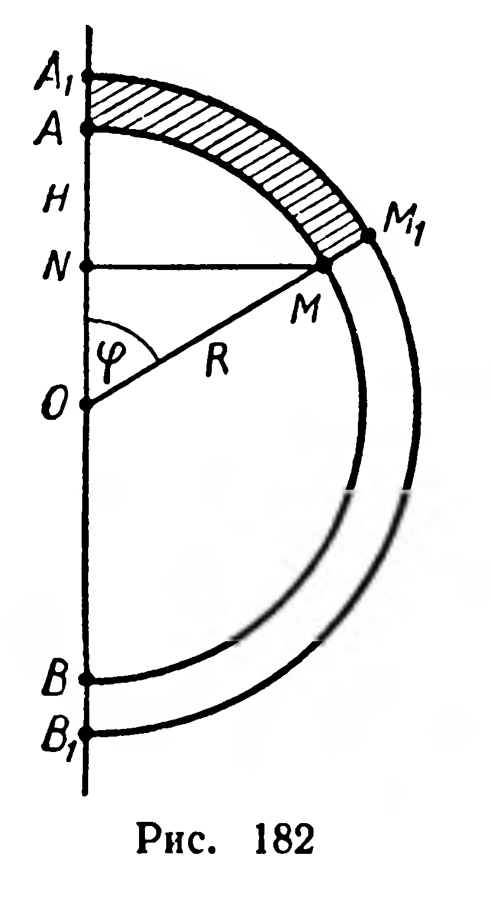

Из треугольников $ABC$ и $BOC$ находим:

$$
|AC|=\frac{\rho}{\cos\varphi},\quad |OB|=\rho\sin\varphi.
$$

Тогда

$$
V_{\triangle ABC}=\frac13\pi\rho^3\sin\varphi\mathop{\rm tg}\varphi.
$$

В рассматриваемом случае $\varphi$ — постоянная, поэтому согласно определению

$$
S_{[AB]}=V'_{\triangle ABC}
=\left(\frac13\pi\rho^3\sin\varphi\mathop{\rm tg}\varphi\right)'
=\pi\rho^2\sin\varphi\mathop{\rm tg}\varphi.
$$

Но $\rho\sin\varphi=R$ и $\rho\mathop{\rm tg}\varphi=L$. Тогда

$$
S_{[AB]}=\pi RL.
$$

Итак, площадь боковой поверхности конуса выражается формулой:

$$
S_{\text{бок}}=\pi RL.
$$

Площадь полной поверхности конуса получим, прибавив к площади его боковой поверхности площадь основания:

$$
S_{\text{кон}}=\pi RL+\pi R^2=\pi R(L+R).
$$

**3.** Пусть дан полукруг с центром $O$ и диаметром $|AB|=2R$ (рис. 182). На его полуокружности возьмем произвольную точку $M$, соединим ее с центром $O$ и проведем $[MN]\perp[AB]$. Рассмотрим вращение данного полукруга вокруг оси $AB$. Круговой сектор $MOA$ образует при этом шаровой сектор, а его дуга — сегментную поверхность, высота которой $|AN|=H$. Дадим радиусу $R$ приращение $\Delta R$, тогда объем шарового сектора получит приращение $\Delta V$, где $\Delta V$ — объем фигуры, полученной при вращении части кругового кольца $AA_1M_1M$.

*За площадь сегментной поверхности принимается предел отношения приращения объема шарового сектора, соответствующего этой сегментной поверхности, к приращению радиуса, когда приращение радиуса стремится к нулю:*

$$
S=\lim_{\Delta R\to0}\frac{\Delta V}{\Delta R}.
$$

Из определения следует, что для нахождения площади сегментной поверхности достаточно найти производную от объема шарового сектора по радиусу.

В формулу объема шарового сектора $V=\frac23\pi R^2H$ входят переменные $R$ и $H$. Чтобы получить функцию одной переменной $R$, введем угол $\varphi=\widehat{MOA}$, который сохраняет свою величину при изменении радиуса. Имеем:

$$
H=|OA|-|ON|=R-R\cos\varphi=R(1-\cos\varphi),
$$

тогда

$$
V=\frac23\pi R^3(1-\cos\varphi).
$$

Пользуясь этой фор-

---
**стр. 233**
---

мулой, находим:

$$
S=V'=2\pi R^2(1-\cos\varphi)=2\pi RH.
$$

Итак, площадь сегментной поверхности вычисляется по формуле:

$$
S=2\pi RH.
$$

### Задачи

**1.** Вычислите площадь части земной поверхности, которую может видеть космонавт при выходе из космического корабля на высоте 300 км над поверхностью Земли.

**Ответ:** $\approx11{,}5$ млн. км².

**2.** Докажите, что площадь сегментной поверхности выражается формулой $S=\pi(r^2+H^2)$, где $r$ — радиус основания поверхности, $H$ — ее высота.

**3.** Плоскость рассекает поверхность шара на части, отношение площадей которых равно $m:n$. Найдите отношение объемов получившихся частей шара.

**Ответ:**

$$
\frac{m^2(m+3n)}{n^2(n+3m)}.
$$

**4.** Найдите объем шарового сектора, у которого площадь сферической поверхности равна $S$, а конической поверхности $Q$.

**Ответ:**

$$
\frac{\sqrt{S(4Q^2+S^2)}}{6\sqrt{\pi}}.
$$

# СИСТЕМА АКСИОМ ГЕОМЕТРИИ, ПРЕДЛОЖЕННАЯ Г. ВЕЙЛЕМ

Курс геометрии может быть построен на основании аксиоматики, отличной от той, которая принята в нашем пособии. Одна из таких систем аксиом основана на неопределяемых понятиях «вектор», «точка», соответствии «пара точек — вектор», а также на действиях сложения векторов, умножения вектора на действительное число и скалярного умножения векторов. Векторы, точки и действия над ними удовлетворяют следующим группам аксиом.

## I группа. Аксиомы сложения векторов

Каждым двум векторам $\vec a$, $\vec b$ однозначно сопоставляется вектор, называемый их суммой и обозначаемый через $\vec a+\vec b$.

$\mathrm{I}_1.$ $(\vec a+\vec b)+\vec c=\vec a+(\vec b+\vec c)$ — для любых трех векторов.

$\mathrm{I}_2.$ $\vec a+\vec b=\vec b+\vec a$ — для любых двух векторов.

$\mathrm{I}_3.$ Существует такой вектор $\vec 0$ (нулевой вектор), что $\vec a+\vec 0=\vec a$ для любого вектора $\vec a$.

$\mathrm{I}_4.$ Для любого вектора $\vec a$ существует такой вектор $\vec b$, что $\vec a+\vec b=\vec 0$ ($\vec b$ — вектор, противоположный $\vec a$, его обозначают $-\vec a$).

---
**стр. 234**
---

## II группа. Аксиомы умножения вектора на число

Каждому вектору $\vec a$ и каждому действительному числу $k$ однозначно сопоставляется вектор, называемый произведением вектора $\vec a$ на число $k$ и обозначаемый через $k\vec a$.

$\mathrm{II}_1.$ $1\cdot\vec a=\vec a$ — для любого вектора $\vec a$.

$\mathrm{II}_2.$ $k(l\vec a)=(kl)\vec a$ — для любого вектора $\vec a$ и любых действительных чисел $k$ и $l$.

$\mathrm{II}_3.$ $(k+l)\vec a=k\vec a+l\vec a$ — для любого вектора $\vec a$ и любых действительных чисел $k$ и $l$.

$\mathrm{II}_4.$ $k(\vec a+\vec b)=k\vec a+k\vec b$ — для любых векторов $\vec a$ и $\vec b$ и любого действительного числа $k$.

## III группа. Аксиомы скалярного умножения

Каждым двум векторам $\vec a$, $\vec b$ однозначно сопоставляется некоторое действительное число, называемое их скалярным произведением и обозначаемое $\vec a\cdot\vec b$.

$\mathrm{III}_1.$ $\vec a\cdot\vec b=\vec b\cdot\vec a$ — для любых векторов $\vec a$ и $\vec b$.

$\mathrm{III}_2.$ $(\vec a+\vec b)\cdot\vec c=\vec a\cdot\vec c+\vec b\cdot\vec c$ — для любых трех векторов $\vec a$, $\vec b$ и $\vec c$.

$\mathrm{III}_3.$ $(k\vec a)\cdot\vec b=k(\vec a\cdot\vec b)$ — для любых двух векторов $\vec a$ и $\vec b$ и любого действительного числа $k$.

$\mathrm{III}_4.$ $\vec a\cdot\vec a>0$ — для любого вектора $\vec a\ne\vec 0$.

## IV группа. Аксиомы размерности

$\mathrm{IV}_1.$ Существуют три вектора $\vec a$, $\vec b$, $\vec c$, таких, что равенство

$$
k\vec a+l\vec b+m\vec c=\vec 0
$$

выполняется только тогда, когда $k=l=m=0$.

$\mathrm{IV}_2.$ Для любых четырех векторов $\vec a$, $\vec b$, $\vec c$, $\vec d$ выполняется равенство

$$
k\vec a+l\vec b+m\vec c+n\vec d=\vec 0
$$

при неравных одновременно нулю $k$, $l$, $m$, $n$.

## V группа. Аксиомы откладывания векторов

Задано непустое множество (пространство), элементы которого называются точками. Каждой паре точек $(A,B)$ однозначно сопоставляется некоторый вектор, обозначаемый через $\overrightarrow{AB}$.

$\mathrm{V}_1.$ Для любой точки $A$ и любого вектора $\vec a$ найдется такая точка $B$, что $\overrightarrow{AB}=\vec a$.

$\mathrm{V}_2.$ $\overrightarrow{AB}+\overrightarrow{BC}=\overrightarrow{AC}$ для любых точек $A$, $B$ и $C$.

$\mathrm{V}_3.$ Если $\overrightarrow{AB}=\vec 0$, то точки $A$ и $B$ совпадают.

---
**стр. 235**
---

Перечисленные 17 аксиом, разбитых на пять групп, составляют систему аксиом, предложенную Г. Вейлем. Можно доказать, что предложенные А. Н. Колмогоровым 14 аксиом, также разбитых на пять групп и лежащих в основе нашего курса геометрии, могут быть доказаны как теоремы на основе аксиоматики Вейля. С другой стороны, все аксиомы Вейля представляют собой теоремы в геометрии, построенной на аксиоматике А. Н. Колмогорова. В курсе VII и IX классов большинство вейлевских аксиом сообщалось как свойства векторов, установленные соответствующими доказательствами. Таким образом, указанные системы аксиом эквивалентны.
