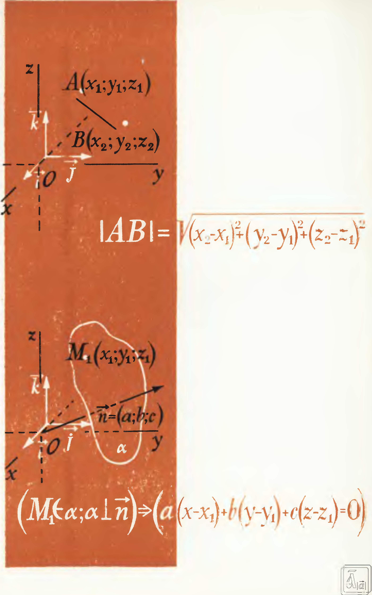
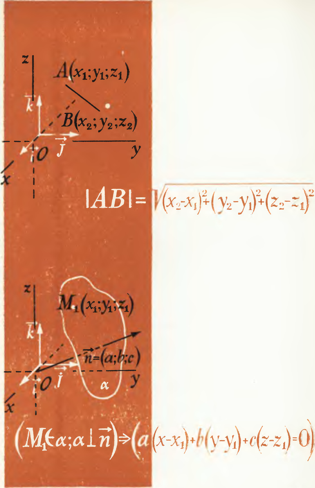

## 7.9. Указатель применяемых символов

---
**стр. 251**
---

# УКАЗАТЕЛЬ ПРИМЕНЯЕМЫХ СИМВОЛОВ

$A\in\Phi$ — точка $A$ принадлежит фигуре $\Phi$;  
$A\notin\Phi$ — точка $A$ не принадлежит фигуре $\Phi$;  
$\Phi_1\subset\Phi_2\;(\Phi_1\not\subset\Phi_2)$ — фигура $\Phi_1$ является (не является) подмножеством фигуры $\Phi_2$;  
$\Phi_1=\Phi_2\;(\Phi_1\ne\Phi_2)$ — фигуры $\Phi_1$ и $\Phi_2$ совпадают (различны);  
$\Phi_1\cup\Phi_2$ — объединение фигур $\Phi_1$ и $\Phi_2$;  
$\Phi_1\cap\Phi_2$ — пересечение фигур $\Phi_1$ и $\Phi_2$;  
$\varnothing$ — пустое множество;  
$\{A,B\}$ — множество, состоящее из элементов $A$ и $B$;  
$(A,B)$ — упорядоченная пара точек $A$ и $B$;  
$(AB)$ — прямая $AB$;  
$[AB]$ — отрезок $AB$;  
$[AB)$ — луч $AB$;  
$|AB|$ — расстояние от точки $A$ до точки $B$ (длина отрезка $AB$);  
$(O;R)$ — окружность с центром $O$ и радиусом $R$;  
$(ABC)$ — плоскость, проходящая через точки $A$, $B$, $C$;  
$\Phi_1\cong\Phi_2$ — фигуры $\Phi_1$ и $\Phi_2$ конгруэнтны;  
$\Phi_1\sim\Phi_2$ — фигуры $\Phi_1$ и $\Phi_2$ подобны;  
$E$ — тождественное преобразование;  
$f^{-1}$ — преобразование, обратное преобразованию $f$;  
$f_2\circ f_1$ — композиция преобразований $f_1$ и $f_2$;  
$\uparrow\uparrow\;(\uparrow\downarrow)$ — одинаково (противоположно) направленные;  
$Z_O$ — симметрия с центром $O$;  
$S_l$ — симметрия с осью $l$;  
$S_\alpha$ — симметрия относительно плоскости $\alpha$;  
$H_O^k$ — гомотетия с центром $O$ и коэффициентом $k$;  
$\parallel\;(\nparallel)$ — параллельны (не параллельны);  
$\mathbin{\dot{-}}$ — скрещивающиеся (прямые);  
$\perp$ — перпендикулярны;  
$\angle$ — угол, двугранный угол, трехгранный угол;  
$\widehat{\phantom{a}}$ — величина угла;  
$\widehat{(a,b)}$ — угол между прямыми;

---
**стр. 252**
---

$\widehat{(i,\alpha)}$ — угол между прямой и плоскостью;  
$\widehat{(\vec a,\vec b)}$ — угол между векторами;  
$\widehat{(\alpha,\beta)}$ — угол между плоскостями;  
$(\vec i;\vec j;\vec k)$ — прямоугольный базис;  
$\vec a,\ \overrightarrow{AB}$ — вектор;  
$\vec 0,\ \overrightarrow{AA}$ — нулевой вектор;  
$|\vec a|=a,\ |\overrightarrow{AB}|=|AB|$ — длина вектора;  
$\vec a\cdot\vec b,\ \overrightarrow{AB}\cdot\overrightarrow{CD}$ — скалярное произведение векторов;  
$\vec a=(x;y;z)$ — вектор с координатами $x$, $y$, $z$;  
$M(x;y;z)$ — точка $M$ с координатами $x$, $y$, $z$;  
$V$ — объем;  
$\Rightarrow$ — следует;  
$\Leftrightarrow$ — равносильны.

---
**стр. 253**
---

# ОГЛАВЛЕНИЕ

## Глава I. ОСНОВНЫЕ ПОНЯТИЯ СТЕРЕОМЕТРИИ. ПАРАЛЛЕЛЬНОСТЬ В ПРОСТРАНСТВЕ

§ 1. О логическом строении курса стереометрии. Основные понятия стереометрии 3  
§ 2. Аксиомы стереометрии 5  
§ 3. Следствия из аксиом 8  
§ 4. Проведение в пространстве прямой, параллельной данной прямой 11  
§ 5. Решение задачи на построение сечения многогранника 12  
§ 6. Скрещивающиеся прямые. Признак скрещивающихся прямых 13  
§ 7. Взаимное расположение прямой и плоскости. Признак параллельности прямой и плоскости 15  
§ 8. Транзитивность параллельности прямых. Связка параллельных прямых 18  
§ 9. Параллелепипед 20  
§ 10. Взаимное расположение двух плоскостей. Признак параллельности плоскостей 21  
§ 11. Теоремы о параллельных плоскостях 23  
§ 12. Параллельная проекция фигуры. Свойства параллельной проекции 26  
§ 13. Изображение фигур в стереометрии 27  
Задачи на повторение к главе I 32

## Глава II. ПРЕОБРАЗОВАНИЯ ПРОСТРАНСТВА. ВЕКТОРЫ

§ 14. Отображение фигуры. Преобразование пространства 36  
§ 15. Перемещения пространства. Конгруэнтность фигур 38  
§ 16. Направление в пространстве 40  
§ 17. Вектор 41  
§ 18. Сложение векторов 44  
§ 19. Противоположные векторы. Вычитание векторов 46  
§ 20. Коллинеарные векторы. Умножение вектора на число 48  
§ 21. Компланарные векторы 50  
§ 22. Применение векторов к решению задач 52  
§ 23. Правило параллелепипеда. Разложение вектора по трем некомпланарным векторам 53  
§ 24. Угол между двумя векторами 55  
§ 25. Скалярное умножение двух векторов 57  
§ 26. Основные свойства скалярного умножения векторов 59  
§ 27. Применение векторов к решению задач 60  
Задачи на повторение к главе II 63

---
**стр. 254**
---

## Глава III. ПЕРПЕНДИКУЛЯРНОСТЬ В ПРОСТРАНСТВЕ. ДВУГРАННЫЕ И МНОГОГРАННЫЕ УГЛЫ

§ 28. Признак перпендикулярности прямой и плоскости 67  
§ 29. Проведение перпендикуляра к плоскости 69  
§ 30. Два перпендикуляра к плоскости. Ортогональное проектирование на плоскость 72  
§ 31. Осевая симметрия пространства 74  
§ 32. Симметрия относительно плоскости 76  
§ 33. Две плоскости, перпендикулярные прямой 78  
§ 34. Расстояние от точки до плоскости 79  
§ 35. Общий перпендикуляр скрещивающихся прямых 81  
§ 36. Теорема о трех перпендикулярах 83  
§ 37. Угол между наклонной и плоскостью 85  
§ 38. Двугранный угол. Измерение двугранных углов 88  
§ 39. Признак перпендикулярности плоскостей 93  
§ 40. Многогранный угол. Трехгранный угол 95  
§ 41. Свойства плоских углов трехгранного и многогранного углов 96  
Задачи на повторение к главе III 99  
Задачи на повторение по курсу IX класса 101

## Глава IV. КООРДИНАТНЫЙ МЕТОД В ПРОСТРАНСТВЕ

§ 42. Координаты вектора. Правила действий над векторами, заданными своими координатами 105  
§ 43. Вычисление длины вектора и угла между двумя векторами по их координатам 107  
§ 44. Прямоугольная система координат. Координаты точки 108  
§ 45. Уравнение плоскости 110  
§ 46. Координатные формулы преобразований. Гомотетия 113  
Задачи на повторение к главе IV 115

## Глава V. МНОГОГРАННИКИ

§ 47. Многогранная поверхность. Многогранник 117  
§ 48. Призма 119  
§ 49. Свойства параллелепипеда 122  
§ 50. Площадь ортогональной проекции многоугольника 125  
§ 51. Площадь поверхности призмы 127  
§ 52. Пирамида 128  
§ 53. Усеченная пирамида 131  
§ 54. Понятие о правильных многогранниках 133  
§ 55. Общие свойства объемов многогранников. Объем прямоугольного параллелепипеда 134  
§ 56. Объем прямой призмы 136  
§ 57. Объем наклонной призмы 138  
§ 58. Объем пирамиды 140  
Задачи на повторение к главе V 142

## Глава VI. ФИГУРЫ ВРАЩЕНИЯ

§ 59. Изображение окружности. Эллипс 147  
§ 60. Фигура вращения. Цилиндр 149  
§ 61. Конус. Усеченный конус 152  
§ 62. Сфера и шар 154  
§ 63. Сечение сферы. Изображение сферы 155  
§ 64. Плоскость, касательная к сфере 158  
§ 65. Обобщение задачи измерения объемов. Объем цилиндра 159

---
**стр. 255**
---

§ 66. Объем фигуры, полученной при вращении криволинейной трапеции 161  
§ 67. Объем конуса 163  
§ 68. Объем шара 164  
§ 69. Площадь сферы 165  
Задачи на повторение к главе VI 167  
Вопросы для повторения 171  
Задачи на повторение по курсу X класса 175  
Исторический очерк 185  
Краткая сводка сведений по курсу планиметрии 193  
Формулы геометрии 217

## Приложения

Теоремы о конгруэнтности фигур (к § 31) 220  
Проекция вектора на ось (к § 26) 222  
Теорема косинусов для трехгранного угла (к § 40) 223  
Необходимое и достаточное условие существования трехгранного угла (к § 41) 224  
Свойства плоских углов многогранного угла (к § 41) 225  
Геометрическое тело (к гл. V и VI) 226  
Объем усеченного конуса, шарового сегмента и шарового сектора (к гл. VI) 228  
Площадь поверхности цилиндра, конуса и шарового сегмента (к гл. VI) 230  
Система аксиом геометрии, предложенная Г. Вейлем 233

## Ответы и указания 235

## Предметный указатель 248

## Указатель применяемых символов 251

---
**стр. 256**
---

ИБ № 1598

Владимир Михайлович Клопский  
Залман Алтерович Скопец  
Михаил Ильич Ягодовский

# ГЕОМЕТРИЯ

## Учебное пособие для 9 и 10 классов

Редакторы А. М. Абрамов, С. В. Пазельский  
Художественный редактор Е. Н. Карасик  
Технический редактор Л. Я. Медведев  
Корректоры К. А. Иванова и Г. С. Поликова

Сдано в набор 26/XI 1976 г. Подписано к печати 11/II 1977 г. $60\times90^{1}/_{16}$. Бумага типогр. № 1. Печ. л. 16. Уч.-изд. л. 15,16 + форз. 0,34. Тираж 2800 тыс. экз.

Ордена Трудового Красного Знамени издательство «Просвещение» Государственного комитета Совета Министров РСФСР по делам издательств, полиграфии и книжной торговли. Москва, 3-й проезд Марьиной рощи, 41.

Саратовский ордена Трудового Красного Знамени полиграфический комбинат Росглавполиграфпрома Государственного комитета Совета Министров РСФСР по делам издательств, полиграфии и книжной торговли, г. Саратов, ул. Чернышевского, 59. Заказ 210.

Цена 30 коп.

---
**стр. 257**
---

---
**стр. 258**
---

---
**стр. 259**
---

# СОВЕТСКИЕ УЧЕБНИКИ  
# БОЛЬШОЙ СКЛАД НА САЙТЕ  
# «СОВЕТСКОЕ ВРЕМЯ»

## SOVIETIME.RU

АЗБУКА

БУКВАРЬ

**СКАЧАТЬ! с  
SOVIETIME.RU**
