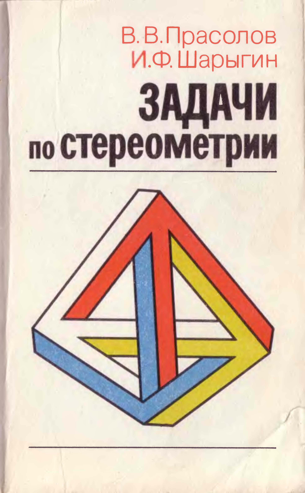

# ВСТУПИТЕЛЬНЫЕ МАТЕРИАЛЫ

## Вступительные материалы

---
**стр. 0**
---

В. В. Прасолов  
И. Ф. Шарыгин

# Задачи по стереометрии

---
**стр. 1**
---

БИБЛИОТЕКА МАТЕМАТИЧЕСКОГО КРУЖКА  
ВЫПУСК 19

В. В. ПРАСОЛОВ, И. Ф. ШАРЫГИН

# ЗАДАЧИ  
# ПО СТЕРЕОМЕТРИИ

МОСКВА «НАУКА»  
ГЛАВНАЯ РЕДАКЦИЯ  
ФИЗИКО-МАТЕМАТИЧЕСКОЙ ЛИТЕРАТУРЫ  
1989

---
**стр. 2**
---

ББК 22.151.0  
П70  
УДК 514.113(023)

Прасолов В. В., Шарыгин И. Ф. Задачи по стереометрии.— М.: Наука. Гл. ред. физ.-мат. лит., 1989.— (Б-ка мат. кружка).— 288 с.— ISBN 5-02-013921-1.

Содержит около 560 задач, снабженных подробными решениями, и 60 задач для самостоятельной работы. Большинство задач по своей тематике близки к школьной программе. Задачи разбиты на циклы, связанные общей идеей решения. Внутри каждого цикла задачи расположены в порядке возрастания трудности. Такое разбиение поможет читателю ориентироваться в наборе задач и даст ему возможность разобраться непосредственно в заинтересовавшей его теме, не читая подряд всю книгу.

Для школьников, преподавателей, студентов педагогических институтов.

Рецензенты:

кандидат физико-математических наук *И. Б. Васильев*;  
кандидат физико-математических наук *П. П. Долбилин*

П $\dfrac{1602050000-046}{053(02)-89}$ 38-89

ISBN 5-02-013921-1

© Издательство «Наука».  
Главная редакция  
физико-математической  
литературы, 1989

---
**стр. 3**
---

# Оглавление

Предисловие 7  
Знакомство со стереометрией 9  
Решения 11

## Глава 1. Прямые и плоскости в пространстве 18

§ 1. Углы и расстояния между скрещивающимися прямыми 18  
§ 2. Углы между прямыми и плоскостями 18  
§ 3. Прямые, образующие равные углы с прямыми и плоскостями 19  
§ 4. Скрещивающиеся прямые 20  
§ 5. Теорема Пифагора в пространстве 20  
§ 6. Метод координат 21  
Задачи для самостоятельного решения 21  
Решения 22

## Глава 2. Проекции, сечения, развертки 31

§ 1. Вспомогательные проекции 31  
§ 2. Теорема о трех перпендикулярах 32  
§ 3. Площадь проекции многоугольника 32  
§ 4. Задачи о проекциях 33  
§ 5. Сечения 33  
§ 6. Развертки 34  
Задачи для самостоятельного решения 34  
Решения 35

## Глава 3. Объем 45

§ 1. Формулы для объема тетраэдра и пирамиды 45  
§ 2. Формулы для объема многогранников и круглых тел 45  
§ 3. Свойства объема 46  
§ 4. Вычисление объема 47  
§ 5. Вспомогательный объем 49  
Задачи для самостоятельного решения 50  
Решения 51

## Глава 4. Сферы 62

§ 1. Длина общей касательной 62  
§ 2. Касательные к сферам 62

---
**стр. 4**
---

§ 3. Две пересекающиеся окружности лежат на одной сфере 63  
§ 4. Разные задачи 64  
§ 5. Площадь сферической полоски и объем шарового сегмента 64  
§ 6. Радикальная плоскость 66  
§ 7. Сферическая геометрия и телесные углы 67  
Задачи для самостоятельного решения 68  
Решения 69

## Глава 5. Трехгранные и многогранные углы. Теоремы Чевы и Менелая для трехгранных углов 82

§ 1. Полярный трехгранный угол 82  
§ 2. Неравенства с трехгранными углами 82  
§ 3. Теоремы синусов и косинусов для трехгранных углов 82  
§ 4. Разные задачи 83  
§ 5. Многогранные углы 84  
§ 6. Теоремы Чевы и Менелая для трехгранных углов 84  
Задачи для самостоятельного решения 87  
Решения 88

## Глава 6. Тетраэдр, пирамида и призма 100

§ 1. Свойства тетраэдра 100  
§ 2. Тетраэдры, обладающие специальными свойствами 101  
§ 3. Прямоугольный тетраэдр 102  
§ 4. Равногранный тетраэдр 103  
§ 5. Ортоцентрический тетраэдр 104  
§ 6. Достраивание тетраэдра 105  
§ 7. Пирамида и призма 107  
Задачи для самостоятельного решения 109  
Решения 110

## Глава 7. Геометрические преобразования и векторы 131

§ 1. Скалярное произведение. Соотношения 131  
§ 2. Скалярное произведение. Неравенства 132  
§ 3. Линейные зависимости векторов 132  
§ 4. Разные задачи 133  
§ 5. Векторное произведение 133  
§ 6. Симметрия 135  
§ 7. Гомотетия 136  
§ 8. Поворот. Композиции преобразований 137  
§ 9. Отражение лучей света 139  
Задачи для самостоятельного решения 139  
Решения 140

---
**стр. 5**
---

## Глава 8. Выпуклые многогранники и пространственные многоугольники 155

§ 1. Разные задачи 155  
§ 2. Признаки выпуклости и невыпуклости многогранников 156  
§ 3. Формула Эйлера 156  
§ 4. Обходы многогранников 157  
§ 5. Пространственные многоугольники 158  
Решения 159

## Глава 9. Правильные многогранники 174

§ 1. Основные свойства правильных многогранников 174  
§ 2. Взаимосвязи между правильными многогранниками 176  
§ 3. Просеки и сечения правильных многогранников 177  
§ 4. Самосовмещения правильных многогранников 177  
§ 5. Различные определения правильных многогранников 178  
Решения 179

## Глава 10. Геометрические неравенства 190

§ 1. Длины, периметры 190  
§ 2. Углы 191  
§ 3. Площади 192  
§ 4. Объемы 192  
§ 5. Разные задачи 193  
Задачи для самостоятельного решения 194  
Решения 194

## Глава 11. Задачи на максимум и минимум 207

§ 1. Отрезок с концами на скрещивающихся прямых 207  
§ 2. Площадь и объем 207  
§ 3. Расстояния 208  
§ 4. Разные задачи 209  
Задачи для самостоятельного решения 209  
Решения 210

## Глава 12. Построения и геометрические места точек 219

§ 1. Скрещивающиеся прямые 219  
§ 2. Сфера и трехгранный угол 220  
§ 3. Разные ГМТ 220  
§ 4. Построения на изображениях 221  
§ 5. Построения, связанные с пространственными фигурами 222  
Решения 222

---
**стр. 6**
---

*Глава 13.* **Некоторые методы решения задач** 231  
§ 1. Принцип крайнего 231  
§ 2. Принцип Дирихле 231  
§ 3. Выход в пространство 232  
Решения 235

*Глава 14.* **Центр масс. Момент инерции. Барицентрические координаты** 244  
§ 1. Центр масс и его основные свойства 244  
§ 2. Момент инерции 245  
§ 3. Барицентрические координаты 246  
Решения 247

*Глава 15.* **Разные задачи** 254  
§ 1. Примеры и контрпримеры 254  
§ 2. Целочисленные решетки 255  
§ 3. Разрезания. Разбиения. Раскраски 256  
§ 4. Задачи-одиночки 257  
Решения 257

*Глава 16.* **Инверсия и стереографическая проекция** 271  
§ 1. Свойства инверсии 271  
§ 2. Сделаем инверсию 272  
§ 3. Наборы касающихся сфер 272  
§ 4. Стереографическая проекция 273  
Решения 274

*Приложение.* Задачи для самостоятельного решения 282  
Список рекомендуемой литературы 286

---
**стр. 7**
---

# ПРЕДИСЛОВИЕ

Настоящий сборник задач предназначен для учащихся старших классов, преподавателей математики, руководителей математических кружков и студентов педагогических институтов. Его можно использовать как источник задач для внеклассной работы и как пособие для самостоятельного изучения геометрии.

Недавно изданная книга И. Ф. Шарыгина «Задачи по геометрии. Стереометрия» (М.: Наука, 1984) наряду с задачами письменных конкурсных экзаменов содержит много интересных задач повышенной трудности, как известных, так и оригинальных, авторских, но задачи в ней почти не систематизированы. Дело в том, что усилиями как профессиональных математиков, так и просто любителей математики в области стереометрии был накоплен богатый и интересный материал, и поэтому сначала нужно было собрать теоремы и задачи, изучить и сравнить их различные доказательства, т. е. провести предварительную обработку всего этого материала, а уже потом привести его к более стройному и завершенному виду. В нашей книге мы и постарались справиться со второй задачей. Разумеется, при этом мы опирались на первый этап работы, и все наиболее интересные задачи из указанной книги в нашу книгу вошли (с переработанными решениями); они составляют примерно половину ее.

Книга содержит около 560 задач, снабженных решениями, и около 60 задач для самостоятельного решения. По сравнению с указанной книгой И. Ф. Шарыгина включено несколько новых тем: центр масс, правильные многогранники, инверсия, принцип Дирихле, разрезания, целочисленные решетки и т. д. Для удобства пользования принята подробная рубрикация; задачи разделены на 16 глав, а каждая глава на 5—6 параграфов.

Особый интерес представляет вводная часть — «Знакомство со стереометрией». В ней собраны задачи,

---
**стр. 8**
---

не требующие фактически никаких знаний по стереометрии, но для решения которых нужно обладать пространственным воображением.

При решении некоторых задач используются планиметрические факты; мы сочли излишним повторять их известные доказательства. В таких случаях указывается, где эти доказательства можно прочитать. Ссылки даются на две книги, изданные недавно и достаточно большим тиражом: Прасолов В. В. Задачи по планиметрии, чч. I, II.— М.: Наука, 1986 (в ссылках — Прасолов и номер соответствующей задачи) и Шарыгин И. Ф. Задачи по геометрии. Планиметрия.— Изд. 2-е.— М.: Наука, 1986 (в ссылках — Шарыгин; римская цифра указывает номер раздела, арабская — номер задачи). См., например, с. 37.

Значительную часть книги составляют задачи повышенной трудности, причем некоторые из них требуют предварительного знакомства с основными понятиями и теоремами стереометрии. Поэтому начинающим изучать стереометрию рекомендуются в первую очередь следующие задачи:

1.1, 1.7, 1.8, 1.11, 1.12, 1.13, 1.14, 1.17, 1.18, 1.19, 1.21, 1.22;

2.1, 2.9, 2.10, 2.11, 2.13, 2.14, 2.18, 2.26;

3.1, 3.2, 3.3, 3.7, 3.10, 3.32;

4.1, 4.2, 4.3, 4.12, 4.41;

5.1, 5.2, 5.3, 5.4, 5.5, 5.6, 5.11, 5.16;

6.1, 6.2, 6.3, 6.18, 6.19, 6.54;

7.1, 7.12, 7.31, 7.33, 7.34, 7.52;

10.13, 10.22, 10.23, 10.32, 10.35;

11.1, 11.10, 11.17, 11.18;

12.20, 12.21, 12.22, 12.23, 12.25, 12.26;

15.1, 15.2, 15.3, 15.4, 15.5, 15.26.
