## Знакомство со стереометрией

---
**стр. 9**
---

# ЗНАКОМСТВО СО СТЕРЕОМЕТРИЕЙ

1. Сложите 6 спичек так, чтобы образовалось 4 правильных треугольника со стороной, равной длине спички.

2. Предложите практический способ непосредственного измерения диагонали кирпича (без каких-либо вычислений).

3. Можно ли изготовить звезду, изображенную на рис. 1?

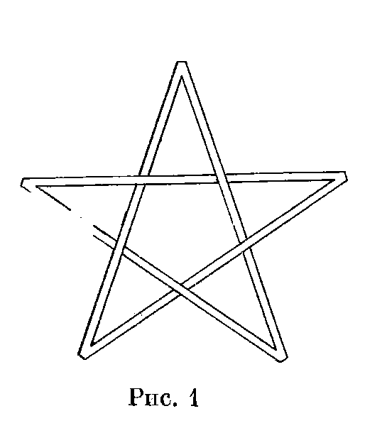

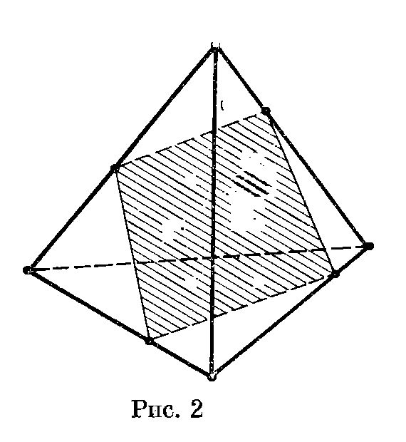

4. Решая задачу, ученик изобразил тетраэдр, в котором проведено сечение (рис. 2). Правилен ли его чертеж?

5. На рис. 3, $а$ и $б$ изображены проекции двух многогранников, точнее говоря, их вид сверху. (Никаких невидимых ребер нет.) Возможны ли такие многогранники?

6. Какую форму должна иметь пробка, чтобы ею можно было заткнуть отверстия трех видов: треугольное, квадратное и круглое?

7. Можно ли в плоскости прорезать тонкое отверстие, не разбивающее ее на части, сквозь которое можно продеть каркас: а) куба; б) тетраэдра? (Ребра каркаса считаются сколь угодно тонкими.)

---
**стр. 10**
---

8. Можно ли четырьмя свинцовыми шарами закрыть точечный источник света? (Источник считается закрытым, если любой луч, выходящий из него, пересекает хотя бы один из шаров.)

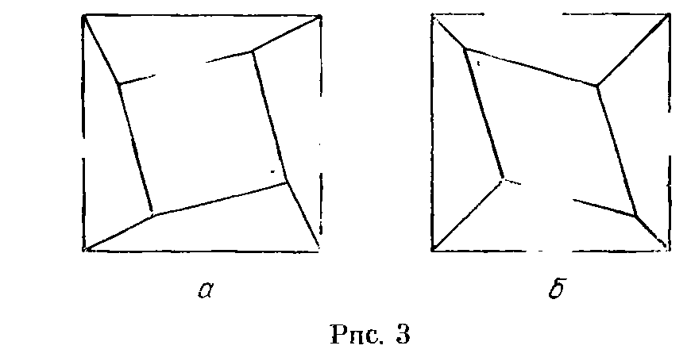

9. Вырежьте из прямоугольного листа бумаги фигуру, изображенную на рис. 4. (Клеем пользоваться нельзя.)

10. Можно ли сложить 6 карандашей так, чтобы любые два из них соприкасались? Тот же вопрос для 7 карандашей.

11. Человек прошел километр на север, затем километр на запад и километр на юг. Мог ли он при этом вернуться в исходное положение?

12. Из 7 одинаковых кубиков склеен «крест» следующим образом: к каждой из 6 граней одного из кубиков приклеено по кубику (склейка происходит по граням). Можно ли такими «крестами» заполнить без просветов все пространство?

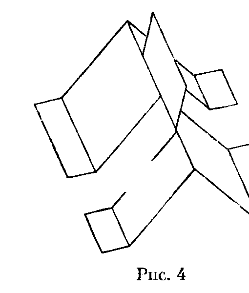

13. а) Вершины $M$ и $N$ куба с ребром $a$ симметричны относительно центра куба. Найдите длину кратчайшего пути, идущего из $M$ в $N$ по поверхности куба.

б) Коробка имеет форму прямоугольного параллелепипеда размером $30\times12\times12$. Точка $A$ находится на грани $12\times12$, причем она удалена на расстояние 1 от одной стороны этой грани и равноудалена от двух

---
**стр. 11**
---

других параллельных сторон. Какова длина кратчайшего пути по поверхности коробки из точки $A$ в точку, симметричную ей относительно центра параллелепипеда?

14. Можно ли единичный кубик завернуть в платок размером $3\times3$?

15. а) Докажите, что поверхность куба можно разрезать так, что, развернув ее, получим фигуру, изображенную на рис. 5, $а$.

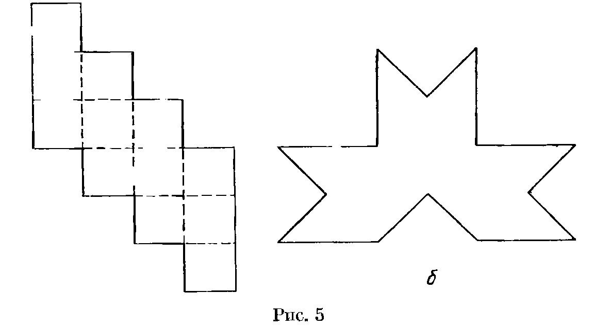

б) Та же задача для фигуры, изображенной на рис. 5, $б$.

16. Докажите, что из прямоугольного листа бумаги можно склеить бесконечно много различных тетраэдров (склейка производится только по краям, без наложений).

17. а) Можно ли соединить 3 резиновых кольца так, чтобы их нельзя было расцепить, но после разрезания любого из них они расцеплялись бы?

б) Тот же вопрос для 10 колец.

## Решения

1. Спички нужно сложить в виде правильного тетраэдра.

2. Можно, например, сложить три кирпича так, как показано на рис. 6, и измерить расстояние между отмеченными точками.

3. Нет, такую звезду изготовить нельзя. Обозначим вершины звезды так, как показано на рис. 7. Рассмотрим плоскость

---
**стр. 12**
---

$A_1A_3A_5$. Звено $A_1A_2$ показывает, что точка $A_2$ лежит «выше» этой плоскости; звено $A_1A_4$ показывает, что точка $A_4$ лежит «ниже» ее. А вот звено $A_2A_4$ показывает, что, наоборот, $A_2$ лежит «ниже», а $A_4$ «выше».

Изображенная звезда представляет собой один из примеров так называемых «невозможных объектов». Подобного рода объекты и конструкции не так уж редки в живописи. Они встречаются уже в работах

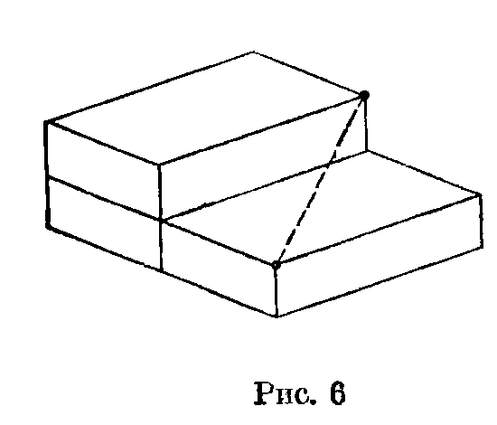

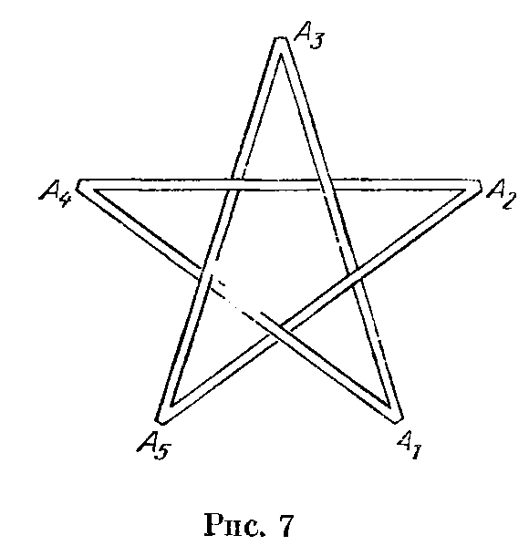

старых русских мастеров иконописцев. Очень много «невозможных объектов» изобрел известный голландский художник Эшер (1898—1972), творчество которого любят многие математики и физики.

**4.** Заштрихованный на рис. 2 четырехугольник не может быть плоским. В самом деле, продолжения противоположных сторон сечения, изображенных сплошной линией, пересекают продолжения переднего ребра тетраэдра в двух различных точках. Этого не может быть, так как плоскость и прямая, в ней не лежащая, имеют не более одной общей точки.

**5.** Изображенные многогранники невозможны. Обозначим на рис. 3, а вершины внешнего четырехугольника (квадрата), начиная с правой нижней, против часовой стрелки через $A$, $B$, $C$ и $D$, а вершины внутреннего четырехугольника через $A_1$, $B_1$, $C_1$ и $D_1$ соответственно. Рассматривая сечения, параллельные плоскости $ABCD$, убедимся, что $B_1$ отстоит от плоскости $ABCD$ дальше, чем $A_1$, $C_1$ — дальше, чем $B_1$, $D_1$ — дальше, чем $C_1$, $A_1$ — дальше, чем $D_1$. Это невозможно.

Введем на рис. 3, б такие же обозначения, как и на рис. 3, а. Как и в предыдущем случае, легко убедиться, что точки $A_1$ и $C_1$ менее удалены от плоскости $ABCD$, чем точки $B_1$ и $D_1$. Следовательно, любая точка отрезка $A_1C_1$ менее удалена от плоскости $ABCD$, чем любая точка отрезка $B_1D_1$, а значит, эти

---
**стр. 13**
---

отрезки не пересекаются. Поэтому точки $A_1$, $B_1$, $C_1$ и $D_1$ не могут лежать в одной плоскости.

**6.** Задача имеет бесконечно много решений. Условию задачи удовлетворяет, например, пробка, изображенная на рис. 8, а (кусок цилиндра с квадратным сечением обрезан в виде клина). С другой стороны, формально возможна даже фигура, изображенная на рис. 8, б (круг, квадрат и треугольник, расположенные так, как показано на этом рисунке).

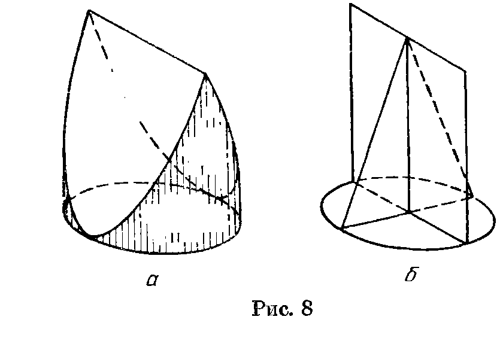

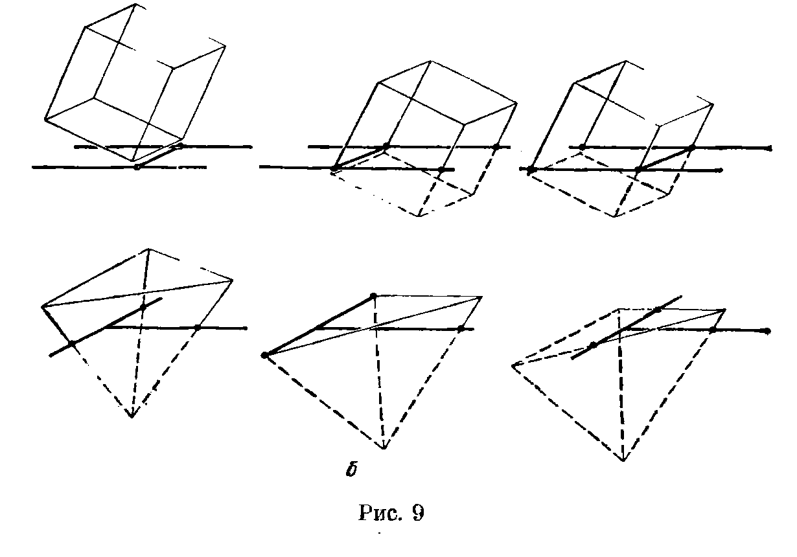

**7.** а) Процесс протаскивания каркаса куба сквозь отверстие в виде буквы Н изображен на рис. 9, а. Сначала подводим одно ребро куба к перекладине и двигаем куб до тех пор, пока

---
**стр. 14**
---

сквозь перекладину не пройдет второе ребро. Затем сдвигаем куб так, чтобы к перекладине переместилась другая пара «вертикальных» ребер. Дальнейший процесс аналогичен предыдущему.

б) Процесс протаскивания каркаса тетраэдра сквозь отверстие в виде буквы Т изображен на рис. 9, б. Расположим тетраэдр так, чтобы одна его грань была параллельна данной плоскости, а его противоположная вершина была обращена к плоскости. Подведем эту вершину к разрезу и начнем проталкивать тетраэдр так, чтобы два его ребра двигались по горизонтальной «перекладине» буквы Т, а одно — по ее вертикальной «стойке». Когда к «перекладине» подойдет ребро грани, параллельной плоскости, повернем слегка тетраэдр вокруг этого ребра. Оставшаяся часть тетраэдра проталкивается сквозь отверстие очевидным образом.

**8.** Можно. Пусть источник света находится в центре $O$ правильного тетраэдра $ABCD$. Рассмотрим трехгранный угол, образованный лучами $OA$, $OB$ и $OC$. Построим шар, пересекающий лучи $OA$, $OB$ и $OC$ и не содержащий точки $O$. Такой шар, как легко видеть, существует: можно, например, взять шар, касающийся лучей $OA$, $OB$ и $OC$, и слегка его увеличить (или приблизить к $O$). Этот шар, очевидно, закроет весь трехгранный угол $OABC$.

Другим шаром закроем угол $OABD$. Если второй шар пересекается с первым, то, отодвигая его центр по лучу $OP$, где $P$ — центр второго шара, и соответственно увеличивая его радиус, всегда можно добиться того, чтобы второй шар не пересекался с первым. Затем точно так же построим шар, закрывающий трехгранный угол $OACD$ и не пересекающийся с двумя первыми шарами, и шар, закрывающий трехгранный угол $OBCD$.

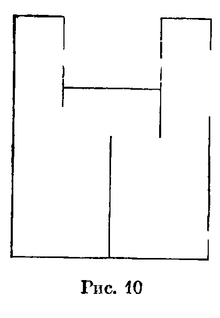

Если потребовать, чтобы все шары были одинакового радиуса, то наименьшее число шаров, закрывающих источник света, равно 6. Доказательство этого факта достаточно сложно. Попробуйте, однако, самостоятельно найти нужную конструкцию из 6 равных шаров.

**9.** Требуемая выкройка изображена на рис. 10. Ее нужно взять в руки, держа левой рукой левый край, а правой — правый, и повернуть правый край на $180^\circ$ на себя. Дальнейшее очевидно.

---
**стр. 15**
---

**10.** На рис. 11, а показано, как сложить три карандаша. Сверху на них можно положить еще три карандаша, сложенных аналогичным образом (рис. 11, б); при этом карандаши можно сложить так, чтобы диаметр вписанной окружности треугольника, образованного точками касания трех нижних (и трех верхних) карандашей, был равен диаметру карандаша. Тогда в образовавшийся между ними зазор можно вставить седьмой карандаш.

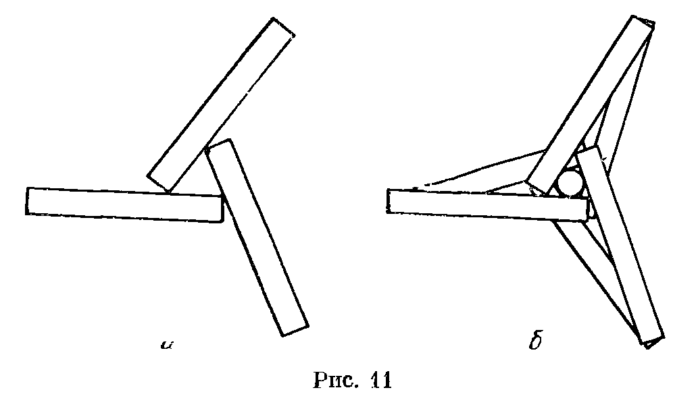

Если $d$ — диаметр карандаша, $l$ — его длина, то сложить 7 карандашей указанным способом можно, лишь если $d/l\leqslant\lambda$, где $\lambda$ — некоторое число. Найдите самостоятельно наименьшее такое $\lambda$. (Для обычных неочиненных карандашей требуемое соотношение выполняется.)

**11.** Да, мог. Предположим, что человек вышел из точки $A$ и, пройдя по меридиану 1 км на север, оказался в точке $B$. Пройдя 1 км по параллели, он может снова оказаться в точке $B$, если обойдет один или несколько раз вокруг Северного полюса. Для этого длина параллели, на которой лежит точка $B$, должна быть равна $1/n$ км.

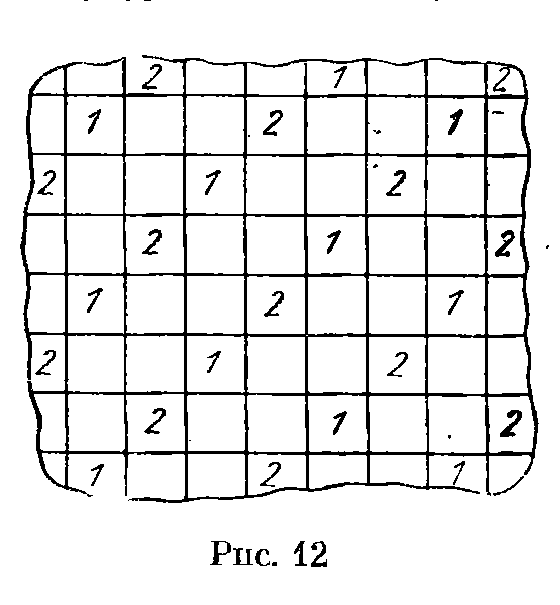

**12.** Можно. Разобьем пространство на слои толщиной 1, а слои разобьем на единичные кубики. В нечетных слоях поместим центры крестов в клетках, отмеченных цифрой 1, а в четных слоях — в клетках, отмеченных цифрой 2 (см. рис. 12).

---
**стр. 16**
---

**13.** а) Любой путь, идущий по поверхности куба, можно развернуть на плоскость. На рис. 13, а изображены развертки шести кратчайших путей, идущих из $M$ в $N$; длина каждого из них равна $\sqrt5a$.

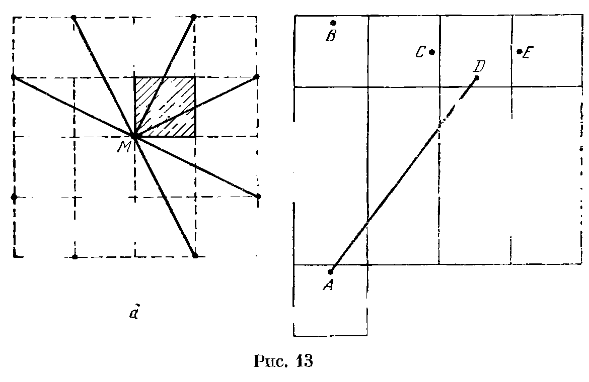

б) Как и в задаче а), достаточно выбрать наименьший из отрезков $AB$, $AC$, $AD$ и $AE$ (рис. 13, б). Ясно, что $AB^2=42^2=1764$, $AC^2=37^2+17^2=1658$, $AD^2=32^2+24^2=1600$ и $AE>AD$. Кратчайший путь $AD$ имеет длину 40.

Изобразите самостоятельно этот путь на параллелепипеде.

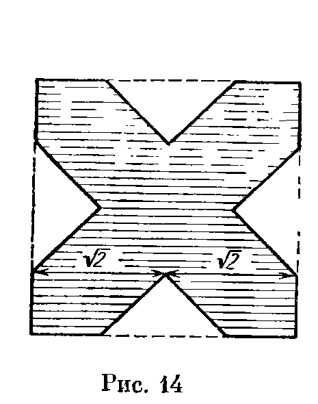

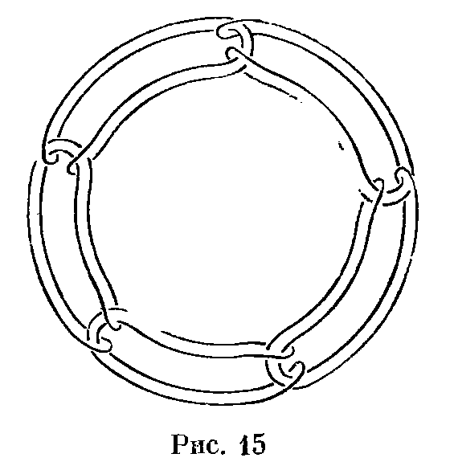

**14.** Можно. Из квадрата со стороной $2\sqrt2$ можно вырезать фигуру, в которую можно завернуть единичный кубик (на рис. 14 эта фигура заштрихована). Ясно также, что $2\sqrt2<3$.

---
**стр. 17**
---

**15.** Вырежьте эти фигуры из бумаги. Свернуть из них поверхность куба вы сможете без затруднений (сгибать их нужно по диагоналям квадратиков).

**16.** Склеим из прямоугольника цилиндр и выделим на его верхнем и нижнем основании два диаметра. Если угол между этими диаметрами не слишком велик, то «сплющив» основания по этим диаметрам, получим тетраэдр. Изменяя угол между диаметрами, будем получать разные тетраэдры.

**17.** Можно. На рис. 15 показано, как сцепить 5 колец. Аналогичным образом можно сцепить любое количество колец.
