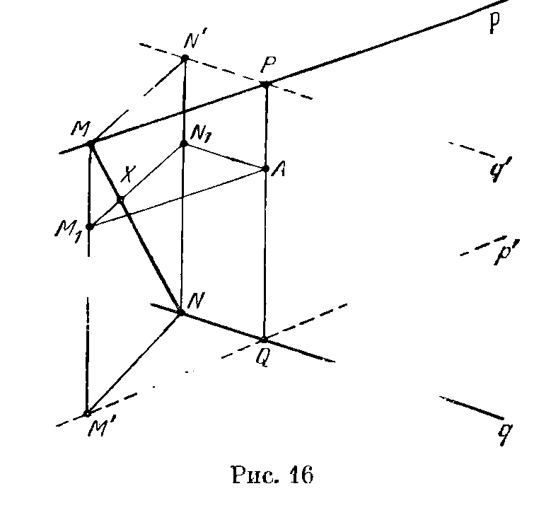

## 1.8. Решения

---
**стр. 22, продолжение**
---

## Решения

**1.1.** Легко проверить, что треугольник $A_1BD$ равносторонний. Кроме того, точка $A$ равноудалена от его вершин. Поэтому она проектируется в центр этого треугольника. Аналогично точка $C_1$ проектируется в центр треугольника $A_1BD$. Следовательно, прямые $A_1B$ и $AC_1$ перпендикулярны, а расстояние между ними равно расстоянию от центра треугольника $A_1BD$ до его стороны. Так как стороны этого треугольника равны $a\sqrt2$, искомое расстояние равно $a/\sqrt6$.

**1.2.** Рассмотрим диагонали $AB_1$ и $BD$ куба $ABCDA_1B_1C_1D_1$. Так как $B_1D_1\parallel BD$, угол между диагоналями $AB_1$ и $BD$ равен углу $AB_1D_1$. Но треугольник $AB_1D_1$ равносторонний, поэтому $\angle AB_1D_1=60^\circ$.

Легко проверить, что прямая $BD$ перпендикулярна плоскости $ACA_1C_1$; поэтому при проекции на эту плоскость она переходит в середину $M$ отрезка $AC$. Аналогично точка $B_1$ при этой проекции переходит в середину $N$ отрезка $A_1C_1$. Таким образом, расстояние между прямыми $AB_1$ и $BD$ равно расстоянию

---
**стр. 23**
---

от точки $M$ до прямой $AN$. Если катеты прямоугольного треугольника равны $a$ и $b$, а его гипотенуза равна $c$, то расстояние от вершины прямого угла до гипотенузы равно $ab/c$. В прямоугольном треугольнике $AMN$ катеты равны $1$ и $1/\sqrt2$, поэтому его гипотенуза равна $\sqrt{3/2}$, а искомое расстояние равно $1/\sqrt3$.

**1.3.** Пусть $O$ — центр куба. Тогда $2\overrightarrow{OK}=\overrightarrow{C_1D}$, $2\overrightarrow{OL}=\overrightarrow{DA_1}$ и $2\overrightarrow{OM}=\overrightarrow{A_1C_1}$. Так как треугольник $C_1DA_1$ правильный, то треугольник $KLM$ тоже правильный, причем $O$ — его центр.

**1.4.** Вычислим сначала величину угла. Пусть $M$ — середина ребра $BB_1$. Тогда $A_1M\parallel KC$, поэтому угол между прямыми $CK$ и $A_1D$ равен углу $MA_1D$. Этот угол можно вычислить по теореме косинусов, так как $A_1D=\sqrt2$, $A_1M=\sqrt5/2$ и $DM=3/2$. После несложных вычислений получаем $\cos MA_1D=1/\sqrt{10}$.

Для вычисления расстояния между прямыми $CK$ и $A_1D$ спроектируем их на плоскость, проходящую через ребра $AB$ и $C_1D_1$. Прямая $A_1D$ при этом проектируется в середину $O$ отрезка $AD_1$, а точки $C$ и $K$ — в середину $Q$ отрезка $BC_1$ и середину $P$ отрезка $OD_1$. Расстояние между прямыми $CK$ и $A_1D$ равно расстоянию от точки $O$ до прямой $PQ$. Катеты $OP$ и $OQ$ прямоугольного треугольника $OPQ$ равны $1/\sqrt8$ и $1$. Поэтому его гипотенуза равна $3/\sqrt8$. Искомое расстояние равно произведению длин катетов, деленному на длину гипотенузы, т. е. оно равно $1/3$.

**1.5.** Рассмотрим проекцию на плоскость, перпендикулярную прямой $CN$. Проекцию любой точки $X$ будем обозначать $X_1$. Расстояние от прямой $CN$ до прямой $AM$ (соответственно $BK$) равно расстоянию от точки $C_1$ до прямой $A_1M_1$ (соответственно $B_1K_1$). Ясно, что треугольник $A_1D_1B_1$ — равнобедренный, $K_1$ — точка пересечения его медиан, $C_1$ — середина $A_1B_1$, а $M_1$ — середина $B_1D_1$. Поэтому прямые $A_1M_1$ и $B_1K_1$ содержат медианы равнобедренного треугольника, а значит, точка $C_1$ равноудалена от них.

**1.6.** Пусть $ABCD$ — данный правильный тетраэдр, $K$ — середина $AB$, $M$ — середина $AC$. Рассмотрим проекцию на плоскость, перпендикулярную грани $ABC$ и проходящую через ребро $AB$. Пусть $D_1$ — проекция вершины $D$, $M_1$ — проекция точки $M$, т. е. середина отрезка $AK$. Расстояние между прямыми $CK$ и $DM$ равно расстоянию от точки $K$ до прямой $D_1M_1$. В прямоугольном треугольнике $D_1M_1K$ катет $KM_1$ равен $1/4$, а катет $D_1M_1$ равен высоте тетраэдра $ABCD$, т. е. он равен

---
**стр. 24**
---

$\sqrt{2/3}$. Поэтому гипотенуза равна $\sqrt{35/48}$, а значит, искомое расстояние равно $\sqrt{2/35}$.

Если $N$ — середина ребра $CD$, то для нахождения расстояния между медианами $CK$ и $BN$ можно рассмотреть проекцию на ту же плоскость, что и в предыдущем случае. Пусть $N_1$ — проекция точки $N$, т. е. середина отрезка $D_1K$. В прямоугольном треугольнике $BN_1K$ катет $KB$ равен $1/2$, а катет $KN_1$ равен $\sqrt{1/6}$. Поэтому гипотенуза равна $\sqrt{5/12}$, а искомое расстояние равно $\sqrt{1/10}$.

**1.7.** Пусть $(x_1,y_1,z_1)$ и $(x_2,y_2,z_2)$ — точки данной плоскости. Тогда
$$
ax_1+by_1+cz_1-(ax_2+by_2+cz_2)=0,
$$
а значит, векторы $(x_1-x_2,\ y_1-y_2,\ z_1-z_2)$ и $(a,b,c)$ перпендикулярны. Поэтому любая прямая, проходящая через две точки данной плоскости, перпендикулярна вектору $(a,b,c)$.

**1.8.** Так как $(\mathbf u,\mathbf v)=|\mathbf u|\cdot|\mathbf v|\cos\varphi$, где $\varphi$ — угол между векторами $\mathbf u$ и $\mathbf v$, то искомый косинус угла равен
$$
\frac{a_1a_2+b_1b_2+c_1c_2}
{\sqrt{a_1^2+b_1^2+c_1^2}\sqrt{a_2^2+b_2^2+c_2^2}}.
$$

**1.9. а) Первое решение.** Возьмем в качестве начала координат точку $A$ и направим оси $Ox$, $Oy$ и $Oz$ по лучам $AB$, $AD$ и $AA_1$. Тогда вектор с координатами $(b,a,0)$ перпендикулярен плоскости $BB_1D$, а вектор $(0,c,-b)$ перпендикулярен плоскости $ABC_1$. Поэтому косинус угла между данными плоскостями равен
$$
\frac{ac}{\sqrt{a^2+b^2}\cdot\sqrt{b^2+c^2}}.
$$

**Второе решение.** Если площадь параллелограмма $ABC_1D_1$ равна $S$, а площадь его проекции на плоскость $BB_1D$ равна $s$, то косинус угла между рассматриваемыми плоскостями равен $s/S$ (см. задачу 2.13). Пусть $M$ и $N$ — проекции точек $A$ и $C_1$ на плоскость $BB_1D$. Проекцией параллелограмма $ABC_1D_1$ на эту плоскость является параллелограмм $MBND_1$. Так как
$$
MB=\frac{a^2}{\sqrt{a^2+b^2}},
$$
то
$$
s=\frac{a^2c}{\sqrt{a^2+b^2}}.
$$
Остается заметить, что
$$
S=a\sqrt{b^2+c^2}.
$$

б) Систему координат введем так же, как и в первом решении задачи а). Если плоскость задана уравнением
$$
px+qy+rz=s,
$$
то вектор $(p,q,r)$ перпендикулярен ей. Плоскость $AB_1D_1$ содержит точки $A$, $B_1$ и $D_1$ с координатами $(0,0,0)$, $(a,0,c)$ и $(0,b,c)$. Эти условия позволяют найти ее уравнение:
$$
bcx+acy-abz=0;
$$
значит, вектор $(bc,ac,-ab)$ перпендикулярен ей. Учитывая, что точки с координатами $(0,0,c)$, $(a,b,c)$ и $(0,b,0)$ принадлежат плоскости $A_1C_1D$, находим ее уравнение и получаем, что вектор $(bc,-ac,-ab)$ перпендикуля-

---
**стр. 25**
---

рен ей. Поэтому косинус угла между данными плоскостями равен косинусу угла между этими двумя векторами, т. е. он равен
$$
\frac{a^2b^2+b^2c^2-a^2c^2}{a^2b^2+b^2c^2+a^2c^2}.
$$

в) Систему координат введем так же, как в первом решении задачи а). Тогда плоскость $A_1BD$ задается уравнением
$$
\frac{x}{a}+\frac{y}{b}+\frac{z}{c}=1,
$$
а значит, вектор
$$
abc\left(\frac1a,\frac1b,\frac1c\right)=(bc,ca,ab)
$$
перпендикулярен этой плоскости. Вектор $\overrightarrow{BD_1}$ имеет координаты $(-a,b,c)$. Поэтому синус угла между прямой $BD_1$ и плоскостью $A_1BD$ равен косинусу угла между векторами $(-a,b,c)$ и $(bc,ca,ab)$, т. е. он равен
$$
\frac{abc}{\sqrt{a^2+b^2+c^2}\sqrt{a^2b^2+b^2c^2+c^2a^2}}.
$$

**1.10.** Пусть $O$ — точка пересечения прямых $AB$ и $A_1B_1$; $M$ — точка пересечения прямых $AC$ и $A_1C_1$. Докажем сначала, что $MO\perp OA$. Возьмем для этого на отрезках $BB_1$ и $CC_1$ точки $B_2$ и $C_2$ так, что
$$
BB_2=CC_2=AA_1.
$$
Ясно, что
$$
MA:AA_1=AC:C_1C_2=1
$$
и
$$
OA:AA_1=AB:B_1B_2=2.
$$
Поэтому
$$
MA:OA=1:2.
$$
Кроме того, $\angle MAO=60^\circ$, а значит, $\angle OMA=90^\circ$. Следовательно, плоскость $AMA_1$ перпендикулярна прямой $MO$, по которой пересекаются плоскости $ABC$ и $A_1B_1C_1$. Поэтому угол между этими плоскостями равен углу $AMA_1$, который равен $45^\circ$.

**1.11.** Доказательство достаточно провести для случая, когда прямая $l$ проходит через точку $O$ пересечения прямых $l_1$ и $l_2$. Пусть $A$ — некоторая точка прямой $l$, отличная от $O$; $P$ — проекция точки $A$ на плоскость $\Pi$; $B_1$ и $B_2$ — основания перпендикуляров, опущенных из точки $A$ на прямые $l_1$ и $l_2$. Так как $\angle AOB_1=\angle AOB_2$, то прямоугольные треугольники $AOB_1$ и $AOB_2$ равны, а значит, $OB_1=OB_2$. По теореме о трех перпендикулярах $PB_1\perp OB_1$ и $PB_2\perp OB_2$. Прямоугольные треугольники $POB_1$ и $POB_2$ имеют общую гипотенузу и равные катеты $OB_1$ и $OB_2$, поэтому они равны, а значит, $\angle POB_1=\angle POB_2$.

**1.12.** Пусть $\Pi$ — плоскость, содержащая данные прямые. Случай, когда $l\perp\Pi$, очевиден. Если же прямая $l$ не перпендикулярна плоскости $\Pi$, то $l$ образует равные углы с данными прямыми тогда и только тогда, когда ее проекция на $\Pi$ является биссектрисой одного из углов между ними (см. задачу 1.11); это означает, что $l$ перпендикулярна второй биссектрисе.

**1.13.** Проведем через точку $O_2$ прямую $l'_1$, параллельную $l_1$. Пусть $\Pi$ — плоскость, содержащая прямые $l_2$ и $l'_1$; $A'_1$ — проекция точки $A_1$ на плоскость $\Pi$. Как следует из задачи 1.11, прямая $A'_1A_2$ образует равные углы с прямыми $l'_1$ и $l_2$, поэтому треугольник $A'_1O_2A_2$ равнобедренный, а значит,
$$
O_2A_2=O_2A'_1=O_1A_1.
$$

---
**стр. 26**
---

Легко проверить, что верно и обратное: если $O_1A_1=O_2A_2$, то прямая $A_1A_2$ образует равные углы с прямыми $l_1$ и $l_2$.

**1.14.** Рассмотрим проекцию на плоскость $\Pi$, перпендикулярную прямой $l$. Точки $A_1$ и $A_2$ при этой проекции переходят в $A'_1$ и $A'_2$, прямая $l$ — в точку $L$, а плоскости $\Pi_1$ и $\Pi_2$ — в прямые $p_1$ и $p_2$. Как следует из решения задачи 1.11, прямая $A_1A_2$ образует равные углы с перпендикулярами к плоскостям $\Pi_1$ и $\Pi_2$ тогда и только тогда, когда прямая $A'_1A'_2$ образует равные углы с перпендикулярами к прямым $p_1$ и $p_2$, т. е. образует равные углы с самими прямыми $p_1$ и $p_2$; а это, в свою очередь, означает, что
$$
A'_1L=A'_2L.
$$

**1.15.** Если прямая не перпендикулярна плоскости $\Pi$ и образует равные углы с двумя пересекающимися прямыми этой плоскости, то ее проекция на плоскость $\Pi$ параллельна биссектрисе одного из двух углов, образованных этими прямыми (задача 1.12). Можно считать, что все три прямые пересекаются в одной точке. Если прямая $l$ является биссектрисой угла между прямыми $l_1$ и $l_2$, то $l_1$ и $l_2$ симметричны относительно прямой $l$, поэтому $l$ не может быть биссектрисой угла между прямыми $l_1$ и $l_3$.

**1.16.** Можно считать, что данные прямые проходят через одну точку. Пусть $a_1$ и $a_2$ — биссектрисы углов между первой и второй прямой, $b_1$ и $b_2$ — между второй и третьей. Прямая образует равные углы с тремя данными прямыми тогда и только тогда, когда она перпендикулярна прямым $a_i$ и $b_j$ (задача 1.12), т. е. перпендикулярна плоскости, содержащей прямые $a_i$ и $b_j$. Различных пар $(a_i,b_j)$ ровно 4. Все плоскости, задаваемые этими парами прямых, различны, так как прямая $a_i$ не может лежать в плоскости, содержащей $b_1$ и $b_2$.

**1.17. Первое решение.** Пусть прямая $l$ перпендикулярна данным прямым $l_1$ и $l_2$. Проведем через прямую $l_1$ плоскость, параллельную $l$. Точка пересечения этой плоскости с прямой $l_2$ является одним концом искомого отрезка.

**Второе решение.** Рассмотрим проекцию данных прямых на плоскость, им параллельную. Концами искомого отрезка являются точки, проецирующиеся в точку пересечения проекций данных прямых.

**1.18.** Пусть прямая $l$ проходит через точку $O$ и пересекает прямые $l_1$ и $l_2$. Рассмотрим плоскости $\Pi_1$ и $\Pi_2$, содержащие точку $O$ и прямые $l_1$ и $l_2$ соответственно. Прямая $l$ принадлежит как плоскости $\Pi_1$, так и плоскости $\Pi_2$. Плоскости $\Pi_1$ и $\Pi_2$ не параллельны, так как они имеют общую точку $O$; ясно также, что они не совпадают. Поэтому плоскости $\Pi_1$ и $\Pi_2$ пересекаются по прямой. Если эта прямая не параллельна ни прямой $l_1$, ни прямой

---
**стр. 27**
---

$l_2$, то она и есть искомая прямая; в противном случае искомой прямой не существует.

**1.19.** Чтобы получить искомый параллелепипед, нужно через каждую из данных прямых провести две плоскости: плоскость, параллельную одной из оставшихся прямых, и плоскость, параллельную другой из оставшихся прямых.

**1.20.** Пусть $PQ$ — общий перпендикуляр к прямым $p$ и $q$, причем точки $P$ и $Q$ лежат на прямых $p$ и $q$ соответственно. Проведем через точки $P$ и $Q$ прямые $q'$ и $p'$, параллельные прямым $q$ и $p$.

Пусть $M'$ и $N'$ — проекции точек $M$ и $N$ на прямые $p'$ и $q'$; $M_1$, $N_1$ и $X$ — точки пересечения плоскости, проходящей через точку $A$ параллельно прямым $p$ и $q$, со сторонами $MM'$ и $NN'$ параллелограмма $MM'NN'$ и с его диагональю $MN$ (рис. 16). По теореме о трех перпендикулярах $M'N\perp q$, а значит, $\angle M_1N_1A=90^\circ$. Ясно также, что
$$
M_1X:N_1X=MX:NX=PA:QA
$$
— величина постоянная. Поэтому точка $X$ принадлежит фиксированной прямой.

**1.21.** Введем систему координат, направив ее оси параллельно трем данным перпендикулярным прямым. Возьмем на прямой $l$ вектор $\mathbf v$ единичной длины. Вектор $\mathbf v$ имеет координаты $(x,y,z)$, где $x=\pm\cos\alpha$, $y=\pm\cos\beta$, $z=\pm\cos\gamma$. Поэтому
$$
\cos^2\alpha+\cos^2\beta+\cos^2\gamma=x^2+y^2+z^2=|\mathbf v|^2=1.
$$

**1.22. Первое решение.** Пусть $\alpha$, $\beta$ и $\gamma$ — углы между плоскостью $ABC$ и плоскостями $DBC$, $DAC$ и $DAB$ соответственно. Если площадь грани $ABC$ равна $S$, то площади граней $DBC$, $DAC$ и $DAB$ равны $S\cos\alpha$, $S\cos\beta$ и $S\cos\gamma$ (см. задачу 2.13). Остается проверить, что
$$
\cos^2\alpha+\cos^2\beta+\cos^2\gamma=1.
$$
Так как углы $\alpha$, $\beta$ и $\gamma$ равны углам между

---
**стр. 28**
---

прямой, перпендикулярной грани $ABC$, и прямыми $DA$, $DB$ и $DC$, то можно воспользоваться результатом задачи 1.21.

**Второе решение.** Пусть $\alpha$ — угол между плоскостями $ABC$ и $DBC$; $D'$ — проекция точки $D$ на плоскость $ABC$. Тогда
$$
S_{DBC}=\cos\alpha S_{ABC}
\quad\text{и}\quad
S_{D'BC}=\cos\alpha S_{DBC}
$$
(см. задачу 2.13), поэтому
$$
\cos\alpha=\frac{S_{DBC}}{S_{ABC}},\qquad
S_{D'BC}=\frac{S_{DBC}^2}{S_{ABC}}.
$$
Аналогичные равенства можно получить и для треугольников $D'AB$ и $D'AC$. Складывая их и учитывая, что сумма площадей треугольников $D'BC$, $D'AC$ и $D'AB$ равна площади треугольника $ABC$, получаем требуемое.

**1.23.** Рассмотрим прямоугольный параллелепипед, ребра которого параллельны данным хордам, а точка $A$ и центр $O$ шара являются его противоположными вершинами. Пусть $a_1$, $a_2$ и $a_3$ — длины его ребер; ясно, что
$$
a_1^2+a_2^2+a_3^2=a^2.
$$

а) Если хорда удалена на расстояние $x$ от центра шара, то квадрат ее длины равен $4R^2-4x^2$. Так как расстояния от данных хорд до точки $O$ равны диагоналям граней параллелепипеда, то искомая сумма квадратов равна
$$
12R^2-4(a_2^2+a_3^2)-4(a_1^2+a_3^2)-4(a_1^2+a_2^2)=12R^2-8a^2.
$$

б) Если длина хорды равна $d$, а точка $A$ находится на расстоянии $y$ от ее середины, то сумма квадратов длин отрезков хорды, на которые она делится точкой $A$, равна $2y^2+d^2/2$. Так как расстояния от точки $A$ до середин данных хорд равны $a_1$, $a_2$ и $a_3$, а сумма квадратов длин хорд равна $12R^2-8a^2$, то искомая сумма квадратов равна
$$
2a^2+(6R^2-4a^2)=6R^2-2a^2.
$$

**1.24.** Пусть $\alpha$, $\beta$ и $\gamma$ — углы между ребрами куба и прямой, перпендикулярной данной плоскости. Тогда длины проекций ребер куба на эту плоскость принимают значения $a\sin\alpha$, $a\sin\beta$ и $a\sin\gamma$, причем каждое значение принимается ровно 4 раза. Так как
$$
\cos^2\alpha+\cos^2\beta+\cos^2\gamma=1
$$
(задача 1.21), то
$$
\sin^2\alpha+\sin^2\beta+\sin^2\gamma=2.
$$
Поэтому искомая сумма квадратов равна $8a^2$.

**1.25.** Проведем через каждое ребро тетраэдра плоскость, параллельную противоположному ребру. В результате получим куб, в который вписан данный тетраэдр, причем ребро куба равно $a/\sqrt2$. Проекция каждой грани куба является параллелограммом, диагонали которого равны проекциям ребер тетраэдра. Сумма квадратов диагоналей параллелограмма равна сумме квадратов длин всех его сторон. Поэтому сумма квадратов длин двух противоположных ребер тетраэдра равна сумме квадратов длин проекций двух пар противоположных ребер куба. Следовательно, сумма квадратов проекций ребер тетраэдра равна сумме квадратов проекций ребер куба, т. е. она равна $4a^2$.

**1.26.** Как и в предыдущей задаче, будем считать, что вер-

---
**стр. 29**
---

шины тетраэдра $AB_1CD_1$ расположены в вершинах куба $ABCDA_1B_1C_1D_1$; длина ребра этого куба равна $a/\sqrt2$. Пусть $O$ — центр тетраэдра. Отрезки $OA$ и $OD_1$ являются половинами диагоналей параллелограмма $ABC_1D_1$, поэтому сумма квадратов их проекций равна четверти суммы квадратов проекций сторон этого параллелограмма. Аналогично сумма квадратов проекций отрезков $OC$ и $OB_1$ равна четверти суммы квадратов проекций сторон параллелограмма $A_1B_1CD$. Заметим, далее, что сумма квадратов проекций диагоналей параллелограммов $AA_1D_1D$ и $BB_1C_1C$ равна сумме квадратов проекций их сторон. В итоге получаем, что искомая сумма квадратов равна четверти суммы квадратов проекций ребер куба, т. е. равна $a^2$.

**1.27.** Пусть $(x_1,y_1,z_1)$ — основание перпендикуляра, опущенного из данной точки на данную плоскость. Так как вектор $(a,b,c)$ перпендикулярен данной плоскости (задача 1.7), то
$$
x_1=x_0+\lambda a,\qquad
y_1=y_0+\lambda b,\qquad
z_1=z_0+\lambda c,
$$
причем искомое расстояние равно
$$
|\lambda|\sqrt{a^2+b^2+c^2}.
$$
Точка $(x_1,y_1,z_1)$ лежит в данной плоскости, поэтому
$$
a(x_0+\lambda a)+b(y_0+\lambda b)+c(z_0+\lambda c)+d=0,
$$
т. е.
$$
\lambda=-\frac{ax_0+by_0+cz_0+d}{a^2+b^2+c^2}.
$$

**1.28.** Введем систему координат так, чтобы точки $A$ и $B$ имели координаты $(-a,0,0)$ и $(a,0,0)$ соответственно. Если точка $M$ имеет координаты $(x,y,z)$, то
$$
\frac{AM^2}{BM^2}
=
\frac{(x+a)^2+y^2+z^2}{(x-a)^2+y^2+z^2}.
$$
Уравнение $AM:BM=k$ приводится к виду
$$
\left(x+\frac{1+k^2}{1-k^2}a\right)^2+y^2+z^2
=
\left(\frac{2ka}{1-k^2}\right)^2.
$$
Это уравнение является уравнением сферы с центром
$$
\left(-\frac{1+k^2}{1-k^2}a,0,0\right)
$$
и радиусом
$$
\left|\frac{2ka}{1-k^2}\right|.
$$

**1.29.** Введем систему координат, направив ось $Oz$ перпендикулярно плоскости $ABC$. Пусть точка $X$ имеет координаты $(x,y,z)$. Тогда, например,
$$
AX^2=(x-a_1)^2+(y-a_2)^2+z^2.
$$
Поэтому для координат точки $X$ получаем уравнение вида
$$
(p+q+r)(x^2+y^2+z^2)+\alpha x+\beta y+\delta=0,
$$
т. е.
$$
\alpha x+\beta y+\delta=0.
$$
Это уравнение задает плоскость, перпендикулярную плоскости $ABC$ (в вырожденных случаях оно задает пустое множество или все пространство).

**1.30.** Пусть ось конуса параллельна оси $Oz$; его вершина имеет координаты $(a,b,c)$; $\alpha$ — угол между осью конуса и образующей. Тогда точки поверхности конуса удовлетворяют
