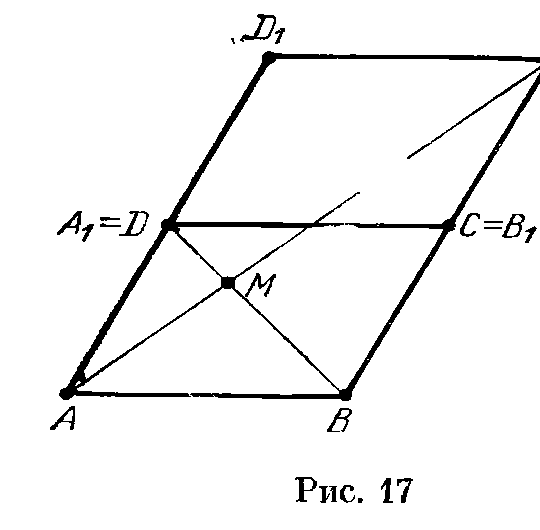
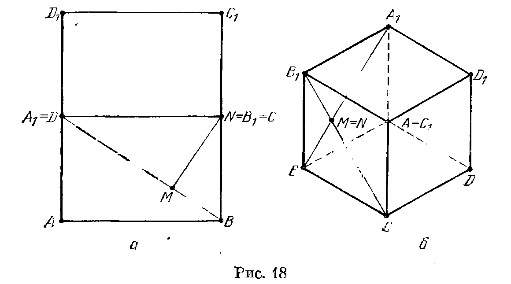
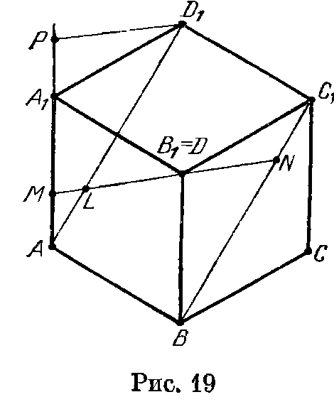
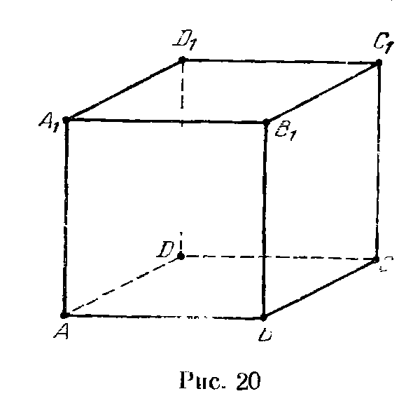
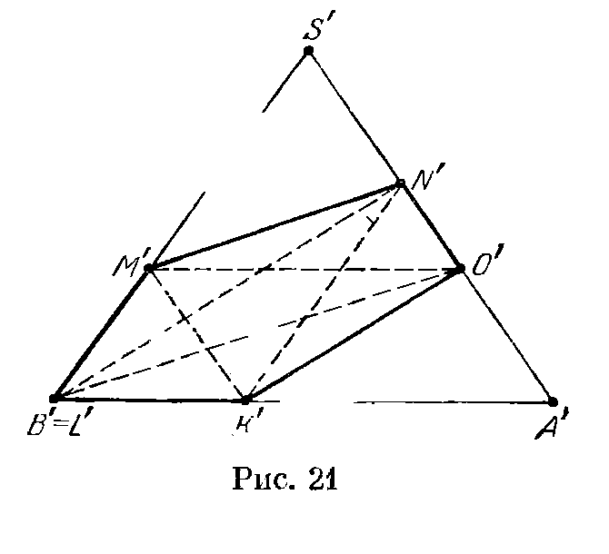
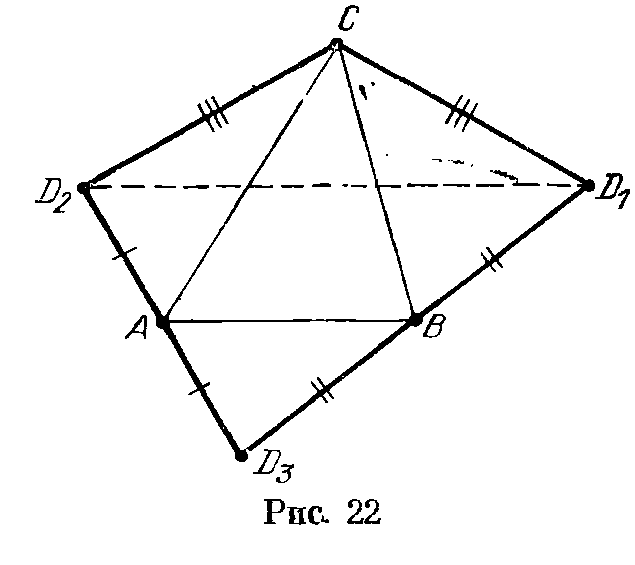
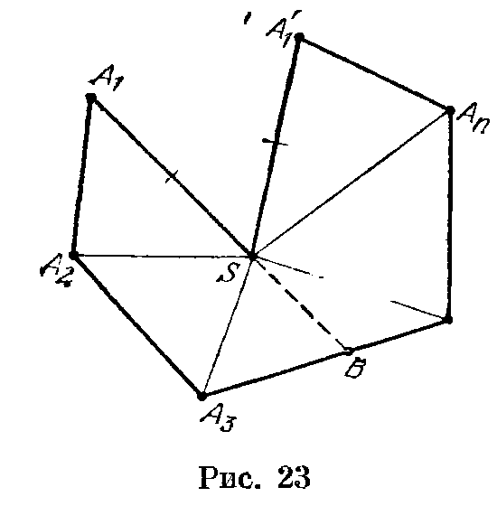
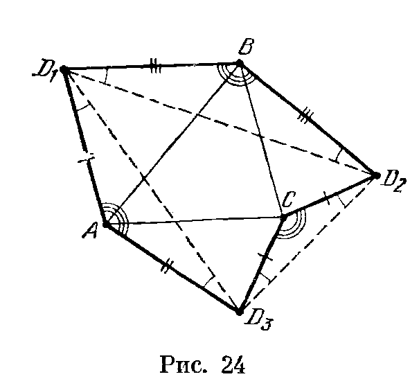

## 2.8. Решения

---
**стр. 35, продолжение**
---

## Решения

**2.1.** Рассмотрим проекцию данного параллелепипеда на плоскость $ABC$ параллельно прямой $A_1D$ (рис. 17). Ясно, что на этом рисунке $AM:MC_1=AD:BC_1=1:2$.

**2.2.** а) **Первое решение.** Рассмотрим проекцию данного куба на плоскость, перпендикулярную прямой $B_1C$ (рис. 18, а). На этом чертеже прямая $B_1C$ изображается одной

---
**стр. 36**
---

точкой, а отрезок $MN$ — перпендикуляром, опущенным из этой точки на прямую $A_1B$. Ясно также, что на этом чертеже $A_1B_1:B_1B=\sqrt2:1$. Так как $A_1M:MN=A_1B_1:B_1B$ и $MN:MB=A_1B_1:B_1B$, то $A_1M:MB=A_1B_1^2:B_1B^2=2:1$.

Второе решение. Рассмотрим проекцию данного куба на плоскость, перпендикулярную прямой $AC_1$ (рис. 18, б). Прямая $AC_1$ перпендикулярна плоскостям треугольников $A_1BD$ и $B_1CD_1$, поэтому она перпендикулярна прямым $A_1B$ и $B_1C$, т. е. отрезок $MN$ ей параллелен. Таким образом, отрезок $MN$ на данном чертеже изображается точкой пересечения отрезков $A_1B$ и $B_1C$. Следовательно, на этом чертеже $A_1M:MB=A_1C:BB_1=2:1$.

б) Рассмотрим проекцию куба на плоскость, перпендикулярную диагонали $B_1D$ (рис. 19). На этом рисунке шестиугольник $ABCC_1D_1A_1$ правильный, а прямая $MN$ проходит через его центр; пусть $L$ — точка пересечения прямых $MN$ и $AD_1$, $P$ — точка пересечения прямой $AA_1$ и прямой, проходящей через точку $D_1$ параллельно $MN$. Легко убедиться, что $\triangle ADM=\triangle A_1D_1P$, а значит, $AM=A_1P$. Поэтому
$$
BC_1:BN=AD_1:D_1L=AP:PM=(AA_1+AM):AA_1=1+AM:AA_1,
$$
т. е. искомая разность отношений равна 1.

**2.3.** Пусть $A_1$, $B_1$ и $C_1$ — проекции вершин данного правильного треугольника $ABC$ на прямую, перпендикулярную

---
**стр. 37**
---

данной плоскости. Если углы между данной плоскостью и прямыми $AB$, $BC$ и $CA$ равны $\gamma$, $\alpha$ и $\beta$, то $A_1B_1=a\sin\gamma$, $B_1C_1=a\sin\alpha$ и $C_1A_1=a\sin\beta$, где $a$ — сторона треугольника $ABC$. Пусть для определенности точка $C_1$ лежит на отрезке $A_1B_1$. Тогда $A_1B_1=A_1C_1+C_1B_1$, т. е. $\sin\gamma=\sin\alpha+\sin\beta$.

**2.4.** Нет, нельзя. Рассмотрим проекцию на прямую, перпендикулярную основанию. Проекции всех векторов основания нулевые, а проекция суммы векторов боковых ребер не может быть равна нулю, так как сумма нечетного количества чисел $\pm1$ нечетна.

**2.5.** Рассмотрим проекцию тетраэдра на плоскость, перпендикулярную прямой, соединяющей середины ребер $AB$ и $CD$. Данная плоскость проецируется при этом в прямую $LN$, проходящую через точку пересечения диагоналей параллелограмма $ADBC$. Ясно, что для проекций $B'C':C'N'=A'D':D'L'$.

**2.6.** Пусть $K$ — точка пересечения отрезков $BC_1$ и $B_1C$. Тогда плоскости $ABC_1$ и $AB_1C$ пересекаются по прямой $AK$, а плоскости $A_1B_1C$ и $A_1BC_1$ — по прямой $A_1K$. Рассмотрим проекцию на плоскость $ABC$ параллельно $AA_1$. Как проекция точки $P$, так и проекция точки $P_1$ лежит на прямой $AK_1$, где $K_1$ — проекция точки $K$. Аналогичные рассуждения показывают, что проекции точек $P$ и $P_1$ лежат на прямых $BL_1$ и $CM_1$, где $L_1$ — проекция точки пересечения прямых $AC_1$ и $A_1C$, $M_1$ — проекция точки пересечения прямых $AB_1$ и $A_1B$. Поэтому проекции точек $P$ и $P_1$ совпадают, т. е. $PP_1\parallel AA_1$.

**2.7.** Пусть $A_1$ и $B_1$ — проекции точек $A$ и $B$ на плоскость $\Pi$. Прямые $AX$ и $BX$ образуют равные углы с плоскостью $\Pi$ тогда и только тогда, когда подобны прямоугольные треугольники $AA_1X$ и $BB_1X$, т. е. $A_1X:B_1X=A_1A:B_1B$. Геометрическим местом точек плоскости, отношение расстояний от которых до двух данных точек $A_1$ и $B_1$ той же плоскости постоянно, является окружность Аполлония или прямая (см. Прасолов, 13.7 или Шарыгин, II.9).

**2.8.** Пусть $d=AB$, где $A$ и $B$ — вершины многогранника. Рассмотрим проекцию многогранника на прямую $AB$. Если некоторая точка $C$ проецируется не на отрезок $AB$, а на его продолжение, например, за точку $B$, то $AC>AB$. Поэтому все точки многогранника проецируются в точки отрезка $AB$. Так как длина проекции отрезка на прямую не превосходит длины

---
**стр. 38**
---

самого отрезка, то достаточно доказать, что в каждую внутреннюю точку отрезка $AB$ проецируются точки по крайней мере трех различных ребер. Проведем через произвольную внутреннюю точку отрезка $AB$ плоскость, перпендикулярную ему. Сечение многогранника этой плоскостью является $n$-угольником, где $n\geqslant3$, а значит, плоскость пересекает по крайней мере три различных ребра.

**2.9.** Пусть $O$ — точка пересечения прямой $l$ и плоскости $\Pi$ (случай, когда прямая $l$ параллельна плоскости $\Pi$, очевиден); $A$ — произвольная точка прямой $l$, отличная от точки $O$; $A'$ — ее проекция на плоскость $\Pi$. Прямая $AA'$ перпендикулярна любой прямой плоскости $\Pi$, поэтому $AA'\perp l_1$. Если $l\perp l_1$, то $AO\perp l_1$; следовательно, прямая $l_1$ перпендикулярна плоскости $AOA'$, а значит, $A'O\perp l_1$. Если $l'\perp l'_1$, то рассуждения аналогичны.

**2.10.** Решим сразу задачу б), частным случаем которой является задача а). Проекцией вершины $S$ на плоскость основания является центр $O$ правильного многоугольника $A_1\ldots A_{2n-1}$, а проекцией прямой $SA_1$ на эту плоскость является прямая $OA_1$. Так как $OA_1\perp A_nA_{n+1}$, то $SA_1\perp A_nA_{n+1}$ (см. задачу 2.9).

**2.11.** Пусть $AH$ — высота тетраэдра $ABCD$. По теореме о трех перпендикулярах $BH\perp CD$ тогда и только тогда, когда $AB\perp CD$.

**2.12.** Пусть $BK$ и $BM$ — высоты треугольников $ABC$ и $DBC$ соответственно. Так как $BK\perp AC$ и $BK\perp AD$, то прямая $BK$ перпендикулярна плоскости $ADC$, а значит, $BK\perp DC$. По теореме о трех перпендикулярах проекция прямой $BK$ на плоскость $BDC$ перпендикулярна прямой $DC$, т. е. она совпадает с прямой $BM$. Для высот, опущенных из вершины $C$, доказательство аналогично.

**2.13.** Утверждение задачи очевидно для треугольника, одна из сторон которого параллельна линии пересечения плоскости $\Pi$ с плоскостью многоугольника. В самом деле, длина этой стороны при проекции не изменяется, а длина высоты, опущенной на нее, при проекции изменяется в $\cos\varphi$ раз.

Докажем теперь, что любой многоугольник можно разрезать на треугольники указанного вида. Проведем для этого через все вершины многоугольника прямые, параллельные линии пересечения плоскостей. Многоугольник разрежется при этом на треугольники и трапеции. Остается разрезать каждую трапецию по любой из ее диагоналей.

**2.14.** Пусть $\varphi$ — двугранный угол при ребре правильного тетраэдра; $O$ — проекция вершины $D$ правильного тетраэдра $ABCD$ на противоположную грань. Тогда
$$
\cos\varphi=S_{ABO}:S_{ABD}=1/3.
$$

---
**стр. 39**
---

**2.15.** Пусть $S$ — площадь боковой грани, $h$ — высота пирамиды, $a$ — сторона основания, $\varphi$ — искомый угол. Площадь проекции на биссекторную плоскость двугранного угла между соседними боковыми гранями для каждой из этих граней равна $S\cos(\varphi/2)$; с другой стороны, она равна $ah\sin(\pi/n)/2$. Ясно также, что площадь проекции боковой грани на плоскость, проходящую через ее основание перпендикулярно основанию пирамиды, равна $S\sin\alpha$; с другой стороны, она равна $ah/2$. Следовательно,
$$
\cos(\varphi/2)=\sin\alpha\sin(\pi/n).
$$

**2.16.** Проекцией стороны основания на плоскость первого сечения является половина диагонали основания, поэтому площадь проекции второго сечения на плоскость первого сечения равна половине площади первого сечения. С другой стороны, если площадь второго сечения равна $S$, то площадь его проекции равна $S\cos\alpha$. Поэтому площадь первого сечения равна $2S\cos\alpha$.

**2.17.** Пусть $D'$ — проекция вершины $D$ пирамиды $ABCD$ на плоскость основания. Тогда
$$
S_{ABC}=\pm S_{BCD'}\pm S_{ACD'}\pm S_{ABD'}
=S_a\cos\alpha+S_b\cos\beta+S_c\cos\gamma.
$$
Площадь треугольника $BCD'$ берется со знаком «−», если точки $D'$ и $A$ лежат по разные стороны от прямой $BC$; для площадей треугольников $ACD'$ и $ABD'$ знак выбирается аналогично.

**2.18.** Не обязательно. Рассмотрим плоскость, перпендикулярную двум данным плоскостям. Любая фигура, расположенная в этой плоскости, будет обладать требуемым свойством, если только ее проекции на данные плоскости не ограничены.

**2.19.** Диаметры указанных кругов равны длине проекции тела на прямую, по которой пересекаются данные плоскости.

**2.20.** Пусть точки $B_1$ и $D$ при рассматриваемой проекции переходят во внутренние точки проекции куба (рис. 20).

Тогда площадь проекции куба равна удвоенной площади проекции треугольника $ACD_1$, т. е. она равна $2S\cos\varphi$, где $S$ — площадь треугольника $ACD_1$, $\varphi$ — угол между плоскостью проекции и плоскостью $ACD_1$. Так как сторона треугольника $ACD_1$ равна $\sqrt2$, то $2S=\sqrt3$.

Проекция куба на прямую $l$, перпендикулярную плоскости проекции, совпадает с проекцией диагонали $B_1D$ на эту

---
**стр. 40**
---

прямую. Так как прямая $B_1D$ перпендикулярна плоскости $ACD_1$, то угол между прямыми $l$ и $B_1D$ тоже равен $\varphi$. Поэтому длина проекции куба на прямую $l$ равна
$$
B_1D\cos\varphi=\sqrt3\cos\varphi.
$$

**2.21.** Проведем через вершины $A$ и $B$ прямые, перпендикулярные плоскости $ABC$, и возьмем на них точки $A_1$ и $B_1$. Пусть $AA_1=x$ и $BB_1=y$ (если точки $A_1$ и $B_1$ лежат по разные стороны от плоскости $ABC$, то считаем, что числа $x$ и $y$ имеют разные знаки). Пусть $a$, $b$ и $c$ — длины сторон данного треугольника. Достаточно проверить, что числа $x$ и $y$ можно подобрать так, чтобы треугольник $A_1B_1C$ был правильным, т. е. выполнялись равенства
$$
x^2+b^2=y^2+a^2
$$
и
$$
(x-y)^2+c^2=y^2+a^2.
$$
Пусть $a^2-b^2=\lambda$ и $a^2-c^2=\mu$, т. е. $x^2-y^2=\lambda$ и $x^2-2xy=\mu$. Из второго равенства получаем $2y=x-\mu/x$. Подставляя это выражение в первое равенство, приходим к уравнению
$$
3u^2+(2\mu-4\lambda)u-\mu^2=0,
$$
где $u=x^2$. Дискриминант $D$ этого квадратного уравнения неотрицателен, поэтому оно имеет корень $x$. Если $x\ne0$, то $2y=x-\mu/x$. Остается заметить, что если $x=0$ — единственное решение полученного уравнения, т. е. $D=0$, то $\lambda=\mu=0$, поэтому $y=0$ — решение.

**2.22.** Обязательно. Докажем сначала, что если проекции двух выпуклых плоских фигур на координатные оси совпадают, то эти фигуры имеют общую точку. Для этого достаточно доказать, что если точки $K$, $L$, $M$ и $N$ лежат на сторонах $AB$, $BC$, $CD$ и $DA$ прямоугольника $ABCD$, то точка пересечения диагоналей $AC$ и $BD$ принадлежит четырехугольнику $KLMN$. Диагональ $AC$ не принадлежит треугольникам $KBL$ и $NDM$, а диагональ $BD$ не принадлежит треугольникам $KAN$ и $LCM$. Поэтому точка пересечения диагоналей $AC$ и $BD$ не принадлежит ни одному из этих треугольников, а значит, она принадлежит четырехугольнику $KLMN$.

Опорные плоскости, параллельные координатным плоскостям, для рассматриваемых тел совпадают. Возьмем одну из опорных плоскостей. Точки каждого из рассматриваемых тел, лежащие в этой плоскости, образуют выпуклую фигуру, причем проекции этих фигур на координатные оси совпадают. Поэтому в каждой опорной плоскости есть хотя бы одна общая точка рассматриваемых тел.

**2.23.** Во всяком случае, точки $A$, $B$ и $C$ лежат в одной плоскости, и поэтому можно рассмотреть сечение плоскостью, содержащей эти точки. Так как плоскость сечения проходит через точку касания сфер (сферы и плоскости), в сечении получаются касающиеся окружности (окружность и прямая). Пусть $O_1$ и $O_2$ — центры первой и второй окружностей. Так как $O_1A\parallel O_2B$ и точки $O_1$, $C$ и $O_2$ лежат на одной прямой, $\angle AO_1C=\angle BO_2C$.

---
**стр. 41**
---

Поэтому $\angle ACO_1=\angle BCO_2$, т. е. точки $A$, $B$ и $C$ лежат на одной прямой.

**2.24.** Осевое сечение данного усеченного конуса является описанной трапецией $ABCD$ с основаниями $AD=2R$ и $BC=2r$. Пусть $P$ — точка касания вписанной окружности со стороной $AB$, $O$ — центр вписанной окружности. В треугольнике $ABO$ сумма углов при вершинах $A$ и $B$ равна $90^\circ$, поэтому он прямоугольный. Следовательно,
$$
AP:PO=PO:BP,
$$
т. е. $PO^2=AP\cdot BP$. Ясно также, что $AP=R$ и $BP=r$. Поэтому радиус $PO$ вписанной в конус сферы равен $\sqrt{Rr}$, а значит,
$$
S=4\pi(R^2+Rr+r^2).
$$

Выражая объем данного усеченного конуса по формулам, приведенным в решениях задач 3.7 и 3.11, и приравнивая эти выражения, получаем, что площадь его полной поверхности равна
$$
2\pi(R^2+Rr+r^2)=S/2
$$
(нужно учесть, что высота усеченного конуса равна удвоенному радиусу сферы, около которой он описан).

**2.25.** Общий перпендикуляр к данным ребрам делится параллельными им плоскостями граней куба на отрезки длиной $y$, $x$ и $z$ ($x$ — длина ребра куба; отрезок длиной $y$ прилегает к ребру $a$). Плоскости граней куба, параллельные данным ребрам, пересекают тетраэдр по двум прямоугольникам. Меньшие стороны этих прямоугольников равны ребру куба $x$. Так как стороны этих прямоугольников легко вычисляются, получаем
$$
x=\frac{by}{c}
\quad\text{и}\quad
x=\frac{az}{c}.
$$
Следовательно,
$$
c=x+y+z=x+\frac{cx}{b}+\frac{cx}{a},
$$
т. е.
$$
x=\frac{abc}{ab+bc+ca}.
$$

**2.26.** Каждая сторона полученного многоугольника принадлежит одной из граней куба, поэтому число его сторон не превосходит 6. Кроме того, стороны, принадлежащие противоположным граням куба, параллельны, так как линии пересечения плоскости с двумя параллельными плоскостями параллельны. Следовательно, сечение куба не может быть правильным пятиугольником, так как у того нет параллельных сторон. Легко проверить, что правильный треугольник, квадрат и правильный шестиугольник могут быть сечениями куба.

**2.27.** Рассмотрим некоторый круг, являющийся сечением данного тела, и проведем через его центр прямую $l$, перпендикулярную его плоскости. Эта прямая пересекает данное тело по некоторому отрезку $AB$. Все сечения, проходящие через прямую $l$, являются кругами с диаметром $AB$.

**2.28.** Рассмотрим произвольное сечение, проходящее через вершину $A$. Это сечение является треугольником $ABC$, причем его стороны $AB$ и $AC$ являются образующими конуса, т. е. имеют постоянную длину. Поэтому площадь сечения пропорциональна синусу угла $BAC$. Угол $BAC$ изменяется от $0^\circ$ до $\varphi$,

---
**стр. 42**
---

где $\varphi$ — угол при вершине осевого сечения конуса. Если $\varphi\leqslant 90^\circ$, то наибольшую площадь имеет осевое сечение, а если $\varphi>90^\circ$, то наибольшую площадь имеет сечение с прямым углом при вершине $A$. Таким образом, из условия задачи следует, что $\sin\varphi=0{,}5$ и $\varphi>90^\circ$, т. е. $\varphi=120^\circ$.

**2.29.** Решим сначала следующую задачу. Пусть на сторонах $AB$ и $AC$ треугольника $ABC$ взяты точки $L$ и $K$ так, что $AL:LB=m$ и $AK:KC=n$; $N$ — точка пересечения прямой $KL$ и медианы $AM$. Вычислим отношение $AN:NM$. Рассмотрим для этого точки $S$ и $T$, в которых прямая $KL$ пересекает прямую $BC$ и прямую, проведенную через точку $A$ параллельно $BC$. Ясно, что $AT:SB=AL:LB=m$ и $AT:SC=AK:KC=n$. Поэтому

$$
AN:NM=AT:SM=2AT:(SC+SB)=2(SC:AT+SB:AT)^{-1}=\frac{2mn}{m+n}.
$$

Заметим, что все рассуждения остаются справедливыми и в случае, когда точки $K$ и $L$ взяты на продолжениях сторон треугольника; в этом случае числа $m$ и $n$ отрицательны.

Предположим теперь, что $AP:PB=p$, $AQ:QC=q$ и $AR:RD=r$. Тогда по условию задачи

$$
\frac{2pq}{p+q}=2,\qquad
\frac{2qr}{q+r}=\frac12,\qquad
\frac{2pr}{p+r}=4.
$$

Решая эту систему уравнений, получаем $p=-4/5$, $q=4/9$ и $r=4/7$. Отрицательность числа $p$ означает, что данная плоскость пересекает не ребро $AB$, а его продолжение.

**2.30.** Занумеруем данные секущие плоскости так, что первая из них — ближайшая к вершине $A$, а третья — наиболее удаленная от вершины $A$. Рассматривая проекцию на плоскость, перпендикулярную прямой $CF$, легко получить, что первая плоскость проходит через середину ребра $SC$ и делит ребро $SD$ в отношении $1:3$, считая от точки $S$; вторая плоскость проходит через середину ребра $SD$, а третья делит его в отношении $3:1$. Пусть сторона основания пирамиды равна $4a$, а высота боковой грани равна $4h$. Тогда первое сечение состоит из двух трапеций: одна с высотой $2h$ и основаниями $6a$ и $4a$, а другая с высотой $h$ и основаниями $4a$ и $a$; второе сечение является трапецией с высотой $2h$ и основаниями $8a$ и $2a$; третье сечение — трапецией с высотой $h$ и основаниями $6a$ и $3a$. Поэтому отношение площадей сечений равно $25:20:9$.

**2.31.** Так как у четырехугольной пирамиды пять граней, данное сечение проходит через все грани. Поэтому можно считать, что вершины $K$, $L$, $M$, $N$ и $O$ правильного пятиугольника лежат на ребрах $AB$, $BC$, $CS$, $DS$ и $AS$ соответственно. Рассмотрим проекцию на плоскость, перпендикулярную ребру $BC$ (рис. 21). Пусть $B'K':A'B'=p$. Так как $M'K'\parallel N'O'$, $M'O'\parallel K'L'$, $K'N'\parallel M'L'$, то

$$
B'M':B'S'=A'O':A'S'=S'N':A'S'=p.
$$

Поэтому $S'O':A'S'=1-p$, а значит, $S'N':$

---
**стр. 43**
---

$A'S'=(1-p)^2$, так как $M'N'\parallel L'O'$. Итак,

$$
p=S'N':A'S'=(1-p)^2,
$$

т. е. $p=(3-\sqrt5)/2$.

Пусть $SA=1$ и $\angle ASB=2\varphi$. Тогда

$$
NO^2=p^2+(1-p)^2-2p(1-p)\cos2\varphi
$$

и

$$
KO^2=p^2+4(1-p)^2\sin^2\varphi-4p(1-p)\sin^2\varphi.
$$

Приравнивая эти выражения и учитывая, что $\cos2\varphi=1-2\sin^2\varphi$, сократим на $1-p$; получим

$$
1-3p=4(1-3p)\sin^2\varphi.
$$

Так как в нашем случае $1-3p\ne0$, то $\sin^2\varphi=1/4$, т. е. $\varphi=30^\circ$.

**2.32.** а) Пусть суммы плоских углов при вершинах $A$, $B$ и $C$ равны $180^\circ$. Тогда развертка тетраэдра на плоскость $ABC$ является треугольником, причем точки $A$, $B$ и $C$ — середины его сторон. Следовательно, все грани тетраэдра равны.

Обратно, если тетраэдр равногранный, то при развертке любые две его смежные грани образуют параллелограмм. Следовательно, развертка тетраэдра является треугольником, т. е. суммы плоских углов при вершинах тетраэдра равны $180^\circ$.

б) Пусть суммы плоских углов при вершинах $A$ и $B$ равны $180^\circ$. Рассмотрим развертку тетраэдра на плоскость грани $ABC$ (рис. 22). Возможны два варианта:

1) Равны ребра $AB$ и $CD$. Тогда

$$
D_1C+D_2C=2AB=D_1D_2,
$$

поэтому точка $C$ — середина отрезка $D_1D_2$.

2) Равны ребра, отличные от $AB$ и $CD$. Пусть для определенности $AC=BD$. Тогда точка $C$ лежит как на серединном перпендикуляре к отрезку $D_1D_2$, так и на окружности радиуса $BD$ с центром $A$. Одна из точек пересечения этих множеств — середина отрезка $D_1D_2$, а вторая точка пересечения лежит на прямой, проходящей через $D_3$ параллельно $D_1D_2$. Вторая точка в нашем случае не годится.

---
**стр. 44**
---

в) Пусть сумма плоских углов при вершине $A$ равна $180^\circ$, $AB=CD$ и $AD=BC$. Рассмотрим развертку тетраэдра на плоскость $ABC$ и воспользуемся для образов вершины $D$ обозначениями рис. 22. Противоположные стороны четырехугольника $ABCD_2$ равны, поэтому он параллелограмм. Следовательно, отрезки $CB$ и $AD_3$ параллельны и равны, а значит, четырехугольник $ACBD_3$ — параллелограмм. Поэтому развертка тетраэдра является треугольником, причем $A$, $B$ и $C$ — середины его сторон.

**2.33.** Пусть $SA_1\ldots A_n$ — данная пирамида. Разрежем ее боковую поверхность по ребру $SA_1$ и развернем на плоскость (рис. 23). По условию точка $S$ лежит внутри многоугольника $A_1\ldots A_nA'_1$. Пусть $B$ — точка пересечения продолжения отрезка $A_1S$ за точку $S$ со стороной этого многоугольника. Если $a$ и $b$ — длины ломаных $A_1A_2\ldots B$ и $B\ldots A_nA'_1$, то $A_1S+SB<a$ и $A'_1S<SB+b$. Поэтому $2A_1S<a+b$.

**2.34.** Так как сумма углов каждой грани тетраэдра равна $180^\circ$, то

$$
S_A+S_B+S_C+S_D=4\cdot180^\circ.
$$

Пусть для определенности $S_A\leqslant S_C$. Тогда $360^\circ-S_C=S_A\leqslant180^\circ$. Рассмотрим развертку данного тетраэдра на плоскость $ABC$ (рис. 24). Так как

$$
\angle AD_3C=\angle D_1D_3D_2
$$

и

$$
AD_3:D_3C=D_1D_3:D_3D_2,
$$

то $\triangle ACD_3\sim\triangle D_1D_2D_3$, причем коэффициент подобия равен отношению боковой стороны к основанию в равнобедренном треугольнике с углом $S_A$ при вершине. Следовательно, $AC=D_1B$. Аналогично $CB=AD_1$. Поэтому

$$
\triangle ABC=\triangle BAD_1=\triangle BAD.
$$

Аналогично доказывается, что $\triangle ACD=\triangle BDC$.

