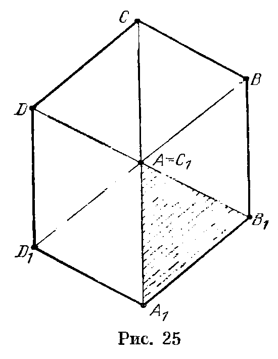
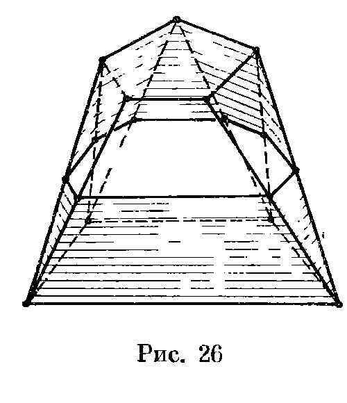
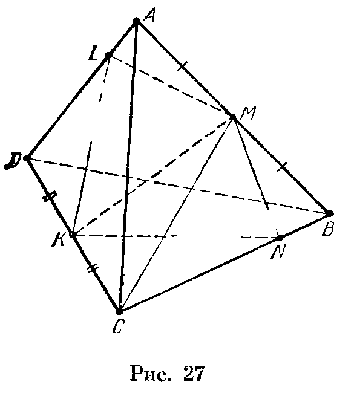
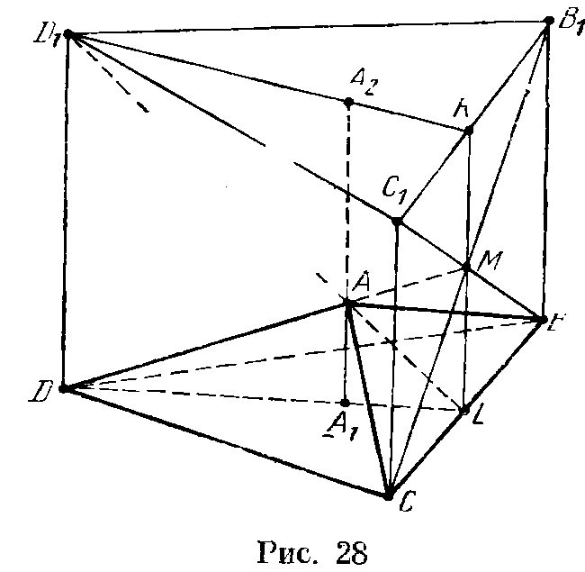
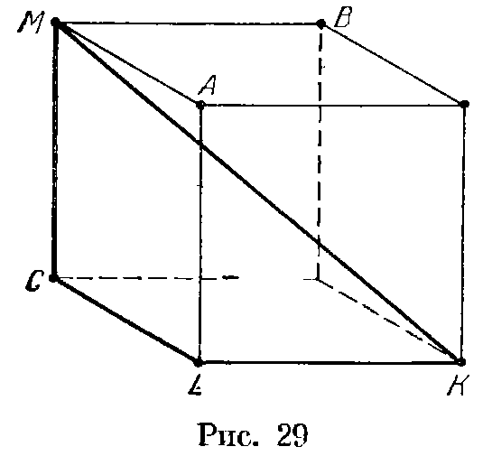
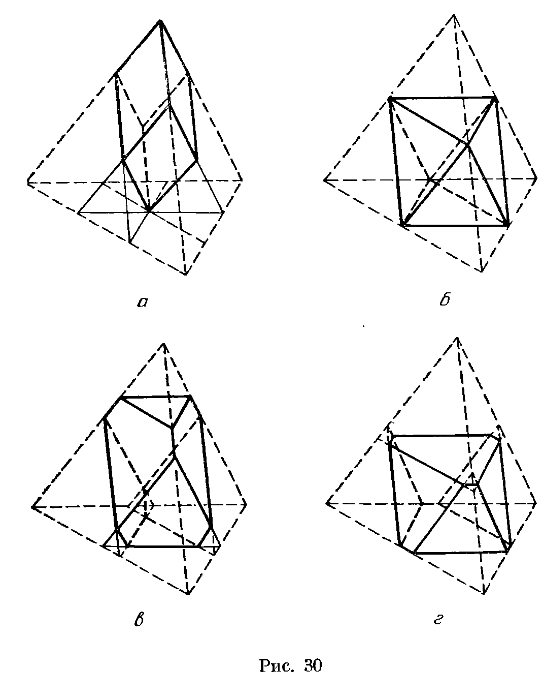
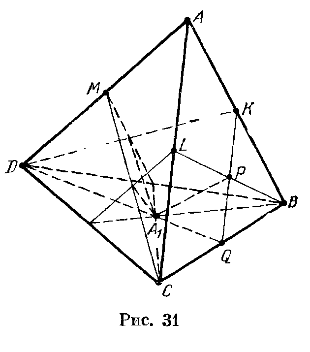

## 3.7. Решения

---
**стр. 51**
---

# Решения

**3.1.** Пусть $h$ и $h'$ — длины перпендикуляров, опущенных из точек $D$ и $D'$ на плоскость $ABC$; $S$ и $S'$ — площади треугольников $ABC$ и $AB'C'$. Ясно, что $h:h'=AD:AD'$ и $S:S'=(AB\cdot AC):(AB'\cdot AC')$. Остается заметить, что
$$
V_{ABCD}:V_{AB'C'D'}=hS:h'S'.
$$

**3.2.** Высота треугольника $ABD$, проведенная из вершины $B$, равна $AB\sin\gamma$, поэтому высота тетраэдра, опущенная на плоскость $ACD$, равна $AB\sin\gamma\sin D$. Ясно также, что площадь треугольника $ACD$ равна $AC\cdot AD\sin\beta/2$.

**3.3.** Пусть $h_1$ и $h_2$ — высоты данных граней, опущенные на их общую сторону. Тогда
$$
V=(h_1\sin\alpha)S_2/3=ah_1h_2\sin\alpha/6.
$$
Остается заметить, что $h_1=2S_1/a$, $h_2=2S_2/a$.

**3.4.** Рассмотрим параллелепипед, образованный плоскостями, проходящими через ребра тетраэдра параллельно противоположным ребрам. Плоскости граней исходного тетраэдра отсекают от параллелепипеда 4 тетраэдра, объем каждого из которых составляет $1/6$ объема параллелепипеда. Поэтому объем тетраэдра составляет $1/3$ объема параллелепипеда. А объем параллелепипеда легко выражается через данные в условии величины: его грань является параллелограммом с диагоналями длиной $AB$ и $CD$ и углом $\varphi$ между ними, а высота, опущенная на эту грань, равна $d$.

**3.5.** Угол $\alpha$ между прямой $KO$ и высотой $h$ пирамиды равен углу между плоскостью основания и плоскостью, перпендикулярной $KO$. Поэтому $h=KO\cos\alpha$ и $S=S'\cos\alpha$, где $S'$ — площадь основания (см. задачу 2.15). Следовательно, $S\cdot KO=S'h$.

**3.6.** Рассмотрим проекцию данного параллелепипеда на плоскость, перпендикулярную прямой $AC_1$ (рис. 25). В дальнейшем ходе решения используются обозначения рис. 25.

На этом рисунке длины отрезков $AA_1$, $AB$ и $AD$ равны расстояниям от вершин $A_1$, $B$ и $D$ параллелепипеда до диагонали $AC_1$, а стороны треугольника $AA_1B_1$ равны этим отрезкам. Так как площадь этого треугольника равна $S$, то площадь треугольника $A_1DB$ равна $3S$. Если $M$ — точка пересечения плоскости $A_1DB$ с диагональю $AC_1$, то $AM=d/3$ (задача 2.4), а значит, согласно задаче 3.5 объем тетраэдра $AA_1DB$ равен $dS/3$. Ясно также, что объем этого тетраэдра составляет $1/6$ часть объема параллелепипеда.

**3.7.** Соединим центр сферы с вершинами многогранника и разобьем его тем самым на пирамиды. Высоты этих пирамид равны радиусу сферы, а их основаниями являются грани многогранника. Поэтому сумма объемов этих пирамид равна

---
**стр. 52**
---

$SR/3$, где $S$ — сумма площадей их оснований, т. е. площадь поверхности многогранника.

**3.8.** И конус, и саму сферу можно рассматривать как некоторый предел многогранников, описанных около данной сферы. Остается заметить, что для каждого из этих многогранников справедлива формула $V=SR/3$, где $V$ — объем, $S$ — площадь поверхности многогранника, $R$ — радиус данной сферы (задача 3.7).

**3.9.** Точно такие же рассуждения, как и в задаче 3.8, показывают, что объем этого тела равен $SR/3$.

**3.10.** а) Рассмотрим произвольное сечение, параллельное основаниям. Пусть $MP$ — радиус сечения конуса, $MC$ — радиус сечения шара, $MB$ — радиус сечения цилиндра. Требуется проверить, что
$$
\pi MP^2=\pi MB^2-\pi MC^2,
$$
т. е. $MB^2=MP^2+MC^2$. Для доказательства этого равенства достаточно заметить, что $MB=OC$, $MP=MO$, а треугольник $COM$ прямоугольный.

б) Объемы рассматриваемых в задаче а) цилиндра и конуса равны $\pi R^3$ и $\pi R^3/3$. Объем шара радиуса $R$ в два раза больше разности объемов цилиндра и конуса, поэтому он равен $4\pi R^3/3$.

**3.11.** Данный конус получается отсечением конуса с высотой $x$ и основанием радиуса $r$ от конуса с высотой $x+h$ и основанием радиуса $R$. Поэтому
$$
V=\pi(R^2(x+h)-r^2x)/3.
$$
Так как $x:r=(x+h):R$, то $x=rh/(R-r)$ и $x+h=Rh/(R-r)$. Следовательно,
$$
V=\pi(r^2+rR+R^2)h/3.
$$

**3.12.** Предположим сначала, что данная плоская фигура является выпуклым $n$-угольником. Тогда рассматриваемое тело состоит из призмы объемом $2dS$, $n$ полуцилиндров с суммарным объемом $\pi pd^2$ и $n$ тел, из которых можно составить шар объемом $4\pi d^3/3$. Опишем подробнее последние $n$ тел. Рассмотрим шар радиуса $d$ и разрежем его полукругами (с центрами в центре шара), получающимися параллельными переносами оснований полуцилиндров. Это и есть разбиение шара на $n$ тел.

Итак, если фигура является выпуклым многоугольником, то объем тела равен
$$
2dS+\pi pd^2+4\pi d^3/3.
$$
Эта формула остается справедливой и для произвольной выпуклой фигуры.

**3.13.** Как и в предыдущей задаче, разобьем полученное тело на исходный многогранник, призмы, соответствующие граням,

---
**стр. 53**
---

части цилиндров, соответствующие ребрам, и части шара радиуса $d$, соответствующие вершинам. Теперь легко проверить, что объем полученного тела равен
$$
V+Sd+\frac12d^2\sum_i(\pi-\varphi_i)l_i+\frac43\pi d^3,
$$
а площадь его поверхности равна
$$
S+d\sum_i(\pi-\varphi_i)l_i+4\pi d^2.
$$

**3.14.** Первое решение. Пусть $O$ — внутренняя точка многогранника, равноудаленная от данных плоскостей. Поверхность многогранника, заключенную между данными плоскостями, можно разбить на треугольники с вершинами в вершинах многогранника. Следовательно, многогранник разбивается на две пирамиды с вершиной $O$, основаниями которых служат грани с площадями $S_1$ и $S_2$, и несколько треугольных пирамид с вершиной $O$, основаниями которых служат указанные треугольники. Объемы первых двух пирамид равны $hS_1/6$ и $hS_2/6$. Объем $i$-й треугольной пирамиды равен $2hs_i/3$, где $s_i$ — площадь сечения этой пирамиды плоскостью, равноудаленной от данных; в самом деле, объем пирамиды в 4 раза больше объема тетраэдра, который отсекает от нее указанная плоскость, а объем тетраэдра равен $hs_i/6$. Ясно также, что $s_1+\ldots+s_n=S$.

Второе решение. Пусть $S(t)$ — площадь сечения многогранника плоскостью, удаленной на расстояние $t$ от первой плоскости. Докажем, что $S(t)$ — квадратичная функция (при $0\leqslant t\leqslant h$), т. е.
$$
S(t)=at^2+bt+c.
$$
Рассмотрим для этого такую проекцию многогранника вдоль некоторой прямой на первую плоскость, что проекции верхней и нижней граней не пересекаются (рис. 26). Площади обеих заштрихованных частей являются квадратичными функциями $t$, поэтому $S(t)$ — площадь незаштрихованной части — тоже квадратичная функция.

Для любой квадратичной функции $S(t)$, где $t$ изменяется от $0$ до $h$, можно подобрать достаточно простой многогранник с точно такой же функцией $S(t)$: если $a>0$, то можно взять усеченную пирамиду, а если $a<0$, то можно взять часть тетраэдра, заключенную между двумя плоскостями, параллельными двум его скрещивающимся ребрам. Объемы многогранников с равными функциями $S(t)$ равны (принцип Кавальери). Легко проверить,

---
**стр. 54**
---

что любой из новых простых многогранников можно разбить на тетраэдры, вершины которых лежат в данных плоскостях. Для них требуемая формула легко проверяется (в случае, когда две вершины тетраэдра лежат в одной плоскости и две в другой, следует воспользоваться формулой из задачи 3.4).

**3.15.** Объем такого тетраэдра равен $abd\sin\varphi/6$, где $a$ и $b$ — длины ребер, $d$ — расстояние между скрещивающимися прямыми, $\varphi$ — угол между ними (задача 3.4).

**3.16.** При проекции на плоскость, перпендикулярную данным прямым, прямые $a$, $b$ и $c$ переходят в точки $A$, $B$ и $C$. Пусть $s$ — площадь треугольника $ABC$; $KS$ — ребро тетраэдра, перемещающееся по прямой $a$. Согласно задаче 3.5 объем рассматриваемого тетраэдра равен $sKS/3$.

**3.17.** Пусть плоскость $\Pi$ пересекает ось цилиндра в точке $O$. Проведем через точку $O$ плоскость $\Pi'$, параллельную основаниям цилиндра. Эти две плоскости делят цилиндр на 4 части, причем 2 части, заключенные между плоскостями, имеют равный объем. Следовательно, объемы тех частей, на которые цилиндр делится плоскостью $\Pi$, равны объемам тех частей, на которые он делится плоскостью $\Pi'$. Ясно также, что отношение объемов цилиндров с равными основаниями равно отношению их высот.

**3.18.** Пусть $M$ и $K$ — середины ребер $AB$ и $CD$ тетраэдра $ABCD$. Пусть для определенности плоскость, проходящая через $M$ и $K$, пересекает ребра $AD$ и $BC$ в точках $L$ и $N$ (рис. 27). Плоскость $DMC$ делит тетраэдр на две части равного объема, поэтому достаточно проверить, что равны объемы тетраэдров $DKLM$ и $CKNM$.

Объем тетраэдра $CKBM$ равен $1/4$ объема тетраэдра $ABCD$, а отношение объемов тетраэдров $CKBM$ и $CKNM$ равно $BC:CN$. Аналогично отношение $1/4$ объема тетраэдра $ABCD$ к объему тетраэдра $DKLM$ равно $AD:DL$. Остается заметить, что $BC:CN=AD:DL$ (задача 2.5).

**3.19.** Согласно задаче 3.16 $V_{A'ABC}=V_{AA'B'C'}$. Записывая аналогичные равенства для объемов тетраэдров $A'ADC$ и $A'ABD$ и выражая $V_{A'BCD}$ и $V_{AB'C'D'}$ через эти объемы, получаем требуемое.

---
**стр. 55**
---

**3.20.** Пусть $A_2$ — точка пересечения прямой $AA_1$ и плоскости $B_1C_1D_1$. Докажем, что $A_1A_2=3A_1A$. Тогда $V_{ABCD}:V_{A_2BCD}=1:3$; воспользовавшись результатом задачи 3.19, окончательно получим
$$
V_{ABCD}:V_{A_1B_1C_1D_1}=V_{ABCD}:V_{A_2B'C'D}=1:3.
$$

Среди коллинеарных векторов $\overrightarrow{BB_1}$, $\overrightarrow{CC_1}$ и $\overrightarrow{DD_1}$ найдутся два сонаправленных; предположим для определенности, что векторы $\overrightarrow{BB_1}$ и $\overrightarrow{CC_1}$ сонаправлены. Пусть $M$ — точка пересечения прямых $BC_1$ и $CB_1$. Прямые $BC_1$ и $CB_1$ принадлежат плоскостям $ADB$ и $ADC$ соответственно, поэтому точка $M$ принадлежит прямой $AD$. Проведем через параллельные прямые $AA_1$ и $DD_1$ плоскость; она проходит через точку $M$ и пересекает отрезки $BC$ и $B_1C_1$ в некоторых точках $L$ и $K$ (рис. 28). Легко проверить, что $M$ — середина отрезка $KL$, точка $A$ принадлежит прямым $DM$ и $D_1L$, точка $A_1$ — прямой $DL$, точка $A_2$ — прямой $D_1K$. Поэтому
$$
\overrightarrow{A_1A}:\overrightarrow{AA_2}=\overrightarrow{LM}:\overrightarrow{LK}=1:2,
$$
а значит, $A_1A_2=3AA_1$.

**3.21.** Пусть $P$ и $Q$ — середины отрезков $AC_1$ и $BC_1$, т. е. $PQ$ — прямая пересечения данных плоскостей. Отношение объемов тетраэдров $C_1PQC$ и $C_1ABC$ равно $(C_1P:C_1A)(C_1Q:C_1B)=1:4$ (см. задачу 3.1). Ясно также, что объем тетраэдра $C_1ABC$ составляет $1/3$ объема призмы. Пользуясь этим, легко проверить, что искомое отношение объемов равно $1:3:3:5$.

**3.22.** Общая часть указанных тетраэдров является выпуклым многогранником с вершинами в центрах граней параллелепипеда. Плоскость, равноудаленная от двух противоположных граней параллелепипеда, рассекает этот многогранник на две

---
**стр. 56**
---

четырехугольные пирамиды, объем каждой из которых равен $V/12$.

**3.23.** Сечение тетраэдра данной плоскостью является параллелограммом. Каждую из двух полученных частей тетраэдра можно разрезать на пирамиду, основанием которой служит этот параллелограмм, и тетраэдр. Объемы этих пирамид и тетраэдров можно выразить через длины $a$ и $b$ скрещивающихся ребер, расстояние $d$ и угол $\varphi$ между ними (для тетраэдров следует воспользоваться формулой задачи 3.4). Тем самым находятся объемы полученных частей; они равны $10v/81$ и $7v/162$, где $v=abd\sin\varphi$, а их отношение равно $20/7$.

**3.24.** Отложим на продолжении ребра $BB_1$ за точку $B_1$ отрезок $B_1B_2$, равный ребру $AA_1$. Пусть $K$ — середина отрезка $A_1B_1$, т. е. точка пересечения отрезков $A_1B_1$ и $AB_2$. Так как объемы тетраэдров $A_1KC_1A$ и $B_1KC_1B_2$ равны, то равны объемы многогранников $ABCA_1B_1C_1$ и $ABCB_2C_1$. Аналогичные рассуждения показывают, что объем многогранника $ABCB_2C_1$ равен объему пирамиды $ABCC_3$, где $CC_3=AA_1+BB_1+CC_1$. Остается воспользоваться формулой задачи 3.5.

**3.25.** Достроим пирамиду $MABC$ до параллелепипеда (рис. 29). Пусть $MK$ — его диагональ. Так как
$$
\overrightarrow{MA}+\overrightarrow{MB}+\overrightarrow{MC}+\overrightarrow{MD}=0
$$
(см. задачу 14.3, а), то $\overrightarrow{KM}=\overrightarrow{MD}$. Поэтому четырехугольник $MCLK$ искомый. Объемы тетраэдров $MCKL$ и $MABC$ равны, так как каждый из них составляет $1/6$ объема рассматриваемого параллелепипеда. Ясно также, что объем тетраэдра $MABC$ равен $V/4$.

З а м е ч а н и е. Из решения задачи 7.15 следует, что набор векторов сторон требуемого пространственного четырехугольника определен однозначно. Поэтому существует 6 различных таких четырехугольников, причем объемы всех задаваемых ими тетраэдров равны (см. задачу 8.26).

**3.26.** Заметим сначала, что при вращении (в плоскости) отрезка длиной $2d$ относительно точки, лежащей на серединном перпендикуляре к этому отрезку и удаленной от отрезка на расстояние $x$, получается кольцо с внутренним радиусом $x$ и внешним радиусом $\sqrt{x^2+d^2}$, площадь этого кольца равна $\pi d^2$, т. е. она не зависит от $x$. Следовательно, сечение данного тела плоскостью, перпендикулярной оси вращения, представляет собой

---
**стр. 57**
---

кольцо, площадь которого не зависит от положения прямой $l$. А значит, достаточно рассмотреть случай, когда осью вращения является высота треугольника. В этом случае объем тела вращения — конуса — равен $\pi a^3\sqrt{3}/24$.

**3.27.** Пусть $AC=x$, $BD=y$; $D_1$ — проекция $D$ на плоскость, касающуюся шара в точке $A$. В треугольнике $CAD_1$ угол $A$ равен $\alpha$ или $180^\circ-\alpha$, поэтому
$x^2+y^2+2xy\cos\alpha=CD_1^2=4R^2\tg^2\varphi$.
Ясно также, что $x+y=CD=2R/\cos\varphi$. Следовательно, либо $xy=R^2/\cos^2(\alpha/2)$, либо $xy=R^2/\sin^2(\alpha/2)$. Учитывая, что $(x+y)^2\geqslant4xy$, получаем, что первое решение возможно при $\varphi\geqslant\alpha/2$, а второе — при $\varphi\geqslant(\pi-\alpha)/2$. Так как объем $V$ тетраэдра $ABCD$ равен $xyR\sin\alpha/3$, окончательный ответ таков: если $\alpha\leqslant2\varphi<\pi-\alpha$, то $V=2R^3\tg(\alpha/2)/3$, а если $\pi-\alpha\leqslant2\varphi<\pi$, то $V$ может иметь значения $2R^3\tg(\alpha/2)/3$ и $2R^3\ctg(\alpha/2)/3$.

**3.28.** На рисунках 30, *а—г* изображены общие части пирамид во всех четырех случаях.

а) Общая часть — параллелепипед (рис. 30, *а*). Он получается из исходной пирамиды отсечением трех пирамид, подобных ей с коэффициентом $2/3$; при этом три пирамиды, подобные исходной с коэффициентом $1/3$, являются общими для пар отсекаемых пирамид. Поэтому объем пирамиды равен
$V(1-3(2/3)^3+3(1/3)^3)=2V/9$.

б) Общая часть — «октаэдр» (рис. 30, *б*). Объем этого многогранника равен
$V(1-4(1/2)^3)=V/2$.

в) Общая часть изображена на рис. 30, *в*. Для вычисления ее объема нужно из объема исходной пирамиды вычесть объем пирамиды, подобной ей с коэффициентом $1/3$ (на рисунке эта пирамида вверху), затем вычесть объем трех пирамид, подобных исходной с коэффициентом $5/9$, и прибавить объем трех пирамид, подобных исходной с коэффициентом $1/9$. Поэтому объем общей части равен
$V(1-(1/3)^3-3(5/9)^3+3(1/9)^3)=110V/243$.

г) Общая часть изображена на рис. 30, *г*. Ее объем равен
$V(1-(3/5)^3-3(7/15)^3+3(1/15)^3)=12V/25$.

**3.29.** Существование такого пространственного четырехугольника $KLMN$ для любого тетраэдра $ABCD$ следует из утверждения задачи 7.19; таких четырехугольников несколько, но объемы всех задаваемых ими тетраэдров равны (задача 8.26).

Воспользовавшись формулой задачи 3.2, легко доказать, что
$V^3=(abc/6)^3p^2q$, где $a$, $b$ и $c$ — длины ребер, выходящих из вершины $A$; $p$ — произведение синусов плоских углов при вершине $A$, $q$ — произведение синусов двугранных углов трехгранного угла при вершине $A$. Опустим из произвольной точки $O$, лежащей внутри тетраэдра $ABCD$, перпендикуляры на грани,

---
**стр. 58**
---

выходящие из вершины $A$, и отложим на них отрезки $OP$, $OQ$ и $OR$, равные площадям этих граней. Из решения задачи 8.26 следует, что объем $W$ тетраэдра $OPQR$ равен объему тетраэдра $KLMN$. Плоские (соответственно двугранные) углы трехгранного угла $OPQR$ дополняют до $180^\circ$ двугранные (соответственно

плоские) углы трехгранного угла $ABCD$ (см. задачу 5.1). Следовательно,
$W^3=(S_1S_2S_3/6)^3q^2p$, где $S_1$, $S_2$, $S_3$ — площади граней, выходящих из вершины $A$. Так как $S_1S_2S_3=(abc)^2p/8$, то
$$
W^3=\left(\frac16\right)^3\left(\frac18\right)^3(abc)^6p^4q^2
=\left(\frac34V^2\right)^3,
$$
т. е. $W=\dfrac34V^2$.

**3.30.** Пусть $M$ и $N$ — середины ребер $B_1C_1$ и $BC$. Рассматриваемые пары плоскостей симметричны относительно плоскости $AA_1MN$. Возьмем на луче $MN$ точку $K$ так, что $MK=2MN$.

---
**стр. 59**
---

Так как $AA_1MN$ — квадрат, то $KA\perp AM$, а значит, прямая $AK$ перпендикулярна плоскости $AB_1C_1$, т. е. $AK$ — прямая пересечения рассматриваемых плоскостей, проходящих через точку $A$. Аналогично строим прямую $A_1L$ пересечения плоскостей, проходящих через точку $A_1$. Так как $B_1N$ — проекция прямой $AB_1$ на плоскость $BCC_1$, то плоскость, проходящая через точку $A$ перпендикулярно $AB_1$, пересекает плоскость $BCC_1$ по прямой, перпендикулярной прямой $B_1N$. Проводя аналогичные рассуждения для других рассматриваемых плоскостей и учитывая, что треугольники $BMC$ и $B_1NC_1$ правильные, получаем, что рассматриваемые плоскости высекают на плоскости $BCC_1B_1$ ромб, состоящий из двух правильных треугольников со стороной $KL=3a$. Площадь этого ромба равна $9a^2\sqrt3/2$. Искомая фигура является четырехугольной пирамидой, основанием которой служит этот ромб, а вершиной — точка $S$ пересечения прямых $AK$ и $A_1L$. Так как расстояние от точки $S$ до прямой $KL$ равно $3a/2$, объем этой пирамиды равен $9a^3\sqrt3/4$.

**3.31.** Пусть $K$, $L$ и $M$ — середины отрезков $AB$, $AC$ и $AD$. Докажем сначала, что $K$ — середина отрезка $DC_1$. Точка $B$ лежит в плоскости $A_1C_1D_1$, поэтому точка $C_1$ лежит в плоскости $A_1LB$. Достроим тетраэдр $ABCD$ до треугольной призмы, добавив вершины $S$ и $T$, где $\overrightarrow{AS}=\overrightarrow{DB}$ и $\overrightarrow{AT}=\overrightarrow{DC}$. Плоскость $A_1LB$ проходит через середины сторон $CD$ и $AT$ параллелограмма $CDAT$, поэтому она содержит прямую $BS$. Следовательно, $S$ — точка пересечения прямой $DK$ с плоскостью $A_1LB$, т. е. $S=C_1$. Аналогично доказывается, что $L$ и $M$ — середины отрезков $BD_1$ и $CB_1$. Итак, тетраэдр $A_1B_1C_1D_1$ ограничен плоскостью $B_1C_1D_1$, проходящей через точку $A$ параллельно грани $BCD$, и плоскостями $A_1LB$, $A_1MC$ и $A_1KD$.

Пусть $Q$ — середина $BC$, $P$ — точка пересечения $BL$ и $KQ$ (рис. 31). Плоскость $A_1KD$ отсекает от тетраэдра $ABCD$ тетраэдр $DKBQ$, объем которого равен $V/4$; плоскости $A_1LB$ и $A_1MC$ отсекают тетраэдры такого же объема. При этом, например, для тетраэдров, отсекаемых плоскостями $A_1KD$ и $A_1LB$, общим является тетраэдр $A_1BPQ$, объем которого равен $V/24$. Следова-

---
**стр. 60**
---

тельно, объем общей части тетраэдров $ABCD$ и $A_1B_1C_1D_1$ равен
$V(1-3/4+3/24)=3V/8$.

**3.32.** Отношение отрезков ребра равно отношению высот, опущенных из его концов на биссекторную плоскость, а последнее отношение равно отношению объемов тетраэдров, на которые плоскость разделила данный тетраэдр. А так как высоты, опущенные из любой точки биссекторной плоскости на грани двугранного угла, равны, то отношение объемов этих тетраэдров равно отношению площадей граней, заключающих данный двугранный угол.

**3.33.** Пусть $a=AB$, $x$ — площадь искомого сечения. Воспользовавшись для объема тетраэдра $ABCD$ и его частей формулой задачи 3.3, получим

$$
\frac{2}{3}\frac{px\sin(\alpha/2)}{a}
+\frac{2}{3}\frac{qx\sin(\alpha/2)}{a}
=\frac{2}{3}\frac{pq\sin\alpha}{a},
$$

Следовательно,

$$
x=\frac{2pq\cos(\alpha/2)}{p+q}.
$$

**3.34.** Разрежем тетраэдр на 4 треугольные пирамиды, основаниями которых служат грани тетраэдра, а вершиной служит данная точка. Указанная сумма отношений является суммой отношений объемов этих пирамид к объему тетраэдра. Эта сумма равна 1, так как сумма объемов пирамид равна объему тетраэдра.

**3.35.** Параллельные отрезки $AD$ и $OA_1$ образуют с плоскостью $BCD$ равные углы, поэтому отношение длин высот, опущенных на эту плоскость из точек $O$ и $A$, равно отношению длин этих отрезков. Следовательно,

$$
\frac{V_{OBCD}}{V_{ABCD}}=\frac{OA_1}{DA}.
$$

Записав такие же равенства для отрезков $OB_1$ и $OC_1$ и сложив их, получим

$$
\frac{OA_1}{DA}+\frac{OB_1}{DB}+\frac{OC_1}{DC}
=\frac{V_{OBCD}+V_{OACD}+V_{OABD}}{V_{ABCD}}=1.
$$

**3.36.** Пусть $S_a$, $S_b$, $S_c$ и $S_d$ — площади граней $BCD$, $ACD$, $ABD$ и $ABC$; $V$ — объем тетраэдра; $O$ — центр сферы, касающейся грани $BCD$ и продолжений трех других граней. Тогда

$$
3V=r_a(-S_a+S_b+S_c+S_d),
$$

а значит,

$$
\frac1{r_a}=\frac{-S_a+S_b+S_c+S_d}{3V}.
$$

Записав аналогичные равенства для остальных радиусов вневписанных сфер и сложив их, получим

$$
\frac1{r_a}+\frac1{r_b}+\frac1{r_c}+\frac1{r_d}
=\frac{2(S_a+S_b+S_c+S_d)}{3V}
=\frac2r.
$$

**3.37.** Пирамиду $MA_1B_1C_1D_1$ можно разрезать на два тетраэдра как плоскостью $MA_1C_1$, так и плоскостью $MB_1D_1$,

---
**стр. 61**
---

поэтому

$$
V_{MB_1C_1D_1}+V_{MA_1B_1D_1}
=V_{MA_1B_1C_1}+V_{MA_1C_1D_1}. \tag{1}
$$

Воспользовавшись формулой задачи 3.1, получим

$$
\begin{aligned}
V_{MB_1C_1D_1}
&=\frac{MB_1}{MB}\cdot\frac{MC_1}{CM}\cdot\frac{MD_1}{MD}V_{MBCD}\\
&=\frac13h\left(
\frac{MA_1}{MA}\cdot
\frac{MB_1}{MB}\cdot
\frac{MC_1}{MC}\cdot
\frac{MD_1}{MD}
\right)\frac{MA}{MA_1}S_{BCD},
\end{aligned}
$$

где $h$ — высота пирамиды $MABCD$. Подставляя в (1) аналогичные выражения для объемов всех тетраэдров, после сокращения получаем требуемое.

**3.38.** Пусть $r$ и $r'$ — радиусы вписанного и вневписанного шаров, $S$ — площадь боковой грани, $s$ — площадь основания, $V$ — объем пирамиды. Тогда $V=(3S+s)r/3$. Аналогично доказывается, что $V=(3S-s)r'/3$. Кроме того, $s=(\cos\alpha+\cos\beta+\cos\gamma)S$ (см. задачу 2.13). Следовательно,

$$
\frac r{r'}=\frac{3S-s}{3S+s}
=\frac{3-\cos\alpha-\cos\beta-\cos\gamma}
{3+\cos\alpha+\cos\beta+\cos\gamma}.
$$
