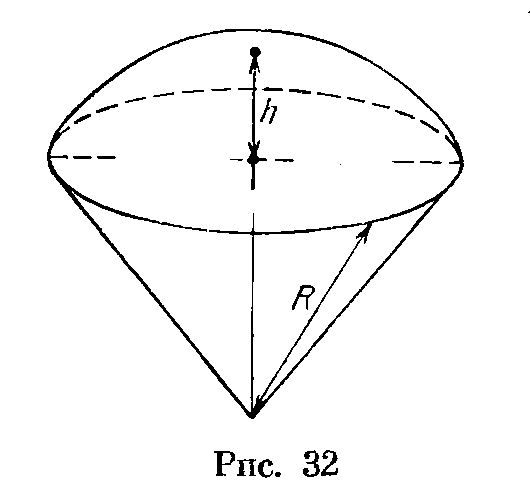
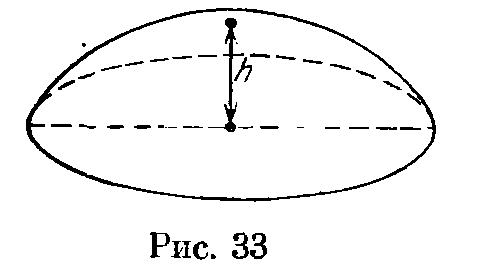
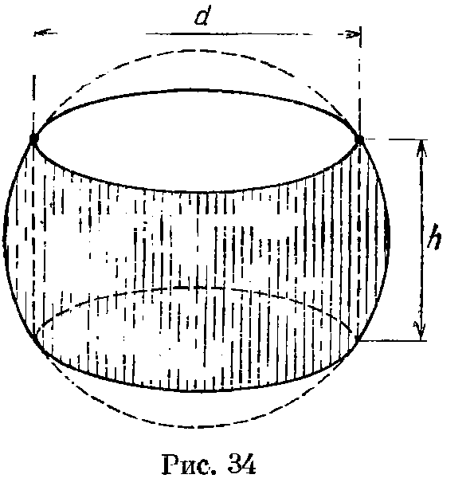

## 4.5. Площадь сферической полоски и объем шарового сегмента

---
**стр. 64, продолжение**
---

## § 5. Площадь сферической полоски и объем шарового сегмента

**4.24.** Две параллельные плоскости, расстояние между которыми равно $h$, пересекают сферу радиуса $R$. Докажите, что площадь поверхности части сферы, заключенной между ними, равна $2\pi Rh$.

---
**стр. 65**
---

**4.25.** Пусть $A$ — вершина шарового сегмента, $B$ — точка окружности его основания. Докажите, что площадь поверхности этого сегмента равна площади круга радиуса $AB$.

**4.26.** Пусть $h$ — высота шарового сектора (рис. 32), $R$ — радиус шара. Докажите, что объем этого шарового сектора равен $2\pi R^2h/3$.

**4.27.** Пусть $h$ — высота шарового сегмента (рис. 33), $R$ — радиус шара. Докажите, что объем шарового сегмента равен $\pi h^2(3R-h)/3$.

**4.28.** Докажите, что объем тела, полученного при вращении сегмента круга относительно не пересекающего его диаметра, равен $\pi a^2h/6$, где $a$ — длина хорды этого сегмента, $h$ — длина проекции этой хорды на диаметр.

**4.29.** Золотое колечко имеет форму тела, ограниченного поверхностью шара и цилиндра (рис. 34). Сколько золота нужно добавить, чтобы увеличить диаметр $d$ в $k$ раз, а высоту $h$ оставить прежней?

**4.30.** Центр сферы $S_1$ принадлежит сфере $S_2$, причем эти сферы пересекаются. Докажите, что площадь части поверхности $S_2$, находящейся внутри $S_1$, равна $1/4$ площади поверхности $S_1$.

**4.31.** Центр сферы $\alpha$ принадлежит сфере $\beta$. Площадь части поверхности сферы $\beta$, лежащей внутри $\alpha$, равна $1/5$ площади поверхности $\alpha$. Найдите отношение радиусов этих сфер.

**4.32.** Некоторый 20-гранник описан около сферы радиуса 10. Докажите, что на его поверхности найдут-

---
**стр. 66**
---

ся две точки, расстояние между которыми больше 21.

**4.33.** Найдите площади частей, на которые плоскости граней куба с ребром $a$ разбивают описанную около него сферу.

**4.34.** Шар радиуса $R$ касается ребер правильного четырехгранного угла (см. с. 174), все плоские углы которого равны $60^\circ$. Поверхность шара, находящаяся внутри угла, состоит из двух криволинейных четырехугольников. Найдите их площади.

**4.35.** Дан правильный тетраэдр с ребром 1. Сфера касается трех его ребер, выходящих из одной вершины, в их концах. Найдите площадь части поверхности сферы, расположенной внутри тетраэдра.

**4.36.** На сфере радиуса 2 расположены три попарно касающиеся окружности радиуса $\sqrt2$. Часть поверхности сферы, расположенная вне окружностей, представляет собой два криволинейных треугольника. Найдите площади этих треугольников.
