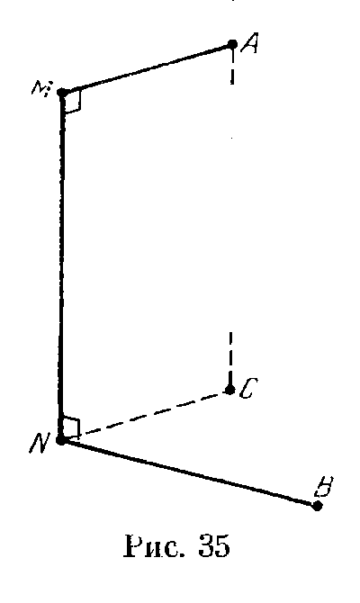
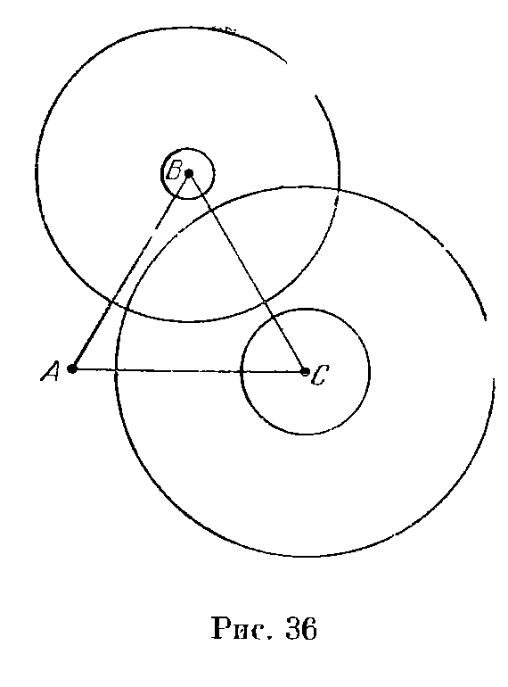
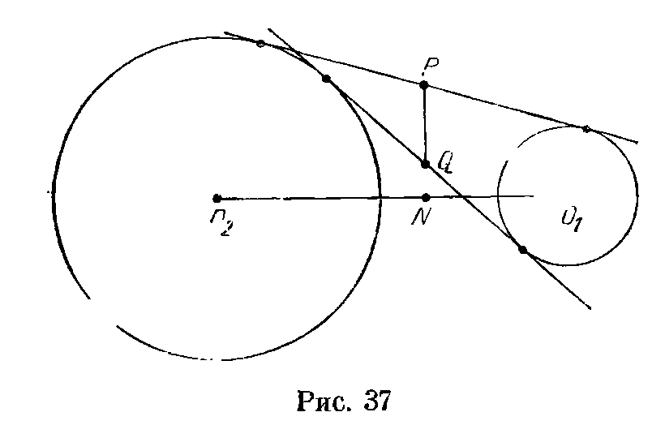
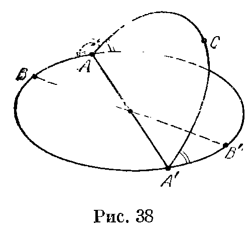
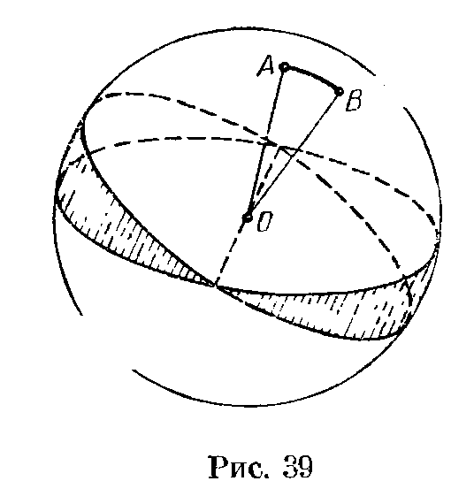
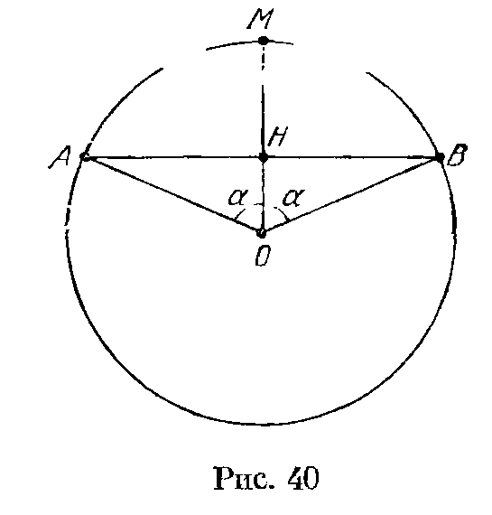

## 4.9. Решения

---
**стр. 69, продолжение**
---

## Решения

**4.1.** Докажем сначала, что длина общей касательной к двум касающимся окружностям радиусов $R$ и $r$ равна $2\sqrt{Rr}$. Рассмотрим для этого прямоугольный треугольник, концы гипотенузы которого — центры окружностей, а один из катетов параллелен общей касательной. Применяя к этому треугольнику теорему Пифагора, получим $x^2+(R-r)^2=(R+r)^2$, где $x$ — длина общей касательной. Отсюда $x=2\sqrt{Rr}$.

Рассматривая теперь сечение, проходящее через центры данных шаров и точки $A$ и $B$, легко проверить, что эта формула справедлива и в нашем случае.

**4.2.** Пусть $x$, $y$ и $z$ — радиусы шаров. Согласно задаче 4.1 $a=2\sqrt{xy}$, $b=2\sqrt{yz}$ и $c=2\sqrt{xz}$. Поэтому $ac/b=2x$, т. е. $x=ac/2b$. Аналогично $y=ab/2c$ и $z=bc/2a$.

**4.3.** Пусть $A$ и $C$ — точки касания с плоскостью шаров радиуса $R$; $B$ и $D$ — точки касания с плоскостью шаров радиуса $r$. Согласно задаче 4.1 $AB=BC=CD=AD=2\sqrt{Rr}$, поэтому $ABCD$ — ромб; его диагонали равны $2R$ и $2r$. Следовательно, $R^2+r^2=4Rr$, т. е. $R=(2\pm\sqrt3)r$. Таким образом, отношение большего радиуса к меньшему равно $2+\sqrt3$.

**4.4.** Пусть $MN$ — общая касательная, $A$ и $B$ — центры шаров. Радиусы $AM$ и $BN$ перпендикулярны касательной $MN$. Пусть $C$ — проекция точки $A$ на плоскость, проходящую через точку $N$ перпендикулярно $MN$ (рис. 35). Так как $NB=r$ и $NC=R$, то $BC$ может изменяться от $R+r$ до $|R-r|$. Поэтому величина $MN^2=AC^2=AB^2-BC^2$ может изменяться от $a^2-(R+r)^2$ до $a^2-(R-r)^2$.

Для пересекающихся шаров верхний предел длины $MN$ остается таким же, а нижний равен 0.

**4.5.** Пусть $a$ и $b$ — радиусы сфер, $A_1$ и $B_1$ — другие точки их касания с гранями угла. Стороны трапеции $AA_1BB_1$ легко вычисляются: $AB_1=A_1B=2\sqrt{ab}$ (задача 4.1), $AA_1=$

---
**стр. 70**
---

$=2a\cos\alpha$ и $BB_1=2b\cos\alpha$. Квадрат высоты этой трапеции равен $4ab-(b-a)^2\cos^2\alpha$, а квадрат диагонали равен
$$
4ab-(b-a)^2\cos^2\alpha+(a+b)^2\cos^2\alpha
=4ab(1+\cos^2\alpha).
$$
Если сфера, проходящая через точки $A$ и $A_1$, пересекает отрезок $AB$ в точке $K$, то
$$
BK=\frac{BA_1^2}{BA_1}
=\frac{2\sqrt{ab}}{\sqrt{1+\cos^2\alpha}}
=\frac{AB}{1+\cos^2\alpha}
$$
и
$$
AK=\frac{AB\cos^2\alpha}{1+\cos^2\alpha}.
$$
Аналогично находятся длины отрезков, на которые делится $AB$ точкой пересечения со второй сферой. В итоге получаем, что отрезок $AB$ разделен в отношении $\cos^2\alpha:\sin^2\alpha:\cos^2\alpha$.

**4.6.** Рассмотрим сначала данный куб $ABCDA_1B_1C_1D_1$. Конус с осью $AC_1$ и образующей $AB$ касается сферы, касающейся всех ребер данного куба. Поэтому конус с осью $AB$ и образующей $AC_1$ касается сферы, касающейся всех ребер куба с диагональю $AB$. Эти рассуждения показывают, что любая из четырех прямых, проходящих через данную точку параллельно какой-либо диагонали данного куба, касается всех полученных шаров.

**4.7.** Так как $AC$ и $AD$ — касательные к данной сфере, они равны. Поэтому точка $A$ принадлежит плоскости, проходящей через середину отрезка $CD$ перпендикулярно ему. Так как $\angle CDB=90^\circ$, то эта плоскость пересекает плоскость $ABC$ по прямой, проходящей через середину отрезка $BC$ перпендикулярно ему.

**4.8.** Докажем сначала следующее вспомогательное утверждение. Пусть две плоскости, пересекающиеся по прямой $AX$, касаются сферы с центром $O$ в точках $F$ и $G$. Тогда $AOX$ — биссекторная плоскость двугранного угла, образованного плоскостями $AOF$ и $AOG$. В самом деле, точки $F$ и $G$ симметричны относительно плоскости $AOX$.

Пусть плоскость $AKN$ касается вписанной в куб сферы в точке $P$, а прямая $AP$ пересекает $NK$ в точке $M$. Применяя доказанное выше утверждение к касательным плоскостям, проходящим через прямую $NA$, получаем, что $AC_1N$ — биссекторная плоскость двугранного угла, образованного плоскостями $AC_1D_1$ и $AC_1M$. Аналогично $AC_1K$ — биссекторная плоскость двугранного угла, образованного плоскостями $AC_1M$ и $AC_1B_1$. Следовательно, угол между плоскостями $AC_1N$ и $AC_1K$ вдвое меньше двугранного угла, образованного полуплоскостями $AC_1D_1$ и $AC_1B_1$. Рассматривая проекцию на плоскость, перпендикуляр-

---
**стр. 71**
---

ную $AC_1$, получаем, что двугранный угол, образованный полуплоскостями $AC_1D_1$ и $AC_1B_1$, равен $120^\circ$.

**4.9.** Пусть $O_1$ и $O_2$ — проекции центра $O$ данного шара на плоскости $KLM$ и $KLN$; $P$ и $S$ — середины отрезков $LM$ и $KN$. Так как $OP=OS$ и $PK=SL$, то $OK=OL$. Поэтому проекцией точек $O_1$ и $O_2$ на прямую $KL$ является точка $Q$ — середина отрезка $KL$. Так как плоскости $KLM$ и $KLN$ перпендикулярны, то $OO_1=O_2Q=QO_1$; поэтому квадрат радиуса искомой сферы равен $PO_1^2+OO_1^2=PO_1^2+QO_1^2$. Применяя теорему косинусов к треугольнику $KLM$, получаем $KM^2=31$. По теореме синусов $31=(2R\sin60^\circ)^2=3R^2$. Следовательно,
$$
PO_1^2+QO_1^2=(R^2-PL^2)+(R^2-QL^2)
=\frac{62}{3}-9-\frac14=\frac{137}{12}.
$$

**4.10.** Пусть $O$ — центр данной сферы, $r$ — ее радиус; $a$ и $b$ — длины касательных, проведенных из точек $A$ и $B$; $M$ — точка пересечения касательных, проведенных из $A$ и $B$; $x$ — длина касательной, проведенной из $M$. Тогда $AM^2=(a\pm x)^2$, $BM^2=(b\pm x)^2$ и $OM^2=r^2+x^2$. Подберем числа $\alpha$, $\beta$ и $\gamma$ так, чтобы выражение $\alpha AM^2+\beta BM^2+\gamma OM^2$ не зависело от $x$, т. е. $\alpha+\beta+\gamma=0$ и $\pm2\alpha a\pm2\beta b=0$. Получаем, что точка $M$ удовлетворяет соотношению
$$
bAM^2+aBM^2-(a+b)OM^2=d_1
$$
или соотношению
$$
bAM^2-aBM^2+(a-b)OM^2=d_2.
$$
Каждое из этих соотношений определяет плоскость (см. задачу 1.29).

**4.11.** Рассмотрим плоскость, касающуюся всех трех данных сфер, и проведем через центр сферы радиуса 3 плоскость, ей параллельную. Полученная плоскость касается сфер радиуса $4\pm3$ и $6\pm3$, концентрических со сферами радиуса 4 и 6. В случае, когда знаки при числе 3 одинаковы, касание внешнее, а когда они разные, касание внутреннее. Ясно также, что для каждой плоскости, касающейся всех сфер, плоскость, симметричная ей относительно плоскости, проходящей через центры сфер, тоже касается всех сфер.

Для того чтобы выяснить, существует ли плоскость, проходящая через данную точку и касающаяся двух данных сфер, можно воспользоваться результатом задачи 12.11. Во всех случаях, кроме внутреннего касания со сферами радиуса 1 и 9, касательные плоскости существуют (см. рис. 36). Докажем, что не существует плоскости, касающейся внутренне сфер радиуса 1 и 9 с центрами $B$ и $C$ и проходящей через точку $A$. Пусть $\alpha$ — угол между прямой $AB$ и касательной из $A$ к сфере с центром $B$, $\beta$ — угол между прямой $AC$ и касательной из $A$ к сфере с центром $C$. Достаточно проверить, что $\alpha+\beta>60^\circ$, т. е. $\cos(\alpha+\beta)<1/2$. Так как $\sin\alpha=1/11$ и $\sin\beta=9/11$, то $\cos\alpha=\sqrt{120}/11$, $\cos\beta=\sqrt{40}/11$. Поэтому $\cos(\alpha+\beta)=$

---
**стр. 72**
---

$=(40\sqrt3-9)/121$. Итак, неравенство $\cos(\alpha+\beta)<1/2$ эквивалентно неравенству $80\sqrt3<139$; последнее неравенство проверяется возведением в квадрат.

В итоге получаем, что всего имеется 3 пары касательных плоскостей.

**4.12.** Пусть $O_1$ и $O_2$ — центры данных окружностей: в задаче а) $M$ — середина отрезка $AB$, в задаче б) $M=P$. Рассмотрим плоскость $MO_1O_2$. Центром искомой сферы является точка пересечения перпендикуляров, восстановленных в этой плоскости из точек $O_1$ и $O_2$ к прямым $MO_1$ и $MO_2$.

**4.13.** Описанные окружности двух боковых граней имеют две общие точки — общие вершины этих граней. Поэтому существует сфера, содержащая обе эти окружности. Описанной окружностью третьей грани является сечение этой сферы плоскостью грани.

**4.14.** Рассмотрим какую-нибудь вершину многогранника и еще три вершины — концы выходящих из нее ребер. Через эти 4 точки можно провести сферу. Такие сферы можно построить для каждой вершины многогранника, и поэтому достаточно доказать, что для соседних вершин эти сферы совпадают.

Пусть $P$ и $Q$ — соседние вершины. Рассмотрим описанные окружности двух граней с общим ребром $PQ$. И точка $P$, и концы выходящих из нее трех ребер принадлежат хотя бы одной из этих окружностей. То же самое верно и для точки $Q$. Остается заметить, что через две окружности, имеющие две общие точки и не лежащие в одной плоскости, можно провести сферу.

**4.15.** Произведение длин отрезков, на которые каждая из трех хорд делится точкой их пересечения, равно произведению длин отрезков, на которые точкой пересечения делится общая хорда, а значит, все эти произведения равны. Если отрезки $AB$ и $CD$ пересекаются в точке $O$ и $AO\cdot OB=CO\cdot OD$, то точки $A$, $B$, $C$ и $D$ лежат на одной окружности. Следовательно, концы первой и второй хорды, а также концы второй и третьей хорды лежат на одной окружности. Вторая хорда принадлежит обеим

---
**стр. 73**
---

этим окружностям, а значит, эти окружности принадлежат одной сфере.

**4.16.** Если все окружности проходят через некоторые две точки, то все доказано. Поэтому можно считать, что есть три окружности, причем третья окружность не проходит хотя бы через одну из точек пересечения первых двух окружностей. Докажем, что тогда эти три окружности принадлежат одной сфере (или плоскости). Согласно задаче 4.12, а первые две окружности принадлежат одной сфере (или плоскости). Третья окружность пересекает первую окружность в двух точках. Эти две точки не могут совпасть с двумя точками пересечения третьей окружности со второй, так как иначе все три окружности проходили бы через две точки. Поэтому третья окружность имеет по крайней мере три общие точки со сферой, заданной первыми двумя окружностями. Следовательно, третья окружность принадлежит этой сфере.

Возьмем теперь какую-нибудь четвертую окружность. Ее точки пересечения с первой окружностью могут, конечно, совпасть с ее точками пересечения со второй окружностью, но тогда они уже не могут совпасть с ее точками пересечения с третьей окружностью. Поэтому четвертая окружность имеет по крайней мере три общие точки со сферой, заданной первыми двумя окружностями, а значит, принадлежит ей.

**4.17.** Пусть сфера (или плоскость) $\alpha$ содержит первую и вторую окружности, сфера (или плоскость) $\beta$ — вторую и третью. Предположим, что $\alpha$ и $\beta$ не совпадают. Тогда их линией пересечения является вторая окружность. Кроме того, общая точка первой и третьей окружностей тоже принадлежит линии пересечения $\alpha$ и $\beta$, т. е. второй окружности, а значит, все три окружности имеют общую точку. Получено противоречие.

**4.18.** Плоскость, проходящая через центр сферы и середины дуг $AB$ и $AC$, проходит также и через середины хорд $AB$ и $AC$, поэтому она параллельна хорде $BC$. Следовательно, большой круг, проходящий через $B$ и $C$, и большой круг, проходящий через середины дуг $AB$ и $AC$, пересекаются в таких двух точках $K$ и $K_1$, что диаметр $KK_1$ параллелен $BC$. Поэтому длина дуги $CK$ равна $(\pi R\pm l)/2$.

**4.19.** Пусть $O$ — центр сферы. Возьмем точку $E$ так, что $\overrightarrow{CE}=\overrightarrow{AB}$. Так как $\angle OCE=60^\circ$ и $CE=1=OC$, то $OE=1$. Точка $O$ равноудалена от всех вершин параллелограмма $ABEC$, поэтому $ABEC$ — прямоугольник и проекция $O_1$ точки $O$ на плоскость этого прямоугольника совпадает с его центром, т. е. с серединой отрезка $BC$. Отрезок $OO_1$ является средней линией

---
**стр. 74**
---

треугольника $CBD$, поэтому
$$
BD=2OO_1=2\sqrt{OC^2-\frac{BC^2}{4}}
=2\sqrt{1-\frac{AB^2+AC^2}{4}}=1.
$$

**4.20.** Пусть $A$ и $B$ — две точки данной окружности, $A_1$ и $B_1$ — вторые точки пересечения прямых $PA$ и $PB$ со сферой; $l$ — касательная к описанной окружности треугольника $PAB$ в точке $P$. Тогда $\angle(l,AP)=\angle(BP,AB)=\angle(A_1B_1,A_1P)$, т. е. $A_1B_1\parallel l$. Пусть плоскость $\Pi$ проходит через точку $A_1$ параллельно плоскости, касающейся в точке $P$ сферы, которая проходит через данную окружность и точку $P$. Все искомые точки лежат в плоскости $\Pi$.

**4.21.** Пусть $O$ — центр сферы; $O_1$, $O_2$ и $O_3$ — центры данных окружностей; $O_4$ — центр искомой окружности. Рассматривая сечение сферы плоскостью $OO_1O_2$, легко доказать, что $OO_1O_2$ — правильный треугольник со стороной $\sqrt3$. Прямая $OO_4$ проходит через центр треугольника $O_1O_2O_3$ перпендикулярно его плоскости, а значит, расстояния от вершин этого треугольника до прямой $OO_4$ равны 1. Пусть $K$ — точка касания окружностей с центрами $O_1$ и $O_4$; $L$ — основание перпендикуляра, опущенного из $O_1$ на $OO_4$; $N$ — основание перпендикуляра, опущенного из $K$ на $O_1L$. Так как $\triangle O_1KN\sim\triangle OO_1L$, то
$$
O_1N=\frac{OL\cdot O_1K}{OO_1}=\sqrt{\frac23},
$$
а значит, искомый радиус $O_4K$ равен
$$
LN=1-\sqrt{\frac23}.
$$

**4.22.** Пусть $P=(x,y,z)$ — данная точка земной поверхности, $P'$ — ее проекция на плоскость экватора. Тогда $z=R\sin\varphi$ и $OP'=R\cos\varphi$. Следовательно, $x=OP'\cos\psi=R\cos\varphi\cos\psi$ и $y=R\cos\varphi\sin\psi$. Итак,
$$
P=(R\cos\varphi\cos\psi,\ R\cos\varphi\sin\psi,\ R\sin\varphi).
$$

**4.23.** Введем такую же систему координат, как и в задаче 4.22. Если широта и долгота точки $P$ равны $\varphi$, то
$$
P=(R\cos^2\varphi,\ R\cos\varphi\sin\varphi,\ R\sin\varphi).
$$
Проекция этой точки на плоскость экватора имеет координаты $x=R\cos^2\varphi$ и $y=R\cos\varphi\sin\varphi$. Легко проверить, что
$$
(x-R/2)^2+y^2=R^2/4,
$$
т. е. искомое множество — окружность радиуса $R/2$ с центром $(R/2,0)$.

**4.24.** Рассмотрим сначала усеченный конус, боковая поверхность которого касается шара радиуса $R$ с центром $O$, причем точки касания делят образующие конуса пополам, и докажем, что площадь его боковой поверхности равна $2\pi Rh$, где $h$ — высота этого конуса. Пусть $AB$ — образующая усеченного конуса; $C$ — середина отрезка $AB$; $L$ — основание перпендикуляра, опущенного из $C$ на ось конуса. Площадь боковой поверхности усеченного конуса равна $2\pi CL\cdot AB$ (эту формулу можно получить предельным переходом, воспользовавшись тем, что площадь трапеции равна произведению сред-

---
**стр. 75**
---

ней линии на высоту), а так как угол между прямой $AB$ и осью конуса равен углу между $CO$ и $CL$, то $AB:CO=h:CL$, т. е. $CL\cdot AB=CO\cdot h=Rh$.

Утверждение задачи доказывается теперь предельным переходом: заменим рассматриваемую часть поверхности сферы фигурой, состоящей из боковых поверхностей нескольких усеченных конусов; когда высоты этих конусов стремятся к нулю, площадь поверхности этой фигуры стремится к площади рассматриваемой части сферы.

**4.25.** Пусть $M$ — центр основания шарового сегмента, $h$ — высота сегмента, $O$ — центр шара, $R$ — радиус шара. Тогда $AM=h$, $MO=R-h$ и $BM\perp AO$. Следовательно,
$$
AB^2-AM^2=BM^2=BO^2-OM^2,
$$
т. е.
$$
AB^2=h^2+R^2-(R-h)^2=2Rh.
$$
Остается воспользоваться результатом задачи 4.24.

**4.26.** Объем шарового сектора равен $SR/3$, где $S$ — площадь сферической части поверхности сектора. Согласно задаче 4.24
$$
S=2\pi Rh.
$$

**4.27.** Шаровой сегмент вместе с соответствующим конусом с вершиной в центре шара составляют шаровой сектор. Объем шарового сектора равен $2\pi R^2h/3$ (задача 4.26). Высота конуса равна $R-h$, а квадрат радиуса его основания равен
$$
R^2-(R-h)^2=2Rh-h^2,
$$
поэтому его объем равен
$$
\pi(R-h)(2Rh-h^2)/3.
$$
Вычитая из объема шарового сектора объем конуса, получаем требуемое.

**4.28.** Пусть $AB$ — хорда данного сегмента, $O$ — центр круга, $x$ — расстояние от $O$ до $AB$, $R$ — радиус круга. Объем тела, полученного при вращении сектора $AOB$ вокруг диаметра, равен $RS/3$, где $S$ — площадь поверхности, полученной при вращении дуги $AB$. Согласно задаче 4.24 $S=2\pi Rh$. Из решения той же задачи следует, что объем тела, полученного при вращении треугольника $AOB$, равен $2\pi x^2h/3$ (для доказательства следует заметить, что часть поверхности этого тела, полученная при вращении отрезка $AB$, касается сферы радиуса $x$).

Итак, искомый объем равен
$$
2\pi R^2h/3-2\pi x^2h/3
=2\pi(x^2+a^2/4)h/3-2\pi x^2h/3
=\pi a^2h/6.
$$

**4.29.** Согласно задаче 4.28 объем колечка равен $\pi h^3/6$, т. е. он не зависит от $d$.

**4.30.** Пусть $O_1$ и $O_2$ — центры сфер $S_1$ и $S_2$, $R_1$ и $R_2$ — их радиусы. Пусть, далее, $A$ — точка пересечения сфер, $AH$ — высота треугольника $O_1AO_2$. Внутри $S_1$ находится сегмент сферы $S_2$ с высотой $O_1H$. Так как $O_1O_2=AO_2=R_2$ и $O_1A=R_1$, то
$$
2O_1H:R_1=R_1:R_2,
$$
т. е. $O_1H=R_1^2/2R_2$. Согласно задаче 4.24 площадь поверхности рассматриваемого сегмента равна
$$
2\pi R_2\cdot\frac{R_1^2}{2R_2}=\pi R_1^2.
$$

---
**стр. 76**
---

**4.31.** Если бы сферы $\alpha$ и $\beta$ пересекались, то площадь поверхности части сферы $\beta$, расположенной внутри $\alpha$, составляла бы $1/4$ поверхности $\alpha$ (задача 4.30). Следовательно, сфера $\beta$ содержится внутри $\alpha$, а значит, отношение их радиусов равно $\sqrt5$.

**4.32.** Рассмотрим описанный около сферы радиуса 10 многогранник, расстояние между любыми двумя точками поверхности которого не превосходит 21, и докажем, что число его граней больше 20. Заметим для начала, что этот многогранник расположен внутри сферы радиуса 11, центр которой совпадает с центром $O$ вписанной сферы. В самом деле, если для некоторой точки $A$ поверхности многогранника $OA>11$, то пусть $B$ — вторая точка пересечения поверхности многогранника с прямой $OA$. Тогда $AB=AO+OB>11+10=21$, чего не может быть.

Каждая плоскость грани отсекает от сферы радиуса 11 «шапочку» площадью $2\pi R(R-r)$, где $R=11$ и $r=10$ (см. задачу 4.24). Такие «шапочки» покрывают всю сферу, поэтому
$$
n\cdot2\pi R(R-r)\geqslant4\pi R^2,
$$
где $n$ — число граней. Следовательно,
$$
n\geqslant2R/(R-r)=22>20.
$$

**4.33.** Плоскости граней куба разбивают описанную сферу на 12 «двуугольников» (соответствующих ребрам куба) и 6 криволинейных четырехугольников (соответствующих граням куба). Пусть $x$ — площадь «двуугольника», $y$ — площадь «четырехугольника». Так как радиус описанной сферы равен $a\sqrt3/2$, то плоскость грани куба отсекает от нее сегмент высотой $a(\sqrt3-1)/2$; площадь поверхности этого сегмента равна $\pi a^2(3-\sqrt3)/2$. Этот сегмент состоит из четырех «двуугольников» и одного «четырехугольника», т. е.
$$
4x+y=\pi a^2(3-\sqrt3)/2.
$$
Ясно также, что
$$
12x+6y=4\pi R^2=3\pi a^2.
$$
Решая эту систему уравнений, получаем
$$
x=\pi a^2(2-\sqrt3)/4
\quad\text{и}\quad
y=\pi a^2(\sqrt3-1)/2.
$$

**4.34.** Рассмотрим правильный октаэдр с ребром $2R$. Радиус шара, касающегося всех его ребер, равен $R$. Грани октаэдра разбивают шар на 8 сферических сегментов (соответствующих граням) и 6 криволинейных четырехугольников (соответствующих вершинам). Пусть $x$ — площадь сегмента, $y$ — площадь «четырехугольника». Искомые площади равны $y$ и $5y+4x$. Вычислим сначала $x$. Так как расстояние от центра октаэдра до вершины равно $\sqrt2R$, а расстояние от центра его грани до вершины равно $2R/\sqrt3$, то расстояние от центра октаэдра до его грани равно $R\sqrt{2/3}$. Следовательно, высота рассматриваемого сферического сегмента равна $(1-\sqrt{2/3})R$, а значит,
$$
x=
$$

---
**стр. 77**
---

$$
=2\pi R^2(1-\sqrt{2/3}).
$$
Ясно также, что $8x+6y=4\pi R^2$. Поэтому
$$
y=\frac{2\pi R^2}{3}\left(4\sqrt{\frac23}-3\right)
$$
и
$$
5y+4x=\pi R^2\left(\frac{16}{3}\sqrt{\frac23}-2\right).
$$

**4.35.** Рассмотрим правильный тетраэдр с ребром 2. Поверхность сферы, касающейся всех его ребер, разбивается его поверхностью на 4 равных криволинейных треугольника, площадь каждого из которых и есть искомая величина, и 4 равных сегмента. Пусть $x$ — расстояние от центра грани до вершины, $y$ — расстояние от центра тетраэдра до грани, $z$ — расстояние от центра грани до ребра этой грани. Легко проверить, что $x=2/\sqrt3$ и $z=1/\sqrt3$. Далее, $y=h/4$, где $h=\sqrt{4-x^2}=\sqrt{8/3}$ — высота тетраэдра, т. е. $y=1/\sqrt6$. Радиус $r$ сферы равен
$$
\sqrt{y^2+z^2}=\sqrt{1/6+1/3}=1/\sqrt2.
$$
Высота каждого из четырех сегментов равна
$$
r-y=1/\sqrt2-1/\sqrt6.
$$
Следовательно, искомая площадь равна
$$
\frac14\left(4\pi\left(\frac1{\sqrt2}\right)^2
-4\cdot2\pi\frac1{\sqrt2}
\left(\frac1{\sqrt2}-\frac1{\sqrt6}\right)\right)
=\pi\left(\frac1{\sqrt3}-\frac12\right).
$$

**4.36.** Рассмотрим куб с ребром $2\sqrt2$. Сфера радиуса 2 с центром в центре куба касается всех его ребер, а ее пересечения с гранями являются окружностями радиуса $\sqrt2$. Поверхность сферы разбивается поверхностью куба на 6 сегментов и 8 криволинейных треугольников. Пусть $x$ — площадь сегмента, $y$ — площадь криволинейного треугольника. Тогда искомые площади равны $y$ и $16\pi-y-3x$ ($16\pi$ — площадь поверхности сферы радиуса 2). Так как высота каждого сегмента равна $2-\sqrt2$, то
$$
x=4\pi(2-\sqrt2),
$$
а значит,
$$
y=(16\pi-6x)/8=\pi(3\sqrt2-4)
$$
и
$$
16\pi-y-3x=\pi(9\sqrt2-4).
$$

**4.37.** Введем систему координат с началом в центре первой сферы и осью $Ox$, проходящей через центр второй сферы. Пусть расстояние между центрами сфер равно $a$; радиусы первой и второй сфер равны $R$ и $r$. Тогда степени точки $(x,y,z)$ относительно первой и второй сфер равны $x^2+y^2+z^2-R^2$ и $(x-a)^2+y^2+z^2-r^2$. Поэтому искомое ГМТ задается уравнением
$$
x^2+y^2+z^2-R^2=(x-a)^2+y^2+z^2-r^2,
$$
т. е.
$$
x=(a^2+R^2-r^2)/2a.
$$
Это уравнение задает плоскость, перпендикулярную прямой, соединяющей центры сфер.

**4.38.** Пусть $M$ — середина отрезка $AB$; $l$ — прямая, проходящая через центры данных сфер; $P$ — точка пересечения прямой $l$ и радикальной плоскости данных сфер. Так как касательные $MA$ и $MB$, проведенные из точки $M$ к данным сферам, равны, то $M$ принадлежит радикальной плоскости этих сфер. Поэтому проекцией точки $M$ на прямую $l$ является

---
**стр. 78**
---

точка $P$, т. е. проекции точек $A$ и $B$ на прямую $l$ симметричны относительно точки $P$. Следовательно, при симметрии относительно точки $P$ проекция отрезка $AC$ на прямую $l$ переходит в проекцию отрезка $BD$.

**4.39.** Середины общих касательных к двум сферам лежат в их радикальной плоскости. Пусть $O_1$ и $O_2$ — центры данных сфер, $M$ — середина общей касательной, $N$ — точка пересечения радикальной плоскости с прямой $O_1O_2$. Рассмотрим сечение данных сфер плоскостью, проходящей через точки $O_1$ и $O_2$, и проведем к полученным в сечении окружностям внешнюю и внутреннюю касательные (рис. 37). Пусть $P$ и $Q$ — середины

этих касательных. Докажем, что $NQ\leq NM\leq NP$. В самом деле,
$$NM^2=O_1M^2-O_1N^2=x^2/4+R_1^2-O_1N^2,$$
где $x$ — длина касательной, а величина $x$ наибольшее и наименьшее значение принимает в случае внутреннего и внешнего касания (см. решение задачи 4.4). Итак, искомым ГМТ является кольцо, расположенное в радикальной плоскости, с внешним радиусом $NP$ и внутренним $NQ$.

**4.40.** Пусть $S_1,\ldots,S_n$ — поверхности данных шаров. Для каждой сферы $S_i$ рассмотрим фигуру $M_i$, состоящую из точек, степень которых относительно $S_i$ не больше степеней относительно всех остальных данных сфер. Докажем, что фигура $M_i$ выпуклая. В самом деле, пусть $M_{ij}$ — фигура, состоящая из точек, степень которых относительно $S_i$ не больше степени относительно $S_j$; фигура $M_{ij}$ является полупространством, состоящим из точек, лежащих по ту же сторону от радикальной плоскости сфер $S_i$ и $S_j$, что и сфера $S_i$. Фигура $M_i$ является пересечением выпуклых фигур $M_{ij}$, поэтому она выпукла. Кроме того, она содержит сферу $S_i$, так как каждая фигура $M_{ij}$ содержит сферу $S_i$. Для любой точки пространства какая-то из ее степеней относительно $S_1,\ldots,S_n$ является наименьшей, поэтому фигуры $M_i$ покрывают все пространство. Рассматривая

---
**стр. 79**
---

части этих фигур, лежащие внутри исходного многогранника, получаем требуемое разбиение.

**4.41.** Пусть $A$ — точка пересечения данных окружностей, $O$ — вершина рассматриваемого конуса (или $OA$ — образующая цилиндра). Так как прямая $OA$ перпендикулярна касательной к окружности $S_1$ в точке $A$, то окружности $S_1$ и $S_2$ перпендикулярны тогда и только тогда, когда $OA$ — касательная к окружности $S_2$.

**4.42.** Рассмотрим сначала сферический «двуугольник» — часть сферы, заключенную внутри двугранного угла величиной $\alpha$, ребро которого проходит через центр сферы. Площадь такой фигуры пропорциональна $\alpha$, а при $\alpha=\pi$ она равна $2\pi R^2$; следовательно, она равна $2\alpha R^2$.

Каждой паре плоскостей граней данного трехгранного угла соответствуют два «двуугольника». Эти «двуугольники» покрывают данный криволинейный треугольник и треугольник, симметричный ему относительно центра сферы, в 3 слоя, а остальную часть сферы в один слой. Следовательно, сумма их площадей равна площади поверхности сферы, увеличенной на $4S$, где $S$ — площадь искомого треугольника. Поэтому
$$S=R^2(\alpha+\beta+\gamma-\pi).$$

**4.43.** Рассмотрим множество концов дуг с началом в точке $C$, делящихся пополам большим кругом, проходящим через точки $A_1$ и $B_1$. Это множество является окружностью, проходящей через точки $A$ и $B$ и точку $C'$, симметричную точке $C$ относительно радиуса, делящего пополам дугу $A_1B_1$. Часть этой окружности, состоящая из концов дуг, пересекающих сторону $A_1B_1$ криволинейного треугольника $A_1B_1C$, лежит внутри криволинейного треугольника $ABC$. В частности, внутри треугольника $ABC$ лежит точка $C'$, а значит,
$$S_{ABC}>S_{A_1B_1C}+S_{A_1B_1C'}$$
(имеются в виду площади криволинейных треугольников). Остается заметить, что $S_{A_1B_1C}=S_{A_1B_1C'}$, так как эти треугольники равны.

**4.44.** Разрежем $n$-гранный угол на $n-2$ трехгранных углов, проведя плоскости через одно его ребро и несмежные с ним ребра. Записав для каждого из этих трехгранных углов формулу из задачи 4.42 и сложив их, получим требуемое.

**4.45.** Пусть $M$ и $N$ — точки пересечения сферы с прямой, проходящей через центр описанной окружности $S$ треугольника $ABC$ перпендикулярно его плоскости. Пусть $\alpha=\angle MBC=\angle MCB$, $\beta=\angle MAC=\angle MCA$ и $\gamma=\angle MAB=\angle MBA$ (имеются в виду углы на сфере). Этим величинам можно так приписать знаки, что будут выполняться равенства $\beta+\gamma=\angle A$, $\alpha+\gamma=\angle B$ и $\alpha+\beta=\angle C$; следовательно,
$$2\gamma=\angle A+$$

---
**стр. 80**
---

$$+\angle B-\angle C.$$
Каждый из углов $A$, $B$ и $C$ определен с точностью до $2\pi$, поэтому угол $\gamma$ определен с точностью до $\pi$. Равенство $\gamma=\angle MAB=\angle MBA$ определяет две точки $M$, симметричные относительно плоскости $OAB$, где $O$ — центр сферы; если вместо $\gamma$ взять $\gamma+\pi$, то вместо $M$ получится точка $N$, т. е. окружность $S$ не изменится. Искомому ГМТ принадлежат не все точки окружности, а лишь одна из дуг, определяемых точками $A$ и $B$ (какая именно — видно из знака числа $\angle A+\angle B-\angle C$). Итак, искомое ГМТ состоит из двух дуг окружностей, симметричных относительно плоскости $OAB$.

**4.46.** Площадь сферического треугольника $ABC$ определяется величиной $\angle A+\angle B+\angle C$ (см. задачу 4.42). Пусть точки $A'$ и $B'$ диаметрально противоположны точкам $A$ и $B$. Углы сферических треугольников $ABC$ и $A'B'C'$ связаны следующим образом: $\angle A'=\pi-\angle A$ (см. рис. 38), $\angle B'=\pi-\angle B$, а углы при вершине $C$ у них равны. Поэтому величина
$$\angle A'+\angle B'-\angle C=2\pi-(\angle A+\angle B+\angle C)$$
постоянна. Искомое ГМТ состоит из двух дуг окружностей, проходящих через точки $A'$ и $B'$ (см. задачу 4.45).

**4.47.** Предположим, что данные дуги $a$, $b$ и $c$ не пересекаются. Пусть $C_a$ и $C_b$ — точки пересечения больших кругов, содержащих дуги $a$ и $b$. Так как дуга $a$ больше $180^\circ$, то она содержит одну из этих точек, например $C_a$. Тогда дуга $b$ содержит точку $C_b$. Рассмотрим также точки $A_b$ и $A_c$, $B_a$ и $B_c$ пересечения других пар больших кругов ($A_b$ принадлежит дуге $b$, $A_c$ — дуге $c$, $B_a$ — дуге $a$, $B_c$ — дуге $c$). Точки $B_c$ и $C_b$ лежат в плоскости дуги $a$, но самой дуге $a$ они не принадлежат. Поэтому $\angle B_cOC_b<60^\circ$ ($O$ — центр сферы). Аналогично $\angle A_cOC_a<60^\circ$ и $\angle A_bOB_a<60^\circ$. Следовательно, $\angle A_cOB_c=\angle A_bOB_a<60^\circ$ и $\angle A_cOC_b=180^\circ-\angle A_cOC_a>120^\circ$, т. е. $\angle A_cOB_c+\angle B_cOC_b<\angle A_cOC_b$. Получено противоречие.

**4.48.** Пусть $O$ — центр сферы. Каждой плоскости, проходящей через $O$, можно сопоставить пару точек сферы — точки пересечения со сферой перпендикуляра к этой плоскости, проходящего через точку $O$. Легко проверить, что при этом сопоставлении плоскостям, проходящим через точку $A$, соответствуют точки большого круга, перпендикулярного прямой $OA$. Поэтому плоскостям, пересекающим дугу $AB$, соответствуют точки части сферы, заключенной между двумя плоскостями,

---
**стр. 81**
---

проходящими через точку $O$ перпендикулярно прямым $OA$ и $OB$ соответственно (рис. 39). Площадь этой фигуры равна $(\alpha/\pi)S$, где $\alpha$ — угловая величина дуги $AB$, а $S$ — площадь сферы. Таким образом, если сумма угловых величин дуг меньше $\pi$, то площадь фигуры, состоящей из точек сферы, соответствующих плоскостям, пересекающим эти дуги, меньше $S$.

**4.49.** а) Телесный угол пропорционален величине двугранного угла, а телесный угол двугранного угла величиной $\pi$ равен $2\pi$.

б) См. задачу 4.44.

**4.50.** Пусть $O$ — вершина конуса, $OH$ — его высота. Построим сферу радиуса 1 с центром $O$ и рассмотрим ее сечение плоскостью, проходящей через прямую $OH$. Пусть $A$ и $B$ — точки конуса, лежащие на сфере; $M$ — точка пересечения луча $OH$ со сферой (рис. 40). Тогда $HM=OM-OH=1-\cos\alpha$. Телесный угол конуса равен площади сферического сегмента, отсекаемого основанием конуса. Согласно задаче 4.24 эта площадь равна $2\pi Rh=2\pi(1-\cos\alpha)$.

**4.51.** Телесный угол трехгранного угла равен сумме его двугранных углов минус $\pi$ (см. задачу 4.42), поэтому сумма телесных углов трехгранных углов тетраэдра равна удвоенной сумме его двугранных углов минус $4\pi$. А удвоенная сумма двугранных углов тетраэдра равна сумме их телесных углов.

**4.52.** Телесный угол при $i$-й вершине многогранника равен $\sigma_i-(n_i-2)\pi$, где $\sigma_i$ — сумма двугранных углов при ребрах, выходящих из нее, а $n_i$ — число этих ребер (см. задачу 4.44). Так как каждое ребро выходит ровно из двух вершин, то $\sum n_i=2\mathrm{P}$, где $\mathrm{P}$ — число ребер. Поэтому сумма телесных углов многогранных углов равна $2\sigma-2(\mathrm{P}-\mathrm{B})\pi$, где $\sigma$ — сумма двугранных углов, $\mathrm{B}$ — число вершин. Остается заметить, что $\mathrm{P}-\mathrm{B}=\mathrm{Г}-2$ (задача 8.14).
