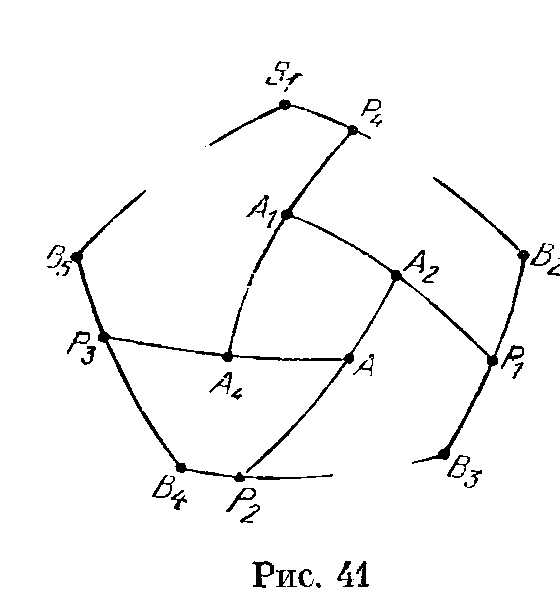
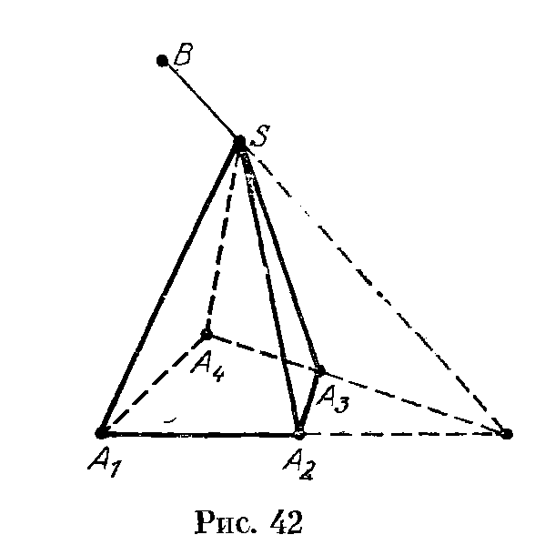
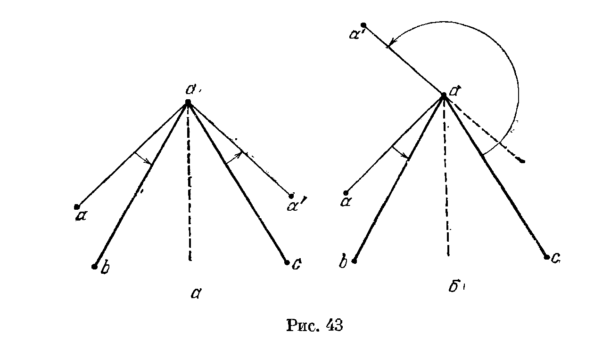

## 5.8. Решения

---
**стр. 88, продолжение**
---

## Решения

**5.1.** Возьмем внутри данного трехгранного угла с вершиной $S$ произвольную точку $S'$ и опустим из нее перпендикуляры $S'A'$, $S'B'$ и $S'C'$ на грани $SBC$, $SAC$ и $SAB$ соответственно.

---
**стр. 89**
---

Ясно, что плоские углы трехгранного угла $S'A'B'C'$ дополняют до $\pi$ двугранные углы трехгранного угла $SABC$. Для завершения доказательства остается заметить, что ребра $SA$, $SB$ и $SC$ перпендикулярны граням $S'B'C'$, $S'A'C'$ и $S'A'B'$ соответственно.

**Замечание.** Угол $S'A'B'C'$ называется *дополнительным* или *полярным* к углу $SABC$.

**5.2.** Рассмотрим трехгранный угол, полярный к данному (см. задачу 5.1). Его плоские углы прямые, поэтому его двугранные углы тоже прямые. Следовательно, плоские углы исходного трехгранного угла тоже прямые.

**5.3.** Полярные углы к данным трехгранным углам имеют равные плоские углы, а значит, они равны.

**5.4.** Рассмотрим трехгранный угол $SABC$ с вершиной $S$. Неравенство
$$
\angle ASC<\angle ASB+\angle BSC
$$
очевидно, если $\angle ASC\leqslant\angle ASB$. Поэтому будем считать, что $\angle ASC>\angle ASB$. Тогда внутри грани $ASC$ можно так выбрать точку $B'$, что $\angle ASB'=\angle ASB$ и $SB'=SB$, т. е. $\triangle ASB=\triangle ASB'$. Можно считать, что точка $C$ лежит в плоскости $ABB'$. Так как
$$
AB'+B'C=AC<AB+BC=A'B+BC,
$$
то $B'C<BC$. Следовательно, $\angle B'SC<\angle BSC$. Остается заметить, что
$$
\angle B'SC=\angle ASC-\angle ASB.
$$

**5.5. Первое решение.** Отложим на ребрах трехгранного угла от вершины $S$ равные отрезки $SA$, $SB$ и $SC$. Пусть $O$ — проекция точки $S$ на плоскость $ABC$. Равнобедренные треугольники $ASB$ и $AOB$ имеют общее основание $AB$ и $AS>AO$. Следовательно, $\angle ASB<\angle AOB$. Записывая аналогичные неравенства для двух других углов и складывая их, получаем
$$
\angle ASB+\angle BSC+\angle CSA<\angle AOB+\angle BOC+\angle COA\leqslant 2\pi
$$
(последнее неравенство становится строгим, только если точка $O$ лежит вне треугольника $ABC$).

Для доказательства второй части достаточно применить уже доказанное неравенство к углу, полярному к данному (см. задачу 5.1). В самом деле, если $\alpha$, $\beta$ и $\gamma$ — двугранные углы данного трехгранного угла, то
$$
(\pi-\alpha)+(\pi-\beta)+(\pi-\gamma)<2\pi,
$$
т. е. $\alpha+\beta+\gamma>\pi$.

**Второе решение.** Пусть точка $A'$ лежит на продолжении ребра $SA$ за вершину $S$. Согласно задаче 5.4
$$
\angle A'SB+\angle A'SC>\angle BSC,
$$
т. е.
$$
(\pi-\angle ASB)+(\pi-\angle ASC)>\angle BSC,
$$
а значит,
$$
2\pi>\angle ASB+\angle BSC+\angle CSA.
$$
Доказательство второй части проводится точно так же, как и в первом решении.

**5.6.** Пусть $K$ — точка пересечения грани $SCB$ с прямой $AC'$. Согласно задаче 5.4
$$
\angle C'SK+\angle KSB>\angle C'SB
$$
и
$$
\angle CSA+\angle CSK>\angle ASK=\angle ASC'+\angle C'SK.
$$
Складывая

---
**стр. 90**
---

эти неравенства и учитывая, что $\angle CSK+\angle KSB=\angle CSB$, получаем требуемое.

**5.7.** Возьмем на ребре $SA$ трехгранного угла $SABC$ произвольную точку $M$. Пусть $M'$ — проекция точки $M$ на плоскость $SBC$, $P$ и $Q$ — проекции точки $M$ на прямые $SB$ и $SC$. По теореме о трех перпендикулярах $M'P\perp SB$ и $M'Q\perp SC$. Если $SM=a$, то $MQ=a\sin\beta$ и $MM'=MQ\sin C=a\sin\beta\sin C$. Аналогично $MM'=MP\sin B=a\sin\gamma\sin B$. Следовательно,
$$
\sin\beta:\sin B=\sin\gamma:\sin C.
$$
Второе равенство доказывается аналогично.

**5.8. а) Первое решение.** Возьмем на ребре $SA$ точку $M$ и восставим из нее в плоскостях $SAB$ и $SAC$ перпендикуляры $PM$ и $QM$ к ребру $SA$ (точки $P$ и $Q$ лежат на прямых $SB$ и $SC$). Выражая по теореме косинусов длину стороны $PQ$ в треугольниках $PQM$ и $PQS$ и приравнивая эти выражения, после сокращения получаем требуемое равенство.

**Второе решение.** Пусть $\mathbf a$, $\mathbf b$ и $\mathbf c$ — единичные векторы, направленные по ребрам $SA$, $SB$ и $SC$. Вектор $\mathbf b$, лежащий в плоскости $SAB$, можно представить в виде $\mathbf b=\mathbf a\cos\gamma+\mathbf u$, где $\mathbf u\perp\mathbf a$ и $|\mathbf u|=\sin\gamma$. Аналогично $\mathbf c=\mathbf a\cos\beta+\mathbf v$, где $\mathbf v\perp\mathbf a$ и $|\mathbf v|=\sin\beta$. Ясно также, что угол между векторами $\mathbf u$ и $\mathbf v$ равен $A$. С одной стороны, скалярное произведение векторов $\mathbf b$ и $\mathbf c$ равно $\cos\alpha$; с другой стороны, произведение равно
$$
(\mathbf a\cos\gamma+\mathbf u,\mathbf a\cos\beta+\mathbf v)
=\cos\beta\cos\gamma+\sin\beta\sin\gamma\cos A.
$$

б) Для доказательства достаточно применить первую теорему косинусов к углу, полярному к данному трехгранному углу (см. задачу 5.1).

**5.9.** Проведем три плоскости, параллельные граням трехгранного угла, удаленные от них на расстояние 1 и пересекающие ребра. Вместе с плоскостями граней они образуют параллелепипед, причем все его высоты равны 1, а значит, площади всех его граней равны. Заметим теперь, что длины ребер этого параллелепипеда равны $1/\sin\alpha$, $1/\sin\beta$ и $1/\sin\gamma$. Следовательно, площади его граней равны $\sin\alpha/\sin\beta\sin\gamma$, $\sin\beta/\sin\alpha\sin\gamma$ и $\sin\gamma/\sin\alpha\sin\beta$. Приравнивая эти выражения, получаем требуемое.

**5.10. а)** Согласно первой теореме косинусов для трехгранного угла (задача 5.8,а)
$$
\sin\beta\sin\gamma\cos A=\cos\alpha-\cos\beta\cos\gamma.
$$
По условию $\cos\alpha<0$ и $\cos\beta\cos\gamma>0$, поэтому $\cos A<0$.

б) Для доказательства достаточно воспользоваться второй теоремой косинусов (задача 5.8,б).

**5.11. Первое решение.** Отложим на ребрах трехгранного угла от вершины $S$ равные отрезки $SA$, $SB$ и $SC$. Биссектрисы углов $ASB$ и $BSC$ проходят через середины отрезков

---
**стр. 91**
---

$AB$ и $BC$, а биссектриса угла, смежного с углом $CSA$, параллельна $CA$.

**Второе решение.** Отложим на ребрах трехгранного угла от вершины $S$ равные векторы $\mathbf a$, $\mathbf b$ и $\mathbf c$. Биссектрисы углов $ASB$ и $BSC$ параллельны векторам $\mathbf a+\mathbf b$ и $\mathbf b+\mathbf c$, а биссектриса угла, смежного с углом $CSA$, параллельна вектору $\mathbf c-\mathbf a$. Остается заметить, что
$$
(\mathbf a+\mathbf b)+(\mathbf c-\mathbf a)=\mathbf b+\mathbf c.
$$

**5.12.** Отложим на ребрах трехгранного угла от его вершины векторы $\mathbf a$, $\mathbf b$ и $\mathbf c$ единичной длины. Векторы $\mathbf a+\mathbf b$, $\mathbf b+\mathbf c$ и $\mathbf a+\mathbf c$ задают биссектрисы плоских углов. Остается проверить, что все попарные скалярные произведения этих векторов имеют один и тот же знак. Легко убедиться, что скалярное произведение любой пары этих векторов равно
$$
1+(\mathbf a,\mathbf b)+(\mathbf b,\mathbf c)+(\mathbf c,\mathbf a).
$$

**5.13. а)** Пусть $\alpha$, $\beta$ и $\gamma$ — плоские углы трехгранного угла $SABC$; $x=\angle ASB_1=\angle ASC_1$, $y=\angle BSA_1=\angle BSC_1$ и $z=\angle CSA_1=\angle CSB_1$. Тогда
$$
x+y=\angle ASC_1+\angle BSC_1=\angle ASB=\gamma,\qquad
y+z=\alpha,\qquad z+x=\beta.
$$
Поэтому $x=(\beta+\gamma-\alpha)/2$.

б) Пусть точка $D'$ лежит на продолжении ребра $AD$ за точку $A$. Тогда вневписанная сфера тетраэдра, касающаяся грани $ABC$, вписана в трехгранный угол $ABCD'$ с вершиной $A$. Из решения задачи а) следует, что
$$
\angle BAP=(\angle BAC+\angle BAD-\angle CAD)/2
$$
и
$$
\angle CAP'=(\angle BAC+\angle CAD'-\angle BAD')/2.
$$
А так как $\angle BAD'=180^\circ-\angle BAD$ и $\angle CAD'=180^\circ-\angle CAD$, то $\angle BAP=\angle CAP'$; значит, прямые $AP$ и $AP'$ симметричны относительно биссектрисы угла $BAC$.

**5.14.** Выберем точки $A$, $B$ и $C$ на ребрах трехгранного угла с вершиной $S$ так, что $SA\perp ABC$ (плоскость, проходящая через точку $A$ одного ребра перпендикулярно ему, пересекает два других ребра, так как плоские углы не прямые). Пусть $AA_1$, $BB_1$ и $CC_1$ — высоты треугольника $ABC$. Достаточно проверить, что $SAA_1$, $SBB_1$ и $SCC_1$ являются плоскостями, о которых говорится в условии задачи. Так как $BC\perp AS$ и $BC\perp AA_1$, то $BC\perp SAA_1$, а значит, плоскости $SBC$ и $SAA_1$ перпендикулярны. Так как $BB_1\perp SA$ и $BB_1\perp AC$, то $BB_1\perp SAC$, а значит, плоскости $SBB_1$ и $SAC$ перпендикулярны. Аналогично доказывается, что плоскости $SCC_1$ и $SBC$ перпендикулярны.

**5.15. а)** Пусть $\mathbf a$, $\mathbf b$ и $\mathbf c$ — векторы, направленные по ребрам $SA$, $SB$ и $SC$ трехгранного угла. Прямая, лежащая в плоскости $SBC$ и перпендикулярная ребру $SA$, параллельна вектору
$$
(\mathbf a,\mathbf b)\mathbf c-(\mathbf a,\mathbf c)\mathbf b.
$$
Аналогично две другие прямые параллельны векторам
$$
(\mathbf b,\mathbf c)\mathbf a-(\mathbf b,\mathbf a)\mathbf c
\quad\text{и}\quad
(\mathbf c,\mathbf a)\mathbf b-(\mathbf c,\mathbf b)\mathbf a.
$$
Так как сумма

---
**стр. 92**
---

этих трех векторов равна нулю, они параллельны одной плоскости.

б) Направим по ребрам первого трехгранного угла $SABC$ векторы $\mathbf a$, $\mathbf b$ и $\mathbf c$. Пусть $(\mathbf b,\mathbf c)=\alpha$, $(\mathbf a,\mathbf c)=\beta$ и $(\mathbf a,\mathbf b)=\gamma$. Если ребро второго угла, лежащее в плоскости $SAB$, параллельно вектору $\lambda\mathbf a+\mu\mathbf b$, то
$$
(\lambda\mathbf a+\mu\mathbf b,\mathbf c)=0,
$$
т. е. $\lambda\beta+\mu\alpha=0$. Легко проверить, что если хотя бы одно из чисел $\alpha$ и $\beta$ отлично от нуля, то это ребро параллельно вектору $\alpha\mathbf a-\beta\mathbf b$ (случай, когда одно из чисел равно нулю, нужно разобрать отдельно). Следовательно, если не более одного из чисел $\alpha$, $\beta$ и $\gamma$ равно нулю, то ребра второго двугранного угла параллельны векторам
$$
\gamma\mathbf c-\beta\mathbf b,\qquad
\alpha\mathbf a-\gamma\mathbf c,\qquad
\beta\mathbf b-\alpha\mathbf a,
$$
а так как сумма этих векторов равна нулю, то ребра должны лежать в одной плоскости. Если же, например, $\alpha\ne0$ и $\beta=\gamma=0$, то два ребра должны быть параллельны вектору $\mathbf a$. Остается единственная возможность: все числа $\alpha$, $\beta$ и $\gamma$ равны нулю, т. е. плоские углы первого трехгранного угла прямые.

**5.16. а)** Пусть $A$, $B$, $C$ и $D$ — точки на ребрах выпуклого четырехгранного угла с вершиной $S$. Прямые $AB$ и $CD$ параллельны тогда и только тогда, когда они параллельны прямой $l_1$, по которой пересекаются плоскости $SAB$ и $SCD$. Прямые $BC$ и $AD$ параллельны тогда и только тогда, когда они параллельны прямой $l_2$, по которой пересекаются плоскости $SCB$ и $SAD$. Следовательно, сечение является параллелограммом тогда и только тогда, когда оно параллельно прямым $l_1$ и $l_2$.

**Замечание.** Для невыпуклого четырехгранного угла сечение плоскостью, параллельной прямым $l_1$ и $l_2$, не будет ограниченной фигурой.

б) Точки $A$ и $C$ на ребрах четырехгранного угла можно выбрать так, что $SA=SC$. Пусть $P$ — точка пересечения отрезка $AC$ с плоскостью $SBD$. Точки $B$ и $D$ можно выбрать так, что $SB=SD$ и отрезок $BD$ проходит через точку $P$. Так как плоские углы данного четырехгранного угла равны, то равны треугольники $SAB$, $SAD$, $SCB$ и $SCD$. Поэтому четырехугольник $ABCD$ — ромб.

**5.17.** Рассмотрим многогранный угол $OA_1\ldots A_n$ с вершиной $O$. Как следует из результата задачи 5.4,
$$
\angle A_1OA_2<\angle A_2OA_3+\angle A_1OA_3,
$$
$$
\angle A_1OA_3<\angle A_3OA_4+\angle A_1OA_4,\quad\ldots,
$$
$$
\angle A_1OA_{n-1}<\angle A_{n-1}OA_n+\angle A_nOA_1.
$$
Следовательно,
$$
\angle A_1OA_2<
\angle A_2OA_3+\angle A_3OA_4+\ldots+
\angle A_{n-1}OA_n+\angle A_nOA_1.
$$

**5.18.** Пусть многогранный угол $OA_1\ldots A_n$ лежит внутри многогранного угла $OB_1\ldots B_m$. Можно считать, что $A_1,\ldots,A_n$, $B_1,\ldots,B_m$ — точки пересечения их ребер со сферой радиуса 1. Тогда величины плоских углов данных многогранных углов равны длинам соответствующих дуг этой сферы. Итак, вместо мно-

---
**стр. 93**
---

тогранных углов будем рассматривать «сферические многоугольники» $A_1\dots A_n$ и $B_1\dots B_m$. Пусть $P_1,\dots,P_n$ — точки пересечения «лучей» $A_1A_2,\dots,A_nA_1$ со сторонами сферического многоугольника $B_1\dots B_m$ (рис. 41). Согласно задаче 5.17

$$
\overset{\frown}{A_iA_{i+1}}+\overset{\frown}{A_{i+1}P_i}
=\overset{\frown}{A_iP_i}
<\overset{\frown}{A_iP_{i-1}}+l(P_{i-1},P_i),
$$

где $l(P_{i-1},P_i)$ — длина части «периметра» многоугольника $B_1\dots B_m$, заключенной внутри «угла» $P_{i-1}A_iP_i$. Складывая эти неравенства, получаем требуемое.

**5.19. а)** Разрежем $n$-гранный угол $SA_1\dots A_n$ с вершиной $S$ на $n-2$ трехгранных углов плоскостями $SA_1A_3$, $SA_1A_4$, …, $SA_1A_{n-1}$. Сумма двугранных углов $n$-гранного угла равна сумме двугранных углов этих трехгранных углов, а сумма двугранных углов любого трехгранного угла больше $\pi$ (задача 5.5).

б) Докажем это утверждение индукцией по $n$. Для $n=3$ оно верно (см. задачу 5.5). Предположим, что оно верно для любого выпуклого $(n-1)$-гранного угла, и докажем, что тогда оно верно для выпуклого $n$-гранного угла $SA_1\dots A_n$ с вершиной $S$. Плоскости $SA_1A_2$ и $SA_{n-1}A_n$ имеют общую точку $S$, поэтому они пересекаются по некоторой прямой $l$, причем эта прямая не лежит в плоскости $SA_1A_n$. Возьмем на прямой $l$ точку $B$ так, чтобы она и многогранный угол $SA_1\dots A_n$ лежали по разные стороны от плоскости $SA_1A_n$ (рис. 42). Рассмотрим $(n-1)$-гранный угол $SBA_2A_3\dots A_{n-1}$. По предположению индукции сумма его плоских углов меньше $2\pi$, а так как

$$
\angle BSA_1+\angle BSA_n>\angle A_1SA_n
$$

(задача 5.4), то сумма плоских углов $n$-гранного угла $SA_1A_2\dots A_n$ меньше суммы плоских углов $(n-1)$-гранного угла $SBA_2A_3\dots A_{n-1}$.

**5.20.** Сумма плоских углов произвольного выпуклого многогранного угла меньше $2\pi$ (см. задачу 5.19, б), а сумма дву-

---
**стр. 94**
---

гранных углов выпуклого $n$-гранного угла больше $(n-2)\pi$ (см. задачу 5.19, а). Поэтому $(n-2)\pi<2\pi$, т. е. $n<4$.

**5.21.** Пусть сфера касается граней четырехгранного угла $SABCD$ в точках $K$, $L$, $M$ и $N$ ($K$ принадлежит грани $SAB$, $L$ — грани $SBC$ и т. д.). Тогда $\angle ASK=\angle ASN$, $\angle BSK=\angle BSL$, $\angle CSL=\angle CSM$, $\angle DSM=\angle DSN$. Поэтому

$$
\angle ASD+\angle BSC
=\angle ASN+\angle DSN+\angle BSL+\angle CSL
$$

$$
=\angle ASK+\angle DSM+\angle BSK+\angle CSM
=\angle ASB+\angle CSD.
$$

**5.22.** Пусть ребра четырехгранного угла $SABCD$ с вершиной $S$ являются образующими конуса с осью $SO$. В трехгранном угле, образованном лучами $SO$, $SA$ и $SB$, двугранные углы при ребрах $SA$ и $SB$ равны. Рассматривая три других таких угла, получаем равенство сумм противоположных двугранных углов четырехгранного угла $SABCD$.

Предположим теперь, что суммы противоположных двугранных углов равны. Рассмотрим конус с образующими $SB$, $SA$ и $SC$. Допустим, что $SD$ не является его образующей. Пусть $SD_1$ — прямая пересечения конуса с плоскостью $ASD$. В четырехгранных углах $SABCD$ и $SABCD_1$ суммы противоположных двугранных углов равны. Из этого следует, что двугранные углы трехгранного угла $SCDD_1$ удовлетворяют соотношению $\angle D+\angle D_1-180^\circ=\angle C$. Рассмотрим трехгранный угол, полярный к $SCDD_1$ (см. задачу 5.1). В этом угле сумма двух плоских углов равна третьему, что невозможно (см. задачу 5.4).

**5.23. а)** Пусть при проекции на прямую, перпендикулярную прямой $A_1B_1$, точки $A$, $B$ и $C$ переходят в $A'$, $B'$ и $C'$, точка $C_1$ — в $Q$, а две точки $A_1$ и $B_1$ переходят в одну точку $P$. Так как

$$
\overline{A_1B}:\overline{A_1C}
=\overline{PB'}:\overline{PC'},\qquad
\overline{B_1C}:\overline{B_1A}
=\overline{PC'}:\overline{PA'}
$$

и

$$
\overline{C_1A}:\overline{C_1B}
=\overline{QA'}:\overline{QB'},
$$

то

$$
\frac{\overline{A_1B}}{\overline{A_1C}}\cdot
\frac{\overline{B_1C}}{\overline{B_1A}}\cdot
\frac{\overline{C_1A}}{\overline{C_1B}}
=
\frac{\overline{PB'}}{\overline{PC'}}\cdot
\frac{\overline{PC'}}{\overline{PA'}}\cdot
\frac{\overline{QA'}}{\overline{QB'}}
=
\frac{\overline{PB'}}{\overline{PA'}}\cdot
\frac{\overline{QA'}}{\overline{QB'}}
=
\frac ba\cdot\frac{a+x}{b+x},
$$

где $|x|=PQ$.

Равенство

$$
\frac ba\cdot\frac{a+x}{b+x}=1
$$

эквивалентно тому, что $x=0$ (нужно учесть, что $a\ne b$, так как $A'\ne B'$). А равенство $x=0$ означает, что $P=Q$, т. е. точка $C_1$ лежит на прямой $A_1B_1$.

б) Докажем сначала, что если прямые $AA_1$, $BB_1$ и $CC_1$ проходят через одну точку $O$, то выполняется указанное соотношение. Пусть $\mathbf a=\overrightarrow{OA}$, $\mathbf b=\overrightarrow{OB}$ и $\mathbf c=\overrightarrow{OC}$. Так как точка $C_1$ лежит на прямой $AB$, то

$$
\overrightarrow{OC_1}=\overrightarrow{OA}+x\overrightarrow{AB}
=\mathbf a+x(\mathbf b-\mathbf a)
=(1-x)\mathbf a+x\mathbf b.
$$

С другой стороны, точка $C_1$ лежит на прямой $OC$, следовательно,

$$
\overrightarrow{OC_1}+\gamma\overrightarrow{OC}=0,
\quad\text{т. е.}\quad
(1-x)\mathbf a+
$$

---
**стр. 95**
---

$$
+x\mathbf b+\gamma\mathbf c=0.
$$

Аналогичные рассуждения для точек $A_1$ и $B_1$ показывают, что

$$
(1-y)\mathbf b+y\mathbf c+\alpha\mathbf a=0
$$

и

$$
(1-z)\mathbf c+z\mathbf a+\beta\mathbf b=0.
$$

Так как векторы $\mathbf a$, $\mathbf b$ и $\mathbf c$ попарно неколлинеарны, то любые тройки ненулевых чисел $(p,q,r)$, для которых

$$
p\mathbf a+q\mathbf b+r\mathbf c=0,
$$

пропорциональны. Сравнение первого и третьего из полученных равенств показывают, что

$$
\frac{1-x}{x}=\frac z\beta,
$$

а второго и третьего —

$$
\frac{1-y}{y}=\frac{\beta}{1-z}.
$$

Следовательно,

$$
\frac{1-x}{x}\cdot\frac{1-y}{y}\cdot\frac{1-z}{z}=1.
$$

Остается заметить, что

$$
\frac{\overline{C_1B}}{\overline{C_1A}}
=-\frac{1-x}{x},\qquad
\frac{\overline{A_1C}}{\overline{A_1B}}
=-\frac{1-y}{y},\qquad
\frac{\overline{B_1A}}{\overline{B_1C}}
=-\frac{1-z}{z}.
$$

Предположим теперь, что выполняется указанное соотношение, и докажем, что тогда прямые $AA_1$, $BB_1$ и $CC_1$ пересекаются в одной точке. Пусть $C_1^*$ — точка пересечения прямой $AB$ с прямой, проходящей через точку $C$ и точку пересечения прямых $AA_1$ и $BB_1$. Для точки $C_1^*$ выполняется такое же соотношение, как и для точки $C_1$. Поэтому

$$
\overline{C_1^*A}:\overline{C_1^*B}
=
\overline{C_1A}:\overline{C_1B}.
$$

Следовательно, $C_1^*=C_1$, т. е. прямые $AA_1$, $BB_1$ и $CC_1$ пересекаются в одной точке.

Можно проверить также, что если выполняется указанное соотношение и две из прямых $AA_1$, $BB_1$ и $CC_1$ параллельны, то третья прямая им параллельна.

**5.24. а)** Возьмем на ребрах $a$, $b$ и $c$ трехгранного угла произвольные точки $A$, $B$ и $C$. Пусть $A_1$, $B_1$ и $C_1$ — точки, в которых лучи $\alpha$, $\beta$ и $\gamma$ (или их продолжения) пересекают прямые $BC$, $CA$ и $AB$. Применяя теорему синусов к треугольникам $SA_1B$ и $SA_1C$, получаем

$$
\frac{A_1B}{\sin BSA_1}
=\frac{BS}{\sin BA_1S}
\quad\text{и}\quad
\frac{A_1C}{\sin CSA_1}
=\frac{CS}{\sin CA_1S}.
$$

Учитывая, что $\sin BA_1S=\sin CA_1S$, получаем

$$
\frac{\sin BSA_1}{\sin CSA_1}
=
\frac{A_1B}{A_1C}\cdot\frac{CS}{BS}.
$$

Как легко убедиться, это означает, что

$$
\frac{\sin(b,\alpha)}{\sin(c,\alpha)}
=
\frac{A_1B}{A_1C}\cdot\frac{CS}{BS}
$$

(нужно лишь проверить совпадение знаков этих величин). Аналогично

$$
\frac{\sin(a,\gamma)}{\sin(b,\gamma)}
=
\frac{C_1A}{C_1B}\cdot\frac{BS}{AS}
$$

и

$$
\frac{\sin(c,\beta)}{\sin(a,\beta)}
=
\frac{B_1C}{B_1A}\cdot\frac{AS}{CS}.
$$

Остается применить теорему Менелая к треугольнику $ABC$ и заметить, что лучи $\alpha$, $\beta$ и $\gamma$ лежат в одной плоскости

---
**стр. 96**
---

тогда и только тогда, когда точки $A_1$, $B_1$ и $C_1$ лежат на одной прямой.

В приведенном выше решении есть небольшая неточность: не учитывается, что прямые, на которых лежат лучи $\alpha$, $\beta$ и $\gamma$, могут быть параллельны прямым $BC$, $CA$ и $AB$. Чтобы этого не случилось, точки $A$, $B$ и $C$ нужно выбирать не произвольно. Пусть $A$ — произвольная точка на ребре $a$, а $P$ и $Q$ — такие точки на ребрах $b$ и $c$, что $AP\parallel\gamma$ и $AQ\parallel\beta$. Возьмем на ребре точку $B$, отличную от $P$, и пусть $R$ — такая точка на ребре $c$, что $BR\parallel\alpha$. Остается взять на ребре $c$ точку $C$, отличную от $Q$ и $R$. Теперь уже всегда существуют точки $A_1$, $B_1$ и $C_1$, в которых лучи $\alpha$, $\beta$ и $\gamma$ (или их продолжения) пересекают прямые $BC$, $CA$ и $AB$.

б) Решение почти дословно повторяет решение предыдущей задачи; нужно лишь к треугольнику $ABC$ применить не теорему Менелая, а теорему Чевы.

**5.25.** а) Как видно из решения задачи 5.24,а, на ребрах $a$, $b$ и $c$ можно так выбрать точки $A$, $B$ и $C$, что лучи $\alpha$, $\beta$ и $\gamma$ не параллельны прямым $BC$, $CA$ и $AB$ и пересекают их в точках $A_1$, $B_1$ и $C_1$. Обозначим для краткости двугранные углы между плоскостями $ab$ и $a\alpha$, $ac$ и $a\alpha$ через $U$, $V$, а углы между лучами $b$ и $\alpha$, $c$ и $\alpha$ — через $u$, $v$; будем также обозначать площадь треугольника $XYZ$ через $(XYZ)$. Вычислим объем тетраэдра $SABA_1$ двумя способами. С одной стороны,

$$
V_{SABA_1}=(SA_1B)\cdot h_a/3=SA_1\cdot SB\cdot h_a\sin u/6,
$$

где $h_a$ — высота, опущенная из вершины $A$ на грань $SBC$. С другой стороны,

$$
V_{SABA_1}=\frac23\frac{(SAB)\cdot(SAA_1)\sin U}{SA}
\quad\text{(см. задачу 3.3).}
$$

Поэтому

$$
SA_1\cdot SB\cdot h_a\sin u/6
=
2(SAB)\cdot(SAA_1)\sin U/3SA.
$$

Аналогично

$$
SA_1\cdot SC\cdot h_a\sin v/6
=
2(SAC)\cdot(SAA_1)\sin V/3SA.
$$

Деля одно из этих равенств на другое, получаем

$$
\frac{SB}{SC}\cdot\frac{\sin u}{\sin v}
=
\frac{(SAB)}{(SAC)}\cdot\frac{\sin U}{\sin V}.
$$

Это равенство означает, что

$$
\frac{SB}{SC}\cdot\frac{\sin(b,\alpha)}{\sin(c,\alpha)}
=
\frac{(SAB)}{(SAC)}
\cdot
\frac{\sin(ab,a\alpha)}{\sin(ac,a\alpha)}
$$

(нужно лишь проверить совпадение знаков этих выражений). Проводя аналогичные рассуждения для точек $B_1$ и $C_1$ и перемножая полученные равенства, после сокращения приходим к требуемому равенству.

---
**стр. 97**
---

б) Для решения этой задачи нужно воспользоваться результатами задач 5.24,а и 5.25,а.

в) Для решения этой задачи нужно воспользоваться результатами задач 5.24,б и 5.25,а.

**5.26.** Пусть $a$, $b$ и $c$ — ребра $SA$, $SB$ и $SC$; $\alpha$, $\beta$ и $\gamma$ — лучи $SA_1$, $SB_1$ и $SC_1$. Так как $\angle ASB_1=\angle ASC_1$, то

$$
|\sin(a,\beta)|=|\sin(a,\gamma)|.
$$

Аналогично

$$
|\sin(b,\alpha)|=|\sin(b,\gamma)|
\quad\text{и}\quad
|\sin(c,\alpha)|=|\sin(c,\beta)|.
$$

Поэтому

$$
\left|
\frac{\sin(a,\gamma)}{\sin(b,\gamma)}
\cdot
\frac{\sin(b,\alpha)}{\sin(c,\alpha)}
\cdot
\frac{\sin(c,\beta)}{\sin(a,\beta)}
\right|=1.
$$

Ясно также, что каждый из трех этих сомножителей отрицателен, а значит, их произведение равно $-1$. Остается воспользоваться первой теоремой Чевы (задача 5.24,б).

**5.27.** Легко проверить, что

$$
\sin(a,\gamma)=-\sin(b,\gamma'),
\qquad
\sin(b,\gamma)=-\sin(a,\gamma'),
$$

$$
\sin(b,\alpha)=-\sin(c,\alpha'),
\qquad
\sin(c,\alpha)=-\sin(b,\alpha'),
$$

и

$$
\sin(c,\beta)=-\sin(a,\beta'),
\qquad
\sin(a,\beta)=-\sin(c,\beta').
$$

Поэтому

$$
\frac{\sin(a,\gamma')}{\sin(b,\gamma')}
\cdot
\frac{\sin(b,\alpha')}{\sin(c,\alpha')}
\cdot
\frac{\sin(c,\beta')}{\sin(a,\beta')}
=
\left(
\frac{\sin(a,\gamma)}{\sin(b,\gamma)}
\cdot
\frac{\sin(b,\alpha)}{\sin(c,\alpha)}
\cdot
\frac{\sin(c,\beta)}{\sin(a,\beta)}
\right)^{-1}.
$$

Для решения задач а) и б) достаточно воспользоваться этим равенством и первыми теоремами Менелая и Чевы (задачи 5.24,а и 5.24,б).

**5.28.** Рассмотрим сечение плоскостью, проходящей через ребро $a$ перпендикулярно ему, и будем обозначать точки пересечения данных прямых и ребер с этой плоскостью теми же буквами, что и их самих. Возможны два случая:

1. Лучи $a\alpha$ и $a\alpha'$ симметричны относительно биссектрисы угла $bac$ (рис. 43,а).
2. Лучи $a\alpha$ и $a\alpha'$ симметричны относительно прямой, перпендикулярной биссектрисе угла $bac$ (рис. 43,б).

В первом случае угол поворота от луча $a\alpha$ к лучу $ab$ равен углу поворота от луча $ac$ к лучу $a\alpha'$ и угол поворота от луча $a\alpha$ к лучу $ac$ равен углу поворота от луча $ab$ к лучу $a\alpha$; во втором случае эти углы не равны, а отличаются на $180^\circ$. Переходя к углам между полуплоскостями, в первом случае получаем

$$
\sin(ab,a\alpha)=-\sin(ac,a\alpha')
\quad\text{и}\quad
\sin(ac,a\alpha)=-\sin(ab,a\alpha'),
$$

а во втором случае

$$
\sin(ab,a\alpha)=\sin(ac,a\alpha')
\quad\text{и}\quad
\sin(ac,a\alpha)=\sin(ab,a\alpha').
$$

В обоих случаях

$$
\frac{\sin(ab,a\alpha)}{\sin(ac,a\alpha)}
=
\frac{\sin(ac,a\alpha')}{\sin(ab,a\alpha')}.
$$

Проводя аналогичные рассуждения

---
**стр. 98**
---

для ребер $b$ и $c$ и перемножая все такие равенства, получаем

$$
\frac{\sin(ab,a\alpha)}{\sin(ac,a\alpha)}
\cdot
\frac{\sin(bc,b\beta)}{\sin(ba,b\beta)}
\cdot
\frac{\sin(ca,c\gamma)}{\sin(cb,c\gamma)}
=
\left(
\frac{\sin(ab,a\alpha')}{\sin(ac,a\alpha')}
\cdot
\frac{\sin(bc,b\beta')}{\sin(ba,b\beta')}
\cdot
\frac{\sin(ca,c\gamma')}{\sin(cb,c\gamma')}
\right)^{-1}.
$$

Для решения задач а) и б) достаточно воспользоваться этим равенством и вторыми теоремами Менелая и Чевы (задачи 5.25,б и 5.25,в).

**5.29.** Обозначим через $\pi_{ij}$ плоскость, симметричную плоскости $PA_iA_j$ относительно биссекторной плоскости двугранного угла при ребре $A_iA_j$. Как следует из задачи 5.28,б, плоскость $\pi_{il}$ проходит через прямую, по которой пересекаются плоскости $\pi_{ij}$ и $\pi_{ik}$. Рассмотрим три плоскости $\pi_{12}$, $\pi_{23}$ и $\pi_{31}$. Возможны два случая.

1. Эти плоскости имеют некоторую общую точку $P^*$. Тогда плоскости $\pi_{14}$, $\pi_{24}$ и $\pi_{34}$ проходят через прямые $A_1P^*$, $A_2P^*$ и $A_3P^*$ соответственно, т. е. все 6 плоскостей $\pi_{ij}$ проходят через точку $P^*$.
2. Плоскости $\pi_{12}$ и $\pi_{13}$, $\pi_{21}$ и $\pi_{23}$, $\pi_{31}$ и $\pi_{32}$ пересекаются по прямым $l_1$, $l_2$, $l_3$, причем эти прямые параллельны. Тогда плоскости $\pi_{14}$, $\pi_{24}$ и $\pi_{34}$ проходят через прямые $l_1$, $l_2$ и $l_3$ соответственно, т. е. все 6 плоскостей $\pi_{ij}$ параллельны одной прямой.

**5.30.** Проекция на плоскость $BSC$ любой прямой $l$, проходящей через точку $S$, совпадает с прямой, по которой плоскость, проведенная через ребро $SA$ и прямую $l$, пересекает плоскость $BSC$. Поэтому достаточно доказать, что плоскости, про-

---
**стр. 99**
---

веденные через ребро $SA$ и прямые пересечения плоскостей $\pi_b$ и $\pi_c$, $\pi'_b$ и $\pi'_c$, симметричны относительно биссекторной плоскости двугранного угла при ребре $SA$. Это следует из результата задачи 5.25,в.

**5.31.** а) При решении этой задачи будем использовать то, что проекция $D_1$ точки $D$ на плоскость $ABC$ лежит на описанной окружности треугольника $ABC$ (задача 7.32,б). Проведем в треугольниках $DAB$, $DBC$ и $DAC$ высоты $DC_1$, $DA_1$ и $DB_1$. Требуется доказать, что лучи $DA_1$, $DB_1$ и $DC_1$ лежат в одной плоскости, т. е. точки $A_1$, $B_1$ и $C_1$ лежат на одной прямой. Так как прямая $DD_1$ перпендикулярна плоскости $ABC$, то $DD_1\perp A_1C$. Кроме того, $DA_1\perp A_1C$. Поэтому прямая $A_1C$ перпендикулярна плоскости $DD_1A_1$; в частности, $D_1A_1\perp A_1C$. Следовательно, $A_1$, $B_1$ и $C_1$ — основания перпендикуляров, опущенных на прямые $BC$, $CA$ и $AB$ из точки $D_1$, лежащей на описанной окружности треугольника $ABC$ (для точек $B_1$ и $C_1$ доказательство проводится точно так же, как и для точки $A_1$). Можно доказать, что точки $A_1$, $B_1$ и $C_1$ лежат на одной прямой (см. Прасолов, 2.29).

б) Если $AA_1$ — высота треугольника $ABC$, а $O$ — центр его описанной окружности, то лучи $AA_1$ и $AO$ симметричны относительно биссектрисы угла $BAC$. В самом деле, легко проверить, что $\angle BAO=\angle CAA_1=|90^\circ-\angle C|$ (нужно рассмотреть два случая: угол $C$ — тупой и угол $C$ — острый). Поскольку, как было доказано в предыдущей задаче, прямые, соединяющие вершину $D$ с точками пересечения высот граней $DAB$, $DBC$ и $DAC$, лежат в одной плоскости, то в одной плоскости лежат и прямые, соединяющие вершину $D$ с центрами описанных окружностей граней $DAB$, $DBC$ и $DAC$ (см. задачу 5.27,а).
