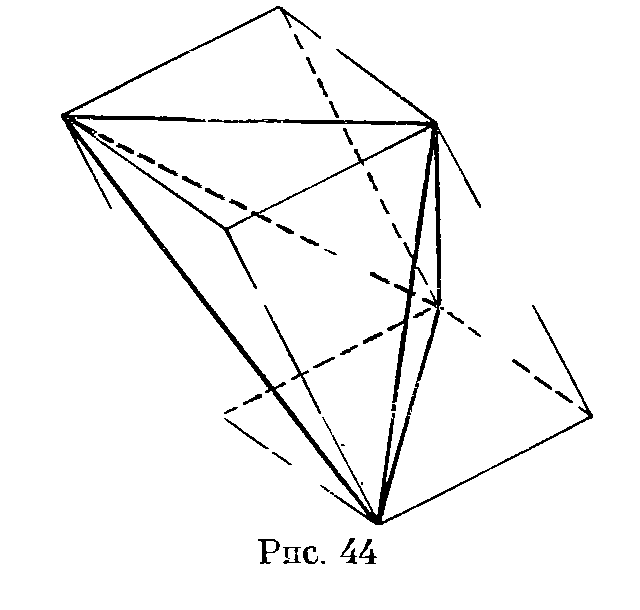

## 6.6. Достраивание тетраэдра

---
**стр. 106, продолжение**
---

## § 6. Достраивание тетраэдра

Проведя через каждое ребро тетраэдра плоскость, параллельную противоположному ребру, тетраэдр можно достроить до параллелепипеда (рис. 44).

**6.47.** Три отрезка, не лежащих в одной плоскости, пересекаются в точке $O$, делящей каждый из них пополам. Докажите, что существуют ровно два тетраэдра, в которых эти отрезки соединяют середины противоположных ребер.

**6.48.** Докажите, что все грани тетраэдра равны тогда и только тогда, когда выполняется одно из следующих условий:

а) при достраивании тетраэдра получается прямоугольный параллелепипед;

б) отрезки, соединяющие середины противоположных ребер, перпендикулярны;

в) площади всех граней равны;

г) центр масс и центр вписанной сферы совпадают.

**6.49.** Докажите, что в равногранном тетраэдре все плоские углы острые.

**6.50.** Докажите, что сумма квадратов длин ребер тетраэдра равна учетверенной сумме квадратов расстояний между серединами его противоположных ребер.

**6.51.** Пусть $a$ и $a_1$, $b$ и $b_1$, $c$ и $c_1$ — длины пар противоположных ребер тетраэдра; $\alpha$, $\beta$, $\gamma$ — соответственные углы между ними $(\alpha,\beta,\gamma\leqslant90^\circ)$. Докажите, что

---
**стр. 107**
---

одно из трех чисел $aa_1\cos\alpha$, $bb_1\cos\beta$ и $cc_1\cos\gamma$ — сумма двух других.

**6.52.** Прямая $l$ проходит через середины ребер $AB$ и $CD$ тетраэдра $ABCD$; плоскость $\Pi$, содержащая $l$, пересекает ребра $BC$ и $AD$ в точках $M$ и $N$. Докажите, что прямая $l$ делит отрезок $MN$ пополам.

**6.53.** Докажите, что прямые, соединяющие середину высоты правильного тетраэдра с вершинами грани, на которую эта высота опущена, попарно перпендикулярны.
