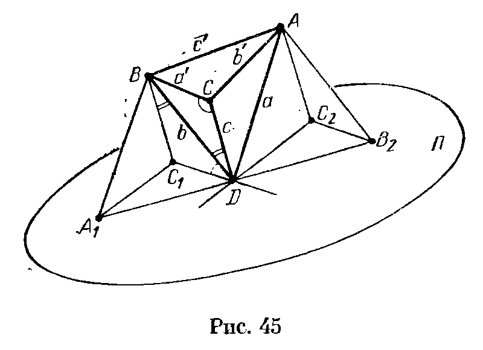
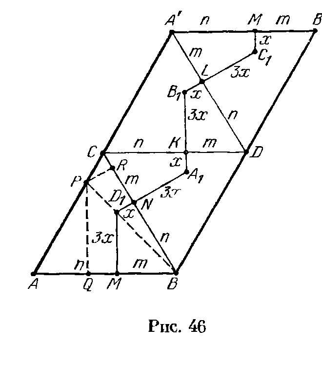
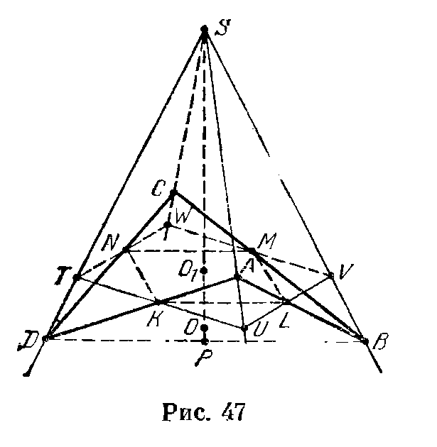
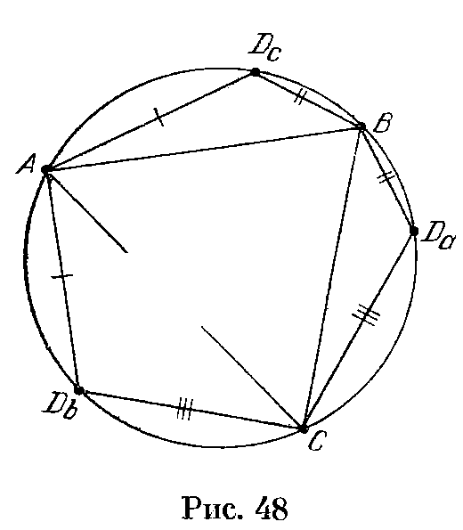
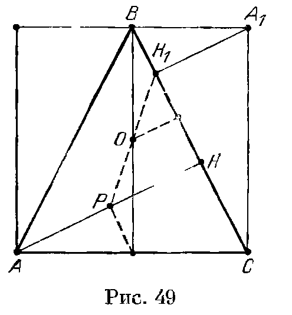
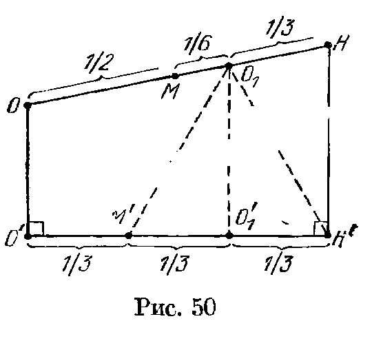
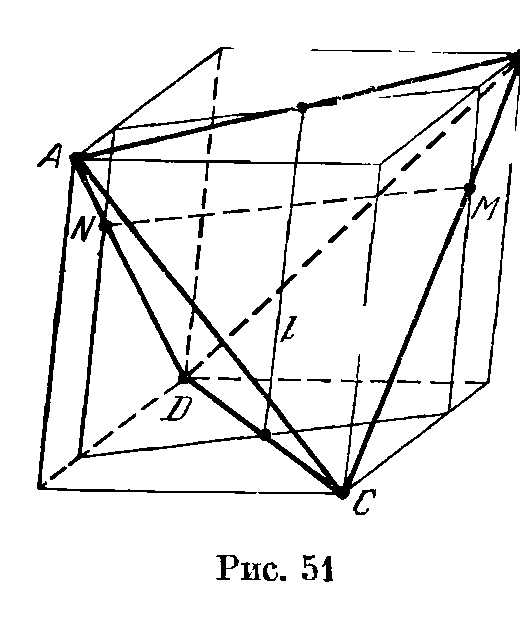
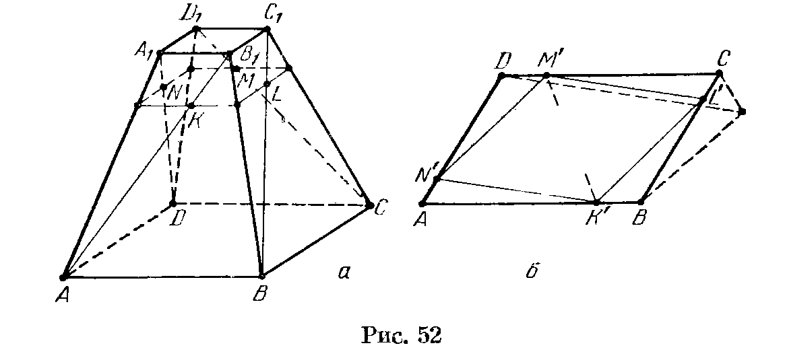

## 6.9. Решения

---
**стр. 110, продолжение**
---

## Решения

**6.1.** Нет, не в любом. Рассмотрим треугольник $ABC$, в котором угол $A$ не прямой, и восставим к плоскости треугольника перпендикуляр $AD$. В тетраэдре $ABCD$ высоты, проведенные из вершин $C$ и $D$, не пересекаются.

**6.2.** а) Перпендикуляр, опущенный из вершины $A$ на плоскость $BCD$, принадлежит всем трем данным плоскостям.

б) Легко проверить, что все указанные плоскости проходят через центр описанной сферы тетраэдра.

**6.3.** Пусть $AD=a$, $BD=b$, $CD=c$, $BC=a_1$, $CA=b_1$ и $AB=c_1$. Вычислим длину $m$ медианы $DM$. Пусть $N$ — середина ребра $BC$, $DN=p$ и $AN=q$. Тогда
$$
DM^2+MN^2-2DM\cdot MN\cos\angle DMN=DN^2
$$
и
$$
DM^2+AM^2-2DM\cdot AM\cos\angle DMA=AD^2,
$$
а значит,
$$
m^2+\frac{q^2}{9}-\frac{2mq\cos\varphi}{3}=p^2
$$
и
$$
m^2+\frac{4q^2}{9}+\frac{4mq\cos\varphi}{3}=a^2.
$$

Домножая первое равенство на 2 и складывая его со вторым равенством, получаем
$$
3m^2=a^2+2p^2-\frac{2q^2}{3}.
$$
А так как
$$
p^2=\frac{2b^2+2c^2-a_1^2}{4}
\quad\text{и}\quad
q^2=\frac{2b_1^2+2c_1^2-a_1^2}{4},
$$
то
$$
9m^2=3(a^2+b^2+c^2)-a_1^2-b_1^2-c_1^2.
$$

**6.4.** Достаточно доказать, что если сфера вписана в трехгранный угол, то плоскость, проходящая через точки касания, разделяет вершину $S$ трехгранного угла и центр $O$ вписанной сферы. Плоскость, проходящая через точки касания, совпадает с плоскостью, проходящей через окружность, по которой конус с вершиной $S$ касается данной сферы. Ясно, что эта плоскость разделяет точки $S$ и $O$; для доказательства можно рассмотреть любое сечение, проходящее через точки $S$ и $O$.

**6.5.** Проекция тетраэдра на плоскость, перпендикулярную ребру $a$, является треугольником со сторонами $2S_1/a$, $2S_2/a$ и $b\sin\varphi$; угол между первыми двумя сторонами равен $\alpha$. Записав теорему косинусов для этого треугольника, получаем требуемое.

---
**стр. 111**
---

**6.6.** Рассмотрим тетраэдр $ABCD$. Пусть $AB=a$, $CD=b$; $\alpha$ и $\beta$ — двугранные углы при ребрах $AB$ и $CD$; $S_1$ и $S_2$ — площади граней $ABC$ и $ABD$, $S_3$ и $S_4$ — площади граней $CDA$ и $CDB$; $V$ — объем тетраэдра. Согласно задаче 3.3

$$V=\frac{2S_1S_2\sin\alpha}{3a}\quad\text{и}\quad V=\frac{2S_3S_4\sin\beta}{3b}.$$

Следовательно,

$$ab:\sin\alpha\sin\beta=4S_1S_2S_3S_4:9V^2.$$

**6.7.** а) Пусть $\alpha$, $\beta$ и $\gamma$ — двугранные углы при ребрах грани с площадью $S_1$. Тогда

$$S_1=S_2\cos\alpha+S_3\cos\beta+S_4\cos\gamma$$

(см. задачу 2.13). Кроме того, согласно задаче 6.5

$$
\begin{aligned}
S_1^2+S_2^2-2S_1S_2\cos\alpha&=P_1^2,\\
S_1^2+S_3^2-2S_1S_3\cos\beta&=P_2^2,\\
S_1^2+S_4^2-2S_1S_4\cos\gamma&=P_3^2.
\end{aligned}
$$

Следовательно,

$$
\begin{aligned}
P_1^2+P_2^2+P_3^2
&=S_2^2+S_3^2+S_4^2+3S_1^2\\
&\quad-2S_1(S_2\cos\alpha+S_3\cos\beta+S_4\cos\gamma)\\
&=S_1^2+S_2^2+S_3^2+S_4^2.
\end{aligned}
$$

б) Поделив обе части полученного в задаче а) равенства на $9V^2$, где $V$ — объем тетраэдра, приходим к требуемому.

**6.8.** Доказательство проведем сначала в случае, когда центр описанного шара находится внутри тетраэдра. Прежде всего докажем, что

$$l_i^2-R_i^2=2h_id_i,$$

где $d_i$ — расстояние от центра описанного шара до $i$-й грани, $h_i$ — высота тетраэдра, опущенная на эту грань. Для определенности будем считать, что номер $i$ соответствует грани $ABC$. Пусть $O$ — центр описанной сферы тетраэдра $ABCD$, $O_1$ — проекция $O$ на грань $ABC$, $DH$ — высота, $H_1$ — проекция $O$ на $DH$. Тогда

$$O_1H^2=DO_1^2-DH^2=l_i^2-h_i^2$$

и

$$OH_1^2=DO^2-DH_1^2=R^2-(h_i-d_i)^2=R^2-d_i^2+2h_id_i-h_i^2,$$

где $R$ — радиус описанной сферы тетраэдра. Так как $O_1H=OH_1$, то

$$l_i^2-R^2+d_i^2=2h_id_i.$$

Остается заметить, что

$$R_i^2=AO_1^2=AO^2-OO_1^2=R^2-d_i^2.$$

Завершают доказательство следующие преобразования:

$$
\sum S_i^2(l_i^2-R_i^2)
=\sum 2S_i^2h_id_i
=\sum 2S_i^2h_i^2(d_i/h_i)
=18V^2\sum(d_i/h_i).
$$

Согласно задаче 8.1,б

$$\sum(d_i/h_i)=1.$$

В случае, когда центр описанного шара находится вне тетраэдра, рассуждения почти не изменяются; нужно только одну из величин $d_i$ считать отрицательной.

**6.9.** Пусть длины ребер $AD$, $BD$ и $CD$ равны $a$, $b$ и $c$; длины ребер $BC$, $CA$ и $AB$ равны $a'$, $b'$ и $c'$. Проведем через вершину $D$ плоскость $\Pi$, касающуюся описанной около тетраэдра сферы. Рассмотрим тетраэдр $A_1BC_1D$, образованный плоскостями $\Pi$, $BCD$, $ABD$ и плоскостью, проходящей через вершину $B$ параллельно плоскости $ACD$, и тетраэдр $AB_2C_2D$, образованный

---
**стр. 112**
---

плоскостями $\Pi$, $ABD$, $ACD$ и плоскостью, проходящей через вершину $A$ параллельно плоскости $BCD$ (рис. 45).

Так как $DC_1$ — касательная к описанной окружности треугольника $DBC$, то $\angle BDC_1=\angle BCD$. Кроме того, $BC_1\parallel CD$, поэтому $\angle C_1BD=\angle BDC$. Следовательно, $\triangle DC_1B\sim\triangle CBD$, а значит,

$$DC_1:DB=CB:CD,$$

т. е. $DC_1=a'b/c$. Аналогично

$$DA_1=c'b/a,\qquad DC_2=b'a/c,\qquad DB_2=c'a/b.$$

А так как $\triangle A_1C_1D\sim\triangle DC_2B_2$, то

$$A_1C_1:A_1D=DC_2:DB_2,$$

т. е.

$$A_1C_1=\frac{b'b^2}{ac}.$$

Итак, длины сторон треугольника $A_1C_1D$, домноженные на $ac/b$, равны $a'a$, $b'b$ и $c'c$, а значит,

$$S_{A_1C_1D}=\frac{b^2}{a^2c^2}S.$$

Вычислим теперь объем тетраэдра $A_1BC_1D$. Рассмотрим для этого диаметр $DM$ описанной сферы исходного тетраэдра и перпендикуляр $BK$, опущенный на плоскость $A_1C_1D$. Ясно, что $BK\perp DK$ и $DM\perp DK$. Опустим из середины $O$ отрезка $DM$ перпендикуляр $OL$ на отрезок $DB$. Так как $\triangle BDK\sim\triangle DOL$, то

$$BK:BD=DL:DO,$$

т. е. $BK=b^2/2R$. Поэтому

$$V_{A_1BC_1D}=\frac13BK\cdot S_{A_1C_1D}=\frac{b^4}{6Ra^2c^2}S.$$

Отношение объемов тетраэдров $A_1BC_1D$ и $ABCD$ равно произведению отношения площадей граней $BC_1D$ и $BCD$ и отношения длин высот, опущенных на эти грани; последнее отношение равно $S_{A_1BD}:S_{ABD}$. Так как $\triangle DC_1B\sim\triangle CBD$, то

$$S_{BC_1D}:S_{BCD}=(DB:CD)^2=b^2:c^2.$$

Аналогично

$$S_{A_1BD}:S_{ABD}=b^2:a^2.$$

Следовательно,

$$V=\frac{a^2c^2}{b^4}V_{A_1BC_1D}
=\frac{a^2c^2}{b^4}\cdot\frac{b^4}{6Ra^2c^2}S
=\frac{S}{6R}.$$

---
**стр. 113**
---

**6.10.** Пусть $S_1$ и $S_2$ — площади граней с общим ребром $a$, $S_3$ и $S_4$ — площади граней с общим ребром $b$. Пусть, далее, $a$, $m$ и $n$ — длины ребер грани с площадью $S_1$; $\alpha$, $\gamma$ и $\delta$ — величины двугранных углов при этих ребрах, $h_1$ — длина высоты, опущенной на эту грань; $H$ — основание этой высоты; $V$ — объем тетраэдра. Соединяя точку $H$ с вершинами грани $S_1$, получаем три треугольника. Выражая площадь грани $S_1$ через площади этих треугольников, получаем

$$ah_1\operatorname{ctg}\alpha+mh_1\operatorname{ctg}\gamma+nh_1\operatorname{ctg}\delta=2S_1$$

(так как углы $\alpha$, $\gamma$ и $\delta$ изменяются от $0^\circ$ до $180^\circ$, эта формула остается справедливой и в том случае, когда точка $H$ лежит вне грани). Учитывая, что $h_1=3V/S_1$, получаем

$$a\operatorname{ctg}\alpha+m\operatorname{ctg}\gamma+n\operatorname{ctg}\delta=\frac{2S_1^2}{3V}.$$

Сложив такие равенства для граней $S_1$ и $S_2$ и вычтя из них равенства для остальных граней, получим

$$a\operatorname{ctg}\alpha-b\operatorname{ctg}\beta=\frac{S_1^2+S_2^2-S_3^2-S_4^2}{3V}.$$

Возведем это равенство в квадрат, заменим $\operatorname{ctg}^2\alpha$ и $\operatorname{ctg}^2\beta$ на $1/\sin^2\alpha-1$ и $1/\sin^2\beta-1$ и воспользуемся равенствами

$$\frac{a^2}{\sin^2\alpha}=\frac{4S_1^2S_2^2}{9V^2},\qquad
\frac{b^2}{\sin^2\beta}=\frac{4S_3^2S_4^2}{9V^2}$$

(см. задачу 3.3). В итоге получим

$$a^2+b^2+2ab\operatorname{ctg}\alpha\operatorname{ctg}\beta=\frac{2Q-T}{9V^2},$$

где $Q$ — сумма квадратов попарных произведений площадей граней, $T$ — сумма четвертых степеней площадей граней.

**6.11.** Пусть $V$ — объем тетраэдра; $S_1$, $S_2$, $S_3$ и $S_4$ — площади его граней. Если расстояние от точки $O$ до $i$-й грани равно $h_i$, то

$$\frac{\sum\varepsilon_i h_iS_i}{3}=V,$$

где $\varepsilon_i=+1$, если точка $O$ и тетраэдр лежат по одну сторону от $i$-й грани, и $\varepsilon_i=-1$ в противном случае. Следовательно, если $r$ — радиус шара, касающегося всех плоскостей граней тетраэдра, то

$$\frac{\left(\sum\varepsilon_iS_i\right)r}{3}=V,$$

т. е.

$$\sum\varepsilon_iS_i>0.$$

Обратно, если для данного набора $\varepsilon_i=\pm1$ величина $\sum\varepsilon_iS_i$ положительна, то существует соответствующий шар. В самом деле, рассмотрим точку, для которой

$$h_1=h_2=h_3=r,$$

где

$$r=\frac{3V}{\sum\varepsilon_iS_i}$$

(иными словами, мы рассматриваем точку пересечения трех плоскостей). Для этой точки $h_4$ также равно $r$.

Для любого тетраэдра существует вписанный шар ($\varepsilon_i=1$ при всех $i$). Кроме того, так как площадь любой грани меньше суммы площадей остальных граней (задача 10.22), то существует 4 вневписанных шара, каждый из которых касается одной грани и продолжений трех других граней (одно из чисел $\varepsilon_i$ равно $-1$).

---
**стр. 114**
---

Ясно также, что если для некоторого набора $\varepsilon_i=\pm1$ величина $\sum\varepsilon_iS_i$ положительна, то для набора с противоположными знаками она отрицательна. Так как всего наборов $2^4=16$, то шаров не более 8. Ровно 8 их будет в том случае, когда сумма площадей любых двух граней не равна сумме площадей двух других граней.

**6.12.** Возьмем на луче $AS$ точку $A_1$ так, что $AA_1=2AS$. В пирамиде $SA_1BC$ двугранные углы при ребрах $SA_1$ и $SC$ равны и $SA_1=SC$, поэтому $A_1B=CB=a$. Треугольник $ABA_1$ прямоугольный, так как его медиана $BS$ равна половине стороны $AA_1$. Следовательно,

$$
AA_1^2=A_1B^2+AB^2=a^2+c^2,\quad\text{т. е.}\quad AS=\frac{\sqrt{a^2+c^2}}2.
$$

**6.13.** Если в тетраэдре $ABCD$ сумма длин ребер $AB$ и $CD$ равна сумме длин ребер $BC$ и $AD$, то существует сфера, касающаяся этих четырех ребер во внутренних точках (см. задачу 8.30). Пусть $O$ — центр этой сферы. Заметим теперь, что если из точки $X$ проведены касательные $XP$ и $XQ$ к сфере с центром $O$, то точки $P$ и $Q$ симметричны относительно плоскости, проходящей через прямую $XO$ и середину отрезка $PQ$, а значит, плоскости $POX$ и $QOX$ образуют с плоскостью $XPQ$ равные углы.

Проведем 4 плоскости, проходящие через точку $O$ и рассматриваемые ребра тетраэдра. Они разбивают каждый из рассматриваемых двугранных углов на 2 двугранных угла. Выше было показано, что полученные двугранные углы, прилегающие к одной грани тетраэдра, равны. Как в одну, так и в другую рассматриваемую сумму двугранных углов входит по одному полученному углу для каждой грани тетраэдра.

**6.14.** Пусть $a$ — длина наибольшего ребра тетраэдра. В обоих гранях, прилегающих к этому ребру, оно является гипотенузой. Эти грани равны, так как подобные прямоугольные треугольники с общей гипотенузой равны; пусть $m$ и $n$ — длины катетов этих прямоугольных треугольников, $b$ — длина шестого ребра тетраэдра. Возможны два варианта:

1) Ребра длиной $m$ выходят из одного конца ребра $a$, ребра длиной $n$ — из другого. В треугольнике со сторонами $m$, $m$ и $b$ прямым может быть только угол, противолежащий $b$; кроме того, в треугольнике со сторонами $a$, $m$ и $n$ катеты тоже должны быть равны, т. е. $m=n$. В итоге получаем, что все грани тетраэдра равны.

2) Из каждого конца ребра $a$ выходит одно ребро длиной $m$ и одно ребро длиной $n$. При этом, если $a=b$, тетраэдр тоже будет равногранный.

---
**стр. 115**
---

Заметим теперь, что в равногранном тетраэдре не может быть прямых плоских углов (задача 6.49). Следовательно, в действительности возможен только второй вариант, причем $b<a$. Пусть для определенности $m\geqslant n$. Так как треугольники со сторонами $a,m,n$ и $m,n,b$ подобны, причем наименьшей стороной второго треугольника не может быть сторона $n$, то
$$
a:m=m:n=n:b=\lambda>1.
$$
Учитывая, что $a^2=m^2+n^2$, получаем $\lambda^4=\lambda^2+1$, т. е.
$$
\lambda=\sqrt{\frac{1+\sqrt5}{2}}.
$$

**6.15.** Опустим перпендикуляры $A_1K$ и $B_1K$ на $CD$, $B_1L$ и $C_1L$ на $AD$, $C_1M$ и $D_1M$ на $AB$, $D_1N$ и $A_1N$ на $BC$. Отношения

длин этих перпендикуляров равны косинусу двугранного угла при ребре правильного тетраэдра, т. е. они равны $1/3$ (см. задачу 2.14). Так как стороны четырехугольника $A_1B_1C_1D_1$ перпендикулярны граням правильного тетраэдра, их длины равны (см. задачу 8.25). Следовательно,
$$
A_1K=B_1L=C_1M=D_1N=x
$$
и
$$
B_1K=C_1L=D_1M=A_1N=3x.
$$
Рассмотрим развертку тетраэдра (рис. 46). Ребра тетраэдра разделены точками $K,L,M$ и $N$ на отрезки длиной $m$ и $n$. Так как
$$
x^2+n^2=D_1B^2=9x^2+m^2,
$$
то
$$
8x^2=n^2-m^2=(n+m)(n-m)=a(n-m).
$$
Пусть луч $BD_1$ пересекает сторону $AC$ в точке $P$; $Q$ и $R$ — проекции точки $P$ на стороны $AB$ и $BC$. Так как $PR:PQ=1:3$, то $CP:PA=1:3$. Поэтому
$$
\frac{BR}{CB}=\frac12+\frac38=\frac78
$$
и
$$
\frac{BQ}{AB}=\frac12+\frac18=\frac58.
$$
Следовательно, $n:m=BR:BQ=7:5$, а значит, $x=a\sqrt3/4$. Длины сторон четырехугольника $A_1B_1C_1D_1$ равны $2\sqrt2x=a/\sqrt6$.

---
**стр. 116**
---

**6.16.** По условию $KLMN$ — квадрат. Проведем через точки $K,L,M$ и $N$ плоскости, касающиеся сферы. Так как все эти плоскости одинаково наклонены к плоскости $KLMN$, то они пересекаются в одной точке $S$, расположенной на прямой $OO_1$, где $O$ — центр сферы, а $O_1$ — центр квадрата. Эти плоскости пересекают плоскость квадрата $KLMN$ по квадрату $TUVW$, серединами сторон которого являются точки $K,L,M$ и $N$ (рис. 47).

В четырехгранном угле $STUVW$ с вершиной $S$ все плоские углы равны, а точки $K,L,M$ и $N$ лежат на биссектрисах его плоских углов, причем
$$
SK=SL=SM=SN.
$$
Следовательно, $SA=SC$ и $SD=SB$, а значит,
$$
AK=AL=CM=CN
$$
и
$$
BL=BM=DN=DK.
$$
По условию $AC$ тоже касается шара, поэтому
$$
AC=AK+CN=2AK.
$$
А так как $SK$ — биссектриса угла $DSA$, то
$$
DK:KA=DS:SA=DB:AC.
$$
Из равенства $AC=2AK$ следует теперь, что $DB=2DK$. Пусть $P$ — середина отрезка $DB$; тогда $P$ лежит на прямой $SO$. Треугольники $DOK$ и $DOP$ равны, так как $DK=DP$ и $\angle DKO=90^\circ=\angle DPO$. Поэтому $OP=OK=R$, где $R$ — радиус сферы, а значит, $DB$ тоже касается сферы.

**6.17. а)** Пусть $BC=a$, $CA=b$, $AB=c$, $DA=a_1$, $DB=b_1$ и $DC=c_1$. Пусть, далее, $G$ — точка пересечения медиан треугольника $ABC$, $N$ — точка пересечения прямой $DM$ с описанной сферой, $K$ — точка пересечения прямой $AG$ с описанной окружностью треугольника $ABC$. Докажем сначала, что
$$
AG\cdot GK=\frac{a^2+b^2+c^2}{9}.
$$
В самом деле,
$$
AG\cdot GK=R^2-O_1G^2,
$$
где $R$ — радиус описанной окружности треугольника $ABC$, $O_1$ — ее центр. Но
$$
O_1G^2=R^2-\frac{a^2+b^2+c^2}{9}
$$
(см. Шарыгин, II.193,б). Далее,
$$
DG\cdot GN=AG\cdot GK=\frac{a^2+b^2+c^2}{9},
$$
а значит,
$$
GN=\frac{a^2+b^2+c^2}{9m},
$$
где
$$
m=DG=\frac{\sqrt{3(a_1^2+b_1^2+c_1^2)-a^2-b^2-c^2}}{3}. \tag{1}
$$
(см. задачу 6.3). Поэтому
$$
DN=DG+GN=m+\frac{a^2+b^2+c^2}{9m}
=\frac{a_1^2+b_1^2+c_1^2}{3m}.
$$

Перпендикулярность прямых $DM$ и $OM$ эквивалентна равенству $DN=2DM$, т. е.
$$
\frac{a_1^2+b_1^2+c_1^2}{3m}=\frac{3m}{2}.
$$
Выражая $m$ по формуле (1), получаем требуемое.

---
**стр. 117**
---

б) Воспользуемся обозначениями задачи а) и ее результатом. Пусть $x=a_1^2+b_1^2+c_1^2$ и $y=a^2+b^2+c^2$. Требуется проверить, что $x=y$. Пусть, далее, $A_1$, $B_1$ и $C_1$ — точки пересечения медиан треугольников $DBC$, $DAC$ и $DAB$. При гомотетии с центром $D$ и коэффициентом $3/2$ точка пересечения медиан треугольника $A_1B_1C_1$ переходит в точку пересечения медиан треугольника $ABC$. Поэтому $M$ — точка пересечения продолжения медианы $DX$ тетраэдра $A_1B_1C_1D$ с описанной сферой этого тетраэдра, а значит, для вычисления длины отрезка $DM$ можно воспользоваться формулой для $DN$, полученной в задаче а):

$$DM=(DA_1^2+DB_1^2+DC_1^2)/3DX.$$

Ясно, что $DX=2m/3$; выражая $DA_1$, $DB_1$ и $DC_1$ через медианы, а медианы через стороны, получаем $DA_1^2+DB_1^2+DC_1^2=(4x-y)/9$. Следовательно, $DM=(4x-y)/18m$. С другой стороны, $DM=3m/4$, поэтому $2(4x-y)=27m^2$. Согласно формуле (1) $9m^2=3x-y$, а значит, $2(4x-y)=3(3x-y)$, т. е. $x=y$.

**6.18.** Пусть $CD=a$. Тогда $AC=a/\sin\alpha$, $BC=a/\sin\beta$ и $AB=a\sqrt{\operatorname{ctg}^2\alpha+\operatorname{ctg}^2\beta}$. Учитывая, что $AB^2=AC^2+BC^2-2AC\cdot BC\cos\varphi$, получаем требуемое.

**6.19.** Рассмотрим прямоугольный параллелепипед, ребра $AB$, $AD$ и $AA_1$ которого являются ребрами данного тетраэдра. Отрезок, соединяющий середины ребер $AB$ и $A_1D$, является средней линией треугольника $ABD_1$ (параллельной $BD_1$); следовательно, его длина равна $d/2$, где $d$ — длина диагонали параллелепипеда.

**6.20.** Так как $S_{ABC}^2=S_{ABD}^2+S_{BCD}^2+S_{ACD}^2$ (см. задачу 1.22), то $S_{ABC}=\sqrt{a^2b^2+b^2c^2+a^2c^2}/2$. Следовательно, объем тетраэдра равен $h\sqrt{a^2b^2+b^2c^2+a^2c^2}/6$. С другой стороны, он равен $abc/6$. Приравнивая эти выражения, получаем требуемое.

**6.21.** Возьмем на лучах $AC$ и $AD$ точки $P$ и $R$ так, что $AP=AR=AB$, и рассмотрим квадрат $APQR$. Ясно, что $\triangle ABC=\triangle RQD$ и $\triangle ABD=\triangle PQC$, а значит, $\triangle BCD=\triangle QDC$. Таким образом, сумма плоских углов при вершине $B$ равна $\angle PQC+\angle CQD+\angle DQR=\angle PQR=90^\circ$.

**6.22.** Для каждого ребра тетраэдра существует лишь одно несмежное с ним ребро, поэтому среди любых трех ребер найдутся два смежных. Заметим теперь, что прямыми не могут быть три двугранных угла при ребрах одной грани. Следовательно, возможны два варианта расположения трех ребер, двугранные углы при которых прямые: 1) эти ребра выходят из одной вершины; 2) два ребра выходят из концов одного ребра.

---
**стр. 118**
---

В первом случае достаточно воспользоваться результатом задачи 5.2.

Рассмотрим второй случай: двугранные углы при ребрах $AB$, $BC$ и $CD$ прямые. Тогда тетраэдр $ABCD$ выглядит следующим образом: в треугольниках $ABC$ и $BCD$ углы $ACB$ и $CBD$ прямые и угол между плоскостями этих треугольников тоже прямой. В этом случае углы $ACB$, $ACD$, $ABD$ и $CBD$ прямые.

**6.23.** Согласно решению задачи 6.22 возможны два варианта.

1) Все плоские углы при одной вершине тетраэдра прямые. Но в этом случае длины всех отрезков, соединяющих середины противоположных ребер, равны (задача 6.19).

2) Двугранные углы при ребрах $AB$, $BC$ и $CD$ прямые. В этом случае ребра $AC$ и $BD$ перпендикулярны граням $CBD$ и $ABC$ соответственно. Пусть $AC=2x$, $BC=2y$ и $BD=2z$. Тогда длина отрезка, соединяющего середины ребер $AB$ и $CD$, и отрезка, соединяющего середины ребер $BC$ и $AD$, равна $\sqrt{x^2+z^2}$, а длина отрезка, соединяющего середины ребер $AC$ и $BD$, равна $\sqrt{x^2+4y^2+z^2}$. Поэтому $x^2+z^2=a^2$ и $x^2+4y^2+z^2=b^2$. Наибольшим ребром тетраэдра $ABCD$ является ребро $AD$; квадрат его длины равен $4(x^2+y^2+z^2)=b^2+3a^2$.

**6.24.** Как следует из решения задачи 6.22, можно считать, что вершинами данного тетраэдра являются вершины $A_1$, $B$, $D$ и $D_1$ прямоугольного параллелепипеда $ABCDA_1B_1C_1D_1$. Пусть $\alpha$ — искомый угол; $AB=a$, $AD=b$ и $DD_1=c$. Тогда $a=b\operatorname{tg}\alpha$ и $c=b\operatorname{tg}\alpha$. Косинус угла между плоскостями $BB_1D$ и $ABC_1$ равен

$$\frac{ac}{\sqrt{a^2+b^2}\sqrt{b^2+c^2}}=\frac{\operatorname{tg}^2\alpha}{1+\operatorname{tg}^2\alpha}=\sin^2\alpha$$

(см. задачу 1.9,а). Следовательно, $\cos\alpha=\sin^2\alpha=1-\cos^2\alpha$, т. е. $\cos\alpha=(-1\pm\sqrt5)/2$. Так как $1+\sqrt5>2$, окончательно получаем $\alpha=\arccos((\sqrt5-1)/2)$.

**6.25.** а) Пусть $AB=CD$, $AC=BD$ и сумма плоских углов при вершине $A$ равна $180^\circ$. Докажем, что $AD=BC$. Для этого достаточно проверить, что $\angle ACD=\angle BAC$. Но как сумма углов треугольника $ACD$, так и сумма плоских углов при вершине $A$ равны $180^\circ$; кроме того, $\angle DAB=\angle ADC$, так как $\triangle DAB=\triangle ADC$.

б) Пусть $O_1$ и $O_2$ — точки касания вписанной сферы с гранями $ABC$ и $BCD$. Тогда $\triangle O_1BC=\triangle O_2BC$. Из условия задачи следует, что $O_1$ и $O_2$ — центры описанных окружностей указанных граней. Поэтому $\angle BAC=\angle BO_1C/2=\angle BO_2C/2=\angle BDC$. Аналогичные рассуждения показывают, что каждый из плоских

---
**стр. 119**
---

углов при вершине $D$ равен соответствующему углу треугольника $ABC$, а значит, их сумма равна $180^\circ$. Это утверждение справедливо для всех вершин тетраэдра. Остается воспользоваться результатом задачи 2.32,а.

в) Углы $ADB$ и $ACB$ опираются на равные хорды в равных окружностях, поэтому они равны или составляют в сумме $180^\circ$. Предположим сначала, что для каждой пары углов граней тетраэдра, опирающихся на одно ребро, имеет место равенство углов. Тогда, например, сумма плоских углов при вершине $D$ равна сумме углов треугольника $ABC$, т. е. равна $180^\circ$. Сумма плоских углов при любой вершине тетраэдра равна $180^\circ$, поэтому он равногранный (см. задачу 2.32,а).

Докажем теперь, что случай, когда углы $ADB$ и $ACB$ не равны, невозможен. Предположим, что $\angle ADB+\angle ACB=180^\circ$ и $\angle ADB\ne\angle ACB$. Пусть для определенности угол $ADB$ тупой. Поверхность тетраэдра $ABCD$ можно так «развернуть» на плоскость $ABC$, что образы $D_a$, $D_b$ и $D_c$ точки $D$ попадут на описанную окружность треугольника $ABC$; при этом направление поворота боковой грани вокруг ребра основания выбирается в соответствии с тем, равны ли углы, опирающиеся на это ребро, или же они составляют в сумме $180^\circ$. В процессе разворачивания точка $D$ движется по окружностям, плоскости которых перпендикулярны прямым $AB$, $BC$ и $CA$. Эти окружности лежат в разных плоскостях, поэтому любые две из них имеют не более двух общих точек. Но две общих точки есть у каждой пары этих окружностей: точка $D$ и точка, симметричная ей относительно плоскости $ABC$. Следовательно, точки $D_a$, $D_b$ и $D_c$ попарно различны. Кроме того, $AD_b=AD_c$, $BD_a=BD_c$ и $CD_a=CD_b$. Развертка выглядит следующим образом: в окружность вписан треугольник $AD_cDC$ с тупым углом $D_c$; из точек $A$ и $B$ проведены хорды $AD_b$ и $BD_a$, равные $AD_c$ и $BD_c$ соответственно; $C$ — середина одной из двух дуг, заданных точками $D_a$ и $D_b$. Одна из середин этих двух дуг симметрична точке $D_c$ относительно прямой, проходящей через середину отрезка $AB$ перпендикулярно ему; эта точка нам не подходит. Искомая развертка изображена на рис. 48. Углы при вершинах $D_a$, $D_b$ и $D_c$ шестиугольника $AD_cBD_aCD_b$ дополняют до $180^\circ$ углы треугольника $ABC$, поэтому их сумма равна $360^\circ$. Но эти углы равны плоским углам при вершине $D$ тетраэдра $ABCD$, поэтому их сумма меньше $360^\circ$. Получено противоречие.

<!-- Рисунок 48 упомянут в тексте, но на странице 119 отсутствует. -->

г) Пусть $K$ и $L$ — середины ребер $AB$ и $CD$, $O$ — центр масс тетраэдра, т. е. середина отрезка $KL$. Так как $O$ — центр описанной сферы тетраэдра, то треугольники $AOB$ и $COD$ равнобедренные, с равными боковыми сторонами и равными медианами $OK$ и $OL$. Поэтому $\triangle AOB=\triangle COD$, а значит, $AB=$

---
**стр. 120**
---

$=CD$. Аналогично доказывается равенство других пар противоположных ребер.

**6.26.** Трехгранные углы при вершинах $A$ и $C$ имеют равные двугранные углы, поэтому они равны (задача 5.3). Следовательно, равны их плоские углы, а значит, $\triangle ABC=\triangle CDA$.

**6.27.** Центр масс тетраэдра лежит на прямой, соединяющей середины ребер $AB$ и $CD$. Следовательно, на этой прямой лежит центр описанной сферы тетраэдра, а значит, указанная прямая перпендикулярна ребрам $AB$ и $CD$. Пусть $C'$ и $D'$ — проекции точек $C$ и $D$ на плоскость, проходящую через прямую $AB$ параллельно $CD$. Так как $AC'BD'$ — параллелограмм, то $AC=BD$ и $AD=BC$.

**6.28.** Пусть $K$ и $L$ — середины ребер $AB$ и $CD$. Центр масс тетраэдра лежит на прямой $KL$, поэтому центр вписанной сферы также лежит на прямой $KL$. Следовательно, при проекции на плоскость, перпендикулярную $CD$, отрезок $KL$ переходит в биссектрису треугольника, являющегося проекцией грани $ABC$. Ясно также, что проекция точки $K$ является серединой проекции отрезка $AB$. Поэтому проекции отрезков $KL$ и $AB$ перпендикулярны, а значит, плоскость $KDC$ перпендикулярна плоскости $\Pi$, проходящей через ребро $AB$ параллельно $CD$. Аналогично плоскость $LAB$ перпендикулярна $\Pi$. Следовательно, прямая $KL$ перпендикулярна $\Pi$. Пусть $C'$ и $D'$ — проекции точек $C$ и $D$ на плоскость $\Pi$. Так как $AC'BD'$ — параллелограмм, то $AC=BD$ и $AD=BC$.

**6.29.** Пусть $S$ — середина ребра $BC$; $K$, $L$, $M$ и $N$ — середины ребер $AB$, $AC$, $DC$ и $DB$. Тогда $SKLMN$ — четырехгранный угол с равными плоскими углами, а его сечение $KLMN$ — параллелограмм. С одной стороны, четырехгранный угол с равными плоскими углами имеет сечение — ромб (задача 5.16,б); с другой стороны, любые два сечения четырехгранного угла, являющиеся параллелограммами, параллельны (задача 5.16,а). Поэтому $KLMN$ — ромб; кроме того, из решения задачи 5.16,б следует, что $SK=SM$ и $SL=SN$. Это означает, что $AB=DC$ и $AC=DB$. Следовательно, $\triangle BAC=\triangle ABD$ и $BC=AD$.

**6.30.** Точка касания вписанной сферы с гранью $ABC$ совпадает с проекцией $H$ точки $O_d$ (центра сферы) на плоскость

---
**стр. 121**
---

$ABC$. Так как трехгранный угол $O_dABC$ прямой, то $H$ — точка пересечения высот треугольника $ABC$ (см. задачу 2.11).

Пусть $O$ — точка касания вписанной сферы с гранью $ABC$. Из результата задачи 5.13,б следует, что прямые, соединяющие точки $O$ и $H$ с вершинами треугольника $ABC$, симметричны относительно его биссектрис. Нетрудно доказать, что это означает, что $O$ — центр описанной окружности треугольника $ABC$ (доказательство достаточно провести для остроугольного треугольника, так как точка $H$ принадлежит грани). Таким образом, точка касания вписанной сферы с гранью $ABC$ совпадает с центром описанной окружности этой грани; для остальных граней доказательство этого проводится аналогично. Остается воспользоваться результатом задачи 6.25,б.

**6.31.** Достроим данный тетраэдр до прямоугольного параллелепипеда (см. задачу 6.48,а); пусть $x$, $y$ и $z$ — ребра этого параллелепипеда. Тогда
$$
x^2+y^2=a^2,\qquad y^2+z^2=b^2\qquad\text{и}\qquad z^2+x^2=c^2.
$$
Так как $R=d/2$, где $d$ — диагональ параллелепипеда, а $d^2=x^2+y^2+z^2$, то
$$
R^2=(x^2+y^2+z^2)/4=(a^2+b^2+c^2)/8.
$$

Складывая равенства $x^2+y^2=a^2$ и $z^2+x^2=c^2$ и вычитая из них равенство $y^2+z^2=b^2$, получаем $x^2=(a^2+c^2-b^2)/2$. Аналогично находим $y^2$ и $z^2$. Так как объем тетраэдра в три раза меньше объема параллелепипеда (см. решение задачи 3.4), то
$$
V^2=(xyz)^2/9=(a^2+b^2-c^2)(a^2+c^2-b^2)(b^2+c^2-a^2)/72.
$$

**6.32.** Достроим данный тетраэдр до прямоугольного параллелепипеда (см. задачу 6.48,а). Точка пересечения биссекторных плоскостей двугранных углов тетраэдра (т. е. центр вписанного шара) совпадает с центром $O$ параллелепипеда. Рассматривая проекции на плоскости, перпендикулярные ребрам тетраэдра, легко проверить, что грани тетраэдра удалены от вершин параллелепипеда, отличных от вершин тетраэдра, вдвое больше, чем от точки $O$. Следовательно, эти вершины являются центрами вневписанных шаров. Этим доказаны оба утверждения.

**6.33.** Достроим данный тетраэдр до прямоугольного параллелепипеда. Пусть $AA_1$ — его диагональ, $O$ — его центр. Точка $H_1$ является проекцией точки $A_1$ на грань $BCD$ (см. задачу 2.11), а центр $O_1$ описанной окружности треугольника $BCD$ — проекцией точки $O$. Так как $O$ — середина отрезка $AA_1$, точки $H$ и $H_1$ симметричны относительно $O_1$.

Рассмотрим проекцию параллелепипеда на плоскость, перпендикулярную $BD$ (рис. 49; в дальнейшем решении используются обозначения этого рисунка, а не обозначения в прост-

---
**стр. 122**
---

ранстве). Высота $CC'$ треугольника $BCD$ параллельна плоскости проекции, поэтому длины отрезков $BH_1$ и $CH_1$ равны $h_1$ и $h_2$; длины отрезков $AH$ и $A_1H_1$ при проецировании не изменились. Так как
$$
AH:A_1H_1=AC:A_1B=2
$$
и
$$
A_1H_1:BH_1=CH_1:A_1H_1,
$$
то
$$
AH^2=4H_1A_1^2=4h_1h_2.
$$

**6.34.** Воспользуемся решением предыдущей задачи и обозначениями рис. 49; на этом рисунке $P$ — середина высоты $AH$. Легко проверить, что
$$
OH=OH_1=OP=\sqrt{r^2+a^2},
$$
где $r$ — расстояние от точки $O$ до грани, $a$ — расстояние между центром описанной окружности и точкой пересечения высот грани.

**6.35.** а) Пусть $\mathbf e_1$, $\mathbf e_2$, $\mathbf e_3$ и $\mathbf e_4$ — единичные векторы, перпендикулярные граням и направленные во внешнюю сторону. Так как площади всех граней равны, то
$$
\mathbf e_1+\mathbf e_2+\mathbf e_3+\mathbf e_4=0
$$
(см. задачу 7.19). Следовательно,
$$
0=\lvert\mathbf e_1+\mathbf e_2+\mathbf e_3+\mathbf e_4\rvert^2
 =4+2\sum(\mathbf e_i,\mathbf e_j).
$$
Остается заметить, что скалярное произведение $(\mathbf e_i,\mathbf e_j)$ равно $-\cos\varphi_{ij}$, где $\varphi_{ij}$ — двугранный угол между гранями с номерами $i$ и $j$.

б) Возьмем на одном ребре данного трехгранного угла с вершиной $S$ произвольную точку $A$ и проведем из нее отрезки $AB$ и $AC$ до пересечения с другими ребрами так, что $\angle SAB=\angle ASC$ и $\angle SAC=\angle ASB$. Тогда $\triangle SCA=\triangle ABS$. Так как сумма углов треугольника $ACS$ равна сумме плоских углов при вершине $S$, то $\angle SCA=\angle CSB$. Следовательно, $\triangle SCA=\triangle CSB$, а значит, тетраэдр $ABCS$ равногранный. Согласно задаче а) сумма косинусов двугранных углов при ребрах этого тетраэдра равна 2, а эта сумма в два раза больше суммы косинусов двугранных углов данного трехгранного угла.

**6.36.** а) Пусть $AD\perp BC$. Тогда существует плоскость $\Pi$, проходящая через $BC$ и перпендикулярная $AD$. Высота, опущенная из вершины $B$, перпендикулярна $AD$, поэтому она лежит в плоскости $\Pi$. Аналогично высота, опущенная из вершины $C$, лежит в плоскости $\Pi$. Следовательно, эти высоты пересекаются в одной точке. Эта точка принадлежит также плоскости $\Pi'$, проходящей через $AD$ и перпендикулярной $BC$. Остается заметить, что плоскости $\Pi$ и $\Pi'$ пересекаются по общему перпендикуляру к $AD$ и $BC$.

б) Пусть высоты $BB'$ и $CC'$ пересекаются в одной точке. Каждая из высот $BB'$ и $CC'$ перпендикулярна $AD$. Поэтому

---
**стр. 123**
---

плоскость, содержащая эти высоты, перпендикулярна $AD$, а значит, $BC\perp AD$.

в) Пусть две пары противоположных ребер тетраэдра перпендикулярны. Тогда третья пара противоположных ребер тоже перпендикулярна (задача 7.1).

Следовательно, высоты тетраэдра попарно пересекаются. Если несколько прямых попарно пересекаются, то они лежат в одной плоскости или проходят через одну точку. В одной плоскости высоты тетраэдра лежать не могут, так как иначе в одной плоскости лежали бы и его вершины; поэтому они пересекаются в одной точке.

**6.37.** Из решения задачи 6.36, а следует, что точка пересечения высот принадлежит каждому общему перпендикуляру к противоположным парам ребер.

**6.38.** а) Четырехугольник $KLMN$ — параллелограмм, стороны которого параллельны $AC$ и $BD$. Его диагонали $KM$ и $LN$ равны тогда и только тогда, когда он прямоугольник, т. е. $AC\perp BD$.

Отметим также, что плоскость $KLMN$ перпендикулярна общему перпендикуляру к $AC$ и $BD$ и делит его пополам.

б) Следует из результатов задач 6.38, а и 6.36, в.

**6.39.** а) Так как $BC\perp AD$, то существует плоскость $\Pi$, проходящая через прямую $AD$ и перпендикулярная $BC$; пусть $U$ — точка пересечения прямой $BC$ с плоскостью $\Pi$. Тогда $AU$ и $DU$ — перпендикуляры, опущенные из точек $A$ и $D$ на прямую $BC$.

б) Пусть $AU$ и $DU$ — высоты треугольников $ABC$ и $DBC$. Тогда прямая $BC$ перпендикулярна плоскости $ADU$, а значит, $BC\perp AD$.

**6.40.** а) Следует из задачи 7.2.

б) Воспользовавшись результатами задач 6.6 и 6.10, получаем, что произведения косинусов противоположных двугранных углов равны тогда и только тогда, когда равны суммы квадратов противоположных ребер.

в) Достаточно проверить, что если все углы между противоположными ребрами равны $\alpha$, то $\alpha=90^\circ$. Предположим, что $\alpha\ne90^\circ$, т. е. $\cos\alpha\ne0$. Пусть $a$, $b$ и $c$ — произведения длин пар противоположных ребер. Одно из чисел $a\cos\alpha$, $b\cos\alpha$ и $c\cos\alpha$ равно сумме двух других (задача 6.51). Так как $\cos\alpha\ne0$, то одно из чисел $a$, $b$ и $c$ равно сумме двух других. С другой стороны, существует треугольник, длины сторон которого равны $a$, $b$ и $c$ (задача 6.9). Получено противоречие.

**6.41.** а) Если $ABCD$ — ортоцентрический тетраэдр, то
$AB^2+CD^2=AD^2+BC^2$ (см. задачу 6.40, а). Поэтому $AB^2+$

---
**стр. 124**
---

$+AC^2-BC^2=AD^2+AC^2-CD^2$, т. е. косинусы углов $BAC$ и $DAC$ имеют один знак.

б) Так как в треугольнике не может быть двух не острых углов, то, учитывая результат задачи а), получаем, что если $\angle BAC\geqslant90^\circ$, то треугольник $BCD$ остроугольный.

**6.42.** Пусть $K$ и $L$ — середины ребер $AB$ и $CD$. Точка $H$ лежит в плоскости, проходящей через $CD$ перпендикулярно $AB$, а точка $O$ — в плоскости, проходящей через $K$ перпендикулярно $AB$. Эти плоскости симметричны относительно центра масс $M$ тетраэдра — середины отрезка $KL$. Рассматривая такие плоскости для всех ребер, получаем, что точки $H$ и $O$ симметричны относительно $M$, а значит, $KHLO$ — параллелограмм. Квадраты его сторон равны $R^2-AB^2/4$ и $R^2-CD^2/4$, поэтому
$$OH^2=2(R^2-AB^2/4)+2(R^2-CD^2/4)-d^2=4R^2-(AB^2+CD^2)/2-d^2.$$
Рассматривая сечение, проходящее через точку $M$ параллельно $AB$ и $CD$, получаем, что $AB^2+CD^2=4d^2$.

**6.43.** а) Окружности 9 точек треугольников $ABC$ и $DBC$ принадлежат одной сфере тогда и только тогда, когда основания высот, опущенных из вершин $A$ и $D$ на прямую $BC$, совпадают. Остается воспользоваться результатом задачи 6.39, б.

б) Отрезки, соединяющие середины противоположных ребер, пересекаются в одной точке, делящей их пополам, — центре масс; кроме того, для ортоцентрического тетраэдра их длины равны (задача 6.38, б). Следовательно, все окружности 9 точек граней тетраэдра принадлежат сфере с диаметром, равным длине отрезка, соединяющего середины противоположных ребер, и центром в центре масс тетраэдра.

в) Обе эти сферы проходят через середины ребер $AB$, $BD$, $DC$ и $CA$, а эти точки лежат в указанной плоскости.

**6.44.** Пусть $O$, $M$ и $H$ — центр описанной сферы, центр масс и точка пересечения высот ортоцентрического тетраэдра. Из решения задачи 6.42 следует, что $M$ — середина отрезка $OH$. Центры масс граней тетраэдра являются вершинами тетраэдра, гомотетичного данному с центром гомотетии $M$ и коэффициентом $-1/3$. При этой гомотетии точка $O$ переходит в точку $O_1$, лежащую на отрезке $MH$, причем $MO_1=MO/3$. Следовательно, $HO_1=HO/3$, т. е. точка $O$ переходит в $O_1$ при гомотетии с центром $H$ и коэффициентом $1/3$. При этой гомотетии вершины тетраэдра переходят в указанные точки на высотах тетраэдра. Итак, 8 из 12 данных точек лежат на сфере радиуса $R/3$ с центром $O_1$ ($R$ — радиус описанной сферы тетраэдра). Остается доказать, что на той же сфере лежат точки пересечения высот граней. Пусть $O'$, $H'$ и $M'$ — центр описанной окружности, точка пересечения высот и центр масс какой-либо грани (рис. 50). Точка $M'$ делит отрезок $O'H'$ в отношении $O'M':M'H'=1:2$

---
**стр. 125**
---

(см. Прасолов, 10.4 или Шарыгин, II.147). Теперь легко вычислить, что проекция точки $O_1$ на плоскость этой грани совпадает с серединой отрезка $M'H'$, а значит, точка $O_1$ равноудалена от $M'$ и $H'$.

**6.45.** а) Из решения задачи 6.44 следует, что при гомотетии с центром $H$ и коэффициентом 3 точка $M'$ переходит в точку описанной сферы тетраэдра.

б) Из решения задачи 6.44 следует, что при гомотетии с центром $M$ и коэффициентом $-3$ точка $H'$ переходит в точку описанной сферы тетраэдра.

**6.46.** Так как $AB\perp CD$, то существует плоскость, проходящая через $AB$ и перпендикулярная $CD$. В этой плоскости лежит как точка пересечения высот, опущенных из вершин $A$ и $B$, так и точка Монжа. Если провести такие плоскости через все ребра, то они будут иметь единственную общую точку.

**6.47.** Рассмотрим тетраэдр, в котором данные отрезки соединяют середины противоположных ребер, и достроим его до параллелепипеда. Ребра этого параллелепипеда параллельны данным отрезкам, а его грани проходят через их концы. Следовательно, этот параллелепипед однозначно определяется данными отрезками, а до одного и того же параллелепипеда достраиваются ровно два тетраэдра.

**6.48.** а) Диагоналями противоположных граней полученного параллелепипеда являются два противоположных ребра тетраэдра. Эти грани будут прямоугольниками тогда и только тогда, когда противоположные ребра равны.

Результат этой задачи используется при решении задач 6—г.

б) Достаточно заметить, что данные отрезки параллельны ребрам параллелепипеда.

в) Пусть площади всех граней тетраэдра равны. Достроим тетраэдр $ABC D_1$ до параллелепипеда $ABCDA_1B_1C_1D_1$. Рассмотрим проекцию на плоскость, перпендикулярную прямой $AC$. Так как высоты треугольников $ACB_1$ и $ACD_1$ равны, то проекцией треугольника $AB_1D_1$ является равнобедренный треугольник, причем точка $A_1$ проецируется в середину его основания. Следовательно, ребро $AA_1$ перпендикулярно грани $ABCD$. Аналогичные рассуждения показывают, что параллелепипед прямоугольный.

---
**стр. 126**
---

г) Воспользуемся обозначениями задачи в) и снова рассмотрим проекцию на плоскость, перпендикулярную $AC$. Если центр вписанной сферы совпадает с центром масс, то плоскость $ACA_1C_1$ проходит через центр вписанной сферы, т. е. является биссекторной плоскостью двугранного угла при ребре $AC$. Следовательно, при проекции отрезок $AA_1$ переходит в биссектрису и медиану проекции треугольника $AB_1D_1$, а значит, ребро $AA_1$ перпендикулярно грани $ABCD$.

**6.49.** Достроим равногранный тетраэдр до параллелепипеда. Получим прямоугольный параллелепипед (задача 6.48, а). Если его ребра равны $a$, $b$ и $c$, то квадраты сторон грани тетраэдра равны $a^2+b^2$, $b^2+c^2$ и $c^2+a^2$. Так как сумма квадратов любых двух сторон больше квадрата третьей стороны, грань является остроугольным треугольником.

**6.50.** Достроим тетраэдр до параллелепипеда. Расстояния между серединами скрещивающихся ребер тетраэдра равны длинам ребер этого параллелепипеда. Остается воспользоваться тем, что если $a$ и $b$ — длины сторон параллелограмма, а $d_1$ и $d_2$ — длины его диагоналей, то $d_1^2+d_2^2=2(a^2+b^2)$.

**6.51.** Достроим тетраэдр до параллелепипеда. Тогда $a$ и $a_1$ — диагонали двух противоположных граней параллелепипеда. Пусть $m$ и $n$ — стороны этих граней, причем $m\geqslant n$. По теореме косинусов
$$4m^2=a^2+a_1^2+2aa_1\cos\alpha\quad\text{и}\quad 4n^2=a^2+a_1^2-2aa_1\cos\alpha,$$
поэтому $aa_1\cos\alpha=m^2-n^2$. Записав такие равенства для чисел $bb_1\cos\beta$ и $cc_1\cos\gamma$, получим требуемое.

**6.52.** Достроим тетраэдр $ABCD$ до параллелепипеда (рис. 51). Сечение этого параллелепипеда плоскостью $\Pi$ является параллелограммом; точки $M$ и $N$ лежат на его сторонах, а прямая $l$ проходит через середины двух других его сторон.

**6.53.** Пусть $AB_1CD_1$ — тетраэдр, вписанный в куб $ABCDA_1B_1C_1D_1$; $H$ — точка пересечения диагонали $AC_1$ с плоскостью $B_1CD_1$; $M$ — середина отрезка $AH$, являющегося высотой тетраэдра. Так как $C_1H:HA=1:2$ (задача 2.1), то точка $M$ симметрична $C_1$ относительно плоскости $B_1CD_1$.

**6.54.** Если $\alpha$ — угол между плоскостями боковых граней и плоскостью основания, $h$ — высота пирамиды, то расстояние от

---
**стр. 127**
---

проекции вершины на плоскость основания до любой прямой, содержащей ребро основания, равно $h\operatorname{ctg}\alpha$.

Заметим также, что если равны двугранные углы при ребрах основания, а не просто углы между плоскостями, то проекция вершины является центром именно вписанной окружности.

**6.55.** Пусть $h$ — высота пирамиды, $V$ — ее объем, $S$ — площадь основания. Согласно задаче 6.54 $h=r\operatorname{tg}\alpha$, где $r$ — радиус вписанной окружности основания. Следовательно,
$$V=\frac{Sh}{3}=\frac{Sr\operatorname{tg}\alpha}{3}=\frac{S^2\operatorname{tg}\alpha}{3p}=\frac{(p-a)(p-b)(p-c)\operatorname{tg}\alpha}{3},$$
где $p=(a+b+c)/2$.

**6.56.** Пусть прямая $AM$ пересекает $BC$ в точке $P$. Тогда
$$MA_1:SA=MP:AP=S_{MBC}:S_{ABC}.$$
Аналогично
$$MB_1:SB=S_{AMC}:S_{ABC}$$
и
$$MC_1:SC=S_{ABM}:S_{ABC}.$$
Складывая эти равенства и учитывая, что
$$S_{MBC}+S_{AMC}+S_{ABM}=S_{ABC},$$
получаем требуемое.

**6.57.** Пусть $O$ — центр основания конуса. В трехгранных углах $SBOC$, $SCOA$ и $SAOB$ двугранные углы при ребрах $SB$ и $SC$, $SC$ и $SA$, $SA$ и $SB$ равны. Обозначим эти углы через $x$, $y$ и $z$. Тогда $\alpha=y+z$, $\beta=z+x$ и $\gamma=x+y$. Так как плоскость $SCO$ перпендикулярна плоскости, касающейся поверхности конуса по образующей $SC$, то искомый угол равен
$$\frac{\pi}{2}-x=\frac{\pi+\alpha-\beta-\gamma}{2}.$$

**6.58.** а) Опустим из точки $M$ перпендикуляр $MO$ на плоскость $ABC$. Так как расстояние от точки $A_1$ до плоскости $ABC$ равно расстоянию от точки $A$ до прямой $BC$, угол между плоскостями $ABC$ и $A_1BC$ равен $45^\circ$. Поэтому расстояние от точки $O$ до прямой $BC$ равно длине отрезка $MO$. Аналогично расстояния от точки $O$ до прямых $CA$ и $AB$ равны длине отрезка $MO$, а значит, $O$ — центр вписанной окружности треугольника $ABC$ и $MO=r$.

б) Пусть $P$ — точка пересечения прямых $B_1C$ и $BC_1$. Тогда плоскости $AB_1C$ и $ABC_1$ пересекаются по прямой $AP$, а плоскости $A_1BC_1$ и $A_1B_1C$ — по прямой $A_1P$. Аналогичные рассуждения показывают, что проекция точки $N$ на плоскость $ABC$ совпадает с проекцией точки $M$, т. е. она является центром $O$ вписанной окружности треугольника $ABC$.

**Первое решение.** Пусть $h_a$, $h_b$ и $h_c$ — высоты треугольника $ABC$; $Q$ — проекция точки $P$ на плоскость $ABC$. Рассматривая трапецию $BB_1C_1C$, получаем
$$PQ=\frac{h_bh_c}{h_b+h_c}.$$
Так как $AO:OQ=AB:BQ=(b+c):a$, то
$$NO=\frac{aAA_1+(b+c)PQ}{a+b+c}
=\frac{ah_a(h_b+h_c)+(b+c)h_bh_c}{(a+b+c)(h_b+h_c)}
=\frac{4S}{a+b+c}=2r.$$

---
**стр. 128**
---

**Второе решение.** Пусть $K$ — точка пересечения прямой $NO$ с плоскостью $A_1B_1C_1$. Из решения задачи 3.20 следует, что $MO=KO/3$ и $NK=KO/3$, поэтому $NO=2MO=2r$.

**6.59.** Пусть $p$ и $q$ — длины сторон оснований пирамиды. Тогда площадь боковой грани равна $a(p+q)/2$. Рассмотрим сечение пирамиды плоскостью, проходящей через центр вписанного шара перпендикулярно одной из сторон основания. Это сечение является описанной трапецией с боковой стороной $a$ и основаниями $p$ и $q$. Следовательно, $p+q=2a$. Поэтому площадь боковой поверхности пирамиды равна $4a^2$.

**6.60.** Пусть $N_i$ — основание перпендикуляра, опущенного из точки $M$ на ребро основания (или его продолжение), причем точка $M_i$ лежит в плоскости грани, проходящей через это ребро. Тогда $MM_i=N_iM\operatorname{tg}\alpha$, где $\alpha$ — угол между основанием и боковой гранью пирамиды. Поэтому нужно доказать, что сумма длин отрезков $N_iM$ не зависит от точки $M$. Разрежем основание пирамиды на треугольники отрезками, соединяющими точку $M$ с вершинами. Сумма площадей этих треугольников равна
$$\frac a2N_1M+\ldots+\frac a2N_nM,$$
где $a$ — длина ребра основания пирамиды. С другой стороны, сумма площадей этих треугольников всегда равна площади основания.

**6.61.** Если сфера касается сторон двугранного угла, то при совмещении этих сторон точки касания совпадают. Поэтому все точки касания боковых граней с вписанной сферой при повороте вокруг ребер попадают в одну точку — точку касания сферы с плоскостью основания пирамиды. Расстояния от этой точки до вершин граней (после поворота) равны расстояниям от точек касания сферы с боковыми гранями до вершины пирамиды. Остается заметить, что длины всех касательных к сфере, проведенных из вершины пирамиды, равны.

**6.62.** Докажем, что все указанные прямые параллельны плоскости, касающейся описанной сферы пирамиды в ее вершине. Для этого достаточно проверить, что если $AA_1$ и $BB_1$ — высоты треугольника $ABC$, то прямая $A_1B_1$ параллельна прямой, касающейся описанной окружности треугольника в точке $C$. Так как
$$A_1C:B_1C=AC\cos C:BC\cos C=AC:BC,$$
то $\triangle A_1B_1C\sim\triangle ABC$. Поэтому $\angle CA_1B_1=\angle A$. Ясно также, что угол между касательной к описанной окружности в точке $C$ и хордой $BC$ равен $\angle A$.

**6.63.** Предположим сначала, что боковые ребра пирамиды образуют равные углы с указанным лучом $SO$. Пусть плоскость, перпендикулярная лучу $SO$, пересекает боковые ребра пирамиды в точках $A_1$, $B_1$, $C_1$ и $D_1$. Так как $SA_1=SB_1=SC_1=SD_1$, а площади треугольников $BCD$, $ADB$, $ABC$ и $ACD$ равны,

---
**стр. 129**
---

то, воспользовавшись результатом задачи 3.37, получим требуемое.

Предположим теперь, что $SA+SC=SB+SD$. Отложим на боковых ребрах пирамиды равные отрезки $SA_1$, $SB_1$, $SC_1$ и $SD_1$. Воспользовавшись результатом задачи 3.37, легко получить, что точки $A_1$, $B_1$, $C_1$ и $D_1$ лежат в одной плоскости $\Pi$. Пусть $S_1$ — описанная окружность треугольника $A_1B_1C_1$, $O$ — ее центр, т. е. проекция вершины $S$ на плоскость $\Pi$. Точка $D_1$ лежит в плоскости $\Pi$, а расстояние от нее до вершины $S$ равно расстоянию от точек окружности $S_1$ до вершины $S$. Поэтому точка $D_1$ лежит на описанной окружности треугольника $A_1B_1C_1$, т. е. луч $SO$ — искомый.

**6.64.** Пусть прямая $l$ пересекает прямую $AB_1$ в точке $K$. Утверждение задачи эквивалентно тому, что плоскости $KBC_1$, $KCD_1$ и $KDA_1$ имеют общую прямую, т. е. имеют общую точку, отличную от $K$. Проведем через точку $K$ плоскость, параллельную основаниям пирамиды. Пусть $L$, $M$ и $N$ — точки пересечения этой плоскости с прямыми $BC_1$, $CD_1$ и $DA_1$ (рис. 52, а); $A_0B_0C_0D_0$ — параллелограмм, по которому эта плоскость пересекает данную пирамиду или продолжения ее ребер. Точки $K$, $L$, $M$ и $N$ делят стороны параллелограмма $A_0B_0C_0D_0$ в одном и том же отношении, т. е. $KLMN$ — параллелограмм. Плоскости $KBC_1$, $KCD_1$ и $KDA_1$ пересекают плоскость $ABCD$ по прямым, проходящим через точки $B$, $C$ и $D$ параллельно прямым $KL$, $KM$ и $KN$. Остается доказать, что эти три прямые пересекаются в одной точке.

Возьмем на сторонах параллелограмма $ABCD$ точки $K'$, $L'$, $M'$ и $N'$, делящие стороны этого параллелограмма в том же отношении, в каком точки $K$, $L$, $M$ и $N$ делят стороны параллелограмма $A_0B_0C_0D_0$. Требуется доказать, что прямые, проходящие через точки $B$, $C$ и $D$ параллельно прямым $K'L'$, $K'M'$ и $L'M'$, пересекаются в одной точке (рис. 52, б). Заметим, что прямые,

---
**стр. 130**
---

проходящие через вершины $K'$, $L'$ и $M'$ треугольника $K'L'M'$ параллельно прямым $BC$, $BD$ и $CD$, пересекаются в точке $M$, симметричной точке $M'$ относительно середины отрезка $CD$. Следовательно, прямые, проходящие через точки $B$, $C$ и $D$ параллельно прямым $K'L'$, $K'M'$ и $L'M'$, тоже пересекаются в одной точке (см. Прасолов, 11.48 или Шарыгин, II.56).

**Замечание.** Так как линейным преобразованием параллелограмм $ABCD$ можно перевести в квадрат, требуемое утверждение достаточно доказать для квадрата. Если $ABCD$ — квадрат, то $K'L'M'N'$ — тоже квадрат. Легко проверить, что прямые, проходящие через точки $B$, $C$ и $D$ параллельно прямым $K'L'$, $K'M'$ и $K'N'$ соответственно, пересекаются в одной точке, лежащей на описанной окружности квадрата $ABCD$.

**6.65.** Если $p$ — полупериметр основания призмы, $r$ — радиус сферы, то площадь основания равна $pr$, а площадь боковой поверхности равна $4pr$. Следовательно, площадь полной поверхности призмы равна $6S$.

**6.66.** а) Пусть $M$ и $N$ — середины ребер $PP_1$ и $AA_1$. Ясно, что тетраэдр $AA_1PP_1$ симметричен относительно прямой $MN$. Пусть, далее, $P'$ — проекция точки $P$ на плоскость грани $ACC_1A_1$. Точка $P'$ лежит на проекции $B'B_1'$ отрезка $BB_1$ на эту плоскость и делит ее в отношении $B'P':P'B_1'=1:2$, поэтому $P'$ — середина отрезка $AP_1$. Следовательно, плоскости $APP_1$ и $AA_1P_1$ перпендикулярны. Аналогично плоскости $A_1PP_1$ и $AA_1P$ перпендикулярны.

б) Так как $PP_1N$ — биссекторная плоскость двугранного угла при ребре $PP_1$ тетраэдра $AA_1PP_1$, то достаточно проверить, что сумма двугранных углов при ребрах $PP_1$ и $AP$ тетраэдра $APP_1N$ равна $90^\circ$. Плоскость $PP_1N$ перпендикулярна грани $BCC_1B_1$, поэтому нужно проверить, что угол между плоскостями $PP_1A$ и $BCC_1B_1$ равен углу между плоскостями $PP_1A$ и $ABB_1A_1$. Равенство этих углов следует из того, что при симметрии относительно прямой $PP'$ плоскость $PP_1A$ переходит в себя, а указанные плоскости граней переходят друг в друга.
