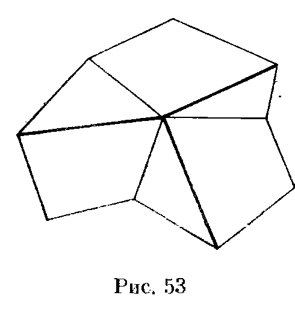

## 7.6. Симметрия

---
**стр. 135, продолжение**
---

## § 6. Симметрия

*Симметрией относительно точки $A$* называется преобразование пространства, переводящее точку $X$ в такую точку $X'$, что $A$ — середина отрезка $XX'$. Другие названия этого преобразования — *центральная симметрия с центром $A$* или просто *симметрия с центром $A$*.

**7.31.** Дан тетраэдр и точка $N$. Через каждое ребро тетраэдра проведена плоскость, параллельная отрезку, соединяющему точку $N$ с серединой противоположного ребра. Докажите, что все шесть этих плоскостей пересекаются в одной точке.

**7.32.** а) Через середину каждого ребра тетраэдра проведена плоскость, перпендикулярная противоположному ребру. Докажите, что все шесть этих плоскостей пересекаются в одной точке (точка Монжа).

б) Докажите, что если точка Монжа лежит в плоскости какой-либо грани тетраэдра, то основание высоты, опущенной на эту грань, находится на ее описанной окружности.

*Симметрией относительно плоскости* $\Pi$ называется преобразование пространства, переводящее точку $X$ в такую точку $X'$, что плоскость $\Pi$ проходит через середину отрезка $XX'$ перпендикулярно ему.

**7.33.** Три равных правильных пятиугольника расположены в пространстве так, что они имеют общую вершину и каждые два из них имеют общее ребро. Докажите, что выделенные на рис. 53 отрезки являются ребрами прямого трехгранного угла.

---
**стр. 136**
---

**7.34.** Даны две пересекающиеся плоскости и касающаяся их сфера. Рассматриваются все сферы, касающиеся этих плоскостей и данной сферы. Найдите геометрическое место точек касания сфер.

**7.35.** Пусть $O$ — центр цилиндра (т. е. середина его оси), $AB$ — диаметр одного основания, $C$ — точка окружности другого основания. Докажите, что сумма двугранных углов трехгранного угла $OABC$ с вершиной $O$ равна $2\pi$.

**7.36.** В выпуклой 5-гранной пирамиде $SABCDE$ равны боковые ребра и двугранные углы при боковых ребрах. Докажите, что эта пирамида правильная.

**7.37.** Какое наибольшее число плоскостей симметрии может иметь пространственная фигура, состоящая из трех попарно непараллельных прямых?

*Симметрией относительно прямой $l$* называется преобразование пространства, переводящее точку $X$ в такую точку $X'$, что прямая $l$ проходит через середину отрезка $XX'$ перпендикулярно ему. Это преобразование называется также *осевой симметрией*, а $l$ — *осью симметрии*.

**7.38.** Докажите, что при симметрии относительно прямой, заданной вектором $\mathbf b$, вектор $\mathbf a$ переходит в вектор

$$
2\mathbf b\frac{(\mathbf a,\mathbf b)}{(\mathbf b,\mathbf b)}-\mathbf a.
$$

**7.39.** Перпендикулярные прямые $l_1$ и $l_2$ пересекаются в одной точке. Докажите, что композиция симметрий относительно этих прямых является симметрией относительно прямой, перпендикулярной им обеим.

**7.40.** Докажите, что никакое тело в пространстве не может иметь ненулевое четное число осей симметрии.
