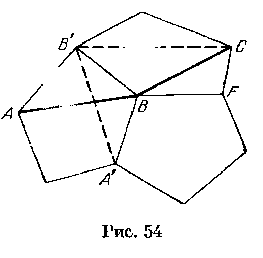
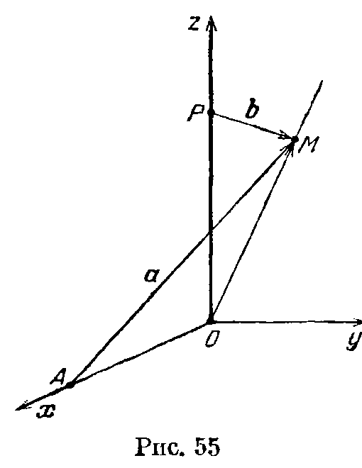

## 7.11. Решения

---
**стр. 140, продолжение**
---

## Решения

**7.1.** а) Пусть $\mathbf a=\overrightarrow{AB}$, $\mathbf b=\overrightarrow{BC}$, $\mathbf c=\overrightarrow{CD}$. Тогда
$$
(\overrightarrow{AB},\overrightarrow{CD})=(\mathbf a,\mathbf c),
$$
$$
(\overrightarrow{AC},\overrightarrow{DB})=(\mathbf a+\mathbf b,-\mathbf b-\mathbf c)=-(\mathbf a,\mathbf b)-(\mathbf b,\mathbf b)-(\mathbf b,\mathbf c)-(\mathbf a,\mathbf c)
$$
и
$$
(\overrightarrow{AD},\overrightarrow{BC})=(\mathbf a+\mathbf b+\mathbf c,\mathbf b)=(\mathbf a,\mathbf b)+(\mathbf b,\mathbf b)+(\mathbf c,\mathbf b).
$$
Складывая эти равенства, получаем требуемое.

б) Очевидно следует из задачи а).

**7.2.** Пусть $\mathbf a=\overrightarrow{AB}$, $\mathbf b=\overrightarrow{BC}$ и $\mathbf c=\overrightarrow{CD}$. Равенство
$$
AC^2+BD^2=BC^2+AD^2
$$
означает, что
$$
|\mathbf a+\mathbf b|^2+|\mathbf b+\mathbf c|^2
=|\mathbf b|^2+|\mathbf a+\mathbf b+\mathbf c|^2,
$$
т. е. $(\mathbf a,\mathbf c)=0$.

**7.3.** Пусть $\mathbf a=\overrightarrow{AA_1}$, $\mathbf b=\overrightarrow{AB}$ и $\mathbf c=\overrightarrow{AD}$. Тогда $\overrightarrow{AC_1}=\mathbf a+\mathbf b+\mathbf c$, и поэтому вектор $\mathbf a+\mathbf b+\mathbf c$ перпендикулярен векторам $\mathbf a-\mathbf b$, $\mathbf b-\mathbf c$ и $\mathbf c-\mathbf a$ по условию. Учитывая, что
$$
(\mathbf a,\mathbf b)=(\mathbf b,\mathbf c)=(\mathbf c,\mathbf a)=0,
$$
получаем
$$
0=(\mathbf a+\mathbf b+\mathbf c,\mathbf a-\mathbf b)=a^2-b^2.
$$
Аналогично $b^2=c^2$ и $c^2=a^2$. Поэтому длины всех ребер данного прямоугольного параллелепипеда равны, т. е. он — куб.

**7.4.** Если вектор $\mathbf x$ лежит в плоскости верхнего или нижнего основания, то будем обозначать через $R\mathbf x$ вектор, полученный из $\mathbf x$ поворотом на $90^\circ$ (в этой плоскости) в положительном направлении. Пусть $O_1$ и $O_2$ — центры верхнего и нижнего оснований; $\overrightarrow{O_1K}=\mathbf a$ и $\overrightarrow{O_2L}=\mathbf b$. Тогда
$$
\overrightarrow{AB}=kR\mathbf a
\quad\text{и}\quad
\overrightarrow{CD}=kR\mathbf b.
$$
Требуется проверить, что
$$
|(\overrightarrow{KL},\overrightarrow{AB})|
=
|(\overrightarrow{KL},\overrightarrow{CD})|,
$$
т. е.
$$
|(\mathbf b-\mathbf a+\mathbf c,kR\mathbf a)|
=
|(\mathbf b-\mathbf a+\mathbf c,kR\mathbf b)|,
$$
где $\mathbf c=\overrightarrow{O_1O_2}$. Учитывая, что скалярное произведение перпендикулярных векторов равно нулю, получаем
$$
(\mathbf b-\mathbf a+\mathbf c,kR\mathbf a)=k(\mathbf b,R\mathbf a)
$$
и
$$
(\mathbf b-\mathbf a+\mathbf c,kR\mathbf b)=-k(\mathbf a,R\mathbf b).
$$
Так как при повороте обоих векторов на $90^\circ$ их скалярное произведение не изменяется и $R(R\mathbf a)=-\mathbf a$, то
$$
(\mathbf b,R\mathbf a)=(R\mathbf b,-\mathbf a)=-(\mathbf a,R\mathbf b).
$$

**7.5.** Пусть $O$ — центр сферы; $M$ — центр масс треугольника $ABC$; $\mathbf u=\overrightarrow{SO}$; $\mathbf a$, $\mathbf b$ и $\mathbf c$ — единичные векторы, направленные по

---
**стр. 141**
---

рёбрам трёхгранного угла. Тогда
$3\overrightarrow{SM}=\overrightarrow{SA}+\overrightarrow{SB}+\overrightarrow{SC}=
2((u,a)a+(u,b)b+(u,c)c)$.
Центр $O$ сферы принадлежит плоскости, проходящей через середину отрезка $SN$ перпендикулярно ему. Поэтому $u=e_1+\lambda e_2+\mu e_3$, где $e_1,e_2$ и $e_3$ — некоторые фиксированные векторы. Следовательно,
$3\overrightarrow{SM}=2(\varepsilon_1+\lambda\varepsilon_2+\mu\varepsilon_3)$, где
$\varepsilon_i=(e_i,a)a+(e_i,b)b+(e_i,c)c$.

**7.6.** Пусть $n_1,\ldots,n_k$ — единичные внешние нормали к граням; $M_1,\ldots,M_k$ — произвольные точки этих граней. Сумма расстояний от внутренней точки $X$ многогранника до всех граней равна

$$
\sum(\overrightarrow{XM_i},n_i)
=
\sum(\overrightarrow{XO},n_i)
+
\sum(\overrightarrow{OM_i},n_i),
$$

где $O$ — некоторая фиксированная внутренняя точка многогранника. Эта сумма не зависит от $X$, только если
$\sum(\overrightarrow{XO},n_i)=0$, т. е. $\sum n_i=0$.

**7.7.** Пусть $O$ — центр описанной сферы ортоцентрического тетраэдра, $H$ — его ортоцентр, $M$ — центр масс. Ясно, что
$\overrightarrow{OM}=(\overrightarrow{OA}+\overrightarrow{OB}+\overrightarrow{OC}+\overrightarrow{OD})/4$.
Поэтому достаточно проверить, что
$\overrightarrow{OH}=(\overrightarrow{OA}+\overrightarrow{OB}+\overrightarrow{OC}+\overrightarrow{OD})/2$.
Будем доказывать, что если
$\overrightarrow{OX}=(\overrightarrow{OA}+\overrightarrow{OB}+\overrightarrow{OC}+\overrightarrow{OD})/2$,
то $X$ — ортоцентр. Докажем, например, что $AX\perp CD$. Ясно, что
$\overrightarrow{AX}=\overrightarrow{AO}+\overrightarrow{OX}
=(-\overrightarrow{OA}+\overrightarrow{OB}+\overrightarrow{OC}+\overrightarrow{OD})/2
=(\overrightarrow{AB}+\overrightarrow{OC}+\overrightarrow{OD})/2$.
Поэтому

$$
2(\overrightarrow{CD},\overrightarrow{AX})
=
(\overrightarrow{CD},\overrightarrow{AB}+\overrightarrow{OC}+\overrightarrow{OD})
=
(\overrightarrow{CD},\overrightarrow{AB})
+
(-\overrightarrow{OC}+\overrightarrow{OD},\overrightarrow{OC}+\overrightarrow{OD}).
$$

Оба слагаемых равны нулю: первое — вследствие того, что $CD\perp AB$, а второе — вследствие того, что $OC=OD$. Аналогично доказывается, что $AX\perp BC$, т. е. прямая $AX$ перпендикулярна грани $BCD$. Для прямых $BX$, $CX$ и $DX$ доказательство аналогично.

**7.8. Первое решение.** Пусть в пространстве расположено несколько лучей с общим началом $O$, образующих попарно тупые углы. Введём систему координат, направив ось $Ox$ вдоль первого луча, а в качестве координатной плоскости $Oxy$ выбрав плоскость, содержащую первые два луча. Каждый луч задаётся некоторым вектором $e$, причём вместо $e$ можно взять $\lambda e$, где $\lambda>0$. Первый луч задаётся вектором $e_1=(1,0,0)$, а луч с номером $k$ — вектором $e_k=(x_k,y_k,z_k)$. При $k>1$ скалярное произведение векторов $e_1$ и $e_k$ отрицательно, поэтому $x_k<0$. Можно считать, что $x_k=-1$. Далее, при $k>2$ скалярное произведение векторов $e_2$ и $e_k$ отрицательно. Учитывая, что $z_2=0$ согласно выбору координатной плоскости $Oxy$, получаем
$(e_2,e_k)=1+y_2y_k<0$. Следовательно, все числа $y_k$ имеют

---
**стр. 142**
---

один и тот же знак (противоположный знаку числа $y_2$). Теперь воспользуемся тем, что
$(e_i,e_j)=1+y_iy_j+z_iz_j<0$ при $i,j\geqslant3$ и $i\ne j$.
Ясно, что $y_iy_j>0$, поэтому $z_iz_j<0$. Так как не существует трёх чисел разных знаков, могут существовать лишь два вектора, отличных от первых двух векторов $e_1$ и $e_2$.

**Второе решение.** Докажем сначала, что если
$\lambda_1e_1+\ldots+\lambda_ke_k=\lambda_{k+1}e_{k+1}+\ldots+\lambda_ne_n$,
причём все числа $\lambda_1,\ldots,\lambda_n$ положительны и $1\leqslant k<n$, то углы между векторами $e_i$ не все тупые. В самом деле, квадрат длины вектора
$\lambda_1e_1+\ldots+\lambda_ke_k$ равен
$(\lambda_1e_1+\ldots+\lambda_ke_k,\lambda_{k+1}e_{k+1}+\ldots+\lambda_ne_n)$,
а если все углы между векторами $e_i$ тупые, то это скалярное произведение является суммой отрицательных чисел.

Предположим теперь, что в пространстве существуют векторы $e_1,\ldots,e_5$, все углы между которыми тупые. Ясно, что эти векторы не могут быть параллельны одной плоскости; пусть, например, векторы $e_1$, $e_2$ и $e_3$ не параллельны одной плоскости. Тогда
$e_4=\lambda_1e_1+\lambda_2e_2+\lambda_3e_3$ и
$e_5=\mu_1e_1+\mu_2e_2+\mu_3e_3$.
Вычтем из первого равенства второе и преобразуем полученное равенство так, чтобы и в правой и в левой его части стояли векторы с положительными коэффициентами; при этом в левой части будет вектор $e_4$, а в правой вектор $e_5$. Получено противоречие.

**7.9.** Предположим, что углы между векторами $e_1,\ldots,e_7$ не острые. Направим ось $Ox$ по вектору $e_1$. В плоскости, перпендикулярной $e_1$, не может быть более четырёх векторов, углы между которыми не острые; вместе с вектором $-e_1$ получится всего лишь 6 векторов. Поэтому выбрать вектор $e_2$ и направить ось $Oy$ можно так, что
$e_2=(x_2,y_2,0)$, где $x_2\ne0$ (а значит, $x_2<0$) и $y_2>0$.
Пусть $e_k=(x_k,y_k,z_k)$ при $k=3,\ldots,7$. Тогда $x_k\leqslant0$ и
$x_kx_2+y_ky_2\leqslant0$. Поэтому $x_kx_2\geqslant0$, а значит, $y_ky_2\leqslant0$, т. е. $y_k\leqslant0$. Так как $(e_s,e_r)\leqslant0$ при $3\leqslant s,r\leqslant7$ и $x_rx_s\geqslant0$, $y_ry_s\geqslant0$, то $z_sz_r\leqslant0$. Но среди 5 чисел $z_3,\ldots,z_7$ нулевых не более двух, поэтому среди трёх оставшихся чисел обязательно найдутся два числа одного знака. Получено противоречие.

**7.10.** Пусть $e_1$, $e_2$, $e_3$ и $e_4$ — единичные векторы, перпендикулярные граням и направленные во внешнюю сторону; $n=e_1+e_2+e_3+e_4$; $s$ — указанная сумма косинусов. Так как
$(e_i,e_j)=-\cos\varphi_{ij}$, где $\varphi_{ij}$ — угол между гранями с номерами $i$ и $j$, то
$|n|^2=4-2s$. Неравенство $s\leqslant2$ теперь очевидно. Остаётся проверить, что $s\geqslant0$, т. е. $|n|\leqslant2$.

Существуют такие ненулевые числа $\alpha$, $\beta$, $\gamma$ и $\delta$, что
$\alpha e_1+\beta e_2+\gamma e_3+\delta e_4=0$.
Пусть для определённости $\delta$ — наибольшее по абсолютной величине среди этих чисел. Поделив данное равенство на $\delta$, можно считать, что $\delta=1$; тогда числа $\alpha$, $\beta$ и $\gamma$ положительны (см. задачу 7.15, б) и не превосходят 1. Так как
$n=n-\alpha e_1-\beta e_2-\gamma e_3-e_4=(1-\alpha)e_1+(1-\beta)e_2+$

---
**стр. 143**
---

$+(1-\gamma)e_3$, то
$|n|\leqslant1-\alpha+1-\beta+1-\gamma=3-(\alpha+\beta+\gamma)$.
Остаётся заметить, что
$1=|e_4|=|\alpha e_1+\beta e_2+\gamma e_3|\leqslant\alpha+\beta+\gamma$,
причём равенства быть не может, так как данные векторы неколлинеарны.

**7.11.** Пусть векторы $a_i$ и $b_i$ сонаправлены с лучами $AA_i$ и $BB_i$ и имеют единичную длину. Согласно задаче 7.16 существуют такие положительные числа $x_1,\ldots,x_n$, что
$x_1a_1+\ldots+x_na_n=0$. Рассмотрим вектор
$b=x_1b_1+\ldots+x_nb_n$. Так как $(b_i,b_j)\leqslant(a_i,a_j)$ по условию, то

$$
|b|^2
=
\sum x_i^2+2\sum_{i<j}x_ix_j(b_i,b_j)
\leqslant
\sum x_i^2+2\sum_{i<j}x_ix_j(a_i,a_j)
=
|x_1a_1+\ldots+x_na_n|^2
=
0.
$$

Причём, если хотя бы одно неравенство $(b_i,b_j)\leqslant(a_i,a_j)$ строгое, то получим строгое неравенство $|b|^2<0$, чего не может быть.

**7.12.** Точка $X$ лежит в плоскости $ABC$ тогда и только тогда, когда
$\overrightarrow{AX}=\lambda\overrightarrow{AB}+\mu\overrightarrow{AC}$, т. е.

$$
\begin{aligned}
\overrightarrow{OX}
&=\overrightarrow{OA}+\overrightarrow{AX}
=\overrightarrow{OA}+\lambda\overrightarrow{AB}+\mu\overrightarrow{AC}\\
&=\overrightarrow{OA}+\lambda(\overrightarrow{OB}-\overrightarrow{OA})
+\mu(\overrightarrow{OC}-\overrightarrow{OA})\\
&=(1-\lambda-\mu)\overrightarrow{OA}
+\lambda\overrightarrow{OB}+\mu\overrightarrow{OC}.
\end{aligned}
$$

Пусть точка $X$ принадлежит треугольнику $ABC$. Докажем, например, что
$\lambda=S_{CXA}:S_{ABC}$. Равенство
$\overrightarrow{AX}=\lambda\overrightarrow{AB}+\mu\overrightarrow{AC}$
означает, что отношение высот, опущенных из точек $X$ и $B$ на прямую $AC$, равно $\lambda$, а отношение этих высот равно $S_{CXA}:S_{ABC}$.

**7.13.** Пусть
$a=\overrightarrow{AB}$, $b=\overrightarrow{AC}$ и $c=\overrightarrow{AD}$.
Пусть, далее, $X$ — произвольная точка и
$\overrightarrow{AX}=\lambda a+\mu b+\nu c$.
Точка $X$ принадлежит плоскости $KLM$, если

$$
\overrightarrow{AX}
=
p\overrightarrow{AK}+q\overrightarrow{AL}+r\overrightarrow{AM}
=
\frac p\alpha a+\frac q\beta b+\frac r\gamma c,
$$

где $p+q+r=1$ (см. задачу 7.12), т. е.
$\lambda\alpha+\mu\beta+\nu\gamma=1$.

а) Числа $\lambda$, $\mu$ и $\nu$ требуется подобрать так, чтобы для любых $\alpha$ и $\beta$ выполнялось равенство
$\lambda\alpha+\mu\beta+\nu(\alpha+\beta+1)=1$, т. е.
$\lambda+\nu=0$, $\mu+\nu=0$ и $\nu=1$.

б) Точка $X$ принадлежит всем рассматриваемым плоскостям, если
$\lambda(\beta-1)+\mu\beta+\nu(\beta+1)=1$ для всех $\beta$, т. е.
$\lambda+\mu+\nu=0$ и $\nu-\lambda=1$. Такие точки $X$ заполняют прямую.

**7.14.** Пусть
$\overrightarrow{OC}=\lambda\overrightarrow{OA}+\mu\overrightarrow{OB}$.
Тогда, так как правильные пятиугольники подобны,
$\overrightarrow{OC_1}=\lambda\overrightarrow{OA_1}+\mu\overrightarrow{OB_1}$,
а значит,
$\overrightarrow{CC_1}=\lambda\overrightarrow{AA_1}+\mu\overrightarrow{BB_1}$,
т. е. прямая $CC_1$ параллельна плоскости $\Pi$, содержащей $AA_1$ и $BB_1$. Аналогично доказывается, что прямая $DD_1$ параллельна плоскости $\Pi$.

**7.15.** а) Перенесём в равенстве
$\alpha\overrightarrow{OA}+\beta\overrightarrow{OB}+\gamma\overrightarrow{OC}+\delta\overrightarrow{OD}=\vec 0$
все слагаемые с отрицательными числами в правую

---
**стр. 144**
---

часть. Если $p$, $q$ и $r$ — положительные числа, то конец вектора
$p\overrightarrow{OP}+q\overrightarrow{OQ}$ лежит внутри угла $POQ$, а конец вектора
$p\overrightarrow{OP}+q\overrightarrow{OQ}+r\overrightarrow{OR}$ — внутри трехгранного угла $OPQR$ с вершиной $O$. Остается заметить, что, например, ребро $CD$ лежит вне угла $AOB$, а вершина $D$ — вне трехгранного угла $OABC$.

б) Так как точка $O$ лежит внутри тетраэдра $A_1B_1C_1D_1$, можно воспользоваться решением задачи а).

**7.16.** Пусть продолжение луча $OA_i$ за точку $O$ пересекает многогранник в точке $M$; $P$ — одна из вершин грани, содержащей точку $M$; $QR$ — сторона этой грани, пересекающаяся с продолжением луча $MP$ за точку $M$. Тогда
$$
\overrightarrow{OM}=p\overrightarrow{OP}+q\overrightarrow{OQ}+r\overrightarrow{OR},
$$
где $p,q,r\geqslant0$. Так как векторы $\overrightarrow{OA_i}$ и $\overrightarrow{OM}$ противоположно направлены, то
$$
\overrightarrow{OA_i}+\alpha\overrightarrow{OP}+\beta\overrightarrow{OQ}+\gamma\overrightarrow{OR}=0,
$$
где $\alpha,\beta,\gamma\geqslant0$, $P,Q,R$ — некоторые вершины многогранника. Записав такие равенства для всех $i$ от 1 до $n$ и сложив их, получим требуемое.

**7.17. Первое решение.** Любой вектор $\mathbf u$ можно представить в виде $\mathbf u=\alpha\mathbf a+\beta\mathbf b+\gamma\mathbf c$; поэтому доказательство достаточно провести лишь для векторов $\mathbf a$, $\mathbf b$ и $\mathbf c$. Так как центр правильного тетраэдра делит его медиану в отношении $1:3$, то
$$
(\mathbf a,\mathbf b)=(\mathbf a,\mathbf c)=(\mathbf a,\mathbf d)=-1/3.
$$
Учитывая, что $\mathbf a+\mathbf b+\mathbf c+\mathbf d=0$, получаем
$$
(\mathbf a,\mathbf a)\mathbf a+(\mathbf a,\mathbf b)\mathbf b+(\mathbf a,\mathbf c)\mathbf c+(\mathbf a,\mathbf d)\mathbf d
=\mathbf a-(\mathbf b+\mathbf c+\mathbf d)/3=\mathbf a+\mathbf a/3=4\mathbf a/3.
$$
Для векторов $\mathbf b$ и $\mathbf c$ доказательство проводится аналогично.

**Второе решение.** Рассмотрим куб $ABCDA_1B_1C_1D_1$. Ясно, что $AB_1CD_1$ — правильный тетраэдр. Введем прямоугольную систему координат с началом в центре куба и осями, параллельными ребрам куба. Тогда
$$
\sqrt3\,\mathbf a=(1,1,1),\quad
\sqrt3\,\mathbf b=(-1,-1,1),\quad
\sqrt3\,\mathbf c=(-1,1,-1)
$$
и
$$
\sqrt3\,\mathbf d=(1,-1,-1).
$$
Пусть $\mathbf u=(x,y,z)$. Несложные, но несколько громоздкие вычисления приводят теперь к требуемому результату.

**7.18.** Опустим из точки $O$ перпендикуляры $OB_i$ на грани тетраэдра. Пусть $\mathbf a_i$ — единичный вектор, сонаправленный с $\overrightarrow{OB_i}$. Тогда
$$
(\overrightarrow{OM},\mathbf a_i)\mathbf a_i+\overrightarrow{MA_i}=\overrightarrow{OB_i}.
$$
Так как тетраэдр $B_1B_2B_3B_4$ правильный, сумма векторов $\overrightarrow{OB_i}$ равна нулю. Следовательно,
$$
\sum\overrightarrow{MA_i}=\sum(\overrightarrow{MO},\mathbf a_i)\mathbf a_i=4\overrightarrow{MO}/3
$$
(см. задачу 7.17).

**7.19. Первое решение.** Докажем, что сумма проекций всех гранных векторов на любую прямую $l$ равна нулю. Рассмотрим для этого проекцию многогранника на плоскость, перпендикулярную прямой $l$. Проекция многогранника покрыта проекциями его граней в два слоя, так как грани можно разбить

---
**стр. 145**
---

на два типа: «видимые сверху» и «видимые снизу» (грани, проецирующиеся в отрезки, можно не учитывать). Приписав площадям проекций граней одного типа знак «плюс», а граней другого типа знак «минус», получим, что сумма площадей проекций граней с учетом знака равна нулю. Заметим теперь, что площадь проекции грани равна длине проекции соответствующего вектора на прямую $l$ (см. задачу 2.13), причем для граней разного типа проекции векторов противоположно направлены. Следовательно, сумма проекций векторов на прямую $l$ тоже равна нулю.

**Второе решение.** Пусть $X$ — точка внутри многогранника, $h_i$ — расстояние от нее до плоскости $i$-й грани. Разрежем многогранник на пирамиды с вершиной $X$, основаниями которых служат его грани. Объем $V$ многогранника равен сумме объемов этих пирамид, т. е.
$$
3V=\sum h_iS_i,
$$
где $S_i$ — площадь $i$-й грани.

Пусть, далее, $\mathbf n_i$ — единичный вектор внешней нормали к $i$-й грани, $M_i$ — произвольная точка этой грани. Тогда
$$
h_i=(\overrightarrow{XM_i},\mathbf n_i),
$$
поэтому
$$
3V=\sum h_iS_i
=\sum(\overrightarrow{XM_i},S_i\mathbf n_i)
=\sum(\overrightarrow{XO},S_i\mathbf n_i)
+\sum(\overrightarrow{OM_i},S_i\mathbf n_i)
=\left(\overrightarrow{XO},\sum S_i\mathbf n_i\right)+3V
$$
(здесь $O$ — некоторая фиксированная точка многогранника). Следовательно,
$$
\sum S_i\mathbf n_i=0.
$$

**7.20.** Рассмотрим параллелепипед $ABCDA_1B_1C_1D_1$. Пусть на данных прямых лежат диагонали граней с общим ребром $BC$, причем $AC$ — одна из этих диагоналей. Тогда $BC_1$ — вторая такая диагональ, а $B_1D$ — диагональ параллелепипеда, лежащая на третьей данной прямой. Введем прямоугольную систему координат так, что прямая $AC$ совпадает с осью $Ox$, прямая $BC_1$ параллельна оси $Oy$ и проходит через точку $(0,0,a)$, прямая $B_1D$ параллельна оси $Oz$ и проходит через точку $(a,a,0)$. Тогда точки $A$ и $C$ имеют координаты $(x_1,0,0)$ и $(x_2,0,0)$, точки $B$ и $C_1$ — $(0,y_1,a)$ и $(0,y_2,a)$, точки $D$ и $B_1$ — $(a,a,z_1)$ и $(a,a,z_2)$. Так как
$$
\overrightarrow{AD}=\overrightarrow{BC}=\overrightarrow{B_1C_1},
$$
то
$$
a-x_1=x_2=-a,\qquad a=-y_1=y_2-a
$$
и
$$
z_1=-a=a-z_2,
$$
откуда
$$
x_1=2a,\quad x_2=-a,\quad y_1=-a,\quad y_2=-2a,\quad z_1=-a,\quad z_2=2a.
$$
Тем самым найдены координаты вершин $A,B,C,D,B_1$ и $C_1$.

Простые вычисления показывают, что
$$
AC=3a,\qquad AB=a\sqrt6,\qquad BC=a\sqrt3,
$$
т. е. треугольник $ABC$ — прямоугольный, а значит, площадь грани $ABCD$ равна
$$
AB\cdot BC=3a^2\sqrt2.
$$
Плоскость грани $ABCD$ задается уравнением $y+z=0$. Расстояние от точки $(x_0,y_0,z_0)$ до плоскости $px+qy+rz=0$ равно
$$
\frac{|px_0+qy_0+rz_0|}{\sqrt{p^2+q^2+r^2}}
$$
(задача 1.27), поэтому

---
**стр. 146**
---

расстояние от точки $B_1$ до грани $ABCD$ равно $3a/\sqrt2$. Следовательно, объем параллелепипеда равен $9a^3$.

**7.21.** Фиксируем $a=|\mathbf a|$, $b=|\mathbf b|$ и $c=|\mathbf c|$. Пусть $x,y,z$ — косинусы углов между векторами $\mathbf a$ и $\mathbf b$, $\mathbf b$ и $\mathbf c$, $\mathbf c$ и $\mathbf a$. Разность между левой и правой частями требуемого неравенства равна
$$
a+b+c+\sqrt{a^2+b^2+c^2+2(abx+bcy+acz)}
-\sqrt{a^2+b^2+2abx}
-\sqrt{b^2+c^2+2bcy}
-\sqrt{c^2+a^2+2acz}
=f(x,y,z).
$$
Числа $x,y$ и $z$ связаны некоторыми неравенствами, но нам будет проще доказать, что $f(x,y,z)\geqslant0$ для всех $x,y,z$, не превосходящих по модулю 1.

Функция
$$
\varphi(t)=\sqrt{p+t}-\sqrt{q+t}
=\frac{p-q}{\sqrt{p+t}+\sqrt{q+t}}
$$
монотонна по $t$. Следовательно, при фиксированных $y$ и $z$ функция $f(x,y,z)$ достигает наименьшего значения, когда $x=\pm1$. Фиксируем затем $x=\pm1$ и $z$; в этом случае функция $f$ достигает наименьшего значения, когда $y=\pm1$. Наконец, фиксировав $x=\pm1$ и $y=\pm1$, получаем, что функция $f$ достигает наименьшего значения, когда числа $x,y,z$ равны $\pm1$. В этом случае векторы $\mathbf a,\mathbf b$ и $\mathbf c$ коллинеарны и неравенство легко проверяется.

**7.22.** Утверждения а) и б) легко следуют из определения.

в) **Первое решение.** Введем систему координат $Oxyz$, направив ось $Ox$ вдоль вектора $\mathbf a$. Можно проверить, что векторным произведением векторов $\mathbf a=(a,0,0)$ и $\mathbf u=(x,y,z)$ является вектор $(0,-az,ay)$. В самом деле, этот вектор перпендикулярен обоим векторам, а его длина равна произведению длины вектора $\mathbf a$ на длину высоты, опущенной на вектор $\mathbf a$ из конца вектора $\mathbf u$; согласованность ориентаций следует проверить для различных вариантов знаков чисел $y$ и $z$.

Теперь требуемое равенство легко проверить, выражая координаты входящих в него векторных произведений через координаты векторов $\mathbf b$ и $\mathbf c$.

**Второе решение.** Рассмотрим призму $ABCA_1B_1C_1$, где
$$
\overrightarrow{AB}=\mathbf b,\qquad
\overrightarrow{BC}=\mathbf c,\qquad
\overrightarrow{AA_1}=\mathbf a.
$$
Так как $\overrightarrow{AC}=\mathbf b+\mathbf c$, то указанное равенство означает, что сумма трех векторов внешних (или внутренних) нормалей к боковым граням призмы, длины которых равны площадям соответствующих граней, равна нулю. Пусть $A'B'C'$ — сечение призмы плоскостью, перпендикулярной боковому ребру. После поворота векторов нормалей на $90^\circ$ в плоскости $A'B'C'$ они переходят в векторы
$$
d\overrightarrow{A'B'},\qquad d\overrightarrow{B'C'},\qquad d\overrightarrow{C'A'},
$$
где $d$ — длина бокового ребра призмы. Ясно, что сумма этих векторов равна нулю.

---
**стр. 147**
---

**7.23.** Пусть $\mathbf a=a_1\mathbf e_1+a_2\mathbf e_2+a_3\mathbf e_3$ и $\mathbf b=b_1\mathbf e_1+b_2\mathbf e_2+b_3\mathbf e_3$, где $\mathbf e_1$, $\mathbf e_2$ и $\mathbf e_3$ — единичные векторы, направленные вдоль осей координат. Для решения задачи можно воспользоваться результатами задач 7.22, а—в, предварительно заметив, что $[\mathbf e_1,\mathbf e_2]=\mathbf e_3$, $[\mathbf e_2,\mathbf e_3]=\mathbf e_1$ и $[\mathbf e_3,\mathbf e_1]=\mathbf e_2$.

**7.24.** Оба равенства можно доказать несложными, но несколько громоздкими вычислениями, воспользовавшись результатом задачи 7.23.

**7.25.** а) Согласно задаче 7.24,а
$$
[\mathbf a,[\mathbf b,\mathbf c]]
 =\mathbf b(\mathbf c,\mathbf a)-\mathbf c(\mathbf a,\mathbf b),\quad
[\mathbf b,[\mathbf c,\mathbf a]]
 =\mathbf c(\mathbf a,\mathbf b)-\mathbf a(\mathbf b,\mathbf c)
$$
и
$$
[\mathbf c,[\mathbf a,\mathbf b]]
 =\mathbf a(\mathbf b,\mathbf c)-\mathbf b(\mathbf a,\mathbf c).
$$
Складывая эти равенства, получаем требуемое.

б) Векторы $[\mathbf b,\mathbf c]$, $[\mathbf c,\mathbf a]$ и $[\mathbf a,\mathbf b]$ перпендикулярны плоскости $ABC$ и сонаправлены, а их длины равны $2S_{BOC}$, $2S_{COA}$ и $2S_{AOB}$. Поэтому векторы $[\mathbf a,[\mathbf b,\mathbf c]]$, $[\mathbf b,[\mathbf c,\mathbf a]]$ и $[\mathbf c,[\mathbf a,\mathbf b]]$ после поворота на $90^\circ$ в плоскости $ABC$ переходят в векторы $2\mathbf aS_{BOC}$, $2\mathbf bS_{COA}$ и $2\mathbf cS_{AOB}$.

**7.26.** Пусть $\mathbf a$, $\mathbf b$ и $\mathbf c$ — векторы, задающие три несмежные стороны шестиугольника; $\mathbf a_1$, $\mathbf b_1$ и $\mathbf c_1$ — векторы противоположных сторон. Так как вектор $\mathbf a_1$ перпендикулярен векторам $\mathbf b$ и $\mathbf c$, то $\mathbf a_1=\lambda[\mathbf b,\mathbf c]$. Следовательно, общий перпендикуляр к векторам $\mathbf a$ и $\mathbf a_1$ задается вектором $\mathbf n_a=[\mathbf a,[\mathbf b,\mathbf c]]$. Из тождества Якоби следует, что $\mathbf n_a+\mathbf n_b+\mathbf n_c=0$, т. е. эти векторы перпендикулярны одной прямой.

**7.27.** Пусть $\mathbf a=\overrightarrow{DA}$, $\mathbf b=\overrightarrow{DB}$ и $\mathbf c=\overrightarrow{DC}$. Утверждение задачи эквивалентно равенству
$$
[\mathbf a,\mathbf b]+[\mathbf b,\mathbf c]+[\mathbf c,\mathbf a]
 +[\mathbf b-\mathbf c,\mathbf a-\mathbf c]=0.
$$

**7.28.** а) Докажем, например, что вектор
$$
[\mathbf a,\mathbf b]+[\mathbf b,\mathbf c]+[\mathbf c,\mathbf a]
$$
лежит в плоскости $\Pi$, проходящей через биссектрису грани $SAB$ перпендикулярно этой грани. Плоскость $\Pi$ перпендикулярна вектору $\mathbf a-\mathbf b$, поэтому она содержит вектор $[\mathbf c,\mathbf a-\mathbf b]$. Кроме того, плоскость $\Pi$ содержит вектор $[\mathbf a,\mathbf b]$, поэтому она содержит вектор
$$
[\mathbf a,\mathbf b]+[\mathbf c,\mathbf a-\mathbf b]
 =[\mathbf a,\mathbf b]+[\mathbf b,\mathbf c]+[\mathbf c,\mathbf a].
$$

б) Пусть
$$
\overrightarrow{OA}
 =\overrightarrow{OA_1}\sin\alpha_1
 +\overrightarrow{OA_2}\sin\alpha_2
 +\overrightarrow{OA_3}\sin\alpha_3.
$$
Докажем, например, что плоскость $OA_2A$ делит пополам угол между гранями $OA_2A_1$ и $OA_2A_3$. Для этого достаточно проверить, что перпендикуляр к плоскости $OA_2A$ является биссектрисой угла между перпендикулярами к плоскостям $OA_2A_1$ и $OA_2A_3$. Перпендикуляры к этим трем плоскостям задаются соответственно векторами
$$
\overrightarrow{OA_2}\times\overrightarrow{OA}
 =\overrightarrow{OA_2}\times\overrightarrow{OA_1}\sin\alpha_1
 +\overrightarrow{OA_2}\times\overrightarrow{OA_3}\sin\alpha_3,
$$
$\overrightarrow{OA_2}\times\overrightarrow{OA_1}$ и $\overrightarrow{OA_2}\times\overrightarrow{OA_3}$. Как легко видеть, если $|\mathbf a|=|\mathbf b|$, то вектор $\mathbf a+\mathbf b$ задает биссектрису угла между векторами $\mathbf a$ и $\mathbf b$. Поэтому остается доказать, что длины векторов $\overrightarrow{OA_2}\times\overrightarrow{OA_1}\sin\alpha_1$

---
**стр. 148**
---

и $\overrightarrow{OA_2}\times\overrightarrow{OA_3}\sin\alpha_3$ равны. Но
$$
\left|\overrightarrow{OA_2}\times\overrightarrow{OA_1}\right|
 =\sin\angle A_1OA_2=\sin\alpha_3
$$
и
$$
\left|\overrightarrow{OA_2}\times\overrightarrow{OA_3}\right|
 =\sin\alpha_1,
$$
что и завершает доказательство. Для плоскостей $OA_1A$ и $OA_3A$ доказательство аналогично.

**7.29.** Пусть $\mathbf a=\overrightarrow{A_1B}$, $\mathbf b=\overrightarrow{BC_1}$ и $\mathbf c=\overrightarrow{C_1D}$. Тогда удвоенные площади граней тетраэдра $A_1BC_1D$ равны длинам векторов $[\mathbf a,\mathbf b]$, $[\mathbf b,\mathbf c]$, $[\mathbf c,\mathbf d]$ и $[\mathbf d,\mathbf a]$, где $\mathbf d=-(\mathbf a+\mathbf b+\mathbf c)$, а удвоенные площади граней параллелепипеда равны длинам векторов $[\mathbf a,\mathbf c]$, $[\mathbf b,\mathbf d]$ и $[\mathbf a+\mathbf b,\mathbf b+\mathbf c]$. Пусть $\mathbf x=[\mathbf a,\mathbf b]$, $\mathbf y=[\mathbf b,\mathbf c]$ и $\mathbf z=[\mathbf c,\mathbf a]$. Тогда учетверенные суммы квадратов площадей граней тетраэдра и параллелепипеда равны
$$
|\mathbf x|^2+|\mathbf y|^2+|\mathbf y-\mathbf z|^2+|\mathbf z-\mathbf x|^2
$$
и
$$
|\mathbf z|^2+|\mathbf x-\mathbf y|^2+|\mathbf x+\mathbf y-\mathbf z|^2
$$
соответственно. Легко проверить, что каждая из этих сумм равна
$$
2\bigl(|\mathbf x|^2+|\mathbf y|^2+|\mathbf z|^2-(\mathbf y,\mathbf z)-(\mathbf x,\mathbf z)\bigr).
$$

**7.30.** Три вектора компланарны тогда и только тогда, когда их смешанное произведение равно нулю. Воспользовавшись формулой задачи 7.23, получаем, что смешанное произведение данных векторов равно
$$
(a_2b_3-a_3b_2)c_1+(a_3b_1-a_1b_3)c_2+(a_1b_2-a_2b_1)c_3.
$$

**7.31.** Пусть $M$ — центр масс тетраэдра, $A$ — середина ребра, через которое проходит плоскость $\Pi$, $B$ — середина противоположного ребра, $N'$ — точка, симметричная $N$ относительно точки $M$. Так как точка $M$ является серединой отрезка $AB$ (см. задачу 14.3), то $AN'\parallel BN$, а значит, точка $N'$ принадлежит плоскости $\Pi$. Следовательно, все шесть плоскостей проходят через точку $N'$.

**7.32.** а) Пусть $A$ — середина ребра $a$, $B$ — середина противоположного ему ребра $b$. Пусть, далее, $M$ — центр масс тетраэдра, $O$ — центр его описанной сферы, $O'$ — точка, симметричная $O$ относительно точки $M$. Так как точка $M$ является серединой отрезка $AB$ (задача 14.3), то $O'A\parallel OB$. Но отрезок $OB$ перпендикулярен ребру $b$, поэтому $O'A\perp b$, а значит, точка $O'$ принадлежит плоскости, проходящей через середину ребра $a$ перпендикулярно ребру $b$. Следовательно, все шесть плоскостей проходят через точку $O'$.

б) Пусть точка Монжа $O'$ лежит в плоскости грани $ABC$. Проведем через вершину $D$ плоскость $\Pi$, параллельную этой грани. Так как центр $O$ описанной сферы тетраэдра симметричен точке $O'$ относительно его центра масс $M$, а точка $M$ делит медиану тетраэдра, проведенную из вершины $D$, в отношении $3:1$ (задача 14.3), то точка $O$ равноудалена от плоскостей $\Pi$ и $ABC$. Остается заметить, что если центр сферы равноудален от двух параллельных секущих плоскостей, то проекция окружности

---
**стр. 149**
---

сечения на вторую секущую плоскость совпадает со второй окружностью сечения.

**7.33.** Докажем, что $\angle ABC=90^\circ$ (рис. 54). Рассмотрим для этого пунктирные отрезки $A'B'$ и $B'C$. Ясно, что при симметрии относительно плоскости, проходящей через середину отрезка $BB'$ и перпендикулярной ему, отрезок $AB$ переходит в $A'B'$, а $BC$ — в $B'C$. Поэтому достаточно доказать, что $\angle A'B'C=90^\circ$. Кроме того, $B'C\parallel BF$, т. е. нужно доказать, что $A'B'\perp BF$. При симметрии относительно биссекторной плоскости двугранного угла, образованного пятиугольниками с общим ребром $BF$, точка $A'$ переходит в $B'$. Поэтому отрезок $A'B'$ перпендикулярен этой плоскости, в частности, $A'B'\perp BF$.

Для остальных углов между рассматриваемыми отрезками доказательство проводится аналогично.

**7.34.** Предположим сначала, что и данная сфера, и сфера, касающаяся ее, расположены в одном и том же двугранном угле между данными плоскостями. Тогда обе сферы симметричны относительно биссекторной плоскости этого двугранного угла, а значит, точка их касания лежит в этой плоскости. Если же данная сфера и сфера, касающаяся ее, расположены в разных двугранных углах, то их общей точкой может быть лишь одна из двух точек касания данной сферы с данными плоскостями. Таким образом, искомое ГМТ состоит из окружности, по которой данную сферу пересекает биссекторная плоскость, и двух точек касания данной сферы с данными плоскостями (легко проверить, что все эти точки действительно принадлежат искомому ГМТ).

**7.35.** Пусть $\alpha$, $\beta$ и $\gamma$ — двугранные углы при ребрах $OA$, $OB$ и $OC$. Рассмотрим точку $C'$, симметричную $C$ относительно $O$. В трехгранном угле $OABC'$ двугранные углы при ребрах $OA$, $OB$ и $OC'$ равны $\pi-\alpha$, $\pi-\beta$ и $\gamma$. Плоскость $OMC'$, где $M$ — середина отрезка $AB$, разбивает двугранный угол при ребре $OC'$ на два двугранных угла. Так как трехгранные углы $OAMC'$ и $OBMC'$ симметричны относительно плоскостей $OMP$ и $OMQ$, где $P$ и $Q$ — середины отрезков $AC'$ и $BC'$, то указанные двугранные углы при ребре $OC'$ равны $\pi-\alpha$ и $\pi-\beta$. Следовательно, $\gamma=(\pi-\alpha)+(\pi-\beta)$, что и требовалось.

**7.36.** Пусть $O$ — проекция вершины $S$ на плоскость основания пирамиды. Так как вершины основания пирамиды равноудалены от точки $S$, то они равноудалены и от точки $O$, а значит,

---
**стр. 150**
---

они лежат на одной окружности с центром $O$. Докажем теперь, что $BC=AE$. Пусть $M$ — середина стороны $AB$. Так как $MO\perp AB$ и $SO\perp AB$, то отрезок $AB$ перпендикулярен плоскости $SMO$, а значит, при симметрии относительно плоскости $SMO$ отрезок $SA$ переходит в отрезок $SB$. Двугранные углы при ребрах $SA$ и $SB$ равны, поэтому плоскость $SAE$ при этой симметрии переходит в плоскость $SBC$. А так как окружность, на которой лежат вершины основания пирамиды, при рассматриваемой симметрии переходит в себя, то точка $E$ переходит в точку $C$.

Аналогично доказывается, что $BC=ED=AB=DC$.

**7.37.** Пусть П — плоскость симметрии фигуры, состоящей из трех попарно непараллельных прямых. Возможны лишь два варианта: 1) относительно П симметрична каждая данная прямая; 2) одна прямая симметрична относительно П, а две другие прямые симметричны друг другу.

В первом случае либо одна прямая перпендикулярна П, а две другие принадлежат П, либо все три прямые принадлежат П. Таким образом, плоскость П задается некоторой парой данных прямых. Следовательно, плоскостей симметрии этого типа не более 3.

Во втором случае плоскость П проходит через биссектрису угла между двумя данными прямыми перпендикулярно плоскости, содержащей эти прямые. Для каждой пары прямых существуют ровно 2 такие плоскости, поэтому число плоскостей симметрии этого типа не более 6.

Итак, всего плоскостей симметрии не более 9. Кроме того, фигура, состоящая из трех попарно перпендикулярных прямых, проходящих через одну точку, имеет как раз 9 плоскостей симметрии.

**7.38.** Пусть $a'$ — образ вектора $a$ при рассматриваемой симметрии; $u$ — проекция вектора $a$ на данную прямую. Тогда
$$
a'+a=2u \quad\text{и}\quad n=b\frac{(a,b)}{(b,b)}.
$$

**7.39.** Введем в пространстве систему координат, взяв прямые $l_1$ и $l_2$ в качестве осей $Ox$ и $Oy$. При симметрии относительно прямой $Ox$ точка $(x,y,z)$ переходит в точку $(x,-y,-z)$, а при симметрии относительно прямой $Oy$ полученная точка переходит в точку $(-x,-y,z)$.

**7.40.** Фиксируем какую-нибудь ось симметрии $l$. Докажем, что остальные оси симметрии разбиваются на пары. Заметим сначала, что при симметрии относительно прямой $l$ ось симметрии переходит в ось симметрии. Если ось симметрии $l'$ не пересекает $l$ или пересекает не под прямым углом, то парой к $l'$ будет ось, симметричная ей относительно $l$. А если ось $l'$ пере-

---
**стр. 151**
---

секает $l$ под прямым углом, то парой к $l'$ будет прямая, перпендикулярная $l$ и $l'$ и проходящая через точку их пересечения. В самом деле, из задачи 7.39 следует, что эта прямая является осью симметрии.

**7.41.** Пусть $M$ — центр масс тетраэдра. При гомотетии с центром $M$ и коэффициентом $-1/3$ вершины тетраэдра переходят в центры масс его граней, а значит, описанная сфера тетраэдра переходит в сферу радиуса $R/3$, пересекающую все грани тетраэдра (или касающуюся их). Для доказательства того, что радиус этой сферы не меньше $r$, достаточно провести плоскости, параллельные граням тетраэдра и касающиеся частей этой сферы, лежащих вне тетраэдра. В самом деле, тогда эта сфера окажется вписанной в тетраэдр, подобный исходному и не меньший его.

**7.42.** Пусть $SAB$ — исходная грань пирамиды $SABCD$, $SAD$ — вторая грань. Повернем плоскости этих граней относительно прямых $AB$ и $AD$ так, чтобы они совпали с плоскостью основания (поворот производится в сторону меньшего угла). Рассмотрим систему координат с началом в точке $A$ и осями $Ox$ и $Oy$, направленными по лучам $AB$ и $AD$. Первая проекция задает преобразование, при котором точка $(x,y)$ переходит в $(x,ky)$, где $k=\cos\alpha$ ($\alpha$ — угол между основанием и боковой гранью); при второй проекции точка $(x,y)$ переходит в $(kx,y)$. Следовательно, композиция этих преобразований переводит точку $(x,y)$ в $(kx,ky)$.

**7.43.** Пусть $A$ и $B$ — наиболее удаленные друг от друга точки многогранника. Тогда образы многогранника $M$ при гомотетиях с центрами $A$ и $B$ и коэффициентом $1/2$ задают искомое расположение. В самом деле, эти многогранники не пересекаются, так как они расположены по разные стороны от плоскости, проходящей через середину отрезка $AB$ перпендикулярно ему. Кроме того, они лежат внутри $M$, так как $M$ — выпуклый многогранник.

**7.44.** Рассмотрим выпуклый многогранник $M$ и любые три многогранника $M_1$, $M_2$ и $M_3$, гомотетичных ему с коэффициентом $k$. Пусть $O_1$, $O_2$ и $O_3$ — центры соответствующих гомотетий. Ясно, что если $A$ — точка многогранника $M$, наиболее удаленная от плоскости, содержащей точки $O_1$, $O_2$ и $O_3$, то $A$ не принадлежит ни одному из многогранников $M_1$, $M_2$ и $M_3$. Это следует из того, что при гомотетии с коэффициентом $k$ и центром $O$, лежащим в плоскости П, наибольшее расстояние от многогранника до плоскости П изменяется в $k$ раз.

**7.45.** Пусть $N$ — центр масс треугольника $ABC$. При гомотетии с центром $N$ и коэффициентом $1/4$ точка $D$ переходит в $M$. Докажем, что точка $M$ лежит в плоскости П, проходящей через

---
**стр. 152**
---

центр $O_1$ описанной окружности треугольника $ABC$ перпендикулярно его медиане $AK$. В самом деле, $OM\perp AK$ по условию и $OO_1\perp AK$. Итак, точка $D$ лежит в плоскости $\text{П}'$, полученной из плоскости П гомотетией с центром $N$ и коэффициентом 4. Обратно, если точка $D$ лежит в этой плоскости, то $OM\perp AK$.

Пусть, далее, $K$ и $L$ — середины ребер $BC$ и $AD$. Тогда $M$ — середина отрезка $KL$. Медиана $OM$ треугольника $KOL$ является высотой, только если $KO=OL$. А так как $OA=OB$, то высоты $OK$ и $OL$ равнобедренных треугольников $BOC$ и $AOD$ равны тогда и только тогда, когда $BC=AD$, т. е. точка $D$ лежит на сфере радиуса $BC$ с центром $A$. Искомым ГМТ является пересечение этой сферы с плоскостью $\text{П}'$.

**7.46.** Можно считать, что плоскости $\text{П}'$ и $\text{П}''$ не параллельны, так как иначе утверждение очевидно. Пусть $l$ — прямая пересечения этих плоскостей, $A_i^*$ — точка пересечения прямой $l$ с плоскостью $A_iA_i'A_i''$. Плоскость $A_iA_i'A_i''$ перпендикулярна прямой $l$, поэтому $l\perp A_i^*A_i'$ и $l\perp A_i^*A_i''$. Следовательно, если плоскость $\text{П}'$ повернуть вокруг прямой $l$ так, чтобы она совпала с плоскостью $\text{П}''$, то прямые $A_i^*A_i'$ будут перпендикулярны прямой $l$.

**7.47.** Рассмотрим сечение плоскостью, перпендикулярной прямой $l$. Требуемое утверждение следует теперь из соответствующего планиметрического утверждения о композиции двух осевых симметрий (см. Прасолов, 8.14, б).

**7.48.** Пусть $A$ — некоторая точка, $B$ — ее образ при симметрии относительно точки $O$, $C$ — образ точки $B$ при повороте на угол $\varphi$ относительно прямой $l$, $D$ — образ точки $C$ при симметрии относительно плоскости П. Тогда точка $D$ является образом точки $A$ при повороте на угол $180^\circ+\varphi$ относительно прямой $l$.

**7.49.** а) Пусть $T$ — некоторое преобразование, переводящее точку $A$ в точку $B$, отличную от $A$; $S$ — симметрия относительно плоскости П, проходящей через середину отрезка $AB$ перпендикулярно ему. Тогда $S\circ T(A)=S(B)=A$, т. е. $A$ — неподвижная точка преобразования $S\circ T$. Кроме того, если $T(X)=X$ для некоторой точки $X$, то $AX=T(A)T(X)=BX$. Следовательно, точка $X$ принадлежит плоскости П, а значит, $S(X)=X$. Таким образом, точка $A$ и все неподвижные точки преобразования $T$ являются неподвижными точками преобразования $S\circ T$.

Возьмем 4 точки пространства, не лежащие в одной плоскости, и рассмотрим их образы при данном преобразовании $P$. Можно подобрать $k$ ($k\leqslant4$) таких преобразований $S_1,\ldots,S_k$ — симметрий относительно плоскостей, что преобразование $S_1\circ\ldots$

---
**стр. 153**
---

$\ldots\circ S_k\circ P$ оставляет неподвижными выбранные 4 точки, т. е. это преобразование оставляет неподвижными все точки пространства. Следовательно, $P=S_k\circ\ldots\circ S_1$; для доказательства этого утверждения можно воспользоваться тем, что если $S\circ F=G$, где $S$ — симметрия относительно плоскости, то $S\circ G=S\circ S\circ F=F$, так как $S\circ S$ — тождественное преобразование.

б) Для преобразования, оставляющего точку $O$ неподвижной, в качестве одной из 4 точек, образы которых задают это преобразование, можно взять точку $O$. Во всем остальном доказательство аналогично решению задачи а).

**7.50.** а) Согласно задаче 7.49,б любое движение первого рода, имеющее неподвижную точку, является композицией двух симметрий относительно плоскостей, т. е. поворотом относительно прямой, по которой пересекаются эти плоскости (см. задачу 7.47).

б) Пусть $T$ — данное движение второго рода, $I$ — симметрия относительно неподвижной точки $O$ этого преобразования. Так как $I$ можно представить в виде композиции трех симметрий относительно трех попарно перпендикулярных плоскостей, проходящих через точку $O$, то $I$ — преобразование второго рода. Поэтому $P=T\circ I$ — преобразование первого рода, причем $O$ — неподвижная точка этого преобразования. Следовательно, $P$ — поворот относительно некоторой оси $l$, проходящей через точку $O$. Поэтому преобразование $T=T\circ I\circ I=P\circ I$ является композицией поворота относительно некоторой прямой $l$ и симметрии относительно плоскости, перпендикулярной $l$ (см. задачу 7.48).

**7.51.** После перекатывания любая точка $A$ поверхности шара переходит в точку $T(A)$, где $T$ — движение первого рода, имеющее неподвижную точку — центр шара. Согласно задаче 7.50,а преобразование $T$ является поворотом относительно некоторой оси $l$. Следовательно, точки $X_1$, $X_2$ и $X_3$ лежат в плоскости, проходящей через точку $X$ перпендикулярно прямой $l$.

**7.52.** Свяжем с данным трехгранным углом прямоугольную систему координат $Oxyz$. Луч света, движущийся в направлении вектора $(x,y,z)$, после отражения от плоскости $Oxy$ будет двигаться в направлении вектора $(x,y,-z)$. Таким образом, отразившись ото всех трех граней, он будет двигаться в направлении вектора $(-x,-y,-z)$.

**7.53.** Пусть $B$ — точка падения луча на зеркало; $A$ — точка луча, отличная от $B$; $K$ и $L$ — проекции $A$ на зеркало в исходном и повернутом положении, $A_1$ и $A_2$ — точки, симметричные $A$ относительно этих положений зеркала. Искомый угол равен углу $A_1BA_2$. Если $AB=a$, то $A_1B=A_2B=a$ и $AK=a\sin\alpha$. Так как $\angle KAL=\beta$, то $A_1A_2=2KL=2AK\sin\beta=$

---
**стр. 154**
---

$=2a\sin\alpha\sin\beta$. Следовательно, если $\varphi$ — искомый угол, то
$\sin(\varphi/2)=\sin\alpha\sin\beta$.

**7.54.** Введем систему координат с началом $O$ в вершине конуса и осью $Ox$, проходящей через точку $A$ (рис. 55). Пусть $\overrightarrow{OM}=(x,y,z)$, тогда $\overrightarrow{AM}=(x-a,y,z)$, где $a=AO$. Если $\alpha$ — угол между осью конуса $Oz$ и его образующей, то
$$
x^2+y^2=k^2z^2,
$$
где $k=\operatorname{tg}\alpha$.

Рассмотрим вектор $\overrightarrow{PM}$, перпендикулярный поверхности конуса, с началом $P$ на оси конуса. Этот вектор имеет координаты $(x,y,t)$, причем
$$
0=(\overrightarrow{OM},\overrightarrow{PM})=x^2+y^2+tz=k^2z^2+tz,
$$
т. е. $t=-k^2z$.

При симметрии относительно прямой $PM$ вектор $\mathbf a=\overrightarrow{AM}$ переходит в вектор
$$
2\mathbf b\frac{(\mathbf a,\mathbf b)}{(\mathbf b,\mathbf b)}-\mathbf a,
$$
где $\mathbf b=\overrightarrow{PM}$ (см. задачу 7.38).

Третья координата этого вектора равна
$$
-2k^2z\frac{x^2-ax+y^2-k^2z^2}{x^2+y^2+k^4z^2}-z
=\frac{2ak^2xz}{(x^2+y^2)(1+k^2)}-z;
$$
она должна быть равна нулю. Поэтому искомое ГМТ задается уравнением
$$
x^2+y^2-\frac{2ak^2xz}{1+k^2}=0;
$$
оно представляет собой окружность радиуса
$$
\frac{ak^2}{1+k^2}=a\sin^2\alpha,
$$
проходящую через вершину конуса.
