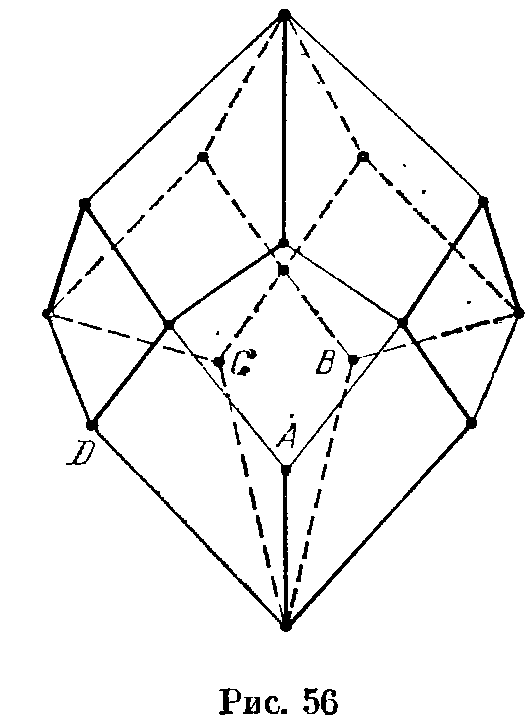

## 8.4. Обходы многогранников

---
**стр. 157, продолжение**
---

## § 4. Обходы многогранников

**8.21.** Планета имеет форму выпуклого многогранника, причем в его вершинах расположены города, а каждое ребро является дорогой. Две дороги закрыты на ремонт. Докажите, что из любого города можно проехать в любой другой по оставшимся дорогам.

**8.22.** На каждом ребре выпуклого многогранника указано направление; при этом в любую вершину хотя бы одно ребро входит и хотя бы одно из нее выходит. Докажите, что существуют две грани, которые можно обойти, двигаясь в соответствии с введенной ориентацией ребер.

**8.23.** Система дорог, проходящих по ребрам выпук-

---
**стр. 158**
---

лого многогранника, изображенного на рис. 56, соединяет все его вершины и не разбивает его на две части. Докажите, что эта система дорог имеет не менее 4 тупиков. (Для системы дорог, изображенной на рис. 56, вершины $A$, $B$, $C$ и $D$ тупиковые.)
