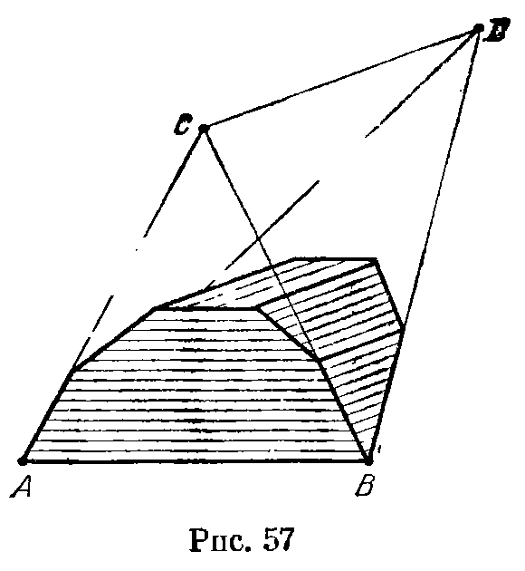
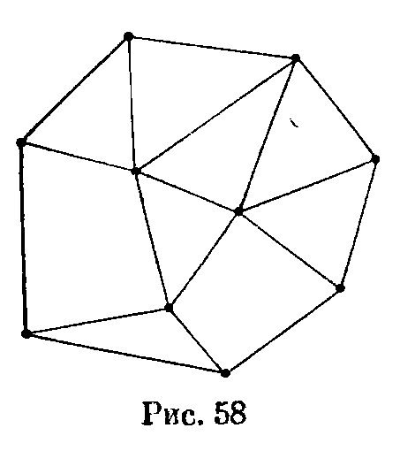
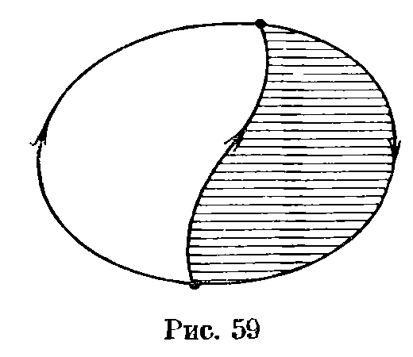
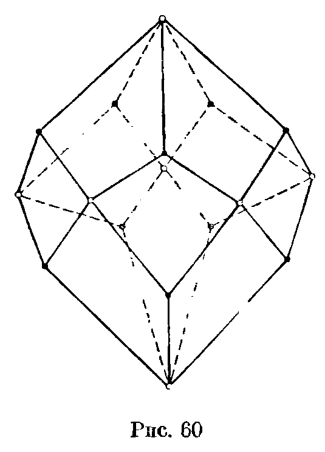
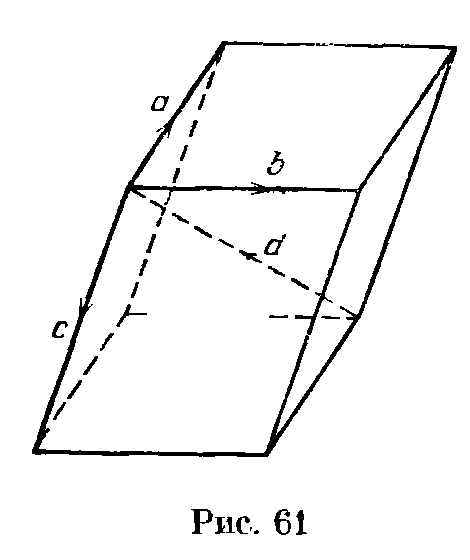
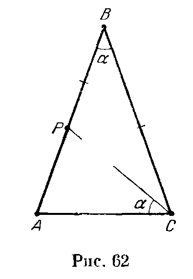
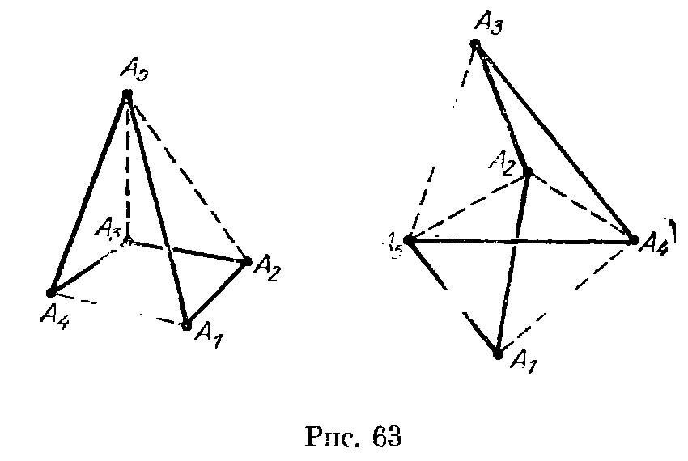
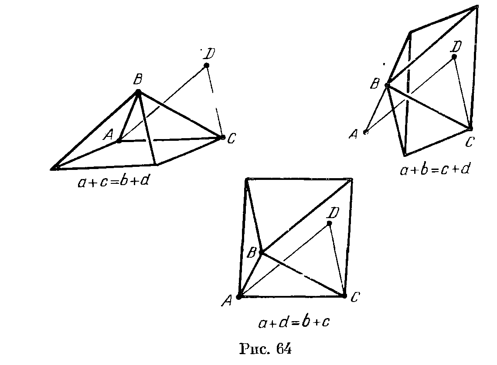

## 8.6. Решения

---
**стр. 159, продолжение**
---

## Решения

**8.1.** а) Пусть $V$ — объем многогранника, $S$ — площадь его грани, $h_i$ — расстояние от точки $X$, лежащей внутри многогранника, до $i$-й грани. Разрезая многогранник на пирамиды с вершиной $X$, основаниями которых служат его грани, получаем
$$
V=Sh_1/3+\ldots+Sh_n/3.
$$
Следовательно,
$$
h_1+\ldots+h_n=3V/S.
$$

б) Пусть $V$ — объем тетраэдра. Так как $h_i=3V/S_i$, где $S_i$ — площадь $i$-й грани, то
$$
\sum(d_i/h_i)=(\sum d_iS_i)/3V.
$$
Остается заметить, что $d_iS_i/3=V_i$, где $V_i$ — объем пирамиды с вершиной в выбранной точке тетраэдра, основанием которой служит $i$-я грань, и $\sum V_i=V$.

**8.2.** а) Предположим, что многогранник имеет только треугольные грани, причем их количество равно Г. Тогда число ребер многогранника равно $3\text{Г}/2$, т. е. оно делится на 3. Если же у многогранника есть грань с числом сторон более трех, то число его ребер не менее 8.

б) Пусть $n\geqslant3$. Тогда $2n$ ребер имеет $n$-угольная пирамида, а $2n+3$ ребер имеет многогранник, который получится, если от $n$-угольной пирамиды отсечь треугольную пирамиду плоскостью, проходящей вблизи от одной из вершин основания.

**8.3.** Предположим для определенности, что центр $O$ вписанной сферы принадлежит части многогранника с объемом $V_1$.

---
**стр. 160**
---

Рассмотрим пирамиду с вершиной $O$, основанием которой служит сечение многогранника данной плоскостью. Пусть $V$ — объем этой пирамиды. Тогда $V_1-V=rS_1/3$ и $V_2+V=rS_2/3$, где $r$ — радиус вписанной сферы (см. задачу 3.7). Поэтому $S_1:S_2=V_1:V_2$ тогда и только тогда, когда
$$
(V_1-V):(V_2+V)=S_1:S_2=V_1:V_2,
$$
а значит, $V=0$, т. е. точка $O$ принадлежит секущей плоскости.

**8.4.** Прямых, соединяющих вершины многогранника, конечное число, поэтому данную плоскость можно слегка пошевелить так, чтобы в процессе шевеления она не пересекла ни одной вершины и в новом положении она не была бы параллельна ни одной прямой, соединяющей вершины многогранника. Будем сдвигать эту плоскость параллельно до тех пор, пока она не выйдет за пределы многогранника. Число вершин сечения будет изменяться, только когда плоскость будет проходить через вершины многогранника, причем она каждый раз будет проходить лишь через одну вершину. Если по одну сторону от этой плоскости лежит $m$ ребер, выходящих из вершины, а по другую $n$ ребер, то число сторон сечения при переходе через вершину изменяется на
$$
n-m=(n+m)-2m=2k-2m,
$$
т. е. на четное число. Так как после выхода плоскости за пределы многогранника число сторон сечения равно нулю, то число сторон исходного сечения четно.

**8.5.** Если любая вершина многогранника соединена ребрами со всеми остальными вершинами, то все грани треугольные.

Рассмотрим две грани $ABC$ и $ABD$ с общим ребром $AB$. Предположим, что многогранник не тетраэдр. Тогда у него есть еще вершина $E$, отличная от вершин рассматриваемых граней. Так как точки $C$ и $D$ лежат по разные стороны от плоскости $ABE$, треугольник $ABE$ не является гранью данного многогранника. Если провести разрезы по ребрам $AB$, $BE$ и $EA$, то поверхность многогранника распадается на две части (для невыпуклого многогранника это было бы неверно), причем точки $C$ и $D$ лежат в разных частях. Поэтому точки $C$ и $D$ не могут быть соединены ребром, так как иначе разрез пересекал бы его, но ребра выпуклого многогранника не могут пересекаться по внутренним точкам.

**8.6.** Ответ: $2n-4$. Докажем сначала, что проекция выпуклого многогранника с $n$ гранями может иметь $2n-4$ сторон. Отрежем от правильного тетраэдра $ABCD$ ребро $CD$ призматической поверхностью, боковые ребра которой параллельны $CD$ (рис. 57). Проекция полученного многогранника с $n$ гранями на плоскость, параллельную прямым $AB$ и $CD$, имеет $2n-4$ сторон.

---
**стр. 161**
---

Докажем теперь, что проекция $M$ выпуклого многогранника с $n$ гранями не может иметь более $2n-4$ сторон. Число сторон проекции на плоскость, перпендикулярную грани, не может быть больше числа сторон всех других проекций. В самом деле, при такой проекции данная грань переходит в сторону многоугольника; если же плоскость проекции слегка пошевелить, то эта сторона сохранится или распадется на несколько сторон, а число остальных сторон не изменится. Поэтому будем рассматривать проекции на плоскости, не перпендикулярные граням. В этом случае ребра, проецирующиеся в границу многоугольника $M$, разбивают многогранник на две части: «верхнюю» и «нижнюю».

Пусть $p_1$ и $p_2$, $q_1$ и $q_2$, $r_1$ и $r_2$ — число вершин, ребер и граней в верхней и нижней частях (вершины и ребра границы не учитываются); $m$ — число вершин многоугольника $M$, $m_1$ (соответственно $m_2$) — число вершин $M$, из которых выходит хотя бы одно ребро верхней (соответственно нижней) части. Так как из каждой вершины $M$ выходит по крайней мере одно ребро верхней или нижней части, то $m\leqslant m_1+m_2$. Оценим теперь число $m_1$. Из каждой вершины верхней части выходит не менее трех ребер, поэтому число концов ребер верхней части не менее $3p_1+m_1$. С другой стороны, число концов этих ребер равно $2q_1$; поэтому
$$
3p_1+m_1\leqslant2q_1.
$$
Докажем теперь, что
$$
p_1-q_1+r_1=1.
$$
Проекции ребер верхней части разбивают многоугольник $M$ на несколько многоугольников. Сумма углов этих многоугольников равна
$$
\pi(m-2)+2\pi p_1.
$$
С другой стороны, она равна
$$
\sum_i\pi(q_{1i}-2),
$$
где $q_{1i}$ — число сторон $i$-го многоугольника разбиения; последняя сумма равна $\pi(m+2q_1)-2r_1$. Приравнивая оба выражения для суммы углов многоугольников, получаем требуемое. Так как $q_1=p_1+r_1-1$ и $m_1+3p_1\leqslant2q_1$, то
$$
m_1\leqslant2r_1-2-p_1\leqslant2r_1-2.
$$
Аналогично $m_2\leqslant2r_2-2$. Следовательно,
$$
m\leqslant m_1+m_2\leqslant2(r_1+r_2)-4=2n-4.
$$

**8.7.** а) Возьмем произвольную грань данного многогранника и ее ребро $r_1$. Так как грань центрально симметрична, то она содержит ребро $r_2$, равное и параллельное $r_1$. Грань, прилегающая к ребру $r_2$, тоже имеет ребро $r_3$, равное и параллельное $r_1$, и т. д. В итоге получаем «поясок» граней, заданный ребром

---
**стр. 162**
---

$r_1$ (он обязательно замкнется на ребре $r_1$). Если из поверхности многогранника вырезать этот «поясок», то останутся две «шапочки» $\text{Ш}_1$ и $\text{Ш}_2$. Сдвинем «шапочку» $\text{Ш}_1$ внутрь многогранника на вектор, заданный ребром $r_1$, и разрежем многогранник по полученной при этом поверхности $T(\text{Ш}_1)$. Часть многогранника, заключенную между $\text{Ш}_1$ и $T(\text{Ш}_1)$, можно разрезать на призмы, а разрезав их основания на параллелограммы (см. Прасолов, ч. II, 24.18), получим разбиение на параллелепипеды. Грани многогранника, заключенного между $T(\text{Ш}_1)$ и $\text{Ш}_2$, центрально симметричны, а число его ребер меньше, чем у исходного многогранника, на число ребер «пояска», параллельных $r_1$. Следовательно, за конечное число подобных операций многогранник можно разрезать на параллелепипеды.

б) Как и в задаче а), рассмотрим «поясок» и «шапочки», заданные ребром $r$ грани $\Gamma$. Проекция многогранника на плоскость, перпендикулярную ребру $r$, является выпуклым многоугольником, сторонами которого служат проекции граней, входящих в «поясок». Проекции граней одной «шапочки» задают разбиение этого многоугольника на центрально симметричные многоугольники. Следовательно, этот многоугольник центрально симметричен (см. Прасолов, ч. II, 24.19), а значит, для грани $\Gamma$ найдется грань $\Gamma'$, проекция которой параллельна проекции $\Gamma$, т. е. эти грани параллельны; ясно также, что выпуклый многогранник может иметь лишь одну грань, параллельную $\Gamma$. Грани $\Gamma$ и $\Gamma'$ входят в один «поясок», поэтому $\Gamma'$ тоже имеет ребро, равное и параллельное ребру $r$. Проводя аналогичные рассуждения для всех «поясков», заданных ребрами грани $\Gamma$, получаем, что грани $\Gamma$ и $\Gamma'$ имеют соответственно равные и параллельные ребра. Так как эти грани выпуклы, они равны. Середина отрезка, соединяющего центры их симметрий, является их центром симметрии.

Итак, для любой грани найдется центрально симметричная ей грань. Остается доказать, что все центры симметрии пар граней совпадают. Это достаточно доказать для двух граней, имеющих общее ребро. Рассматривая «поясок», заданный этим ребром, получим, что параллельные им грани также имеют общее ребро, причем оба центра симметрии пар граней совпадают с центром симметрии пары общих ребер граней.

**8.8.** Воспользуемся решением задачи 8.7. Каждый «поясок» разбивает поверхность многогранника на две «шапочки». Так как многогранник центрально симметричен, обе «шапочки» содержат равное число граней. Поэтому другой «поясок» не может целиком лежать в одной «шапочке», т. е. любые два «пояска» пересекаются, причем ровно по двум граням (параллельным ребрам, задающим «пояски»).

---
**стр. 163**
---

Пусть $k$ — число различных «поясков». Тогда каждый «поясок» пересекается с $k-1$ другими «поясками», т. е. он содержит $2(k-1)$ граней. Так как любая грань является параллелограммом, она входит ровно в два «пояска». Поэтому число граней равно $2(k-1)k/2=(k-1)k$.

**8.9.** Докажем, что если никакие две черные грани описанного многогранника не имеют общего ребра, то площадь черных граней не превосходит площади белых. При доказательстве будем использовать то, что если две грани многогранника касаются сферы в точках $O_1$ и $O_2$, а $AB$ — их общее ребро, то $\triangle ABO_1=\triangle ABO_2$. Разобьем грани на треугольники, соединив каждую точку касания многогранника и сферы со всеми вершинами соответствующей грани. Из предыдущего замечания и условия следует, что каждому черному треугольнику можно сопоставить белый треугольник с такой же площадью. Поэтому сумма площадей черных треугольников не меньше суммы площадей белых треугольников.

Описанный многогранник — правильный октаэдр — можно окрасить так, чтобы площадь черных граней равнялась площади белых и никакие две черные грани не имели общего ребра.

**8.10.** Докажем, что если в многогранник вписана сфера и никакие две черные грани не имеют общего ребра, то черных граней не больше, чем белых. При доказательстве будем использовать то, что если $O_1$ и $O_2$ — точки касания со сферой граней с общим ребром $AB$, то $\triangle ABO_1=\triangle ABO_2$, а значит, $\angle AO_1B=\angle AO_2B$. Рассмотрим все углы, под которыми из точек касания сферы с гранями видны ребра соответствующей грани. Из предыдущего замечания и условия следует, что каждому такому углу черной грани можно сопоставить равный ему угол белой грани. Поэтому сумма черных углов не больше суммы белых углов. С другой стороны, сумма таких углов для одной грани равна $2\pi$. Следовательно, сумма черных углов равна $2\pi n$, где $n$ — число черных граней, а сумма белых углов равна $2\pi m$, где $m$ — число белых граней. Таким образом, $n\leqslant m$.

**8.11.** Докажем, что если многогранник вписан в сферу и никакие две черные вершины не соединены ребром, то черных вершин не больше, чем белых.

Пусть плоскости, касающиеся в точках $P$ и $Q$ сферы с центром $O$, пересекаются по прямой $AB$. Тогда любые две плоскости, проходящие через отрезок $PQ$, высекают на плоскости $ABP$ такой же угол, как и на плоскости $ABQ$. В самом деле, эти углы симметричны относительно плоскости $ABO$. Рассмотрим теперь для каждой вершины нашего многогранника углы, которые высекаются на касательной плоскости двугранными углами между сходящимися в этой вершине гранями. Из предыдущего заме-

---
**стр. 164**
---

чания и условия следует, что каждому углу при черной вершине можно сопоставить равный ему угол при белой вершине. Поэтому сумма черных углов не больше суммы белых. С другой стороны, сумма таких углов для одной вершины равна $\pi(n-2)$, где $n$ — число граней многогранного угла с этой вершиной (для доказательства этого удобно рассмотреть сечение многогранного угла плоскостью, параллельной касательной плоскости). Видно также, что если вместо этих углов рассматривать углы, дополняющие их до $180^\circ$ (т. е. внешние углы многоугольника сечения), то их сумма для любой вершины будет равна $2\pi$. Как и раньше, сумма черных таких углов не больше суммы белых. С другой стороны, сумма черных углов равна $2\pi n$, где $n$ — число черных вершин, а сумма белых углов равна $2\pi m$, где $m$ — число белых вершин. Следовательно, $2\pi n\leqslant2\pi m$, т. е. $n\leqslant m$.

**8.12.** Окрасим грани исходного куба в белый цвет, а остальные грани полученного многогранника — в черный. Белых граней 6, черных граней 8, причем никакие две черные грани не имеют общего ребра. Следовательно, в этот многогранник нельзя вписать сферу (см. задачу 8.10).

**8.13.** Окрасим 6 вершин исходного октаэдра в белый цвет, а 8 новых вершин — в черный. Тогда один конец каждого ребра полученного многогранника белый, а другой черный. Следовательно, этот многогранник нельзя вписать в сферу (см. задачу 8.11).

**8.14. Первое решение.** Пусть $M$ — проекция многогранника на плоскость, не перпендикулярную ни одной его грани; при такой проекции все грани проецируются в многоугольники. Ребра, проецирующиеся в стороны границы $M$, разбивают многогранник на две части.

Рассмотрим проекцию одной из этих частей (рис. 58). Пусть $n_1,\ldots,n_k$ — числа ребер граней этой части, $B_i$ — число внутренних вершин этой части, $B'$ — число вершин границы $M$. Сумма углов многоугольников, на которые разбит многоугольник $M$, равна, с одной стороны, $\sum\pi(n_i-2)$, а с другой стороны, $\pi(B'-2)+2\pi B_i$. Следовательно,
$$
\sum n_i-2k=B'-2+2B_i,
$$
где $k$ — число граней первой части. Записывая такое же равенство для второй части многогранника и складывая оба эти равенства, получаем требуемое.

**Второе решение.** Рассмотрим сферу радиуса 1 с центром $O$, лежащим внутри многогранника. Углы вида $AOB$,

---
**стр. 165**
---

где $AB$ — ребро многогранника, разбивают поверхность сферы на сферические многоугольники. Пусть $n_i$ — число сторон $i$-го сферического многоугольника, $\sigma_i$ — сумма его углов, $S_i$ — площадь. Согласно задаче 4.44 $S_i=\sigma_i-\pi(n_i-2)$. Сложив все такие равенства для $i=1,\ldots,\text{Г}$, получим $4\pi=2\pi\text{В}-2\pi\text{Р}+2\pi\text{Г}$.

**8.15.** Пусть $\sum$ — сумма всех углов граней выпуклого многогранника. В задаче а) требуется доказать, что $\sum=2(\text{В}-2)\pi$, а в задаче б) требуется доказать, что $2\text{В}\pi-\sum=4\pi$. Поэтому обе задачи эквивалентны.

Если грань содержит $k$ ребер, то сумма ее углов равна $(k-2)\pi$. При суммировании по всем граням каждое ребро учитывается дважды, так как оно принадлежит ровно двум граням. Следовательно, $\sum=(2\text{Р}-2\text{Г})\pi$. Поэтому $2\text{В}\pi-\sum=2\pi(\text{В}-\text{Р}+\text{Г})=4\pi$.

**8.16.** Каждому ребру можно сопоставить две вершины, соединенные им. При этом вершина, в которой сходится $k$ ребер, встречается $k$ раз. Поэтому
$$
2\text{Р}=3\text{В}_3+4\text{В}_4+5\text{В}_5+\ldots
$$
С другой стороны, каждому ребру можно сопоставить две грани, прилегающие к нему. При этом $k$-угольная грань встречается $k$ раз. Поэтому
$$
2\text{Р}=3\text{Г}_3+4\text{Г}_4+5\text{Г}_5+\ldots
$$

**8.17.** а) Предположим, что некоторый выпуклый многогранник не имеет ни треугольных граней, ни трехгранных углов. Тогда $\text{В}_3=\text{Г}_3=0$, а значит,
$$
2\text{Р}=4\text{Г}_4+5\text{Г}_5+\ldots\geqslant4\text{Г}
$$
и
$$
2\text{Р}=4\text{В}_4+5\text{В}_5+\ldots\geqslant4\text{В}
$$
(см. задачу 8.16). Следовательно, $4\text{В}-4\text{Р}+4\text{Г}\leqslant0$. С другой стороны, $\text{В}-\text{Р}+\text{Г}=2$. Получено противоречие.

б) Согласно формуле Эйлера $4\text{В}+4\text{Г}=4\text{Р}+8$. Подставим в эту формулу следующие выражения для входящих в нее величин:
$$
4\text{В}=4\text{В}_3+4\text{В}_4+4\text{В}_5+\ldots,
$$
$$
4\text{Г}=4\text{Г}_3+4\text{Г}_4+4\text{Г}_5+\ldots
$$
и
$$
4\text{Р}=2\text{Р}+2\text{Р}=3\text{В}_3+4\text{В}_4+5\text{В}_5+\ldots+3\text{Г}_3+4\text{Г}_4+5\text{Г}_5+\ldots
$$
После сокращения получаем
$$
\text{В}_3+\text{Г}_3=8+\text{В}_5+2\text{В}_6+3\text{В}_7+\ldots+\text{Г}_5+2\text{Г}_6+3\text{Г}_7+\ldots\geqslant8.
$$

**8.18.** Предположим, что любая грань некоторого выпуклого многогранника имеет не менее шести сторон. Тогда $\text{Г}_3=\text{Г}_4=\text{Г}_5=0$, и поэтому $2\text{Р}=6\text{Г}_6+7\text{Г}_7+\ldots\geqslant6\text{Г}$ (см. задачу 8.16), т. е. $\text{Р}\geqslant3\text{Г}$. Кроме того, для любого многогранника
$$
2\text{Р}=3\text{В}_3+4\text{В}_4+\ldots\geqslant3\text{В}.
$$
Складывая неравенства $\text{Р}\geqslant3\text{Г}$ и $2\text{Р}\geqslant3\text{В}$, получаем $\text{Р}\geqslant\text{Г}+\text{В}$. С другой стороны, $\text{Р}=\text{Г}+\text{В}-2$. Получено противоречие.

**Замечание.** Аналогичным образом можно доказать, что в любом выпуклом многограннике найдется вершина, из которой выходит менее шести ребер.

---
**стр. 166**
---

**8.19.** Для любого многогранника
$$
2\text{Р}=3\text{В}_3+4\text{В}_4+5\text{В}_5+\ldots\geqslant3\text{В}.
$$
С другой стороны, $\text{В}=\text{Р}-\text{Г}+2$. Поэтому $2\text{Р}\geqslant3(\text{Р}-\text{Г}+2)$, т. е. $3\text{Г}\geqslant6+\text{Р}$. Неравенство $3\text{В}\geqslant6+\text{Р}$ доказывается аналогично.

**8.20.** Пусть $a$, $b$ и $c$ — количества граней, имеющих 5, 6 и 7 сторон соответственно. Тогда $\text{Р}=(5a+6b+7c)/2$, $\text{Г}=a+b+c$ и, так как по условию из каждой вершины выходят три ребра, $\text{В}=(5a+6b+7c)/3$. Умножив все эти выражения на 6 и подставив в формулу $6(\text{В}+\text{Г}-\text{Р})=12$, получим требуемое.

**8.21.** Пусть $A$ и $B$ — данные города. Докажем сначала, что из $A$ в $B$ можно было проехать по закрытии на ремонт двух дорог. Рассмотрим для этого проекцию многогранника на некоторую прямую, не перпендикулярную ни одному из его ребер (при такой проекции вершины многогранника не сливаются). Пусть $A'$ и $B'$ — проекции точек $A$ и $B$, а $M'$ и $N'$ — крайние точки проекции многогранника (в точки $M'$ и $N'$ проецируются вершины $M$ и $N$). Если идти из вершины $A$ так, что в проекции движение будет происходить по направлению от $M'$ к $N'$, то в конце концов обязательно попадем в вершину $N$. Аналогично из вершины $B$ можно пройти в $N$. Таким образом, можно проехать из $A$ в $B$ (через $N$).

Если полученный путь из $A$ в $B$ проходит через закрытую дорогу, то есть еще два объезда по граням, для которых это ребро является общим. Вторая закрытая дорога не может находиться сразу на двух этих объездах.

**8.22.** Выйдем из некоторой вершины многогранника и будем идти по ребрам в указанном на них направлении до тех пор, пока не попадем в вершину, в которой уже побывали ранее. Путь от первого прохождения через эту вершину до второго образует «петлю», разбивающую многогранник на две части. Рассмотрим одну из них и найдем на ней грань с требуемым свойством. Границу каждой из двух частей можно обойти, двигаясь в соответствии с введенной ориентацией. Если рассматриваемая фигура сама является гранью, то все уже доказано. Поэтому будем считать, что она не является гранью, т. е. на границе имеется вершина, из которой выходит (соответственно входит) ребро, не лежащее на границе фигуры. Пройдем по этому ребру и будем идти дальше по ребрам в указанном направлении (соответственно в направлении, противоположном указанному) до тех пор, пока снова не выйдем на границу или получим петлю. Путь разбивает фигуру на две части; границу одной из них можно обойти в соответствии с ориентацией (рис. 59). С той частью проделаем то же самое и т. д. После нескольких таких операций останется одна грань, обладающая требуемым свойством. Для

---
**стр. 167**
---

другой из полученных на самом первом шаге частей аналогично можно найти вторую нужную грань.

**8.23.** Раскрасим вершины многогранника в 2 цвета так, как показано на рис. 60. Тогда любое ребро соединяет 2 вершины разного цвета. Для данной системы дорог назовем степенью вершины многогранника число дорог, проходящих через эту вершину. Если система дорог не имеет вершин степени более 2, то разность между числом черных и белых вершин не превосходит 1. Если есть лишь одна вершина степени 3, а остальные вершины имеют степень не более 2, то разность между числом черных и белых вершин не превосходит 2.

В нашем случае разность между числом черных и белых вершин равна $10-7=3$. Поэтому найдется вершина степени не менее 4 или 2 вершины степени 3. В обоих случаях число тупиков не менее 4.

**8.24.** Рассмотрим проекцию на прямую, перпендикулярную данной плоскости. Все точки $B_i$ проецируются при этом в одну точку $B$, а точки $A_1,\ldots,A_n$ — в $C_1,\ldots,C_n$. Так как отношения отрезков, лежащих на одной прямой, при проецировании сохраняются, то
$$
\frac{A_1B_1}{A_2B_1}\cdot
\frac{A_2B_2}{A_3B_2}\ldots
\frac{A_nB_n}{A_1B_n}
=
\frac{C_1B}{C_2B}\cdot
\frac{C_2B}{C_3B}\ldots
\frac{C_nB}{C_1B}
=1.
$$

Данная плоскость разбивает пространство на две части. Идя из вершины $A_i$ в $A_{i+1}$, мы переходим из одной части пространства в другую, только если точка $B_i$ лежит на стороне $A_iA_{i+1}$. Так как, совершив обход многоугольника, мы вернемся в исходную часть пространства, то число точек $B_i$, лежащих на сторонах многоугольника, четно.

**8.25.** Пусть $a$, $b$, $c$ и $d$ — векторы, параллельные данным прямым. Так как любые три вектора в пространстве, не лежащие

---
**стр. 168**
---

в одной плоскости, образуют базис, то существуют такие ненулевые числа $\alpha$, $\beta$ и $\gamma$, что $\alpha\mathbf a+\beta\mathbf b+\gamma\mathbf c+\mathbf d=0$. Векторы $\alpha\mathbf a$, $\beta\mathbf b$, $\gamma\mathbf c$ и $\mathbf d$ являются сторонами искомого четырехугольника. Пусть теперь $\alpha_1\mathbf a$, $\beta_1\mathbf b$, $\gamma_1\mathbf c$ и $\mathbf d$ — векторы сторон другого такого четырехугольника. Тогда
$\alpha_1\mathbf a+\beta_1\mathbf b+\gamma_1\mathbf c+\mathbf d=0=\alpha\mathbf a+\beta\mathbf b+\gamma\mathbf c+\mathbf d$, т. е.
$(\alpha_1-\alpha)\mathbf a+(\beta_1-\beta)\mathbf b+(\gamma_1-\gamma)\mathbf c=0$.
Так как векторы $\mathbf a$, $\mathbf b$ и $\mathbf c$ не лежат в одной плоскости, то $\alpha=\alpha_1$, $\beta=\beta_1$ и $\gamma=\gamma_1$.

**8.26.** а) Фиксируем один из векторов сторон. За ним может следовать любой из трех оставшихся векторов, а за ним — любой из двух оставшихся. Поэтому всего различных четырехугольников ровно 6.

б) Пусть $\mathbf a$, $\mathbf b$, $\mathbf c$ и $\mathbf d$ — данные векторы сторон. Рассмотрим параллелепипед, задаваемый векторами $\mathbf a$, $\mathbf b$ и $\mathbf c$ (рис. 61); его диагональю служит вектор $\mathbf d$. Несложный перебор показывает, что все 6 различных четырехугольников содержатся среди четырехугольников, сторонами которых являются ребра этого параллелепипеда и его диагональ $d$ (фиксировать при переборе удобно вектор $\mathbf d$). Объем каждого соответствующего тетраэдра составляет $1/6$ часть объема параллелепипеда.

**8.27.** В треугольниках $ABC$ и $CDA$ равны стороны $AB$ и $CD$ и углы $B$ и $D$, а сторона $AC$ у них общая. Если $\triangle ABC=\triangle CDA$, то $AC\perp BD$. Рассмотрим теперь случай, когда эти треугольники не равны. Возьмем на луче $BA$ точку $P$ так, что $\triangle CBP=\triangle CDA$, т. е. $CP=CA$ (рис. 62). Она может не совпасть с точкой $A$, только если $\angle ABC<\angle APC=\angle BAC$, т. е. $\alpha<60^\circ$. В этом случае
$\angle ACD=\angle PCB=(90^\circ-\alpha/2)-\alpha=90^\circ-3\alpha/2$.
Следовательно,
$\angle ACD+\angle DCB=(90^\circ-3\alpha/2)+\alpha=90^\circ-\alpha/2=\angle ACB$.
Поэтому точки $A$, $B$, $C$ и $D$ лежат в одной плоскости, причем точка $D$ лежит внутри угла $ACB$. Так как $\triangle ABC=\triangle DCB$ и эти треугольники равнобедренные, то угол между прямыми $AC$ и $BD$ равен $\alpha$.

Итак, если $\alpha\geqslant60^\circ$, то $AC\perp BD$, а если $\alpha<60^\circ$, то либо $AC\perp BD$, либо угол между прямыми $AC$ и $BD$ равен $\alpha$.

**8.28.** Пусть $\overrightarrow{A_iX_i}=\lambda\overrightarrow{A_iB_i}$. Достаточно проверить, что при $\lambda=1\pm1/\sqrt5$ стороны пятиугольника $X_1\ldots X_5$ параллельны противоположным диагоналям. Пусть $\mathbf a$, $\mathbf b$, $\mathbf c$, $\mathbf d$, $\mathbf e$ — векторы сторон $\overrightarrow{A_1A_2}$, $\overrightarrow{A_2A_3}$, ..., $\overrightarrow{A_5A_1}$. Тогда
$\overrightarrow{A_1X_1}=\lambda(\mathbf a+\mathbf b+\mathbf c/2)$,
$\overrightarrow{A_1X_2}=\mathbf a+\lambda(\mathbf b+\mathbf c+\mathbf d/2)$,
$\overrightarrow{A_1X_3}=\mathbf a+\mathbf b+\lambda(\mathbf c+\mathbf d+\mathbf e/2)$,
$\overrightarrow{A_1X_4}=\mathbf a+\mathbf b+\mathbf c+\lambda(\mathbf d+\mathbf e+\mathbf a/2)$
и
$\overrightarrow{A_1X_5}=\mathbf a+\mathbf b+\mathbf c+\mathbf d+\lambda(\mathbf e+\mathbf a+\mathbf b/2)$.
Поэтому
$\overrightarrow{X_1X_3}=\overrightarrow{A_1X_3}-\overrightarrow{A_1X_1}=(1-\lambda)\mathbf a+(1-\lambda)\mathbf b+\lambda\mathbf d+(\lambda/2)(\mathbf c+\mathbf e)=$

---
**стр. 169**
---

$=(1-3\lambda/2)\mathbf a+(1-3\lambda/2)\mathbf b+(\lambda/2)\mathbf d$,
$\overrightarrow{X_4X_5}=\overrightarrow{A_1X_5}-\overrightarrow{A_1X_4}=(\lambda/2)\mathbf a+(\lambda/2)\mathbf b+(1-\lambda)\mathbf d$.
Значит, $X_1X_3\parallel X_4X_5$ тогда и только тогда, когда
$(2-3\lambda)/\lambda=\lambda/(2-2\lambda)$, т. е.
$5\lambda^2-10\lambda+4=0$.
Это уравнение имеет корни $1\pm1/\sqrt5$.

**8.29. Первое решение.** Предположим, что данный пятиугольник $A_1\ldots A_5$ не плоский. Выпуклая оболочка его

вершин либо является четырехугольной пирамидой, либо состоит из двух тетраэдров с общей гранью. В обоих случаях можно считать, что вершины $A_1$ и $A_4$ лежат по одну сторону от плоскости $A_2A_3A_5$ (см. рис. 63). Из условия задачи следует, что диагонали данного пятиугольника равны, поэтому равны тетраэдры $A_4A_2A_3A_5$ и $A_1A_3A_2A_5$. А так как точки $A_1$ и $A_4$ лежат

по одну сторону от грани $A_2A_3A_5$ — равнобедренного треугольника, то $A_1$ и $A_4$ симметричны относительно плоскости, проходящей через середину отрезка $A_2A_3$ перпендикулярно ему. Следовательно, точки $A_1$, $A_2$, $A_3$ и $A_4$ лежат в одной плоскости.

---
**стр. 170**
---

Рассматривая теперь равные (плоские) тетраэдры $A_1A_2A_3A_4$ и $A_1A_5A_4A_3$, приходим к противоречию.

**Второе решение.** Тетраэдры $A_1A_2A_3A_4$ и $A_2A_1A_5A_4$ равны, так как равны их соответствующие ребра. Эти тетраэдры симметричны либо относительно плоскости, проходящей через середину отрезка $A_1A_2$ перпендикулярно ему, либо относительно прямой $A_4M$, где $M$ — середина отрезка $A_1A_2$. В первом случае диагональ $A_3A_5$ параллельна $A_1A_2$, поэтому 4 вершины пятиугольника лежат в одной плоскости. Если есть две диагонали с таким свойством, то пятиугольник плоский. Если же есть 4 диагонали со вторым свойством, то две из них выходят из одной вершины, например $A_3$. Пусть $M$ и $K$ — середины сторон $A_1A_2$ и $A_4A_5$, $L$ и $N$ — середины диагоналей $A_1A_3$ и $A_3A_5$. Так как отрезок $A_3A_5$ симметричен относительно прямой $A_4M$, его середина $N$ принадлежит этой прямой. Поэтому точки $A_4$, $M$, $N$, $A_3$ и $A_5$ лежат в одной плоскости; в той же плоскости лежит и середина $K$ отрезка $A_4A_5$. Аналогично в одной плоскости лежат точки $A_2$, $K$, $L$, $A_3$, $A_1$ и $M$. Следовательно, все вершины пятиугольника лежат в плоскости $A_3KM$.

**8.30.** Пусть вписанные окружности $S_1$ и $S_2$ треугольников $ABC$ и $ADC$ касаются стороны $AC$ в точках $P_1$ и $P_2$ соответственно. Тогда
$AP_1=(AB+AC-BC)/2$ и
$AP_2=(AD+AC-CD)/2$.
Так как $AB-BC=AD-CD$ по условию, то $AP_1=AP_2$, т. е. точки $P_1$ и $P_2$ совпадают. Следовательно, окружности $S_1$ и $S_2$ принадлежат одной сфере (см. задачу 4.12).

**8.31.** Пусть сфера касается сторон $AB$, $BC$, $CD$ и $DA$ пространственного четырехугольника $ABCD$ в точках $K$, $L$, $M$ и $N$ соответственно. Тогда $AN=AK$, $BK=BL$, $CL=CM$ и $DM=DN$. Поэтому

$$
\frac{AK}{BK}\cdot\frac{BL}{CL}\cdot\frac{CM}{DM}\cdot\frac{DN}{AN}=1.
$$

Рассмотрим теперь точку $N'$, в которой плоскость $KLM$ пересекает прямую $DA$. Воспользовавшись результатом задачи 8.24, получим, что $DN:AN=DN':AN'$ и точка $N'$ лежит на отрезке $AD$. Следовательно, $N=N'$, т. е. точка $N$ лежит в плоскости $KLM$.

**8.32.** Так как $AN=AK$, то в плоскости $DAB$ существует окружность $S_1$, касающаяся прямых $AD$ и $AB$ в точках $N$ и $K$. Аналогично в плоскости $ABC$ существует окружность $S_2$, касающаяся прямых $AB$ и $BC$ в точках $K$ и $L$. Докажем, что сфера, содержащая окружности $S_1$ и $S_2$, — искомая. Эта сфера касается прямых $AD$, $AB$ и $BC$ в точках $N$, $K$ и $L$ (в частности, точки $B$, $C$ и $D$ лежат вне этой сферы). Остается проверить, что эта сфера касается прямой $CD$ в точке $M$.

---
**стр. 171**
---

Пусть $S_3$ — сечение данной сферы плоскостью $BCD$, $DN'$ — касательная к $S_3$. Так как $DC=\pm DM+MC$, а $DM=DN=DN'$ и $MC=CL$, то длина отрезка $DC$ равна сумме или разности длин касательных, проведенных из точек $C$ и $D$ к окружности $S_3$. Это означает, что прямая $CD$ касается окружности $S_3$.

В самом деле, пусть $a=d^2-R^2$, где $d$ — расстояние от центра окружности $S_3$ до прямой $CD$ и $R$ — радиус $S_3$; $P$ — основание перпендикуляра, опущенного из центра окружности $S_3$ на прямую $CD$; $x=CP$ и $y=DP$. Тогда длины касательных $CL$ и $DN'$ равны $\sqrt{x^2+a}$ и $\sqrt{y^2+a}$. Пусть
$$
\left|\sqrt{x^2+a}\pm\sqrt{y^2+a}\right|=|x\pm y|\ne0.
$$
Докажем, что тогда $a=0$. Возведя обе части в квадрат, получим
$$
\sqrt{(x^2+a)(y^2+a)}=\pm xy\pm a.
$$
Еще раз возведя в квадрат, получим
$$
a(x^2+y^2)=\pm2axy.
$$
Если $a\ne0$, то $(x\pm y)^2=0$, т. е. $x=\pm y$. Равенство $2|\sqrt{x^2+a}|=2|x|$ выполняется, только если $a=0$.

**8.33.** а) Введем на прямых $AB$, $BC$, $CD$ и $DA$ координаты, взяв в качестве начал координат точки $A$, $B$, $C$ и $D$ соответственно, а в качестве положительных направлений — направления лучей $AB$, $BC$, $CD$ и $DA$. В соответствии с результатом задачи 8.32 будем искать на прямых $AB$, $BC$, $CD$ и $DA$ такие точки $K$, $L$, $M$ и $N$, что $AN=AK$, $BK=BL$, $CL=CM$ и $DM=DN$, т. е.
$$
\overrightarrow{AK}=x,\quad \overrightarrow{AN}=\alpha x,\quad
\overrightarrow{BC}=y,\quad \overrightarrow{BK}=\beta y,\quad
\overrightarrow{CM}=z,\quad \overrightarrow{CL}=\gamma z,\quad
\overrightarrow{DN}=u,\quad \overrightarrow{DM}=\delta u,
$$
где $\alpha,\beta,\gamma,\delta=\pm1$. Так как
$$
\overrightarrow{AB}=\overrightarrow{AK}+\overrightarrow{KB},
$$
то $a=x-\beta y$. Аналогично $b=y-\gamma z$, $c=z-\delta u$ и $d=u-\alpha x$. Следовательно,
$$
u=d+\alpha x,
$$
$$
z=c+\delta d+\delta\alpha x,
$$
$$
y=b+\gamma c+\gamma\delta d+\gamma\delta\alpha x
$$
и
$$
x=a+\beta b+\beta\gamma c+\beta\gamma\delta d+\beta\gamma\delta\alpha x.
$$
Из последнего соотношения получаем
$$
(1-\alpha\beta\gamma\delta)x=a+\beta b+\beta\gamma c+\beta\gamma\delta d.
$$
Итак, если $1-\alpha\beta\gamma\delta=0$, то выполняется соотношение вида $a\pm b\pm c\pm d=0$; ясно также, что соотношение $a-b-c-d=0$ выполняться не может. Следовательно, в нашем случае $\alpha\beta\gamma\delta\ne1$, а значит, $\alpha\beta\gamma\delta=-1$. Числа $\alpha,\beta,\gamma=\pm1$ можно задавать произвольно, а число $\delta$ определяется этими числами. Всего существует 8 различных наборов чисел $\alpha,\beta,\gamma,\delta$, причем для каждого набора существует единственное решение $x,y,z,u$. Кроме того, все числа $x,y,z,u$ отличны от нуля, поэтому все 8 решений различны.

б) **Первое решение.** Разберем, например, случай, когда $a+c=b+d$, т. е. $a-b+c-d=0$. В этом случае следует положить $\beta=-1$, $\beta\gamma=1$, $\beta\gamma\delta=-1$ и $\alpha\beta\gamma\delta=1$, т. е. $\alpha=\beta=\gamma=\delta=-1$. Рассматриваемая в решении задачи а) система уравнений для $x,y,z,u$ имеет бесконечно много решений:
$$
u=d-x,\qquad z=c-d+x
$$
и
$$
y=b-c+d-x=a-x,
$$
где число $x$ произвольно.

---
**стр. 172**
---

Остальные случаи разбираются аналогично: если $a+b=c+d$, то $\alpha=\gamma=-1$ и $\beta=\delta=1$, а если $a+d=b+c$, то $\alpha=\gamma=1$ и $\beta=\delta=-1$.

**Второе решение.** В каждом из трех случаев, когда выполняются указанные соотношения, можно построить четырехугольную пирамиду с вершиной $B$, боковые ребра которой равны и параллельны сторонам данного четырехугольника, основанием является параллелограмм, а суммы длин противоположных ребер равны (см. рис. 64). Поэтому существует луч, с которым ребра пирамиды — а значит, и стороны четырехугольника — образуют равные углы (задача 6.63).

Пусть плоскость $\Pi$, перпендикулярная этому лучу, пересекает прямые $AB$, $BC$, $CD$ и $DA$ в точках $P$, $Q$, $R$ и $S$, а соответствующие боковые ребра пирамиды — в точках $P'$, $Q'$, $R'$ и $S'$. Так как точки $P'$, $Q'$, $R'$ и $S'$ лежат на одной окружности, а прямые $PQ$ и $P'Q'$, $QR$ и $Q'R'$ и т. д. параллельны, то
$$
\angle(PQ,PS)=\angle(P'Q',P'S')=\angle(R'Q',R'S')=\angle(RQ,RS),
$$
т. е. точки $P$, $Q$, $R$ и $S$ лежат на одной окружности (см. Прасолов, I, с. 36); пусть $O$ — центр этой окружности. Так как прямые $AP$ и $AS$ образуют с плоскостью $\Pi$ равные углы, то $AP=AS$. Следовательно, соответствующие стороны треугольников $APO$ и $ASO$ равны, а значит, равны расстояния от точки $O$ до прямых $AB$ и $AD$. Аналогично доказывается, что точка $O$ равноудалена от всех прямых $AB$, $BC$, $CD$ и $DA$, т. е. сфера с центром $O$, радиус которой равен расстоянию от точки $O$

---
**стр. 173**
---

до этих прямых, искомая. Перемещая плоскость $\Pi$ параллельно, получаем бесконечное множество сфер.

**Замечание.** Для каждой вершины пространственного четырехугольника $ABCD$ можно рассмотреть две биссекторные плоскости, проходящие через биссектрисы его внешнего и внутреннего угла перпендикулярно им. Ясно, что $O$ — точка пересечения биссекторных плоскостей. По одной прямой пересекаются следующие четверки биссекторных плоскостей: в случае $a+c=b+d$ все 4 внутренние; в случае $a+b=c+d$ — внутренние при вершинах $A$ и $C$ и внешние при вершинах $B$ и $D$; в случае $a+d=b+c$ — внутренние при вершинах $B$ и $D$ и внешние при вершинах $A$ и $C$.
