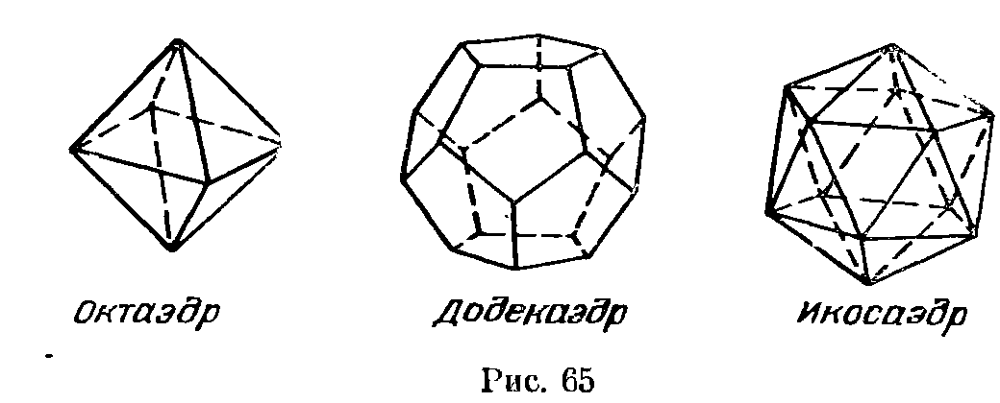

## 9.1. Основные свойства правильных многогранников

---
**стр. 174**
---

# Глава 9. ПРАВИЛЬНЫЕ МНОГОГРАННИКИ

## § 1. Основные свойства правильных многогранников

Выпуклый многогранный угол называется правильным, если все его плоские углы равны и все двугранные углы тоже равны.

Выпуклый многогранник называется правильным, если все его грани и многогранные углы правильные, а кроме того, все грани равны и многогранные углы тоже равны. С точки зрения логики, это определение неудачно — в нем сказано много лишнего. Достаточно было бы потребовать, чтобы грани и многогранные углы были правильными; их равенство уже следовало бы из этого. Но такие детали — не для первого знакомства с правильными многогранниками. (Разбору различных эквивалентных определений правильных многогранников посвящен § 5.)

Имеется всего лишь пять различных правильных многогранников: тетраэдр, куб, октаэдр, додекаэдр и икосаэдр; последние три многогранника изображены на рис. 65. Этот рисунок, впрочем, мало о чем говорит — он не может заменить ни доказательства того, что других правильных многогранников нет, ни даже доказательства того, что такие правильные многогранники, какие нарисованы, действительно существуют. Все это нужно доказывать.

В одной из дошедших до нашего времени античных книг говорится, что октаэдр и икосаэдр открыл ученик Платона Теэтет (410—368 г. до н. э.), а куб, тетраэдр и додекаэдр были известны пифагорейцам задолго до него. Многие историки математики сомневались в правдивости этих слов; особенное недоверие вызывало то, что октаэдр был открыт позже додекаэдра. Действительно, египетские пирамиды построены в глубокой древности, а соединив мысленно две пирамиды, легко получить октаэдр.

---
**стр. 175**
---

Но более внимательное исследование заставляет поверить словам античной книги. Эти слова вряд ли можно истолковать иначе, чем так: Теэтет выделил класс правильных многогранников, т. е. с какой-то степенью строгости дал их определение, обнаружив тем самым их общее свойство, и доказал, что существует всего лишь 5 различных правильных многогранников. Куб, тетраэдр и додекаэдр привлекали внимание геометров и до Теэтета, но лишь просто как интересные геометрические объекты, а не как правильные многогранники. Интерес к кубу, тетраэдру и додекаэдру подтверждает древнегреческая терминология: у этих многогранников были специальные названия.

Не удивительно, что куб и тетраэдр всегда интересовали геометров; додекаэдр требует пояснений. В природе встречаются кристаллы пирита, близкие по форме к додекаэдру. Сохранился также додекаэдр, непонятно для каких целей изготовленный этрусскими ремесленниками в 500 г. до н. э. Форма додекаэдра несравненно привлекательней и таинственней формы октаэдра. Пифагорейцев додекаэдр должен был заинтриговать еще и потому, что их символом была правильная пятиконечная звезда, естественно вписывающаяся в грани додекаэдра.

При изучении правильных многогранников наибольшие трудности также вызывают именно октаэдр и икосаэдр. Скрепив три правильных треугольника, три квадрата или три правильных пятиугольника и продолжив такое конструирование, в конце концов придем к правильному тетраэдру, кубу или додекаэдру; при этом на каждом шаге получается жесткая конструкция. А для октаэдра и икосаэдра приходится скреплять соответственно четыре и пять треугольников, т. е. начальная конструкция нежесткая.

**9.1.** Докажите, что не существует никаких других правильных многогранников, кроме перечисленных выше.

**9.2.** Докажите, что существует додекаэдр — правильный многогранник с пятиугольными гранями и трехгранными углами при вершинах.

**9.3.** Докажите, что все углы между не параллельными гранями додекаэдра равны.

**9.4.** Докажите, что существует икосаэдр — правильный многогранник с треугольными гранями и пятигранными углами при вершинах.

**9.5.** Докажите, что для любого правильного многогранника существует:

а) сфера, проходящая через все его вершины (описанная сфера);

б) сфера, касающаяся всех его граней (вписанная сфера).

**9.6.** Докажите, что центр описанной сферы правильного многогранника является его центром масс (т. е. центром масс системы точек с единичными массами, расположенными в его вершинах).

---
**стр. 176**
---

Центр описанной сферы правильного многогранника, совпадающий с центром вписанной сферы и с центром масс, называется *центром* правильного многогранника.
